# CampusOne ERP — World-Class Database Redesign Blueprint

**Status:** Target architecture and research-backed design proposal, not yet an approved production migration.  
**Scope reviewed:** the supplied CampusOne architecture, schema dictionary, relationship inventory, data-flow diagrams, security review, API inventory, and gap-analysis documents.  
**Database target:** PostgreSQL 16+; application currently uses Node.js/TypeScript, Prisma 7, Express, and PostgreSQL.  
**Important evidence boundary:** this review is based on supplied repository-analysis documents, not a fresh connection to the repository or live Neon/PostgreSQL instance. The documents report a single `202608310001_init` migration, 21 migrated tables versus 24 Prisma models, and drift candidates (`SystemActivity`, `ExpenseRecord`, `ResearchGrant`, `Notice.isPinned`). These are reported findings and must be reverified against the actual checked-out code and each database environment before migration.

---

## 1. Executive decision

Do **not** simply patch the existing schema model by model, and do **not** drop/recreate a live database. Establish a new target model in a separate branch and schema, reconcile actual source and deployed databases, map old data into the target, prove the mapping, and cut over through tested migrations.

The current design is a useful prototype but it is not yet a dependable long-lived institutional record system. Its largest risks are not merely indexes or naming: the data model cannot reliably represent the complete lifecycle of students, course registrations, teaching sessions, assessments, fee obligations and allocations, approvals, library copies, and audit evidence.

### Main structural defects found in supplied documentation

| Severity | Finding | Why it matters | Target response |
|---|---|---|---|
| Critical | Schema/migration divergence reported | A developer, CI, staging and production may build different structures | One authoritative Prisma contract + reviewed, immutable migration history + CI drift checks |
| Critical | `FeeTransaction` is not tied to a fee invoice/assessment; money is floating point | No reliable account balance, allocation, refund, reconciliation, or historical fee-plan proof | Decimal money, versioned fee plans, invoices/lines, payments, allocations, refunds, idempotency and immutable financial events |
| Critical | Payment balance validation is documented as read-then-write without an atomic lock | Concurrent requests can over-collect or double-process | Idempotency key, transaction, row lock/conditional update, unique provider reference, reconciliation |
| High | One `User.role` enum is the whole role assignment model | Cannot cleanly express concurrent roles, time-bounded roles, scoped authority, or acting appointments | `users`, `roles`, `permissions`, `role_permissions`, `user_role_assignments` with validity and optional scope |
| High | `Student` mixes identity, current placement and mutable summary fields | Semester/section changes overwrite history; CGPA and attendance caches can go stale | Stable student record + program admissions/enrolments/term registrations; derived metrics or explicitly governed snapshots |
| High | No documented course-enrolment entity | Attendance and results cannot prove that a student was registered for a course offering at that time | `course_offerings` + `course_enrollments` with lifecycle and unique constraints |
| High | Attendance is recorded against course/date/period, not a first-class class session | No robust cancellation, reschedule, make-up class, late/leave/authorized absence or session-level audit | `class_sessions` + one attendance row per enrollment/session |
| High | Exam result can have a nullable exam link and is unique on nullable tuple | Results may be orphaned from the assessed activity; PostgreSQL uniqueness with NULL can permit duplicates | Assessments and assessment results keyed to course enrollment and assessment; explicit grading scales and result publication state |
| High | Admissions do not have a clear conversion link to student/account | Applicant-to-student conversion can duplicate people and lose provenance | Applicant person/contact + application + decisions + accepted-offer conversion with unique idempotent link |
| High | Fee structure is keyed by free-text program/quota and mutable current values | Historical invoice cannot prove which price/version applied | Normalized programme/cohort eligibility + immutable versioned fee plan + invoice snapshots |
| High | Library counts are maintained as `totalCopies`/`availableCopies` on title | Counts drift and cannot track a specific lost/damaged/issued copy | Bibliographic title + individually identified `library_copies` + loans + fine ledger |
| High | HOD is both a user role and a unique pointer on department | Appointment history, start/end dates, acting HOD, and cross-department consistency are not modeled | `department_appointments` / scoped role assignment with effective dates |
| High | Timetable duplicates department/semester/section context alongside course | The schedule can contradict its referenced course; uniqueness does not model dated periods or room/faculty conflicts robustly | Offering/class section + dated time blocks; exclusion constraints or transactional conflict checks |
| High | Deletes cascade through academic/financial records | Deleting a user may erase evidence and linked history | Soft-disable identity; restrict deletion of institutional records; archival/anonymization policy |
| High | Fine can refer to a user and an unrelated circulation record | The database cannot prove the fined user is the borrower | Fine is generated from the loan and inherits borrower by FK path; payment/waiver ledger |
| Medium | Leave requests lack approver/decision trail; activity logs lack actor/target relation | No defensible accountability | Approval steps + immutable audit events with actor, action, target, outcome, request correlation |
| Medium | Notice department is free text and targeting is a single role enum | Poor targeting, no multi-audience delivery/read state | Notice + normalized audience rules + per-user delivery/read state |
| Medium | Placement stores company name and CTC as a flat record | Cannot represent companies, drives, eligibility, applications, multiple offers and offer outcomes | Company, drive, drive eligibility, applications, offers and offer status history |
| Medium | Expense/grant entities are described as drift candidates | Analytics may query data structures that do not exist in every environment | Decide their lifecycle and make migrations authoritative; connect grants/expenses to departments, people, budget and audit |

### Important clarification
A canonical `User` table with separate `Student` and `Faculty` profile tables is **not inherently a flaw**. It is a sound identity/profile pattern when one person may have zero or more domain profiles. The defect is the missing lifecycle, role-assignment, enrollment, historical and authorization relationships around those profiles.

---

## 2. Research method and design principles

This is a synthesis of the supplied CampusOne documentation and current primary-source guidance. No claim is made that an LLM can certify a schema as “perfect”; the way to earn confidence is explicit invariants, migration proof, tests, threat modeling, query plans, and operational verification.

### Standards and primary references consulted

1. **PostgreSQL constraints** — enforce invariants as close to the data as practical using primary keys, foreign keys, unique constraints, checks and (where suitable) exclusion constraints. Do not rely on a controller-only check for core integrity. [PostgreSQL constraints](https://www.postgresql.org/docs/current/ddl-constraints.html).
2. **PostgreSQL transactions** — use transaction boundaries and concurrency controls for payments, inventory issue/return, seat/registration limits, and other read-modify-write operations; retry serializable failures where used. [Transaction isolation](https://www.postgresql.org/docs/current/transaction-iso.html).
3. **PostgreSQL date/time types** — distinguish calendar dates from instants; use `date` for date-only academic/business dates and `timestamptz` for instants such as payment capture and audit events. [Date/time types](https://www.postgresql.org/docs/current/datatype-datetime.html).
4. **NIST RBAC reference model** — core RBAC includes user-role and permission-role assignments; role hierarchy and separation-of-duty are extensions. [NIST RBAC FAQ](https://csrc.nist.gov/Projects/Role-Based-Access-Control/faqs).
5. **1EdTech OneRoster 1.2** — useful interoperability reference for organizations, users, courses, classes, enrollments, academic sessions and gradebook results. It is primarily K–12-focused, so it informs naming/interchange but does not fully define a university ERP. [OneRoster overview](https://www.1edtech.org/standards/oneroster) and [1.2 specification](https://standards.1edtech.org/oneroster/specifications/standards/v1p2).
6. **OWASP Database Security** — minimize database network exposure and privilege, protect credentials, and separate application/database responsibilities. [Database Security Cheat Sheet](https://cheatsheetseries.owasp.org/cheatsheets/Database_Security_Cheat_Sheet.html).
7. **OWASP Password Storage** — prefer Argon2id for new systems when operationally feasible; bcrypt is a legacy-compatible option with limitations. [Password Storage Cheat Sheet](https://cheatsheetseries.owasp.org/cheatsheets/Password_Storage_Cheat_Sheet.html).
8. **OWASP Logging** — record when, where, who and what, protect log integrity, control access, and avoid logging secrets. [Logging Cheat Sheet](https://cheatsheetseries.owasp.org/cheatsheets/Logging_Cheat_Sheet.html).
9. **NIST SP 800-63B-4 (2025)** — current digital-authentication guidance, including password verifier and lifecycle requirements; use the revision 4 publication rather than older superseded guidance when setting authentication policy. [NIST SP 800-63B-4](https://csrc.nist.gov/pubs/sp/800/63/B/4/final).
10. **Prisma migration guidance** — version schema changes, review migration output, and use expand-and-contract for production changes where old and new application versions may overlap. [Prisma expand-and-contract](https://www.prisma.io/docs/guides/database/data-migration) and [schema changes in teams](https://www.prisma.io/docs/guides/database/schema-changes).

### Rules adopted for the target

- One authoritative model, one migration history, one repeatable schema build.
- Model business facts, not just dashboard screens. A table should represent a durable concept with a clear key and lifecycle.
- Keep identity, role, profile, appointment, enrollment and authorization separate.
- Use normalized relational facts as the source of truth; materialize/report summaries only as rebuildable projections with documented refresh logic.
- Use FK/unique/check constraints for row-level invariants; use transaction logic, locking, exclusion constraints or controlled procedures for cross-row/time-overlap invariants.
- Use `numeric(p,s)` for currency and exact decimal scores where the institution requires exact arithmetic; never use binary floating point for money.
- Store timestamps as `timestamptz`; store date-only values as `date`; store campus timezone explicitly for timetable display.
- Use immutable accounting events and status history for financial/academic decisions. Correct with reversal/adjustment records, not destructive edits.
- Avoid destructive cascades from identity tables into financial, assessment, admission, library and audit history.
- Treat role checks as insufficient by themselves: authorize the actor against the target resource, scope, state, and operation.
- Use explicit data retention, privacy, access, backup, restore and disaster-recovery policies.
- Do not partition or add dozens of indexes pre-emptively; benchmark representative queries and add indexes from evidence.
- Never store uploaded file bytes in the relational database unless there is a specific justified requirement; store object key, checksum, media type, size, scan status and ownership metadata.

---

## 3. Target domain architecture

### A. Institution and academic calendar

`institutions → campuses → departments`; `academic_years → academic_terms`; `programs` belong to departments and have levels/award metadata. Academic term dates are explicit. Avoid using a string like `2026-27` or a semester integer as the only representation of time. Academic calendar entities are authoritative; term status and date constraints govern registrations and scheduling.

### B. Identity and authorization

`users` represents the authenticated person/account; `student_profiles` and `employee_profiles` are optional domain profiles. `faculty_profiles` specializes employee data. `roles`, `permissions`, `role_permissions`, and `user_role_assignments` represent RBAC. Role assignments can be time-bounded and scoped to institution/campus/department/program. Department leadership is a dated appointment, not a magic enum alone. Sessions/revocation and authentication events support lifecycle control.

**Do not** duplicate a person's login credentials in student/faculty rows. **Do not** assume every student is only a student forever. A user can have multiple active profiles/roles if policy allows it.

### C. Admissions and student lifecycle

`admission_applications` is a process record, separate from `users` and `students`. An applicant can have an optional existing user account, but an application is not required to create an account before application. `admission_decisions` captures decision actor/time/reason. An accepted application is converted to one student record and a program admission/enrollment, with unique constraints that make conversion idempotent. Documents use typed metadata and object-storage references.

`students` is a stable institutional identity. `student_program_enrollments` captures programme entry, effective dates, status, and exit. `student_term_registrations` records term-by-term academic status. Do not overwrite semester/section on the person record to represent historical progression.

### D. Curriculum, courses, teaching and attendance

Separate catalog `courses` from scheduled instances `course_offerings`. Curriculum versions and curriculum-course membership define intended study plans. Offerings bind course + term + section/cohort and have explicit instructor assignments. `course_enrollments` is the authoritative registration record. A course enrollment may have status and effective dates.

A timetable is a plan; a `class_session` is the actual meeting that can be held, cancelled, moved or made up. `attendance_records` link one session to one enrolled student and have controlled statuses (present, absent, late, excused, etc.). A unique `(class_session_id, course_enrollment_id)` prevents duplicate marking. Attendance reports derive from these facts.

### E. Assessments and results

Use a general `assessments` model for internal work, practicals, end-semester papers, viva, projects, etc. An assessment belongs to a course offering and has max score, weight, dates, publication state and versioning. `assessment_results` link to a course enrollment and assessment. `grade_scales` and `grade_scale_items` make grading rules explicit and term/program applicable. Final course outcomes are derived or stored as a controlled, versioned finalization record. Published grades are not silently overwritten; corrections require reason, actor and history.

### F. Finance (student receivables first)

Fee plans are versioned and scoped to program/cohort/term/quota or another approved eligibility key. `student_invoices` snapshot the applied fee-plan version; `invoice_lines` snapshot the billed components. `payments` represent actual payment/provider events; `payment_allocations` allocate a payment to one or more invoice lines/invoices. `refunds` and adjustment/reversal records are first-class. Every provider callback is idempotent. Receipts are immutable references, not the primary key. Balances are computed from posted invoice lines, allocations, credits/refunds and write-offs; a cached balance is only a rebuildable projection.

A full general ledger is not included in the minimum target because the supplied application currently shows fees and expense analytics rather than an accounting module. If statutory accounting is in scope, add a double-entry ledger with accounts, journal entries, debit/credit lines, posting periods, and reversal entries before claiming accounting-grade finance.

### G. Library

Separate bibliographic `library_items` (title/edition/ISBN) from physical `library_copies` (barcode/accession/status/location). `library_loans` track copy, borrower, issue/due/return and staff actors. Fine assessment/payment/waiver are separate ledger events linked to a loan. Availability is derived from copy states, not manually synchronized title counters. Enforce at most one active loan per copy with a partial unique index.

### H. Notices, workflow, documents and audit

Notices have normalized audience targeting and publication lifecycle. User delivery/read state is separate from the notice itself. Leave and document requests have state transitions and approval records. Document metadata references object storage and includes checksum/size/MIME/scan state; do not treat a URL as a document model.

Audit events include actor, event name, target type/id, timestamp, outcome, correlation ID and safe metadata. Avoid storing passwords, session tokens, full payment credentials, or sensitive document contents in audit payloads. Audit logs should be append-only to the application role and copied to protected log storage according to policy.

### I. Placement, grants and expenses

Placement becomes `companies → placement_drives → drive_applications → offers`; company name, salary components/currency and outcome are normalized. Research grants have investigator relationships, award amount/currency, start/end/status, funder and grant transactions/expenses. Expense records include department, submitter, approval, cost center and receipt reference. Analytics should aggregate normalized source records rather than depend on undocumented denormalized tables.

---

## 4. Relationship map (logical ERD)

```mermaid
erDiagram
  INSTITUTION ||--o{ CAMPUS : has
  CAMPUS ||--o{ DEPARTMENT : contains
  DEPARTMENT ||--o{ PROGRAM : offers
  INSTITUTION ||--o{ ACADEMIC_YEAR : defines
  ACADEMIC_YEAR ||--o{ ACADEMIC_TERM : contains
  USER ||--o| STUDENT_PROFILE : may_have
  USER ||--o| EMPLOYEE_PROFILE : may_have
  EMPLOYEE_PROFILE ||--o| FACULTY_PROFILE : specializes
  USER ||--o{ USER_ROLE_ASSIGNMENT : assigned
  ROLE ||--o{ USER_ROLE_ASSIGNMENT : granted
  ROLE ||--o{ ROLE_PERMISSION : includes
  PERMISSION ||--o{ ROLE_PERMISSION : mapped
  DEPARTMENT ||--o{ DEPARTMENT_APPOINTMENT : leadership_history
  FACULTY_PROFILE ||--o{ DEPARTMENT_APPOINTMENT : appointed
  ADMISSION_APPLICATION ||--o{ ADMISSION_DECISION : decisions
  ADMISSION_APPLICATION ||--o| STUDENT_PROFILE : converted_to
  STUDENT_PROFILE ||--o{ STUDENT_PROGRAM_ENROLLMENT : program_history
  PROGRAM ||--o{ STUDENT_PROGRAM_ENROLLMENT : enrolls
  STUDENT_PROFILE ||--o{ STUDENT_TERM_REGISTRATION : registers
  ACADEMIC_TERM ||--o{ STUDENT_TERM_REGISTRATION : term
  COURSE ||--o{ COURSE_OFFERING : offered_as
  ACADEMIC_TERM ||--o{ COURSE_OFFERING : term
  COURSE_OFFERING ||--o{ TEACHING_ASSIGNMENT : staffed_by
  FACULTY_PROFILE ||--o{ TEACHING_ASSIGNMENT : teaches
  COURSE_OFFERING ||--o{ COURSE_ENROLLMENT : roster
  STUDENT_TERM_REGISTRATION ||--o{ COURSE_ENROLLMENT : takes
  COURSE_OFFERING ||--o{ CLASS_SESSION : meets
  CLASS_SESSION ||--o{ ATTENDANCE_RECORD : records
  COURSE_ENROLLMENT ||--o{ ATTENDANCE_RECORD : attendance
  COURSE_OFFERING ||--o{ ASSESSMENT : assesses
  ASSESSMENT ||--o{ ASSESSMENT_RESULT : produces
  COURSE_ENROLLMENT ||--o{ ASSESSMENT_RESULT : receives
  STUDENT_PROFILE ||--o{ STUDENT_INVOICE : billed
  FEE_PLAN_VERSION ||--o{ STUDENT_INVOICE : priced_by
  STUDENT_INVOICE ||--o{ INVOICE_LINE : contains
  PAYMENT ||--o{ PAYMENT_ALLOCATION : allocates
  STUDENT_INVOICE ||--o{ PAYMENT_ALLOCATION : settled_by
  LIBRARY_ITEM ||--o{ LIBRARY_COPY : has_copy
  LIBRARY_COPY ||--o{ LIBRARY_LOAN : loan_history
  USER ||--o{ LIBRARY_LOAN : borrows
  LIBRARY_LOAN ||--o{ LIBRARY_FINE : may_generate
  COMPANY ||--o{ PLACEMENT_DRIVE : runs
  PLACEMENT_DRIVE ||--o{ DRIVE_APPLICATION : receives
  STUDENT_PROFILE ||--o{ DRIVE_APPLICATION : applies
  DRIVE_APPLICATION ||--o{ PLACEMENT_OFFER : results_in
  USER ||--o{ AUDIT_EVENT : acts
```

This is a logical map, not a substitute for reviewing the physical SQL/Prisma contract. Some links are intentionally omitted for readability.

---

## 5. Core modeling rules / invariants

### Keys and names
- Use native PostgreSQL `uuid` primary keys (`gen_random_uuid()`); keep human-readable codes as separate unique business keys.
- Use `citext` only if the team consciously adopts the extension; otherwise normalize login email in application and use a unique index on `lower(email)`.
- Every table has a clear primary key. Composite uniqueness expresses real business identity, not an arbitrary index.
- Keep SQL identifiers consistently snake_case. Avoid mapped names like Prisma `facultyId` to SQL `faculty_instructor` unless required for compatibility.

### Referential actions
- `ON DELETE CASCADE` is appropriate for disposable pure join rows (e.g. role_permissions) and some dependent draft data, not for grades, invoices, payments, admissions, grants, loans, or audit history.
- Use `RESTRICT` for institutional records. Disable accounts and close records through lifecycle state, not deletion.
- Use `SET NULL` only when losing the reference is a valid business state; preserve a snapshot of actor display identity when audit/legal policy requires it.

### Currency and numeric precision
- Money: `numeric(14,2)` or higher after maximum exposure is confirmed; currency is explicit ISO 4217 code. Never use `float`, `double precision`, JS `number` arithmetic or a computed `totalAmount` as the financial source of truth.
- Percentages: constrained `numeric(5,2)` (0–100), if stored. Scores: `numeric(7,3)` or a domain-appropriate precision. Validate maximums and rounding rules in one canonical grading/finance service.

### Time
- `date` for due date, birth date, academic effective dates and calendar days where time-of-day is irrelevant.
- `timestamptz` for payments, event creation, login/audit events and other instants.
- Timetable definitions use local `time` plus campus timezone and a dated term/schedule version; actual class session has a concrete `timestamptz` start/end.

### Derived values
- Do not persist student `attendancePercentage`, `cgpa`, book `availableCopies`, fee status or invoice balance as independently writable truth.
- If dashboards need materialized snapshots, mark them as projections, store `computed_at`/source version and provide deterministic rebuilds. Do not let clients update them.

### Concurrency and idempotency
- Payment callback: unique `(provider, provider_event_id)` or provider payment reference; unique idempotency key; transactionally record provider event, payment and allocations.
- Loan issue: lock copy row and ensure active-loan uniqueness.
- Attendance: unique session+enrollment.
- Enrollment: unique term-registration+offering and explicit capacity enforcement.
- Timetable overlap: preferably PostgreSQL range/exclusion constraints where the chosen schema permits; otherwise one service transaction with explicit conflict locking and DB-level supporting constraints.

---

## 6. Security and privacy model

- Store only a password hash; prefer Argon2id for new credentials after load testing. If bcrypt remains, ensure configured work factor and the 72-byte input limitation are understood. Never provision shared predictable passwords.
- Separate login identity from institutional identifiers; a roll number or employee code is a lookup identifier, not an alternate password or permission grant.
- Enforce least privilege with distinct database roles for migration owner, application runtime, read-only reporting and backup/monitoring. Runtime should not own schema objects.
- Evaluate PostgreSQL Row-Level Security only as defense-in-depth after designing connection/session context carefully; it is not a replacement for API authorization. Prisma connection pooling and transaction-local context must be tested.
- Sensitive profile fields should have documented purpose, access scope and retention. Minimize collection of government IDs and sensitive categories; encrypt especially sensitive values where justified and keep keys outside the database.
- Keep files in private object storage; signed URLs should be short-lived. Track malware scan status and checksum.
- Audit access to sensitive records, permission changes, grade changes, fee adjustments/refunds, admissions decisions, HOD/role appointments, and administrative impersonation.
- Follow applicable Indian privacy, education, tax/accounting and retention requirements after counsel/institution policy confirms applicability. This design does not assert legal compliance by itself.

---

## 7. Physical performance strategy

Start with correctness and realistic query plans; do not over-index every field. The target SQL contains baseline indexes for high-value access paths. Before production, profile these queries with representative data and `EXPLAIN (ANALYZE, BUFFERS)`:

1. student schedule by student + active term;
2. course roster by offering/status;
3. attendance by session, enrollment and term;
4. faculty teaching assignments and timetable conflict checks;
5. student invoice statement and outstanding amount;
6. payment-provider webhook idempotency lookup;
7. library active loans by borrower and overdue date;
8. notices visible to a user by publication window/audience;
9. admissions pipeline by term/status;
10. audit events by actor, target, time and correlation ID;
11. placement drives and applications by term/program/status;
12. analytics aggregate by academic term and department.

Use partial indexes for active records where the predicate is stable and beneficial. Partition audit events or attendance only when row volume and measured maintenance/query behavior justify it; partitioning increases operational complexity and is not a default requirement.

---

## 8. Data migration and cutover — mandatory sequence

### Phase 0 — evidence lock (no DDL changes)
1. Freeze a Git commit and record the exact branch/commit SHA.
2. Export `schema.prisma`, every migration SQL file, generated Prisma client version, seed scripts and `package.json` lockfile.
3. Run `npx prisma migrate status` and Prisma schema validation against the exact repository version.
4. Connect separately to local, staging and production with read-only credentials; capture `pg_dump --schema-only`, table counts, constraints, indexes, enum values, and migration table status.
5. Compare the three actual schemas to the migration replay. Do not infer live drift from documentation alone.
6. Take a tested backup and verify restore to an isolated database before any migration.

### Phase 1 — profile and map data
1. Inventory row counts, duplicate emails/roll numbers/employee codes, orphan references, nulls, invalid enum strings, negative amounts, duplicate attendance, duplicate results, missing applicant conversions, and payment records without a reliable invoice target.
2. Create a mapping matrix: old table/column → target table/column → transform → default/exception policy → reconciliation query.
3. Identify fields that cannot be migrated faithfully (e.g. historical section/semester if only current value is stored). Do not fabricate history; mark it as unknown/legacy and document the loss.
4. Classify PII, financial data, grade data, retention needs and authorized access.

### Phase 2 — build target in isolation
1. Add the target SQL/Prisma model in a new branch. SQL in the companion file is a reference baseline and must be tested against PostgreSQL 16 and the project's Prisma 7 version.
2. Create a new disposable database from migration history; require a clean rebuild to succeed in CI.
3. Add schema-diff checks, seed idempotency checks, data constraints tests and representative query-plan tests.
4. Do not edit an already-applied migration file. Add forward-only migrations.

### Phase 3 — backfill and dual validation
1. Migrate in dependency order: institution/calendar/master data → users/profiles/roles → programs/admissions → students/enrollments → courses/offerings/registrations → sessions/attendance/assessments/results → fee plans/invoices/payments → library → notices/workflows → placement/grants/expenses → audit references.
2. Use stable mapping tables from old IDs to new UUIDs; make import scripts restartable and idempotent.
3. Reconcile source/target row counts and key aggregates; compare each student's term registration, attendance totals, grade totals, invoice totals, payment totals and library loan states.
4. Resolve all exceptions explicitly. Never silently drop a row or invent a missing FK.

### Phase 4 — shadow read / cutover
1. Deploy compatibility code that can read the target without changing authoritative writes, where feasible.
2. Compare API responses and reports against the old system; log only non-sensitive mismatch metadata.
3. Choose a maintenance/read-only window or a controlled dual-write strategy only if consistency and failure recovery are proven.
4. Cut over, verify payments and academic workflows end-to-end, retain the old DB read-only for a defined rollback window, then retire it after sign-off.

### Phase 5 — operations
- Automated daily backups + point-in-time recovery where supported; scheduled restore drills.
- Migration job runs once per deployment; no `db push` in production.
- Alerts for failed migrations, payment reconciliation gaps, deadlocks, DB connection exhaustion, replication/backup failure and abnormal auth/audit events.
- Document RPO/RTO, retention, incident response and database owner/on-call responsibility.

---

## 9. Acceptance gates (must pass before production)

### Schema / data integrity
- Fresh database builds from committed migrations without manual steps.
- Migration replay and deployed schema are identical except explicitly documented extensions/system objects.
- No orphan FK references; all unique/check constraints pass.
- No floating-point money columns remain.
- Every payment is idempotent and reconciles to provider events; every invoice balance is reproducible from ledger facts.
- No duplicate attendance row per session/enrollment or result per assessment/enrollment.
- No active loan can exist for a copy more than once.
- Accepted application conversion creates exactly one student/program enrollment and is retry-safe.
- HOD/role/teaching assignment validity periods are explicit and non-overlapping where required.

### Security
- No shared default passwords or credentials in source control.
- Application DB role cannot create/drop schema objects or bypass required authorization.
- Grade change, fee adjustment/refund, role changes, admission decisions and sensitive access are audited.
- Secrets, tokens, password hashes, full payment credentials and document content are excluded from general logs.
- Backup restore and access revocation have been tested.

### Application behavior
- Contract/API tests cover student, faculty, HOD, admin, finance, librarian and management use cases.
- Unauthorized cross-student access tests fail closed.
- Concurrent duplicate payment callbacks create one payment; conflicting payment attempts cannot over-allocate an invoice.
- Concurrent issue of the same library copy results in one successful loan only.
- Grade publication/correction and admission conversion have explicit state transitions and history.
- Analytics can be rebuilt from source-of-truth records and reconciles to financial/academic ledgers.

---

## 10. Decisions required before calling this “final”

These are business-policy questions, not questions an LLM should guess:

1. Is CampusOne single-institution or multi-tenant SaaS? The proposed model supports one institution with campuses; true tenant isolation changes every key, unique constraint and authorization boundary.
2. Is a person allowed to be both student and employee/faculty simultaneously?
3. Are roll numbers unique institution-wide or per program/cohort? Can they change after re-admission?
4. Is course enrollment manually approved, curriculum-driven, elective-based, or capacity-limited?
5. What is the official grading policy (marks, grade points, repeat/improvement exams, backlog, revaluation, GPA/CGPA rounding)?
6. Which fee policies apply: installments, scholarships, waivers, late charges, refunds, payment gateway, cash/challan, partial allocations, credit notes and tax treatment?
7. Does finance need a full double-entry general ledger or only student receivables + expenses?
8. Can a student borrow library materials using their own user identity before admission/after graduation?
9. What is the institution's official attendance policy for late/medical/excused absence and rescheduled classes?
10. What exact approval matrix applies to leave, documents, admissions, fee adjustments, purchases/expenses, grants and grade corrections?
11. Which privacy/retention rules and records schedules has the institution adopted?
12. What scale is expected: number of students, campuses, years of attendance/audit history, concurrent users and transaction rate?

Until these are answered, the attached target is a strong baseline, not a policy-certified final design.

---

## 11. Artifact guide

- `CampusOne-ERP-Target-Schema.sql` — executable-style PostgreSQL target baseline for the major domains. Review and test in an isolated database before use.
- `CampusOne-ERP-Redesign-Implementation-Checklist.md` — phase plan, verification queries, test scenarios and release gates.
- This document — rationale, research basis, domain model and architecture decisions.

**Do not run the target SQL directly against production.** It defines a new target model, not a safe in-place migration. Production migration requires a verified source schema, data mapping, tested backup/restore, migration scripts, and an approved cutover plan.

## 12. Physical table inventory (target baseline)

The companion SQL currently defines **79 tables**. This is a broad higher-education ERP baseline, not a requirement to implement every module in the first release. Keep tables for out-of-scope modules only if ownership, migration and lifecycle are understood.

### Institutional and academic master data

`institutions`, `campuses`, `departments`, `academic_years`, `academic_terms`, `programs`, `rooms`

### Identity and RBAC. A person may have more than one domain profile and role.

`users`, `user_credentials`, `auth_sessions`, `roles`, `permissions`, `role_permissions`, `user_role_assignments`, `authentication_events`

### Student, employee, faculty and admissions lifecycle

`student_profiles`, `employee_profiles`, `faculty_profiles`, `department_appointments`, `admission_applications`, `admission_decisions`, `stored_files`, `admission_application_documents`, `student_program_enrollments`

### Multiple concurrent program enrollments are allowed unless institutional policy explicitly forbids them.

`student_term_registrations`

### Course catalog, curriculum, course offering and enrollment

`courses`, `curriculum_versions`, `curriculum_courses`, `course_offerings`, `teaching_assignments`, `course_enrollments`

### Timetable plan and actual class sessions. Overlap checks must be implemented with a range exclusion constraint or a locked transaction.

`timetable_entries`, `class_sessions`, `attendance_records`

### Assessment and grading

`grade_scales`, `grade_scale_items`, `assessments`, `assessment_results`, `course_final_results`, `course_final_result_events`, `grade_change_events`

### Student finance: versioned fee plans, invoices, payments and allocations

`fee_plans`, `fee_plan_versions`, `fee_plan_items`, `student_invoices`, `invoice_lines`, `payments`, `payment_allocations`, `payment_refunds`, `financial_adjustments`, `scholarships`, `student_scholarships`

### Library catalog and circulation

`library_items`, `library_item_authors`, `library_copies`, `library_loans`, `library_fines`, `library_fine_payments`

### Notices, workflows, documents and audit trail

`notices`, `notice_audiences`, `notice_user_states`, `leave_types`, `leave_requests`, `document_types`, `document_requests`, `document_request_files`, `audit_events`

### Placement, research funding and departmental expenses

`companies`, `placement_drives`, `placement_drive_eligibility`, `drive_applications`, `placement_offers`, `research_grants`, `grant_investigators`, `expense_records`, `leave_approvals`, `expense_approvals`

### Reliable background/event integration and request idempotency

`idempotency_records`, `outbox_events`
