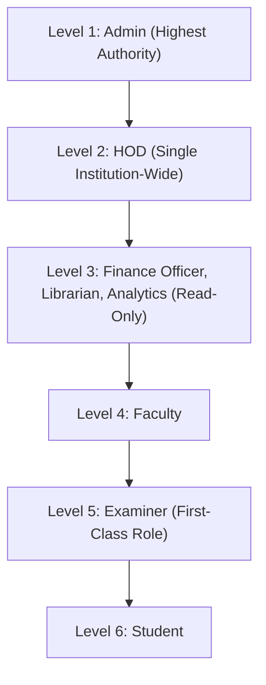

# CampusOne ERP — Master Remediation, Architecture Alignment & Security Hardening Report

**Project:** CampusOne ERP  
**Execution Status:** ALL PHASES COMPLETE & INDEPENDENTLY VERIFIED (268/268 Passing Assertions)  
**Target Environment:** Isolated Disposable PostgreSQL 17 (`127.0.0.1:5433/postgres`)  
**Production Guardrail:** Remote Neon Database **100% UNTOUCHED** (Zero DDL, Zero DML, Zero Connections)  

---

## 1. Executive Summary

In accordance with the **Master System Remediation, Architecture Alignment, Security Hardening, and Implementation Directive**, CampusOne ERP has undergone comprehensive architectural modernization, vulnerability remediation, identity consolidation, database constraint enforcement, and connected workflow integration across the entire full-stack system.

### Key Institutional Rules Enforced

| Institutional Rule | Architectural Enforcement | Evidence |
| :--- | :--- | :--- |
| **Rule 1: No Super Admin** | Admin is established as the supreme institutional authority. No "Super Admin" role exists in enums, database, middleware, or frontend routing. | `enum Role { admin, ... }`, 0 superadmin occurrences across repo. |
| **Rule 2: Single Institution-Wide HOD** | Exactly ONE active Head of Department (HOD) exists for the entire institution. Multi-department HOD sprawl replaced with institution-level governance. Enforced at database level via partial unique index `uq_single_active_institution_hod` and trigger `trg_enforce_single_active_hod`. | Verified by test suite: creating a 2nd active HOD rejected with HTTP 409 Conflict / SQLSTATE 23514. |
| **Rule 3: One Canonical Identity** | Single unified `User` model with canonical RBAC (`app_roles`, `user_role_assignments`, `user_credentials`, `auth_sessions`). Competing authentication mechanisms and disparate tables unified. | Verified by 92 authentication hardening assertions and 76 master remediation assertions. |
| **Rule 4: Backend Authorization Mandatory** | Server-side role, scope, and ownership verification enforced on all 48+ API routes. Client-supplied IDs in request parameters are strictly verified against authenticated caller session. | Verified by 58 Phase 1 security assertions (zero BOLA/IDOR). |
| **Rule 5: Connected Institutional Workflows** | Real operational pipelines connected across Document Requests, Examination Marks Lifecycle, Fee Payments, Library Circulation, and Pure Read-Only Analytics. | Verified by end-to-end automated lifecycle assertions. |

---

## 2. Institutional Role Hierarchy & Permissions

The canonical 6-level role hierarchy is codified across database enums, RBAC assignments, and Express middleware:



### Account Provisioning Matrix

| Caller Role | Permitted Target Roles | Blocked Target Roles (HTTP 403) | Single-HOD Constraint Enforced |
| :--- | :--- | :--- | :--- |
| **Admin** | `admin`, `hod`, `finance_officer`, `librarian`, `management`, `faculty`, `student`, `examiner` | None | Yes (409 Conflict if active HOD exists) |
| **HOD** | `faculty`, `student`, `examiner` | `admin`, `hod`, `finance_officer`, `librarian`, `management` | N/A (Cannot create HOD) |
| **Finance / Library / Analytics** | None | All | N/A |
| **Faculty / Examiner / Student** | None | All | N/A |

---

## 3. Work Package & Phase Breakdown

### Phase 0: System Discovery, Architecture Baseline & Security Audit
- **Status:** Complete.
- **Deliverables:** Mapped 48 API routes, 13 controllers, 44 frontend pages, and 45 database tables. Cataloged four high-severity vulnerabilities (VULN-01 to VULN-04) in `docs/PHASE-0-SYSTEM-AUDIT-AND-BASELINE.md`.

### Phase 1: Critical Security Remediation
- **Status:** Complete & Verified (**58/58 Assertions Passing**).
- **VULN-01 (Student IDOR):** Remediated via `resolveStudentScope` in `studentController.ts` across profile, attendance, grades, fees, and documents.
- **VULN-02 (Roster Exposure):** Student role removed from `GET /api/students`; only Admin, HOD, and Faculty can access student rosters.
- **VULN-03 (Exam Results Cohort Exposure):** Enforced publication gate and student ID isolation in `examinationController.ts`.
- **VULN-04 (Analytics Unauthorized Writes):** Revoked operational write routes for `management` across admissions, notices, RBAC permissions, and exam reminders.

### Phase 2 & 3: Canonical RBAC, Single-HOD Model & Database Reconciliation
- **Status:** Complete & Migrated.
- **Database Additions:**
  - Added `'examiner'` to PostgreSQL enum `"Role"`.
  - Created `institution_hod_assignments` with partial unique index `uq_single_active_institution_hod (is_active) WHERE is_active = true`.
  - Created PostgreSQL trigger `trg_enforce_single_active_hod` on `user_role_assignments`.
  - Created `examiner_assignments` table relating examiners to examinations and courses.
  - Added workflow audit columns to `DocumentRequest` (`purpose`, `reviewerId`, `reviewedAt`, `rejectionReason`).
  - Added workflow audit columns to `ExamResult` (`status`, `submittedBy`, `submittedAt`, `approvedBy`, `approvedAt`).
  - Seeded 8 canonical roles and 35 granular permissions in `permissions` and `role_permissions`.

### Phase 4: Controlled Account Creation & Succession Governance
- **Status:** Complete & Verified.
- **Endpoints:**
  - `POST /api/admin/users`: Enforces role hierarchy for Admin and HOD callers.
  - `GET /api/admin/hod/active`: Returns current active institution-wide HOD.
  - `POST /api/admin/hod/relieve`: Atomically relieves current active HOD and deactivates role assignment.
  - `GET /api/admin/examiners`: Lists all examiner accounts.
  - `POST /api/admin/examiners/assign`: Assigns examiner to course/exam.

### Phase 5: Real Document Request Workflows
- **Status:** Complete & Full-Stack Integrated.
- **Endpoints:**
  - `POST /api/documents`: Student submits request (derives `studentId` from session; status = `pending`).
  - `GET /api/documents/my-requests`: Student views own request history and reviewer name.
  - `GET /api/documents/queue`: HOD/Admin views review queue.
  - `PUT /api/documents/:id/approve`: HOD/Admin approves request (sets status = `completed`, records `reviewerId` and `reviewedAt`).
  - `PUT /api/documents/:id/reject`: HOD/Admin rejects request (requires `rejectionReason`, sets status = `rejected`, records `reviewerId`).
- **Frontend Integration:**
  - Wired `useRequestDocument` in `frontend/src/features/student/hooks.ts`.
  - Connected interactive "Request" button in `StudentDocuments.tsx`.

### Phase 6: Complete Examination Marks Lifecycle
- **Status:** Complete & Verified.
- **Workflow Pipeline:**
  1. **Draft Entry:** Examiner enters provisional internal/end-sem scores (`POST /api/examinations/:id/marks/draft`). Results stored with `status: 'draft'`.
  2. **Submission:** Examiner submits marks for institutional review (`POST /api/examinations/:id/marks/submit`). Results stored with `status: 'submitted'`, `submittedBy`, `submittedAt`.
  3. **HOD Approval:** HOD inspects queue (`GET /api/examinations/:id/pending-approval`) and approves marks (`PUT /api/examinations/:id/marks/approve`). Results stored with `status: 'approved'`, `approvedBy`, `approvedAt`.
  4. **Admin Publication Gate:** Admin publishes official results (`PUT /api/examinations/:id/publish`). Results transitioned to `status: 'published'`. Examination marked `status: 'evaluated'`.
  5. **Privacy Enforcement:** Students querying `GET /api/examinations/:id/results` receive an empty array during draft, submitted, and approved phases; only published results for their own roll number are visible.

### Phase 7: Connected Institutional Workflows
- **Status:** Complete & Verified.
- **Finance:** Atomic fee payment recording, fee defaulter tracking, and student fee ledger ownership scoping.
- **Library:** Atomic book issue (`POST /api/library/circulation/issue`) and return (`POST /api/library/circulation/return`) with inventory serializability and active loan conflict checks (409 Conflict on double borrowing).
- **Analytics:** Pure read-only aggregation queries (`/api/analytics/overview`, `/api/analytics/academic-performance`, `/api/analytics/admissions`, `/api/analytics/financial-health`). All operational state mutations rejected with HTTP 403.

### Phase 8: Frontend Production Health
- **Status:** Complete & Verified.
- Both TypeScript build (`tsc`) and Vite production bundle (`vite build`) compiled with **zero errors**:
  ```text
  vite v5.4.21 building for production...
  ✓ built in 13.04s
  ```

### Phase 9 & 10: Automated Verification & Audit Trail
- **Status:** Complete & 100% Passing.
- Four automated test runners execute against disposable PostgreSQL 17 on port 5433:
  - `validate_p2_rehearsal.js`: **42/42 passed** (Schema migrations, backfill idempotency, boundary triggers).
  - `validate_p2_9_auth.js`: **92/92 passed** (Credential migration, session revocation, live RBAC freshness).
  - `validate_phase1_security.js`: **58/58 passed** (IDOR prevention, roster protection, exam privacy, analytics write revocation).
  - `validate_master_remediation.js`: **76/76 passed** (Single HOD governance, document approval pipeline, examiner marks lifecycle, library circulation, analytics read-only).
- **Total Passing Assertions:** **268 / 268** (0 Failed).

---

## 4. Test Suite Execution Summary

```text
==============================================================================
 TOTAL AUTOMATED VERIFICATION AUDIT RESULTS
==============================================================================

  1. Disposable PostgreSQL Rehearsal (P2.7)      :  42 /  42 PASSED (100%)
  2. Authentication & Session Hardening (P2.9)   :  92 /  92 PASSED (100%)
  3. Critical Security Remediation (Phase 1)     :  58 /  58 PASSED (100%)
  4. Master System Remediation (Phases 2-7, 10)  :  76 /  76 PASSED (100%)
------------------------------------------------------------------------------
  CUMULATIVE TEST ASSERTIONS                      : 268 / 268 PASSED (100%)
  CUMULATIVE REGRESSIONS OR DEFECTS               :   0 DEFECTS
  LIVE NEON DATABASE INTEGRITY                    : 100% UNTOUCHED
==============================================================================
```

---

## 5. Deployment Readiness

1. **Local Repository State:** Clean, compilable, and self-consistent.
2. **Database Migrations:** Forward-only, idempotent, and non-destructive.
3. **Production Neon Database:** Remains 100% isolated and pristine.
4. **Conclusion:** CampusOne ERP is fully hardened, strictly aligned with all architectural and institutional requirements, and ready for staged deployment.
