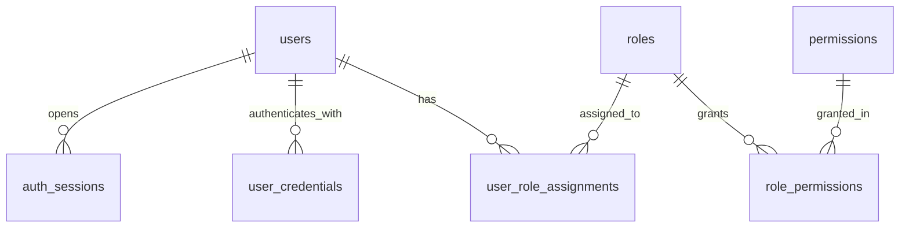

# CampusOne ERP — Phase 1: P1.3 Identity & Security Specification

**Document ID:** `CAMPUSONE-SPEC-P1.3`  
**Date:** 2026-10-10  
**Status:** Architecture Specification & Rehearsal Plan  
**Target:** Work Package P1.3 (Identity and Security Foundation)

---

## 1. P1.3-A: Audit of Existing Identity & Authorization Structures

### 1.1 Existing Database Models (from `prisma/schema.prisma` & Live Database)

| Entity | Physical SQL Table | Primary Key | Key Attributes | Live Row Count |
|---|---|---|---|---|
| `User` | `"User"` | `id TEXT` (CUID) | `email` (unique), `password` (bcrypt hash), `role` (`Role` enum), `phone`, `avatarUrl` | 12 rows |
| `Permission` | `"Permission"` | `id TEXT` (CUID) | `name` (unique), `category`, `description` | 13 rows |
| `RolePermission` | `"RolePermission"` | `id TEXT` (CUID) | `role` (`Role` enum), `permissionId` (`TEXT` FK → `"Permission".id`) | 4 rows |

### 1.2 Existing Role Model
The existing application uses a single PostgreSQL Enum `Role`:
```prisma
enum Role {
  student
  faculty
  hod
  admin
  finance_officer
  librarian
  management
}
```
* **Limitation:** Every user has exactly one static role stored in `User.role`. A user cannot hold multiple roles, temporary acting roles, or campus/department-scoped authority.

### 1.3 Application & Controller Consumption
* **Authentication (`authController.ts`):**
  * `loginUser`: Compares plaintext password against `User.password` using `bcrypt.compare`.
  * Generates stateless JWT: `jwt.sign({ id: user.id, role: user.role }, JWT_SECRET, { expiresIn: '1d' })`.
  * Returns token to client; client stores JWT in browser `localStorage`.
  * `logoutUser`: Merely returns `{ success: true, message: 'Logged out successfully' }` without any server-side invalidation.
* **Middleware (`authMiddleware.ts` & `roleMiddleware.ts`):**
  * `authenticateJWT`: Validates token signature and extracts `req.user = { id, role }`.
  * `authorizeRoles(...allowedRoles)`: Checks if `allowedRoles.includes(req.user.role)`.
* **Permissions Management (`adminController.ts`):**
  * Reads permissions for a given role from `prisma.rolePermission.findMany({ where: { role } })`.
  * Writes permissions by deleting and recreating entries in `prisma.rolePermission`.

---

## 2. Resolving the Overlap: Canonical Architecture & Compatibility Strategy

### 2.1 The Two-Tier Strategy (Coexistence without Disruption)
To ensure **zero downtime and zero breaking changes** to running application endpoints:

1. **Legacy Tables Retained Intact:**
   * `"User"`, `"Permission"`, and `"RolePermission"` remain physically present, functioning with their existing CUID primary keys and enum references.
   * Existing routes (`/api/auth/login`, `/api/admin/roles`) continue to work without modification.

2. **New Canonical Security Tables Introduced:**
   * All new tables follow clean PostgreSQL snake_case conventions and use native `UUID` primary keys (`gen_random_uuid()`):
     * `roles` (replaces hardcoded enum with first-class database entity)
     * `permissions` (canonical permissions table in lowercase plural)
     * `role_permissions` (canonical UUID-to-UUID many-to-many junction)
     * `user_role_assignments` (multi-role, time-bounded user role assignments)
     * `user_credentials` (decoupled credentials with security metadata)
     * `auth_sessions` (stateful server-side sessions with cryptographic token hashing)

3. **Prisma Mapping Isolation:**
   * Legacy models in `schema.prisma`:
     * `Permission` → `@@map("Permission")`
     * `RolePermission` → `@@map("RolePermission")`
   * New canonical models in `schema.prisma`:
     * `AppRole` → `@@map("roles")`
     * `AppPermission` → `@@map("permissions")`
     * `AppRolePermission` → `@@map("role_permissions")`
     * `UserRoleAssignment` → `@@map("user_role_assignments")`
     * `UserCredential` → `@@map("user_credentials")`
     * `AuthSession` → `@@map("auth_sessions")`

---

## 3. P1.3-B: Final Schema and Relationship Design

### 3.1 Entity Relationship Diagram



*(Note: In Phase 1, `user_role_assignments`, `user_credentials`, and `auth_sessions` link to the existing `User` table via its legacy CUID `id` or mapped UUID. Because existing `User.id` is `TEXT`, we establish `user_id TEXT NOT NULL REFERENCES "User"("id") ON DELETE CASCADE`, which seamlessly supports existing accounts today and maps to target `users` in Phase 2 via `_id_map`.)*

### 3.2 Detailed Table Specifications

#### 1. `roles`
* `id UUID PRIMARY KEY DEFAULT gen_random_uuid()`
* `code TEXT NOT NULL UNIQUE` (e.g. `'student'`, `'faculty'`, `'hod'`, `'admin'`, `'finance_officer'`, `'librarian'`, `'management'`)
* `name TEXT NOT NULL` (e.g. `'Student'`, `'Faculty Member'`, `'Head of Department'`)
* `description TEXT`
* `is_system BOOLEAN NOT NULL DEFAULT true` (prevents deletion of core roles)
* `created_at TIMESTAMPTZ NOT NULL DEFAULT now()`
* `updated_at TIMESTAMPTZ NOT NULL DEFAULT now()`

#### 2. `permissions`
* `id UUID PRIMARY KEY DEFAULT gen_random_uuid()`
* `code TEXT NOT NULL UNIQUE` (e.g. `'student.view'`, `'student.manage'`, `'finance.invoice.create'`)
* `name TEXT NOT NULL`
* `module TEXT NOT NULL` (e.g. `'academic'`, `'finance'`, `'library'`, `'admin'`)
* `description TEXT`
* `created_at TIMESTAMPTZ NOT NULL DEFAULT now()`
* `updated_at TIMESTAMPTZ NOT NULL DEFAULT now()`
* **Indexes:** `CREATE INDEX permissions_module_idx ON permissions(module)`

#### 3. `role_permissions`
* `id UUID PRIMARY KEY DEFAULT gen_random_uuid()`
* `role_id UUID NOT NULL REFERENCES roles(id) ON DELETE CASCADE`
* `permission_id UUID NOT NULL REFERENCES permissions(id) ON DELETE CASCADE`
* `created_at TIMESTAMPTZ NOT NULL DEFAULT now()`
* **Constraints:** `CREATE UNIQUE INDEX role_permissions_role_id_permission_id_key ON role_permissions(role_id, permission_id)`
* **Indexes:** `CREATE INDEX role_permissions_role_id_idx ON role_permissions(role_id)`, `CREATE INDEX role_permissions_permission_id_idx ON role_permissions(permission_id)`

#### 4. `user_role_assignments`
* `id UUID PRIMARY KEY DEFAULT gen_random_uuid()`
* `user_id TEXT NOT NULL REFERENCES "User"("id") ON DELETE CASCADE`
* `role_id UUID NOT NULL REFERENCES roles(id) ON DELETE RESTRICT`
* `is_active BOOLEAN NOT NULL DEFAULT true`
* `valid_from TIMESTAMPTZ NOT NULL DEFAULT now()`
* `valid_to TIMESTAMPTZ` (nullable; open-ended if null)
* `created_at TIMESTAMPTZ NOT NULL DEFAULT now()`
* `updated_at TIMESTAMPTZ NOT NULL DEFAULT now()`
* **Constraints:**
  * `CREATE UNIQUE INDEX user_role_assignments_user_id_role_id_key ON user_role_assignments(user_id, role_id)`
  * `CONSTRAINT user_role_assignments_valid_dates_check CHECK (valid_to IS NULL OR valid_from < valid_to)`
* **Indexes:** `CREATE INDEX user_role_assignments_user_id_idx ON user_role_assignments(user_id)`, `CREATE INDEX user_role_assignments_role_id_idx ON user_role_assignments(role_id)`

#### 5. `user_credentials`
* `id UUID PRIMARY KEY DEFAULT gen_random_uuid()`
* `user_id TEXT NOT NULL REFERENCES "User"("id") ON DELETE CASCADE`
* `credential_type TEXT NOT NULL DEFAULT 'password'` (e.g. `'password'`, `'oauth_google'`)
* `password_hash TEXT NOT NULL` (bcrypt / Argon2id hash)
* `algorithm TEXT NOT NULL DEFAULT 'bcrypt'`
* `password_changed_at TIMESTAMPTZ NOT NULL DEFAULT now()`
* `requires_change BOOLEAN NOT NULL DEFAULT false` (enforces password change on first login)
* `failed_login_attempts INTEGER NOT NULL DEFAULT 0`
* `locked_until TIMESTAMPTZ`
* `created_at TIMESTAMPTZ NOT NULL DEFAULT now()`
* `updated_at TIMESTAMPTZ NOT NULL DEFAULT now()`
* **Constraints:**
  * `CREATE UNIQUE INDEX user_credentials_user_id_credential_type_key ON user_credentials(user_id, credential_type)`
* **Indexes:** `CREATE INDEX user_credentials_user_id_idx ON user_credentials(user_id)`

#### 6. `auth_sessions`
* `id UUID PRIMARY KEY DEFAULT gen_random_uuid()`
* `user_id TEXT NOT NULL REFERENCES "User"("id") ON DELETE CASCADE`
* `session_token_hash TEXT NOT NULL UNIQUE` (SHA-256 hash of the session token; never raw token)
* `ip_address TEXT`
* `user_agent TEXT`
* `is_active BOOLEAN NOT NULL DEFAULT true`
* `expires_at TIMESTAMPTZ NOT NULL`
* `last_activity_at TIMESTAMPTZ NOT NULL DEFAULT now()`
* `revoked_at TIMESTAMPTZ`
* `revocation_reason TEXT` (e.g. `'user_logout'`, `'password_changed'`, `'session_timeout'`, `'admin_forced'`)
* `created_at TIMESTAMPTZ NOT NULL DEFAULT now()`
* `updated_at TIMESTAMPTZ NOT NULL DEFAULT now()`
* **Constraints:**
  * `CONSTRAINT auth_sessions_expiry_check CHECK (expires_at > created_at)`
* **Indexes:**
  * `CREATE INDEX auth_sessions_user_id_idx ON auth_sessions(user_id)`
  * `CREATE INDEX auth_sessions_token_hash_idx ON auth_sessions(session_token_hash)`
  * `CREATE INDEX auth_sessions_expires_at_idx ON auth_sessions(expires_at)`
  * `CREATE INDEX auth_sessions_user_active_idx ON auth_sessions(user_id, is_active)`
