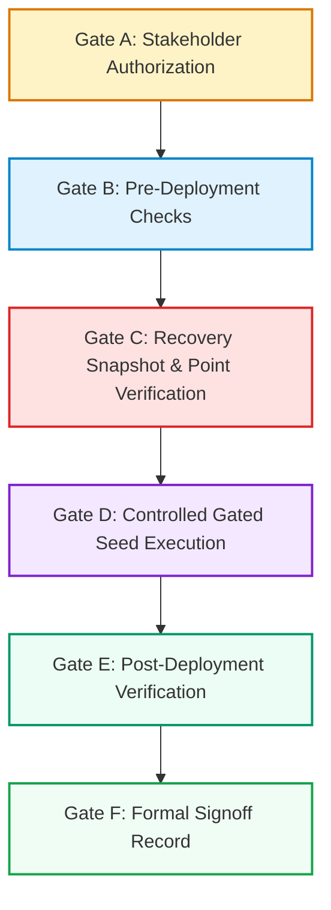
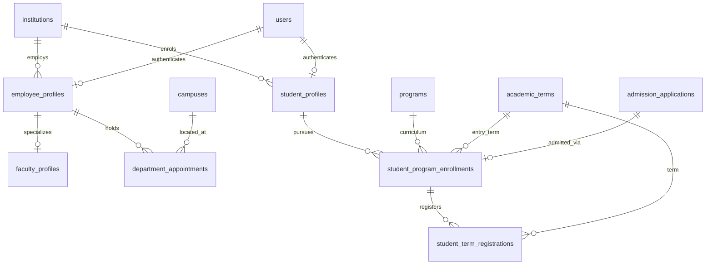
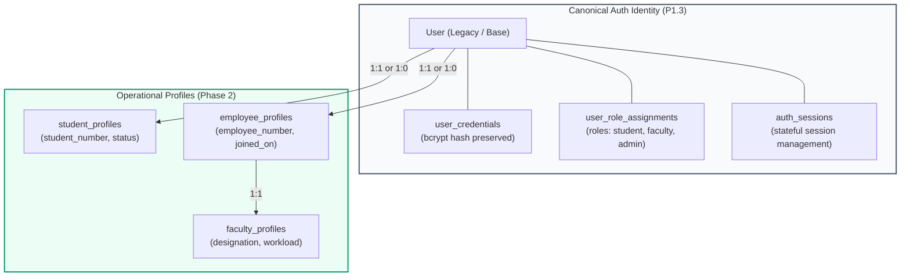
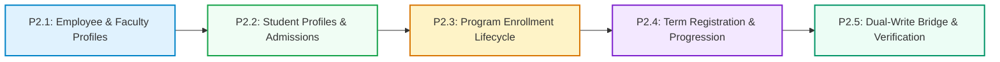

# CampusOne ERP — Phase 1 Closeout, Cutover Staging, and Phase 2 Architecture Alignment

**Document ID:** `CAMPUSONE-SPEC-P1.5`  
**Revision:** v1.0 (Formal Architecture & Planning Baseline)  
**Date:** 2026-10-10  
**Status:** 📋 **PLANNING & SPECIFICATION ONLY — NO DATABASE WRITES AUTHORIZED**  
**Repository Working Directory:** `C:\Projects\ERP-System`  
**Git Branch Status:** `main...origin/main [ahead 4]` (Clean working tree; 4 unpushed local commits)  
**Live Target Database (Neon):** 🛡️ **100% UNTOUCHED (Zero writes to live `public` schema; foundation tables remain empty)**  

---

## 1. Executive Summary

Work Package P1.5 serves as the formal architectural bridge between **Phase 1: Foundation Schema & Master Data** and **Phase 2: Student and Faculty Lifecycle**. 

Phase 1 introduced 14 additive tables across two schema migrations (`202610100001_p1_foundation_schema` and `202610100002_p1_identity_security`) and established a fully rehearsed, idempotent seed and backfill layer (`backend/scripts/seed_p1_4_master_data.js`). The local rehearsal demonstrated 100% legacy data preservation across all 22 existing application tables, zero partial writes on transaction rollback, complete idempotency on repeated execution, and strict cryptographic UUID v5 mapping.

This document accomplishes three objectives:
1. **Formalizes Phase 1 Closeout:** Documents the exact implementation, testing, and deployment status of work packages P1.1 through P1.4.
2. **Defines the Gated Phase 1 Staging Runbook:** Specifies the multi-stage authorization, pre-check, execution, and verification protocol required before P1.4 master data can be seeded into the live Neon database.
3. **Establishes Phase 2 Architecture & Decision Gates:** Specifies the domain model, entity relationships, legacy-to-canonical mappings, and prerequisite policy decisions required before implementing the student and employee lifecycle tables in Phase 2.

**Boundary Commitment:** This document is strictly an architecture and planning deliverable. No DDL migrations, Prisma schema modifications, or live database writes are authorized or executed during this work package.

---

## 2. Repository Evidence and Current State

A direct audit of the workspace as of 2026-10-10 confirms the following technical baseline:

### 2.1 Tooling & Environment
* **Runtime:** Node.js v22.17.0
* **ORM:** Prisma v7.10.0 (`@prisma/client`, `@prisma/adapter-pg`)
* **Database Driver:** `pg` v8.23.0 via `@prisma/adapter-pg` driver adapter
* **Target Engine:** PostgreSQL 16 (Hosted on Neon serverless PostgreSQL, AWS `ap-southeast-1`)

### 2.2 Git Commit Trail
The local `main` branch contains four reviewed commits ahead of `origin/main` that have not been pushed to the remote repository:

| Commit SHA | Commit Message | Scope & Artifacts |
|---|---|---|
| `fa9a0d0` | `docs(phase0): establish baseline, DDL snapshot, and decision register` | Baseline diagnostic outputs, source schema DDL, decision register. |
| `1573b88` | `feat(schema): add Phase 1 foundation schema migration (P1.1 & P1.2)` | Schema models & migration SQL for 8 foundation tables (`_id_map`, `_term_date_map`, `institutions`, etc.). |
| `79cbaac` | `feat(schema): add Phase 1 identity and security foundation migration (P1.3)` | Schema models & migration SQL for 6 security tables (`roles`, `permissions`, `auth_sessions`, etc.). |
| `6629d9b` | `feat(data): add Phase 1 master-data seed and backfill rehearsal (P1.4)` | Master-data seed script, rehearsal runner, and sanitized rehearsal report. |

Working tree status: Clean (`git status --short --branch` shows no modified or untracked files prior to this document).

### 2.3 Live Neon Schema Inventory
The target Neon database `public` schema currently contains **39 base tables**:
* **24 Legacy Application Tables:** `User`, `Department`, `Course`, `Student`, `Faculty`, `TimetableEntry`, `FeeStructure`, `FeeTransaction`, `Examination`, `ExamResult`, `AttendanceRecord`, `Book`, `CirculationRecord`, `FineRecord`, `Notice`, `LeaveRequest`, `AdmissionApplication`, `DocumentRequest`, `ExpenseRecord`, `PlacementRecord`, `ResearchGrant`, `SystemActivity`, `Permission`, `RolePermission`.
* **1 Migration Ledger:** `_prisma_migrations` (contains 3 applied migration records).
* **8 Foundation Tables (P1.1/P1.2 DDL Applied):** `_id_map`, `_term_date_map`, `institutions`, `campuses`, `academic_years`, `academic_terms`, `programs`, `rooms`.
* **6 Identity & Security Tables (P1.3 DDL Applied):** `roles`, `permissions`, `role_permissions`, `user_role_assignments`, `user_credentials`, `auth_sessions`.

### 2.4 Live Neon Data State
* **Legacy Tables:** All 24 legacy tables retain their exact historical row counts (`Department: 1`, `Course: 2`, `Student: 5`, `Faculty: 2`, `User: 12`, `FeeTransaction: 2`, `TimetableEntry: 1`).
* **Phase 1 Foundation Tables:** All eight foundation tables contain **0 rows** (`institutions: 0`, `campuses: 0`, `academic_years: 0`, `academic_terms: 0`, `_term_date_map: 0`, `programs: 0`, `rooms: 0`, `_id_map: 0`).
* **Live Seeding Status:** No seed scripts have been executed against the live Neon database.

---

## 3. Phase 1 Completion Matrix

The table below provides a granular status breakdown of each Phase 1 work package, distinguishing local implementation from live deployment:

| Work Package | Deliverable | Schema & Script Changes | Validation & Evidence | Deployment Status | Acceptance Status |
|---|---|---|---|---|---|
| **P1.1 — Migration Infrastructure** | `_id_map`, `_term_date_map` | Added to `schema.prisma`; Migration `202610100001_p1_foundation_schema` lines 12–35. | Rehearsed in `validate_p1_migration.js`; bidirectional unique constraints verified. | Applied to Neon DDL. 0 rows in live tables. | ✅ **ACCEPTED** |
| **P1.2 — Institutional Hierarchy** | `institutions`, `campuses`, `academic_years`, `academic_terms`, `programs`, `rooms` | Added to `schema.prisma`; Migration `202610100001_p1_foundation_schema` lines 37–181. | Negative constraint tests (date checks, unique indexes, term type checks) verified in disposable schema. | Applied to Neon DDL. 0 rows in live tables. | ✅ **ACCEPTED** |
| **P1.3 — Identity & Security Foundation** | `roles`, `permissions`, `role_permissions`, `user_role_assignments`, `user_credentials`, `auth_sessions` | Added to `schema.prisma`; Migration `202610100002_p1_identity_security`. | Rehearsed in `validate_p1_3_migration.js`; multi-role assignments, credential isolation, session revocation validated. | Applied to Neon DDL. 0 rows in live tables. | ✅ **ACCEPTED** |
| **P1.4 — Seed & Master-Data Backfill** | Root institution, campus, 4 AYs, 8 terms, historical map, program, room, `_id_map` for Dept & Course | Implemented in `backend/scripts/seed_p1_4_master_data.js`; tested via `validate_p1_4_rehearsal.js`. | 14-stage rehearsal in disposable schema: 100% idempotent, rollback verified, all 22 legacy tables retain identical SHA-256 digests. | Committed locally (`6629d9b`). **NOT SEEDED IN NEON.** | ⏸️ **ACCEPTED WITH EXCEPTIONS (Deployment ON HOLD)** |

### Granular Deployment Lifecycle Status
* **Implemented Locally:** P1.1, P1.2, P1.3, P1.4
* **Committed Locally:** P1.1, P1.2, P1.3, P1.4
* **Published to Remote (GitHub):** None (4 commits pending review)
* **Applied to Neon (DDL):** P1.1, P1.2, P1.3
* **Seeded in Neon (DML):** None (P1.4 held pending Gate A authorization)
* **Independently Audited:** P1.1, P1.2, P1.3, P1.4

---

## 4. Known Risks and Outstanding Exceptions

The following exceptions and uncertainties have been audited and explicitly recorded:

1. **Quarantined Historical Cohort (`UNRESOLVED_STUDENT_01`):**
   * *Evidence:* Legacy student record with `degree: "B.Tech"`, `semester: 1`, and `batch: "2026-2026"`.
   * *Status:* Quarantined. Not mapped in `_term_date_map`.
   * *Risk:* If forced into an arbitrary cohort, historical attendance and billing would link to incorrect terms.
   * *Mitigation:* Quarantined without blocking other verified seed data.
2. **Provisional Program Code (`BTECH-CS`):**
   * *Evidence:* Deterministically derived from `Student.degree` (`'B.Tech'`) and `Department.code` (`'CS101'`).
   * *Status:* Provisional.
   * *Risk:* Formal academic documentation may designate this program as `BTECH-CSE` or `UG-CS`.
   * *Mitigation:* Documented as derived normalization; subject to Board of Studies endorsement.
3. **Provisional Room Seating Capacity (`60`):**
   * *Evidence:* Sourced from Prisma schema column default (`DEFAULT 60`). Legacy `TimetableEntry` contains no capacity field.
   * *Status:* Unverified architectural capacity.
   * *Mitigation:* Documented as a database default, avoiding claims of physical seating surveys.
4. **Historical Term Date Provenance (Semesters 1–7):**
   * *Evidence:* Approved in Phase 0 Decision Register. Mid-term examination window for Semester 7 (`2026-09-04`..`09-09`) is corroborated by live `Examination` data.
   * *Status:* Complete semester boundaries (`2026-07-15`..`12-15`) classified as `confidence: 'inferred'`.
   * *Mitigation:* Explicitly avoids claiming source-transaction verification for calendar boundary dates.
5. **Institutional Legal Entity & Domain:**
   * *Evidence:* Neither the statutory legal entity nor the primary web domain was formally registered in Phase 0 decisions.
   * *Status:* `institutions.legal_name` and `institutions.website` explicitly seeded as `null`.
   * *Mitigation:* Eliminates assumptions; leaves optional columns null pending legal charter signoff.

---

## 5. Phase 1 Deployment Staging Runbook

When stakeholder authorization to deploy P1.4 to Neon is granted, the deployment must follow this strict six-gate procedure. **Under no circumstances should any step be skipped or reordered.**



---

### Gate A — Authorization
* **Requirement:** Written confirmation from the lead database architect and project owner authorizing live writes to the Neon database.
* **Separation Rule (Three Independent Operations):**
  1. **Schema Migration Deployment (DDL):** Applied to Neon in previous authorized steps (`202610100001_p1_foundation_schema` and `202610100002_p1_identity_security`).
  2. **Master-Data Seeding (DML):** Strictly gated under Gate A; requires separate authorization (`seed_p1_4_master_data.js --allow-live-neon`).
  3. **Remote Git Publication:** Strictly independent operational decision; local commits (`ahead 4`) remain unpublished on `origin/main`.
* **Scope Restriction:** Gate A authorizes execution of `backend/scripts/seed_p1_4_master_data.js` with `--allow-live-neon` only. Documentation signoff, code review, or rehearsal tests **never** constitute deployment authorization.

---

### Gate B — Pre-Deployment Checks
Prior to invoking the live seed script, execute the following non-destructive diagnostic checks in PowerShell:

```powershell
# 1. Confirm working directory
cd C:\Projects\ERP-System\backend
Get-Location

# 2. Confirm Git branch and working tree cleanliness
git status --short --branch
# Expected: ## main...origin/main [ahead 4], working tree clean

# 3. Confirm head commit SHA
git rev-parse HEAD
# Expected: 6629d9b43bd757c5ce31f48acac9e6c156dde752 (or latest amended SHA)

# 4. Verify Prisma migration status against Neon
npx prisma migrate status --config prisma7.config.ts
# Expected: Database schema is up to date (3 applied migrations)

# 5. Confirm target database host (non-secret check)
node -e "const u = new URL(process.env.DATABASE_URL); console.log('Target Host:', u.host, '| Database:', u.pathname);"
# Expected: Target Host: ep-green-pine-azr0z3ii.c-3.ap-southeast-1.aws.neon.tech | Database: /neondb

# 6. Verify that foundation tables are currently empty
node -e "require('dotenv').config(); const { Client } = require('pg'); const c = new Client({ connectionString: process.env.DATABASE_URL }); c.connect().then(async () => { const ts = ['institutions','campuses','academic_years','academic_terms','_term_date_map','programs','rooms','_id_map']; for (const t of ts) { const r = await c.query('SELECT COUNT(*) FROM ' + t); console.log(t, r.rows[0].count); } await c.end(); });"
# Expected: All 8 tables output count 0

# 7. Test seed script safety guard (dry-run without live flag must abort)
node scripts/seed_p1_4_master_data.js
# Expected: Exits with code 1 and displays 'SAFETY GUARD: Direct write to live Neon public schema is prohibited'
```

*Criteria for Gate B:* If any table has unexpected rows, if migration status is diverged, or if the safety guard fails, **HALT IMMEDIATELY**.

---

### Gate C — Recovery Preparation
* **Recovery Point Objective (RPO):** Zero data loss.
* **Recovery Time Objective (RTO):** Under 15 minutes.
* **Snapshot Protocol:**
  1. Take an automated Neon point-in-time branch snapshot or execute a logical backup:
     ```powershell
     node scripts/backup_live_db.js
     ```
  2. Confirm the resulting backup file is non-empty and structurally valid using `verify_backup_restore.js` in an isolated schema.
* **Transaction Rollback Semantics:**
  * `seed_p1_4_master_data.js` wraps all master data inserts in a single transaction (`BEGIN` ... `COMMIT`).
  * If an unhandled constraint violation or network timeout occurs during execution, PostgreSQL rolls back all partial writes automatically.
  * *Disaster Recovery Rule:* Never execute `prisma migrate reset` or table truncation against Neon. If recovery is needed, restore the verified point-in-time branch snapshot.

---

### Gate D — Controlled Gated Seed Execution
Only after Gates A, B, and C are fully verified, execute the live seed command:

```powershell
# Authorized live seed command
node scripts/seed_p1_4_master_data.js --allow-live-neon
```

* **Purpose of `--allow-live-neon`:** Overrides the internal safety guard that blocks writes to schemas named `public` on hostnames matching `neon.tech`.
* **Execution Behavior:** Connects to Neon, begins transaction, executes idempotent checks and inserts, maps `Department` and `Course` to deterministic UUIDs, validates bidirectional uniqueness, and issues `COMMIT`.

---

### Gate E — Post-Deployment Verification
Immediately following execution, run post-deployment reconciliation checks:

```powershell
# 1. Verify populated master record counts
node -e "require('dotenv').config(); const { Client } = require('pg'); const c = new Client({ connectionString: process.env.DATABASE_URL }); c.connect().then(async () => { const expected = { institutions: 1, campuses: 1, academic_years: 4, academic_terms: 8, _term_date_map: 7, programs: 1, rooms: 1, _id_map: 3 }; for (const [t, exp] of Object.entries(expected)) { const r = await c.query('SELECT COUNT(*) FROM ' + t); const actual = parseInt(r.rows[0].count, 10); console.log(t, actual === exp ? '✅ PASS (' + actual + ')' : '❌ FAIL (' + actual + ' != ' + exp + ')'); } await c.end(); });"

# 2. Verify legacy table data preservation
node -e "require('dotenv').config(); const { Client } = require('pg'); const c = new Client({ connectionString: process.env.DATABASE_URL }); c.connect().then(async () => { const legacy = { Department: 1, Course: 2, Student: 5, Faculty: 2, User: 12, FeeTransaction: 2, TimetableEntry: 1 }; for (const [t, exp] of Object.entries(legacy)) { const r = await c.query('SELECT COUNT(*) FROM \"' + t + '\"'); const actual = parseInt(r.rows[0].count, 10); console.log(t, actual === exp ? '✅ PASS (' + actual + ')' : '❌ FAIL (' + actual + ' != ' + exp + ')'); } await c.end(); });"

# 3. Test idempotency against live Neon (second execution must insert 0 rows)
node scripts/seed_p1_4_master_data.js --allow-live-neon
# Expected: Reports inserted: 0 across all master tables; all existing mappings preserved.
```

*Criteria for Gate E:* All record counts match exactly, legacy tables remain unchanged, and the idempotency test inserts zero rows.

---

### Gate F — Acceptance Signoff Record
The deployment signoff state must be recorded in project documentation:

* **Current Status:** `READY FOR AUTHORIZATION`
* **Signoff Authority:** Lead Database Architect & Project Stakeholder
* **Deployment Date:** *Pending Authorization*
* **Signoff Decision:**
  - [ ] **DEPLOYED AND VERIFIED**
  - [x] **READY FOR AUTHORIZATION (Deployment ON HOLD)**
  - [ ] **BLOCKED**

---

## 6. Phase 1 Acceptance Gates and Signoff

Evaluation against the locked criteria in `docs/REDESIGN-IMPLEMENTATION-PLAN.md` (line 317):

| Phase 1 Gate Criterion | Technical Verification Standard | Verification Evidence | Gate Status |
|---|---|---|:---:|
| **1. Fresh build from migrations succeeds** | Migrations apply cleanly in order from baseline DDL. | Verified in `validate_p1_migration.js` and `validate_p1_3_migration.js`. | ✅ **PASSED** |
| **2. Seed is idempotent** | Second run inserts zero rows and preserves existing mappings. | Verified in `validate_p1_4_rehearsal.js` (Run 2: 0 inserts across all tables). | ✅ **PASSED** |
| **3. Canonical terms populated from calendar** | Terms mapped to official academic calendar, not semester integers. | 4 AYs and 8 terms seeded (`2023-ODD` .. `2027-EVEN`). Active term `2026-ODD` set. | ✅ **PASSED** |
| **4. No existing functionality broken** | Legacy tables unmodified; zero orphan foreign keys. | 100% byte-for-byte SHA-256 legacy fingerprint match across all 22 tables. | ✅ **PASSED** |

---

## 7. Unresolved Policy Decision Register

The following three architectural decisions must be formally resolved before Phase 2 implementation begins. Each decision has been evaluated against repository evidence, schema constraints, and institutional requirements.

---

### Decision Brief 1: Concurrent Program Enrolments
* **Decision Status:** 🟡 **PROVISIONALLY APPROVED FOR P2.3 SCHEMA MODELING — PENDING INSTITUTIONAL POLICY SIGNOFF**
* **Context:** Legacy `Student.degree` stores a single string (e.g., `'B.Tech'`), implicitly assuming a 1:1 relationship between a student and a program. The target redesign introduces `student_program_enrollments`.
* **Repository & Schema Evidence:**
  * In `backend/prisma/schema.prisma` lines 196–229, `Student` defines `degree String?` and `batch String?`. The table contains no capability to track multiple degrees, program transfers, or add-on certifications over time.
  * Currently, all 5 legacy student rows have `degree = 'B.Tech'`. No concurrent degree data exists in the active database.
* **The Policy Question:** Does CampusOne permit a student to be concurrently enrolled in more than one program (e.g., a B.Tech degree and an add-on Honours diploma, minor certification, or dual-degree program)?
* **Option A: Prohibit Multiple Active Programs (1:1 Active Constraint)**
  * *Implementation:* Add a partial unique constraint at the database level:
    ```sql
    CREATE UNIQUE INDEX student_program_enrollments_active_idx 
    ON student_program_enrollments(student_id) 
    WHERE status = 'active';
    ```
  * *Consequences:* Enforces single-program enrollment strictly in the database. Prevents accidental duplicate enrollments. However, it hard-blocks legitimate dual-degree or concurrent certificate registrations without schema modifications.
* **Option B: Permit Multiple Concurrent Programs (1:N Lifecycle Modeling)**
  * *Implementation:* Model `student_program_enrollments` as an independent 1:N lifecycle entity without a unique constraint on `student_id`. Enforce concurrency rules at the application/service layer.
  * *Consequences:* Fully future-proof; accommodates transfers, readmissions, and concurrent certifications natively. Downstream queries (term registration, tuition invoicing, transcripts) must qualify operations with `program_enrollment_id`.
* **What Must Be Verified Before Implementation:**
  * Academic Council / Dean of Academics must confirm whether institutional policy permits concurrent enrollments or mandates a single active program.
* **Provisional Design Decision:** **Option B (Independent Lifecycle Entity)** adopted for P2.3 schema modeling. Single-active-program rules will be enforced in service-layer validation unless institutional policy mandates Option A database-level constraints.

---

### Decision Brief 2: Canonical Admission Application Relationship
* **Decision Status:** 🟢 **PROVISIONALLY APPROVED FOR P2.2 DESIGN — PENDING ADMISSIONS OFFICE ENDORSEMENT**
* **Context:** In the legacy schema, `AdmissionApplication` is unlinked to `Student`. In the target redesign, two competing foreign key relationships were evaluated:
  1. `student_profiles.admission_application_id`
  2. `student_program_enrollments.admission_application_id`
* **Repository & Schema Evidence:**
  * Inspecting `backend/prisma/schema.prisma` lines 575–592 confirms:
    ```prisma
    model AdmissionApplication {
      id            String            @id @default(uuid())
      applicantName String
      applicationId String            @unique
      program       String
      department    String
      jeeRank       Int?
      gateRank      Int?
      category      String
      quota         String
      status        ApplicationStatus @default(pending)
      appliedDate   DateTime          @default(now())
      updatedAt     DateTime          @updatedAt
      @@index([status])
      @@index([department])
      @@index([program])
    }
    ```
  * `AdmissionApplication` is uniquely identified by `applicationId` and contains explicit `program` and `department` fields.
  * It has **no existing foreign key** to `Student`, `User`, or any other table.
* **Cardinality & Structural Analysis:**
  * An applicant applies for admission to a *specific academic program* (`program = 'B.Tech - Computer Science'`).
  * An accepted application directly materializes as a program enrollment offer (`student_program_enrollments`).
  * Placing `admission_application_id` on `student_profiles` falsely implies a 1:1 relationship between a physical person and an application. If an alumnus returns for a postgraduate program or an applicant applies twice across different academic years, `student_profiles` would suffer duplicate or conflicting links.
* **What Must Be Verified Before Implementation:**
  * Admissions Office confirmation that admissions are granted per-program, and that an individual who matriculates multiple times over their lifespan submits distinct applications per program.
* **Provisional Design Decision:** **Link canonically to `student_program_enrollments.admission_application_id`** (nullable UUID FK referencing `AdmissionApplication.id`). Omit `admission_application_id` from `student_profiles` to eliminate duplicate sources of truth.

---

### Decision Brief 3: Resolution Protocol for `UNRESOLVED_STUDENT_01`
* **Decision Status:** 🟠 **QUARANTINED IN STAGING — PENDING ACADEMIC REGISTRAR CONFIRMATION**
* **Context:** Legacy student `UNRESOLVED_STUDENT_01` has `degree: "B.Tech"`, `semester: 1`, and `batch: "2026-2026"`.
* **Repository & Data Evidence:**
  * Legacy `Student` record confirmed in baseline database and `backend/scripts/seed_p1_4_master_data.js`: `semester = 1`, `degree = 'B.Tech'`, `batch = '2026-2026'`.
  * The value `"2026-2026"` represents a single academic year interval rather than the standard 4-year B.Tech span (`"2026-2030"`).
* **Analysis of Interpretations:**
  * *Hypothesis 1 (Typo for 4-Year Cohort):* The student was admitted in Autumn 2026 for the 2026–2030 cohort, but the registrar entered `"2026-2026"` instead of `"2026-2030"`. (Corroborated by `semester = 1` and `degree = 'B.Tech'`).
  * *Hypothesis 2 (Special 1-Year Curriculum):* The student is enrolled in a 1-year bridge or diploma curriculum.
* **What Must Be Verified Before Implementation:**
  * Academic Registrar must inspect original paper or scanned admission ledgers for `UNRESOLVED_STUDENT_01` to determine the authorized curriculum and cohort span.
* **Quarantine Protocol:**
  1. **Zero Production Mutation:** The legacy row in `Student` remains unaltered.
  2. **Staging Quarantine:** The record is excluded from automated Phase 2 program enrollment backfills until an administrative confirmation memo is signed.
  3. **Resolution Logging:** Upon receipt of confirmation, the verified cohort mapping (`2026-2030` / `2026-ODD` or special curriculum) will be recorded in the migration audit log and seeded via an explicit migration patch.

---

## 8. Phase 2 Domain and Entity Architecture

Phase 2 introduces the core academic lifecycle entities. All proposed tables will use native PostgreSQL UUID primary keys, explicit foreign keys, check constraints, and soft-delete audit timestamps.



---

### 8.1 Proposed Phase 2 Entity Specifications

#### 1. `student_profiles`
* **Purpose:** Represents the institutional identity and record of a student. Decoupled from authentication credentials.
* **Columns:**
  * `id UUID PRIMARY KEY DEFAULT gen_random_uuid()`
  * `user_id UUID NOT NULL REFERENCES users(id) ON DELETE RESTRICT`
  * `institution_id UUID NOT NULL REFERENCES institutions(id) ON DELETE RESTRICT`
  * `student_number TEXT NOT NULL UNIQUE` (Institutional roll number / registration number)
  * `first_name TEXT NOT NULL`, `last_name TEXT NOT NULL`
  * `date_of_birth DATE`
  * `gender TEXT CHECK (gender IN ('male', 'female', 'other', 'unspecified'))`
  * `blood_group TEXT`
  * `emergency_contact_phone TEXT`
  * `status TEXT NOT NULL DEFAULT 'active' CHECK (status IN ('active', 'graduated', 'withdrawn', 'suspended', 'deceased'))`
  * `created_at TIMESTAMPTZ DEFAULT CURRENT_TIMESTAMP`
  * `updated_at TIMESTAMPTZ DEFAULT CURRENT_TIMESTAMP`
  * `deleted_at TIMESTAMPTZ` (Soft delete support per Policy 11)
* **Indexes:** `UNIQUE (institution_id, student_number)`, `INDEX (user_id)`, `INDEX (status)`.

#### 2. `employee_profiles`
* **Purpose:** Represents any employed staff member (faculty, administration, finance, library).
* **Columns:**
  * `id UUID PRIMARY KEY DEFAULT gen_random_uuid()`
  * `user_id UUID NOT NULL REFERENCES users(id) ON DELETE RESTRICT`
  * `institution_id UUID NOT NULL REFERENCES institutions(id) ON DELETE RESTRICT`
  * `employee_number TEXT NOT NULL UNIQUE` (Legacy `employeeCode`)
  * `first_name TEXT NOT NULL`, `last_name TEXT NOT NULL`
  * `employment_type TEXT NOT NULL CHECK (employment_type IN ('permanent', 'contract', 'adjunct', 'visiting'))`
  * `employment_status TEXT NOT NULL DEFAULT 'active' CHECK (employment_status IN ('active', 'on_leave', 'resigned', 'retired', 'terminated'))`
  * `joined_on DATE NOT NULL`
  * `exited_on DATE`
  * `created_at TIMESTAMPTZ DEFAULT CURRENT_TIMESTAMP`
  * `updated_at TIMESTAMPTZ DEFAULT CURRENT_TIMESTAMP`
  * `deleted_at TIMESTAMPTZ`
* **Indexes:** `UNIQUE (institution_id, employee_number)`, `INDEX (user_id)`, `INDEX (employment_status)`.

#### 3. `faculty_profiles`
* **Purpose:** Academic specialization extension for teaching and research employees.
* **Columns:**
  * `id UUID PRIMARY KEY DEFAULT gen_random_uuid()`
  * `employee_profile_id UUID NOT NULL UNIQUE REFERENCES employee_profiles(id) ON DELETE RESTRICT`
  * `designation TEXT NOT NULL` (e.g., `'Professor'`, `'Associate Professor'`, `'Assistant Professor'`)
  * `primary_department_id UUID NOT NULL` (References canonical department UUID via `_id_map`)
  * `highest_qualification TEXT`
  * `specialization_area TEXT`
  * `weekly_workload_target_hours NUMERIC(4,2) DEFAULT 16.0`
  * `leave_balance_days NUMERIC(4,1) DEFAULT 0.0`
  * `created_at TIMESTAMPTZ DEFAULT CURRENT_TIMESTAMP`
  * `updated_at TIMESTAMPTZ DEFAULT CURRENT_TIMESTAMP`
* **Indexes:** `UNIQUE (employee_profile_id)`, `INDEX (primary_department_id)`.

#### 4. `department_appointments`
* **Purpose:** Formal administrative appointments (Head of Department, Dean, Committee Chair). Replaces raw string references.
* **Columns:**
  * `id UUID PRIMARY KEY DEFAULT gen_random_uuid()`
  * `department_id UUID NOT NULL` (Canonical department UUID)
  * `faculty_profile_id UUID NOT NULL REFERENCES faculty_profiles(id) ON DELETE RESTRICT`
  * `appointment_role TEXT NOT NULL DEFAULT 'HOD' CHECK (appointment_role IN ('HOD', 'DEAN', 'PROGRAM_COORDINATOR'))`
  * `starts_on DATE NOT NULL`
  * `ends_on DATE`
  * `is_active BOOLEAN NOT NULL DEFAULT true`
  * `created_at TIMESTAMPTZ DEFAULT CURRENT_TIMESTAMP`
* **Constraints:** Partial unique constraint ensuring only one active appointment per role per department:
  ```sql
  CREATE UNIQUE INDEX department_appointments_active_role_idx 
  ON department_appointments(department_id, appointment_role) 
  WHERE is_active = true AND ends_on IS NULL;
  ```

#### 5. `student_program_enrollments`
* **Purpose:** Represents an independent degree pursuit by a student.
* **Columns:**
  * `id UUID PRIMARY KEY DEFAULT gen_random_uuid()`
  * `student_profile_id UUID NOT NULL REFERENCES student_profiles(id) ON DELETE RESTRICT`
  * `program_id UUID NOT NULL REFERENCES programs(id) ON DELETE RESTRICT`
  * `entry_term_id UUID NOT NULL REFERENCES academic_terms(id) ON DELETE RESTRICT`
  * `admission_application_id UUID REFERENCES admission_applications(id) ON DELETE SET NULL`
  * `cohort_year SMALLINT NOT NULL`
  * `current_semester INTEGER NOT NULL DEFAULT 1`
  * `enrollment_status TEXT NOT NULL DEFAULT 'active' CHECK (enrollment_status IN ('active', 'completed', 'withdrawn', 'suspended', 'transferred'))`
  * `admitted_on DATE NOT NULL`
  * `completed_on DATE`
  * `created_at TIMESTAMPTZ DEFAULT CURRENT_TIMESTAMP`
* **Indexes:** `INDEX (student_profile_id)`, `INDEX (program_id)`, `INDEX (entry_term_id)`.

#### 6. `student_term_registrations`
* **Purpose:** Explicit registration of a student in a specific canonical academic term. Eliminates integer semester inference.
* **Columns:**
  * `id UUID PRIMARY KEY DEFAULT gen_random_uuid()`
  * `program_enrollment_id UUID NOT NULL REFERENCES student_program_enrollments(id) ON DELETE RESTRICT`
  * `academic_term_id UUID NOT NULL REFERENCES academic_terms(id) ON DELETE RESTRICT`
  * `semester_number INTEGER NOT NULL CHECK (semester_number BETWEEN 1 AND 12)`
  * `registration_status TEXT NOT NULL DEFAULT 'registered' CHECK (registration_status IN ('registered', 'provisionally_registered', 'withdrawn', 'did_not_register'))`
  * `fee_clearance_status TEXT NOT NULL DEFAULT 'pending' CHECK (fee_clearance_status IN ('cleared', 'pending', 'waived', 'overdue'))`
  * `registered_on DATE NOT NULL DEFAULT CURRENT_DATE`
  * `created_at TIMESTAMPTZ DEFAULT CURRENT_TIMESTAMP`
* **Constraints:** `UNIQUE (program_enrollment_id, academic_term_id)`.

---

## 9. Legacy-to-Canonical Data Mapping

The following transformation rules map existing legacy tables to the canonical Phase 2 structures:

### 9.1 Student Mapping
* Source: Legacy `Student` table (5 rows in production baseline).
* Destination: `student_profiles`, `student_program_enrollments`, `student_term_registrations`.
* Mapping Rules:
  * `Student.id` → `_id_map(table_name='Student', old_id=Student.id)` → `student_profiles.id`.
  * `Student.userId` → Canonical `User.id` (foreign key verified).
  * `Student.rollNumber` → `student_profiles.student_number` (unique index verified).
  * Name: Derived from linked `User.name` (`split(' ')` into `first_name` and `last_name`).
  * `Student.degree` + `Student.departmentId` → Mapped to canonical `programs.id` (`BTECH-CS`).
  * `Student.batch` (`'2023-2027'`) → `entry_term_id` resolved via `_term_date_map` to `2023-ODD`.
  * `Student.semester` (current active semester 7) → Active term registration in `2026-ODD`.
  * Historical Semesters (1–6) → Backfilled in `student_term_registrations` referencing canonical terms from `_term_date_map`.

### 9.2 Faculty Mapping
* Source: Legacy `Faculty` table (2 rows in production baseline).
* Destination: `employee_profiles`, `faculty_profiles`.
* Mapping Rules:
  * `Faculty.id` → `_id_map(table_name='Faculty', old_id=Faculty.id)` → `employee_profiles.id`.
  * `Faculty.userId` → Linked `User.id`.
  * `Faculty.employeeCode` → `employee_profiles.employee_number`.
  * `Faculty.departmentId` → Mapped via `_id_map(table_name='Department')` to canonical department UUID.
  * `Faculty.designation`, `qualification`, `weeklyWorkloadHours`, `leaveBalance` → Transferred directly to `faculty_profiles`.

### 9.3 Department HOD Appointment Mapping
* Source: Legacy `Department.headOfDepartmentId`.
* Destination: `department_appointments`.
* Mapping Rules:
  * If `headOfDepartmentId IS NOT NULL`: Resolve faculty member via `_id_map(table_name='Faculty')`.
  * Set `department_appointments.starts_on = Department.createdAt`.
  * Set `is_active = true`, `appointment_role = 'HOD'`.

---

## 10. Identity and Authorization Compatibility

Phase 2 will introduce student and employee profiles without disrupting the active application:



### 10.1 Decoupling Authentication from Operational Roles
* **Principle:** `User` represents the human actor and login identity. `student_profiles` and `employee_profiles` represent functional relationships with the institution.
* **Dual Roles (Policy 2):** A teaching assistant or staff member pursuing a degree can link their single `User.id` to **both** an `employee_profiles` row and a `student_profiles` row.
* **Authorization Evaluation:**
  * Authentication validates credentials against `user_credentials` / `User.password`.
  * Global permissions evaluate `user_role_assignments`.
  * Contextual authorization (e.g., viewing grades vs grading a class) evaluates the active selected profile context in session state.

---

## 11. Data Migration and Integrity Strategy

Phase 2 data backfill will adhere to the forward-only, idempotent principles proven in Phase 1:

1. **Deterministic Identity Generation:**
   * Every legacy `Student` and `Faculty` record will be assigned a stable UUID v5 using the project namespace (`6ba7b810-9dad-11d1-80b4-00c04fd430c8`) and key format `${tableName}:${oldId}`.
   * Reruns will query `_id_map` first to guarantee zero UUID regeneration.
2. **Pre-Migration Data Profiling:**
   * Inspect for duplicate roll numbers, blank employee codes, or orphan department references.
   * Generate an exception quarantine report for any record violating integrity constraints.
3. **Cryptographic Integrity Assertions:**
   * Compute pre-migration and post-migration SHA-256 digests over all legacy tables.
   * Zero mutations will be permitted against existing legacy records during Phase 2.
4. **Disposable Schema Rehearsals:**
   * All Phase 2 migrations and backfill scripts will be rehearsed in disposable test schemas before being scheduled for live deployment.

---

## 12. Phase 2 Work Packages and Implementation Sequence

To minimize risk and support incremental testing, Phase 2 is decomposed into five ordered work packages:



| Package | Scope | Dependencies | Schema & Migration Deliverables | Exit Criteria |
|---|---|---|---|---|
| **P2.1** | Employee, Faculty Profiles & HOD Appointments | P1.2 (`campuses`, `_id_map`), P1.3 (`roles`) | Tables: `employee_profiles`, `faculty_profiles`, `department_appointments`. Migration SQL + Backfill Script. | All legacy `Faculty` rows mapped to employee profiles; HOD appointments backfilled; disposable rehearsal passed. |
| **P2.2** | Student Profiles & Canonical Admissions Link | P1.2 (`institutions`), Decision Brief 2 | Tables: `student_profiles`, canonical link to `admission_applications`. Migration SQL + Backfill Script. | All valid `Student` rows mapped to student profiles; unique student numbers enforced; legacy data SHA-256 unchanged. |
| **P2.3** | Program Enrollment Lifecycle | P1.2 (`programs`, `academic_terms`), P2.2, Decision Brief 1 | Tables: `student_program_enrollments`. Migration SQL + Backfill Script. | Active cohort enrollments initialized; enrollment multiplicity policy enforced; zero unmapped active students. |
| **P2.4** | Term Registration & Progression Tracking | P1.1 (`_term_date_map`), P2.3 | Tables: `student_term_registrations`. Migration SQL + Historical Backfill Script. | Semesters 1–7 term registrations backfilled for Batch 2023–2027; zero term reference orphans; idempotency proven. |
| **P2.5** | Dual-Write Bridge & Reconciliation | P2.1, P2.2, P2.3, P2.4 | Service layer transactional dual-write handlers for profile creation and updates. | Dual-write transactional consistency verified; live reconciliation report clean; zero drift detected. |

---

## 13. Testing and Acceptance Matrix

Every Phase 2 work package must pass the following test gates prior to deployment review:

| Test Domain | Testing Standard | Failure Condition & Reaction |
|---|---|---|
| **Schema Integrity** | Foreign keys, check constraints, unique indexes, and column types match design. | Migration aborts; rollback schema. |
| **Idempotency** | Rerunning the backfill script results in 0 inserts and 0 modified UUIDs. | Script halts; report discrepancy. |
| **Legacy Data Preservation** | Pre-run and post-run SHA-256 digests of all 22 legacy tables are identical. | Integrity breach; immediate investigation. |
| **Negative Constraints** | Rejection of duplicate employee numbers, duplicate student numbers, overlapping active HOD appointments, invalid term registrations. | If accepted, migration design rejected. |
| **Transactional Atomicity** | Injected failure midway through a batch backfill leaves 0 partial writes. | If partial writes persist, script architecture rejected. |

---

## 14. Deployment and Recovery Strategy

1. **Forward-Only Migrations:** All schema changes must be forward-only additive migrations. No columns or tables from the legacy schema will be dropped during Phase 2.
2. **Disposable Schema Validation:** Every migration and backfill script must successfully execute in a fresh disposable schema populated with the production baseline before deployment review.
3. **Gated Deployment Commands:** Production execution will require explicit command-line flags and pre-recorded point-in-time recovery snapshots.
4. **Disaster Recovery:** In the event of an unrecoverable failure during deployment, recovery will be achieved by restoring the pre-deployment Neon point-in-time snapshot, not by running inverse DDL scripts.

---

## 15. Open Questions and Required Approvals

Prior to authorizing the creation of the P2.1 migration, the following stakeholder approvals must be signed off:

- [ ] **Approval Gate 1:** Explicit authorization to push the four local commits (`fa9a0d0`, `1573b88`, `79cbaac`, `6629d9b`) to `origin/main`.
- [ ] **Approval Gate 2:** Authorization to execute the gated Phase 1 deployment runbook (P1.4 seed to Neon).
- [ ] **Approval Gate 3:** Stakeholder decision on Decision Brief 1 (Concurrent Program Enrolments multiplicity policy).
- [ ] **Approval Gate 4:** Stakeholder decision on Decision Brief 2 (Canonical admission application foreign key placement).
- [ ] **Approval Gate 5:** Registrar resolution on Decision Brief 3 (`UNRESOLVED_STUDENT_01` cohort mapping).

---

## 16. Final Readiness Assessment

* **Phase 1 Technical Status:** **READY FOR DEPLOYMENT AUTHORIZATION**
* **Phase 1 Live Deployment Status:** **ON HOLD (Awaiting Gate A Signoff)**
* **Phase 2 Planning Status:** **ARCHITECTURE & ROADMAP COMPLETE**
* **Next Immediate Action:** Review the gated P1.4 deployment staging runbook (Section 5) and resolve the three policy decision briefs (Section 7) with academic stakeholders before authorizing Phase 2 code implementation.
