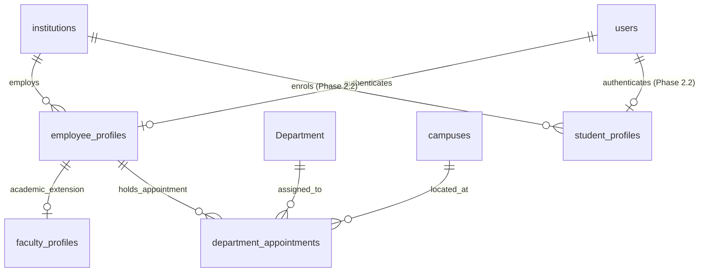
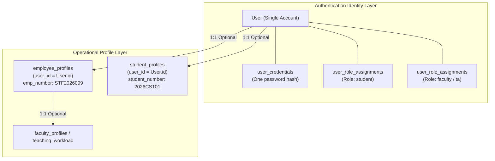

# CampusOne ERP — Phase 2: P2.1 Employee and Faculty Profiles Specification

**Document ID:** `CAMPUSONE-SPEC-P2.1`  
**Revision:** v1.0 (Architecture Baseline & Design Specification)  
**Date:** 2026-10-10  
**Status:** 📋 **PLANNING & SPECIFICATION ONLY — NO DATABASE WRITES OR MIGRATION SQL GENERATED**  
**Repository Working Directory:** `C:\Projects\ERP-System`  
**Git Branch Status:** `main...origin/main [ahead 5]` (Clean working tree; 5 unpushed local commits)  
**Live Target Database (Neon):** 🛡️ **100% UNTOUCHED (Zero writes; foundation & security tables preserved)**  

---

## 1. Executive Summary

Work Package **P2.1: Employee and Faculty Profiles** represents the first structural increment of **Phase 2: Student and Faculty Lifecycle**. 

In the existing legacy ERP:
1. Academic faculty are tracked in a single flat table (`"Faculty"`), which conflates baseline employment data, academic rank, leave balances, and departmental assignment.
2. Non-academic institutional personnel (librarians, finance officers, administrative coordinators, management) possess **no profile table whatsoever**; their identity exists solely as an email and a single role string in `"User"`.
3. Departmental affiliation is hard-coded as a single foreign key (`Faculty.departmentId`), making joint appointments, secondary affiliations, or historical leadership transitions impossible without data loss.

This specification establishes a clean, decoupled, forward-only three-tier architecture:
* **`employee_profiles`:** The canonical institutional employment record for all university personnel (faculty and non-academic staff).
* **`faculty_profiles`:** A specialized 1:1 extension table capturing academic designation, qualification, teaching workload, and research specialization.
* **`department_appointments`:** A normalized, historical affiliation entity capturing primary department memberships, joint appointments, and Head of Department (HOD) leadership tenures.

**Boundary Commitment:** This deliverable is strictly an architectural design specification. In adherence to Phase 1 closeout governance, no Prisma schema files are modified, no migration SQL is generated or executed, no seeds are written to live Neon, and no local commits are pushed to GitHub during this step.

---

## 2. Legacy Baseline & Source Data Audit

A physical inspection of the live Neon PostgreSQL database and `backend/prisma/schema.prisma` confirms the following baseline:

### 2.1 Legacy Tables Involved
| Legacy Entity | Physical Table | Live Rows | Primary Key | Key Columns / Relations |
|---|---|---|---|---|
| `Faculty` | `"Faculty"` | 2 | `id String @id @default(uuid())` | `userId`, `employeeCode`, `departmentId`, `designation`, `qualification`, `weeklyWorkloadHours`, `leaveBalance` |
| `Department` | `"Department"` | 1 | `id String @id @default(uuid())` | `code`, `name`, `headOfDepartmentId` (`Faculty.id` FK) |
| `User` | `"User"` | 12 | `id String @id @default(uuid())` | `email`, `role`, `name`, `password` |

### 2.2 Live Data Records Inspected
Direct read-only inspection reveals:
* **Faculty Records (2 rows):**
  1. `id: 9b24f51d-b9ad-4682-9513-3fe3f57900a8` | `employeeCode: FAC2026601` | `designation: Professor` | `deptId: 2ab2ef28-36c6-47ef-b40e-2f977a451379` (`CS101`) | `workload: 0` | `leave: 0`
  2. `id: 603552f4-a8b6-44b5-946d-817c12d25fb1` | `employeeCode: FAC2026488` | `designation: Professor` | `deptId: 2ab2ef28-36c6-47ef-b40e-2f977a451379` (`CS101`) | `workload: 0` | `leave: 0`
* **Department Record (1 row):**
  * `id: 2ab2ef28-36c6-47ef-b40e-2f977a451379` | `code: CS101` | `name: Computer  Science` | `headOfDepartmentId: null`
* **User Accounts by Role (12 rows):**
  * `admin`: 1 user
  * `faculty`: 2 users (linked to the 2 `Faculty` rows above)
  * `student`: 5 users (linked to 5 legacy `Student` rows)
  * `librarian`: 1 user (`51903b28-...`) — **No legacy profile table exists**
  * `finance_officer`: 2 users (`b8172952-...`, `c6421096-...`) — **No legacy profile table exists**
  * `management`: 1 user (`b2678311-...`) — **No legacy profile table exists**

### 2.3 Structural Deficiencies of the Legacy Schema
1. **Single-Role Conflation:** The legacy system assumes that an employee is solely a faculty member. Non-faculty staff cannot store emergency contact details, joining dates, or employment contracts without abusing the `Faculty` table or bloating `User`.
2. **Circular FK Dependency:** `Faculty.departmentId` references `Department.id`, while `Department.headOfDepartmentId` references `Faculty.id`. If a department is established before its HOD is hired, or an HOD resigns, nullability workarounds must be used.
3. **Absence of Employment History:** If a faculty member is promoted from Assistant Professor to Associate Professor, or transfers between departments, the legacy schema overwrites the existing row, destroying the institutional audit trail.

---

## 3. Proposed Domain Architecture

To resolve legacy deficiencies while maintaining 100% backward compatibility, P2.1 introduces three normalized entities.



---

## 4. Entity Technical Specifications

### 4.1 `employee_profiles`

The foundational employment entity for all staff members at the institution.

| Column | Type | Nullable | Default | Description / Constraints |
|---|---|:---:|---|---|
| `id` | `UUID` | No | `gen_random_uuid()` | Primary Key (native PostgreSQL UUID). |
| `user_id` | `TEXT` | No | None | Foreign Key referencing legacy `"User"("id")` `ON DELETE RESTRICT`. |
| `institution_id` | `UUID` | No | None | Foreign Key referencing `"institutions"("id")` `ON DELETE RESTRICT`. |
| `employee_number` | `TEXT` | No | None | Institutional employee ID (e.g., `FAC2026601`, `STF2026001`). |
| `first_name` | `TEXT` | No | None | Legal first name. |
| `last_name` | `TEXT` | No | None | Legal last name. |
| `employment_type` | `TEXT` | No | `'permanent'` | CHECK: `employment_type IN ('permanent', 'contract', 'adjunct', 'visiting', 'probationary', 'temporary')` |
| `employment_status` | `TEXT` | No | `'active'` | CHECK: `employment_status IN ('active', 'on_leave', 'suspended', 'resigned', 'retired', 'terminated')` |
| `joined_on` | `DATE` | No | `CURRENT_DATE` | Date employment commenced. |
| `exited_on` | `DATE` | Yes | `NULL` | Date employment ended (null for active staff). |
| `emergency_contact_phone` | `TEXT` | Yes | `NULL` | Emergency phone number. |
| `created_at` | `TIMESTAMPTZ` | No | `CURRENT_TIMESTAMP` | Audit creation timestamp. |
| `updated_at` | `TIMESTAMPTZ` | No | `CURRENT_TIMESTAMP` | Audit update timestamp. |
| `deleted_at` | `TIMESTAMPTZ` | Yes | `NULL` | Soft-delete timestamp (Policy 11). |

#### Indexes & Table Constraints:
* `CONSTRAINT "employee_profiles_pkey" PRIMARY KEY ("id")`
* `CONSTRAINT "employee_profiles_user_id_key" UNIQUE ("user_id")` — Ensures a user account maps to at most one employee profile.
* `CONSTRAINT "employee_profiles_inst_emp_no_key" UNIQUE ("institution_id", "employee_number")` — Guarantees employee number uniqueness within an institution.
* `CONSTRAINT "employee_profiles_dates_check" CHECK ("exited_on" IS NULL OR "joined_on" <= "exited_on")` — Guarantees chronological consistency.
* `CREATE INDEX "employee_profiles_institution_id_idx" ON "employee_profiles"("institution_id");`
* `CREATE INDEX "employee_profiles_status_idx" ON "employee_profiles"("employment_status");`
* `CREATE INDEX "employee_profiles_type_idx" ON "employee_profiles"("employment_type");`

---

### 4.2 `faculty_profiles`

Academic specialization extension. Exactly 1:1 with an `employee_profiles` row for teaching and research personnel.

| Column | Type | Nullable | Default | Description / Constraints |
|---|---|:---:|---|---|
| `id` | `UUID` | No | `gen_random_uuid()` | Primary Key (native PostgreSQL UUID). |
| `employee_profile_id` | `UUID` | No | None | Foreign Key referencing `"employee_profiles"("id")` `ON DELETE RESTRICT`. |
| `designation` | `TEXT` | No | None | Academic rank (e.g. `'Professor'`, `'Associate Professor'`, `'Assistant Professor'`, `'Lecturer'`). |
| `qualification` | `TEXT` | Yes | `NULL` | Highest academic degree attained (e.g. `'Ph.D. in Computer Science'`). |
| `specialization` | `TEXT` | Yes | `NULL` | Research or teaching domain (e.g. `'Artificial Intelligence'`). |
| `weekly_workload_hours` | `NUMERIC(4, 1)` | No | `0.0` | Assigned weekly teaching/contact hours. Must be `>= 0.0`. |
| `leave_balance` | `NUMERIC(4, 1)` | No | `0.0` | Accrued paid leave days. Must be `>= 0.0`. |
| `created_at` | `TIMESTAMPTZ` | No | `CURRENT_TIMESTAMP` | Audit creation timestamp. |
| `updated_at` | `TIMESTAMPTZ` | No | `CURRENT_TIMESTAMP` | Audit update timestamp. |

#### Indexes & Table Constraints:
* `CONSTRAINT "faculty_profiles_pkey" PRIMARY KEY ("id")`
* `CONSTRAINT "faculty_profiles_employee_profile_id_key" UNIQUE ("employee_profile_id")` — Enforces strict 1:1 extension cardinality.
* `CONSTRAINT "faculty_profiles_workload_check" CHECK ("weekly_workload_hours" >= 0.0)`
* `CONSTRAINT "faculty_profiles_leave_check" CHECK ("leave_balance" >= 0.0)`
* `CREATE INDEX "faculty_profiles_designation_idx" ON "faculty_profiles"("designation");`

---

### 4.3 `department_appointments`

Tracks departmental affiliations, joint appointments, and academic leadership assignments over time.

| Column | Type | Nullable | Default | Description / Constraints |
|---|---|:---:|---|---|
| `id` | `UUID` | No | `gen_random_uuid()` | Primary Key (native PostgreSQL UUID). |
| `employee_profile_id` | `UUID` | No | None | Foreign Key referencing `"employee_profiles"("id")` `ON DELETE RESTRICT`. |
| `department_id` | `TEXT` | No | None | Foreign Key referencing legacy `"Department"("id")` `ON DELETE RESTRICT`. |
| `campus_id` | `UUID` | No | None | Foreign Key referencing `"campuses"("id")` `ON DELETE RESTRICT`. |
| `appointment_role` | `TEXT` | No | `'primary_member'` | CHECK: `appointment_role IN ('primary_member', 'joint_member', 'head_of_department', 'dean', 'coordinator')` |
| `starts_on` | `DATE` | No | `CURRENT_DATE` | Date appointment commenced. |
| `ends_on` | `DATE` | Yes | `NULL` | Date appointment concluded. |
| `is_active` | `BOOLEAN` | No | `true` | Active status flag. |
| `created_at` | `TIMESTAMPTZ` | No | `CURRENT_TIMESTAMP` | Audit creation timestamp. |
| `updated_at` | `TIMESTAMPTZ` | No | `CURRENT_TIMESTAMP` | Audit update timestamp. |

#### Indexes & Table Constraints:
* `CONSTRAINT "department_appointments_pkey" PRIMARY KEY ("id")`
* `CONSTRAINT "department_appointments_dates_check" CHECK ("ends_on" IS NULL OR "starts_on" <= "ends_on")`
* **Single Active HOD per Department (Partial Unique Index):**
  ```sql
  CREATE UNIQUE INDEX "dept_appointments_active_hod_idx"
  ON "department_appointments" ("department_id")
  WHERE "appointment_role" = 'head_of_department' AND "is_active" = true AND "ends_on" IS NULL;
  ```
* **Single Active Primary Appointment per Employee (Partial Unique Index):**
  ```sql
  CREATE UNIQUE INDEX "dept_appointments_active_primary_idx"
  ON "department_appointments" ("employee_profile_id")
  WHERE "appointment_role" = 'primary_member' AND "is_active" = true AND "ends_on" IS NULL;
  ```
* `CREATE INDEX "dept_appointments_employee_idx" ON "department_appointments"("employee_profile_id");`
* `CREATE INDEX "dept_appointments_dept_idx" ON "department_appointments"("department_id");`
* `CREATE INDEX "dept_appointments_campus_idx" ON "department_appointments"("campus_id");`
* `CREATE INDEX "dept_appointments_role_active_idx" ON "department_appointments"("appointment_role", "is_active");`

---

## 5. Architectural Alignment & Safety Considerations

### 5.1 Why `user_id` is Typed as `TEXT` in `employee_profiles`
In PostgreSQL, foreign key constraints require strict type equality between referencing and referenced columns.
* Legacy `"User"("id")"` is typed as `TEXT` (storing UUID strings formatted like `'b3fcb03f-b830-4f94-a843-0d418960bafb'`).
* In Phase 1 Work Package P1.3, all security tables (`user_role_assignments`, `user_credentials`, `auth_sessions`) typed their `user_id` columns as `TEXT REFERENCES "User"("id")`.
* In `employee_profiles`, typing `user_id` as `TEXT REFERENCES "User"("id")` preserves 100% type compatibility, avoids type-casting errors, and maintains the strict Phase 1 invariant of **zero modifications to legacy table DDL**.

### 5.2 Supporting Dual-Role Users (Student + Employee)
A critical requirement of the redesign (Policy 2) is enabling a single person to act as both a student and an employee (e.g., Graduate Teaching Assistants, Research Assistants, or staff members enrolled in degree programs).



* **Decoupled Identity:** The user has exactly one `User` row, one password in `user_credentials`, and one set of session tokens.
* **Independent Profiles:** `employee_profiles.user_id` and `student_profiles.user_id` are each declared `UNIQUE`. They can both point to the **same** `User.id` simultaneously without constraint collision.
* **Contextual Authorization:**
  * When submitting coursework or viewing tuition invoices, the application evaluates the user's `student_profiles` context.
  * When grading examinations or logging departmental leave, the application evaluates the user's `employee_profiles` / `faculty_profiles` context.
  * Session state in `auth_sessions` or JWT payload carries an optional `active_profile_context` (`'student'` vs `'employee'`).

### 5.3 Head of Department (HOD) Alignment Rule (Correction 4D)
In accordance with `docs/REDESIGN-IMPLEMENTATION-PLAN.md` (lines 349–351):
> *"Enforce that the appointed faculty's primary_department_id matches the appointment's department_id, unless policy explicitly allows cross-department HOD appointments."*

* **Technical Enforcement Limitation:** In standard PostgreSQL, table-level `CHECK` constraints cannot execute subqueries or inspect other rows/tables. Therefore, verifying that an employee holds an active `primary_member` appointment in the department where they are appointed HOD cannot be achieved via a declarative `CHECK` constraint.
* **Enforcement Strategy:**
  1. **Database Trigger Mechanism (Strict Database-Level Guard):**
     A PostgreSQL trigger function `trg_enforce_hod_primary_membership()` will be executed `BEFORE INSERT OR UPDATE ON "department_appointments" FOR EACH ROW`.
     ```sql
     CREATE OR REPLACE FUNCTION trg_enforce_hod_primary_membership()
     RETURNS TRIGGER AS $$
     BEGIN
       IF NEW.appointment_role = 'head_of_department' AND NEW.is_active = true THEN
         IF NOT EXISTS (
           SELECT 1 FROM "department_appointments"
           WHERE employee_profile_id = NEW.employee_profile_id
             AND department_id = NEW.department_id
             AND appointment_role = 'primary_member'
             AND is_active = true
             AND (ends_on IS NULL OR ends_on >= CURRENT_DATE)
         ) THEN
           RAISE EXCEPTION 'HOD Appointment Violation: Employee % must hold an active primary appointment in Department % prior to HOD appointment.',
             NEW.employee_profile_id, NEW.department_id;
         END IF;
       END IF;
       RETURN NEW;
     END;
     $$ LANGUAGE plpgsql;
     ```
  2. **Service-Layer Transactional Validation:** The application's service layer will enforce this rule atomically within the assignment transaction before committing DML.
  3. **Backfill Sequence:** In migration and rehearsal backfill scripts, the `primary_member` appointment is created and inserted *prior* to any HOD appointment record for the same employee.

### 5.4 Department Identifier Compatibility & Circular Relationship Preservation
* **Identifier Compatibility:** `department_appointments.department_id` is explicitly typed as `TEXT` referencing `"Department"("id")`. This preserves exact foreign-key type matching with the legacy schema without requiring type-casting or DDL modifications to legacy `"Department"`.
* **Legacy Circular Relationship Invariant:** Legacy `"Department"("headOfDepartmentId")"` and `"Faculty"("departmentId")"` will remain physically untouched and fully active in the live schema. Dual-write operations in Phase 2.5 will synchronize appointments without dropping or rewriting legacy foreign keys.

### 5.5 Employee-Number Lifecycle & Retention Policy
* **Institutional Uniqueness:** `employee_number` is globally unique within an institution (`UNIQUE ("institution_id", "employee_number")`).
* **Non-Recycling Invariant:** Employee identifiers are permanent institutional attributes. When an employee exits (`employment_status IN ('resigned', 'retired', 'terminated')`), their `employee_number` is retained permanently and is never recycled or reassigned to another individual.
* **Soft Deletes:** Deleting an employee profile via `deleted_at` retains the unique constraint, preventing historical identity conflicts.

### 5.6 Historical Data Provenance Classification
* **Joining Date Heuristic:** In the backfill mapping, `joined_on` and `starts_on` are derived from `Faculty.createdAt::date`.
* **Provenance Classification:** Sourced timestamps from legacy row creation are explicitly classified as `confidence: 'inferred'` heuristics rather than verified physical employment contract dates. This mirrors the `_term_date_map` provenance standard established in Phase 1.

---

## 6. Legacy-to-Canonical Data Migration & Mapping Strategy

### 6.1 Deterministic Identity Preservation via `_id_map`
To ensure zero UUID regeneration on repeated runs, all Phase 2 primary keys will be generated deterministically:
* **Namespace:** Standard project DNS namespace (`6ba7b810-9dad-11d1-80b4-00c04fd430c8`).
* **Generation Seed:**
  * `employee_profiles`: `uuidv5(NAMESPACE, 'employee_profiles:' + legacyFaculty.id)`
  * `faculty_profiles`: `uuidv5(NAMESPACE, 'faculty_profiles:' + legacyFaculty.id)`
  * `department_appointments`: `uuidv5(NAMESPACE, 'department_appointments:primary:' + legacyFaculty.id + ':' + legacyFaculty.departmentId)`
* **Recording in `_id_map`:**
  * `_id_map` record: `table_name = 'Faculty'`, `old_id = legacyFaculty.id`, `new_id = employeeProfileId`.

### 6.2 Legacy Field Mapping Transformations
For each row in `"Faculty"`:

| Canonical Target Field | Source Value / Heuristic | Rationale & Evidence |
|---|---|---|
| `employee_profiles.user_id` | `Faculty.userId` | Byte-for-byte link to existing `User` account. |
| `employee_profiles.institution_id` | Resolved from `institutions.code = 'CAMPUSONE'` | Root institution ID seeded in P1.4. |
| `employee_profiles.employee_number` | `Faculty.employeeCode` | Preserves verified natural key (e.g. `FAC2026601`). |
| `employee_profiles.first_name` | Parsed from `User.name` (Token 1) | Legacy `User.name` stores full name (e.g. `"Dr. Alan Turing"` $\to$ First: `"Dr. Alan"`, Last: `"Turing"`). |
| `employee_profiles.last_name` | Parsed from `User.name` (Remaining tokens) | If single name, `last_name` defaults to `'.'` per institutional convention. |
| `employee_profiles.employment_type` | `'permanent'` | Standard full-time baseline for legacy faculty. |
| `employee_profiles.employment_status` | `'active'` | Both live faculty rows are active in current semester. |
| `employee_profiles.joined_on` | `Faculty.createdAt::date` | Historical timestamp of legacy creation. |
| `faculty_profiles.designation` | `Faculty.designation` | Preserved directly (e.g. `'Professor'`). |
| `faculty_profiles.qualification` | `Faculty.qualification` | Preserved directly (`null` if empty). |
| `faculty_profiles.weekly_workload_hours`| `Faculty.weeklyWorkloadHours` | Live rows have `0.0`; preserved directly. |
| `faculty_profiles.leave_balance` | `Faculty.leaveBalance` | Live rows have `0.0`; preserved directly. |
| `department_appointments.dept_id`| `Faculty.departmentId` | Maps to legacy `Department.id` (`CS101`). |
| `department_appointments.campus_id`| Resolved from `campuses.code = 'MAIN'` | Main campus seeded in P1.4. |
| `department_appointments.role` | `'primary_member'` | Baseline primary departmental membership. |
| `department_appointments.starts_on`| `Faculty.createdAt::date` | Start date matches faculty creation. |

### 6.3 Handling Legacy Department HOD Backfill
For each row in `"Department"`:
* If `headOfDepartmentId IS NOT NULL`:
  1. Lookup the corresponding `employee_profiles.id` via `_id_map(table_name='Faculty', old_id=headOfDepartmentId)`.
  2. Insert a second row into `department_appointments`:
     * `appointment_role = 'head_of_department'`
     * `department_id = Department.id`
     * `campus_id = MAIN_CAMPUS_ID`
     * `starts_on = Department.createdAt::date`
     * `is_active = true`
* *Current live state:* `Department.headOfDepartmentId` is `null`. The backfill logic will gracefully handle 0 HOD rows without error.

---

## 7. Draft DDL Specification (For Review Only)

The following SQL represents the proposed forward-only schema for P2.1. **It will not be applied until Phase 2 architecture is approved.**

```sql
-- ==============================================================================
-- DRAFT PROPOSAL: Phase 2 Work Package P2.1 (Employee & Faculty Profiles)
-- DO NOT EXECUTE DIRECTLY - PENDING STAKEHOLDER APPROVAL
-- ==============================================================================

-- 1. Table: employee_profiles
CREATE TABLE "employee_profiles" (
    "id" UUID NOT NULL DEFAULT gen_random_uuid(),
    "user_id" TEXT NOT NULL,
    "institution_id" UUID NOT NULL,
    "employee_number" TEXT NOT NULL,
    "first_name" TEXT NOT NULL,
    "last_name" TEXT NOT NULL,
    "employment_type" TEXT NOT NULL DEFAULT 'permanent',
    "employment_status" TEXT NOT NULL DEFAULT 'active',
    "joined_on" DATE NOT NULL DEFAULT CURRENT_DATE,
    "exited_on" DATE,
    "emergency_contact_phone" TEXT,
    "created_at" TIMESTAMPTZ NOT NULL DEFAULT CURRENT_TIMESTAMP,
    "updated_at" TIMESTAMPTZ NOT NULL DEFAULT CURRENT_TIMESTAMP,
    "deleted_at" TIMESTAMPTZ,

    CONSTRAINT "employee_profiles_pkey" PRIMARY KEY ("id"),
    CONSTRAINT "employee_profiles_user_id_key" UNIQUE ("user_id"),
    CONSTRAINT "employee_profiles_inst_emp_no_key" UNIQUE ("institution_id", "employee_number"),
    CONSTRAINT "employee_profiles_dates_check" CHECK ("exited_on" IS NULL OR "joined_on" <= "exited_on"),
    CONSTRAINT "employee_profiles_type_check" CHECK (
        "employment_type" IN ('permanent', 'contract', 'adjunct', 'visiting', 'probationary', 'temporary')
    ),
    CONSTRAINT "employee_profiles_status_check" CHECK (
        "employment_status" IN ('active', 'on_leave', 'suspended', 'resigned', 'retired', 'terminated')
    )
);

-- 2. Table: faculty_profiles
CREATE TABLE "faculty_profiles" (
    "id" UUID NOT NULL DEFAULT gen_random_uuid(),
    "employee_profile_id" UUID NOT NULL,
    "designation" TEXT NOT NULL,
    "qualification" TEXT,
    "specialization" TEXT,
    "weekly_workload_hours" NUMERIC(4, 1) NOT NULL DEFAULT 0.0,
    "leave_balance" NUMERIC(4, 1) NOT NULL DEFAULT 0.0,
    "created_at" TIMESTAMPTZ NOT NULL DEFAULT CURRENT_TIMESTAMP,
    "updated_at" TIMESTAMPTZ NOT NULL DEFAULT CURRENT_TIMESTAMP,

    CONSTRAINT "faculty_profiles_pkey" PRIMARY KEY ("id"),
    CONSTRAINT "faculty_profiles_employee_profile_id_key" UNIQUE ("employee_profile_id"),
    CONSTRAINT "faculty_profiles_workload_check" CHECK ("weekly_workload_hours" >= 0.0),
    CONSTRAINT "faculty_profiles_leave_check" CHECK ("leave_balance" >= 0.0)
);

-- 3. Table: department_appointments
CREATE TABLE "department_appointments" (
    "id" UUID NOT NULL DEFAULT gen_random_uuid(),
    "employee_profile_id" UUID NOT NULL,
    "department_id" TEXT NOT NULL,
    "campus_id" UUID NOT NULL,
    "appointment_role" TEXT NOT NULL DEFAULT 'primary_member',
    "starts_on" DATE NOT NULL DEFAULT CURRENT_DATE,
    "ends_on" DATE,
    "is_active" BOOLEAN NOT NULL DEFAULT true,
    "created_at" TIMESTAMPTZ NOT NULL DEFAULT CURRENT_TIMESTAMP,
    "updated_at" TIMESTAMPTZ NOT NULL DEFAULT CURRENT_TIMESTAMP,

    CONSTRAINT "department_appointments_pkey" PRIMARY KEY ("id"),
    CONSTRAINT "department_appointments_dates_check" CHECK ("ends_on" IS NULL OR "starts_on" <= "ends_on"),
    CONSTRAINT "department_appointments_role_check" CHECK (
        "appointment_role" IN ('primary_member', 'joint_member', 'head_of_department', 'dean', 'coordinator')
    )
);

-- 4. Foreign Key Constraints
ALTER TABLE "employee_profiles" ADD CONSTRAINT "employee_profiles_user_id_fkey"
    FOREIGN KEY ("user_id") REFERENCES "User"("id") ON DELETE RESTRICT ON UPDATE CASCADE;

ALTER TABLE "employee_profiles" ADD CONSTRAINT "employee_profiles_institution_id_fkey"
    FOREIGN KEY ("institution_id") REFERENCES "institutions"("id") ON DELETE RESTRICT ON UPDATE CASCADE;

ALTER TABLE "faculty_profiles" ADD CONSTRAINT "faculty_profiles_employee_profile_id_fkey"
    FOREIGN KEY ("employee_profile_id") REFERENCES "employee_profiles"("id") ON DELETE RESTRICT ON UPDATE CASCADE;

ALTER TABLE "department_appointments" ADD CONSTRAINT "department_appointments_employee_profile_id_fkey"
    FOREIGN KEY ("employee_profile_id") REFERENCES "employee_profiles"("id") ON DELETE RESTRICT ON UPDATE CASCADE;

ALTER TABLE "department_appointments" ADD CONSTRAINT "department_appointments_department_id_fkey"
    FOREIGN KEY ("department_id") REFERENCES "Department"("id") ON DELETE RESTRICT ON UPDATE CASCADE;

ALTER TABLE "department_appointments" ADD CONSTRAINT "department_appointments_campus_id_fkey"
    FOREIGN KEY ("campus_id") REFERENCES "campuses"("id") ON DELETE RESTRICT ON UPDATE CASCADE;

-- 5. Performance and Unique Partial Indexes
CREATE INDEX "employee_profiles_institution_id_idx" ON "employee_profiles"("institution_id");
CREATE INDEX "employee_profiles_status_idx" ON "employee_profiles"("employment_status");
CREATE INDEX "faculty_profiles_designation_idx" ON "faculty_profiles"("designation");

CREATE INDEX "dept_appointments_employee_idx" ON "department_appointments"("employee_profile_id");
CREATE INDEX "dept_appointments_dept_idx" ON "department_appointments"("department_id");
CREATE INDEX "dept_appointments_campus_idx" ON "department_appointments"("campus_id");

-- Ensure exactly 1 active HOD per department
CREATE UNIQUE INDEX "dept_appointments_active_hod_idx"
ON "department_appointments" ("department_id")
WHERE "appointment_role" = 'head_of_department' AND "is_active" = true AND "ends_on" IS NULL;

-- Ensure an employee has at most 1 active primary appointment
CREATE UNIQUE INDEX "dept_appointments_active_primary_idx"
ON "department_appointments" ("employee_profile_id")
WHERE "appointment_role" = 'primary_member' AND "is_active" = true AND "ends_on" IS NULL;
```

---

## 8. Rehearsal, Validation & Acceptance Gates

Before P2.1 can be approved for live Neon deployment, it must pass a comprehensive rehearsal in a disposable test schema (`p2_1_disposable_validation`):

### 8.1 Acceptance Criteria
| Gate | Verification Check | Expected Result |
|---|---|---|
| **Gate 1: Migration Atomicity** | Execute DDL in fresh schema. | All 3 tables and 7 indexes create without error. |
| **Gate 2: Legacy Preservation** | SHA-256 fingerprint comparison of all 22 legacy tables before and after backfill. | **100% byte-for-byte identical**. Zero rows added, removed, or mutated in legacy tables. |
| **Gate 3: Backfill Completeness** | Map 2 legacy `Faculty` rows. | Exactly 2 `employee_profiles`, 2 `faculty_profiles`, and 2 `department_appointments` created. |
| **Gate 4: Idempotency** | Execute backfill script a second time. | Exactly **0 inserts**, 0 updates, 0 duplicate mappings. |
| **Gate 5: Negative Constraint Tests** | Attempt invalid data insertions: | All rejected with expected PostgreSQL constraint violation: |
| | a) Duplicate `employee_number` | ❌ Rejected by `employee_profiles_inst_emp_no_key`. |
| | b) Two active HODs in same department | ❌ Rejected by `dept_appointments_active_hod_idx`. |
| | c) Inverted dates (`exited_on < joined_on`) | ❌ Rejected by `employee_profiles_dates_check`. |
| | d) Negative workload (`-5.0`) | ❌ Rejected by `faculty_profiles_workload_check`. |
| | e) Non-existent department ID | ❌ Rejected by `department_appointments_department_id_fkey`. |
| **Gate 6: Transactional Rollback** | Inject artificial error midway through batch backfill. | Entire transaction rolls back; schema leaves **0 orphan rows**. |

---

## 9. Dependencies & Implementation Checklist

### 9.1 Prerequisites
- [x] Phase 0 baseline snapshot committed.
- [x] P1.1 / P1.2 foundation migration deployed to Neon (`202610100001_p1_foundation_schema`).
- [x] P1.3 identity/security migration deployed to Neon (`202610100002_p1_identity_security`).
- [x] P1.4 master-data seed rehearsed and verified (live seeding on hold).
- [x] P1.5 closeout and Phase 2 roadmap committed (`60f4063`).

### 9.2 Outstanding Authorizations Required Before Coding P2.1
- [ ] **Stakeholder Approval:** Endorsement of the three-tier (`employee_profiles` $\to$ `faculty_profiles` $\to$ `department_appointments`) architecture.
- [ ] **Neon Master Data:** Confirmation of whether Gate D (live master data seed) should run before or in parallel with Phase 2 migrations.
- [ ] **Dual-Role Authorization:** Confirmation of user context-switching workflow in frontend session state.

---

## 10. Summary & Next Steps

Work Package P2.1 provides the architectural foundation for university personnel without breaking any running authentication or legacy faculty queries.

1. **Document Created:** [`docs/P2.1-EMPLOYEE-AND-FACULTY-PROFILES-SPECIFICATION.md`](file:///c:/Projects/ERP-System/docs/P2.1-EMPLOYEE-AND-FACULTY-PROFILES-SPECIFICATION.md)
2. **Current Database State:** Unchanged; 0 writes performed.
3. **Current Commit Status:** 5 commits ahead of `origin/main`; working tree clean except for this specification.
4. **Next Step:** Review specification details with project stakeholders before proceeding to P2.2 (Student Profiles and Admissions Architecture) or creating the P2.1 rehearsal script.
