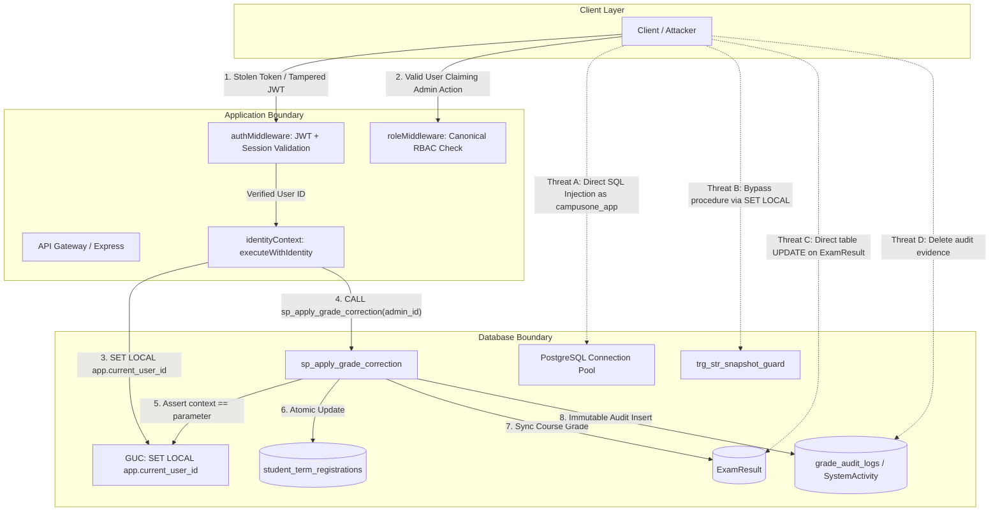

# CampusOne ERP — Work Package P2.10: Trusted Database Identity Propagation, Stored Procedures, and Grade-Correction Authorization

**Document ID:** `CAMPUSONE-PLAN-P2.10`  
**Revision:** v1.0 (Comprehensive Implementation & Security Plan)  
**Date:** October 15, 2026  
**Status:** 📋 **PLANNING ONLY — STRICTLY NO SCHEMA MODIFICATIONS OR PRODUCTION DEPLOYMENTS**  
**Classification:** Internal Institutional Security Architecture Specification  
**Target Environments:** Disposable PostgreSQL 17 on `127.0.0.1:5433` (Database: `postgres`, Schema: `public`), Node.js Express Backend (`backend/src/`), Prisma ORM (`@prisma/client` + `@prisma/adapter-pg`)  
**Production Target (Neon `ep-green-pine-azr0z3ii`):** 🛡️ **100% UNTOUCHED (Zero queries, zero writes, deployment strictly blocked)**  
**Remote Git Status:** **ZERO PUSHES (Branch `main` remains 12 commits ahead of `origin/main`; working tree uncommitted locally)**  

---

## 1. Executive Summary

Work Package **P2.10** is the critical security bridge connecting server-side authenticated identity to database-enforced academic integrity. Following the successful security-hardening audit of Work Package P2.9 (which validated stateful sessions, brute-force resistance, and live database RBAC across 92 passing assertions), P2.10 establishes a trustworthy, auditable, and tamper-resistant path from the authenticated HTTP actor to protected PostgreSQL operations—specifically **academic grade corrections**.

### The Core Problem
Under the existing prototype implementation in migration `202610100003_p2_student_faculty_lifecycle`:
1. The stored procedure `sp_apply_grade_correction` accepts `p_modifying_user_id TEXT` as an input parameter and checks whether that user possesses the `'admin'` role in `user_role_assignments`. However, the procedure **does not verify that the caller is actually that user**. Any database client or application service capable of executing the procedure could pass an arbitrary administrator's UUID, spoofing the modifier.
2. The trigger `trg_str_snapshot_guard` prevents direct modifications to completed `student_term_registrations` rows unless `current_setting('app.authorized_grade_correction', true) = 'true'`. An attacker capable of issuing arbitrary SQL can set this local session GUC directly (`SET LOCAL app.authorized_grade_correction = 'true'`) and bypass the stored procedure entirely.
3. Individual course exam marks in `ExamResult` have direct `UPDATE` privileges granted to `campusone_app` without trigger protection, while term-level summaries in `student_term_registrations` are protected, creating an architectural disconnect.
4. Audit records are written to a legacy table `SystemActivity` as loose JSON strings with no relational foreign keys, no column-level immutability, and no write restrictions preventing `campusone_app` from executing `DELETE FROM "SystemActivity"`.

### Objectives of P2.10
* **Establish a Multi-Layered Trust Boundary:** Explicitly separate caller HTTP authentication, operational authorization, transaction-local identity scoping, database-level procedure verification, and immutable durable audit.
* **Harden `sp_apply_grade_correction`:** Enforce identity authenticity inside PL/pgSQL by cross-checking `p_modifying_user_id` against `current_setting('app.current_user_id', true)` (populated via verified server-side middleware in `identityContext.executeWithIdentity`).
* **Enforce Database Privilege Separation:** Revoke direct `UPDATE` privileges from `campusone_app` on academic result entities, enforce `SECURITY DEFINER` with fixed `search_path = pg_catalog, public`, and restrict procedure execution exclusively to designated roles.
* **Synchronize Course Grades & Term GPAs:** Ensure that course-level corrections in `ExamResult` and term-level GPA/CGPA adjustments in `student_term_registrations` occur atomically.
* **Provide Durable, Tamper-Resistant Auditing:** Introduce an immutable, append-only grade audit trail that captures pre- and post-correction states, memo references, actor identity, and request correlation IDs.
* **Prepare Repeatable Disposable Verification:** Design a 15-scenario security test matrix covering identity spoofing, unprivileged database execution, invalid grade transitions, and failure rollbacks against disposable PostgreSQL on port 5433.

---

## 2. Current-State Findings & Architecture Audit

A physical inspection of the codebase, schema, and live disposable database on port 5433 revealed the following architectural facts:

### 2.1 Examination and Result Data Structures
* **`ExamResult` (`backend/prisma/schema.prisma:379`):** Represents course-level scores (`studentId`, `courseId`, `examinationId`, `internalScore Float?`, `endSemScore Float?`, `totalScore Float`, `grade String`). It has a composite unique constraint `@@unique([studentId, courseId, examinationId])`.
* **`StudentTermRegistration` (`backend/prisma/schema.prisma:1093`):** Represents semester-level academic standing (`programEnrollmentId`, `academicTermId`, `semesterNumber`, `registrationStatus`, `termGpa Decimal?`, `cumulativeCgpa Decimal?`, `creditsAttempted Decimal`, `creditsEarned Decimal`).
* **Disconnect:** In `examinationController.ts`, faculty submit initial marks via `submitExamResults` using `prisma.examResult.createMany`. There is currently **no application endpoint for grade corrections**. If a grade change is required post-publication, there is no controller route, no validation pipeline, and no link between `ExamResult` and `sp_apply_grade_correction`.

### 2.2 Stored Procedure Prototype (`202610100003_p2_student_faculty_lifecycle`)
The existing procedure `sp_apply_grade_correction` has the signature:
```sql
CREATE OR REPLACE PROCEDURE sp_apply_grade_correction(
    p_registration_id UUID,
    p_modifying_user_id TEXT,
    p_new_term_gpa NUMERIC(4, 2),
    p_new_cumulative_cgpa NUMERIC(4, 2),
    p_new_credits_earned NUMERIC(4, 1),
    p_reason TEXT,
    p_memo_reference TEXT
)
```
* **Critical Finding 1 (Identity Spoofing):** Lines 504–517 query `user_role_assignments` using `p_modifying_user_id`. The procedure never inspects the session environment or transaction settings. An unprivileged caller who can invoke the procedure can pass an administrator's user ID as `p_modifying_user_id` and succeed.
* **Critical Finding 2 (Trigger Bypass):** Line 542 sets `SET LOCAL app.authorized_grade_correction = 'true'`, which satisfies trigger `trg_str_snapshot_guard`. Any SQL client with `UPDATE` privilege on `student_term_registrations` can execute `SET LOCAL app.authorized_grade_correction = 'true'` directly and bypass the stored procedure.
* **Critical Finding 3 (Scope Omission):** The procedure updates `student_term_registrations` (GPA, CGPA, credits) but does **not** update or validate the underlying course `ExamResult` records.
* **Critical Finding 4 (Audit Destination):** Lines 554–572 insert an audit record into `"SystemActivity"` as a JSON string in `description`. `SystemActivity` is a general application log table with no referential constraints and no deletion prevention.

### 2.3 Live Database Role & Privilege Configuration
Inspection of disposable PostgreSQL 17 on `127.0.0.1:5433` revealed:
* Active roles: `postgres` (superuser, used for migrations and tests) and `campusone_app` (`rolsuper = false`, `rolcanlogin = true`).
* Privileges for `campusone_app`:
  - `student_term_registrations`: `INSERT`, `SELECT`, `DELETE` granted; `UPDATE` revoked at table level, but column-level `UPDATE ("notes", "section")` granted.
  - `ExamResult`: `SELECT`, `INSERT`, `UPDATE`, `DELETE` fully granted.
  - `SystemActivity`: `SELECT`, `INSERT`, `UPDATE`, `DELETE` fully granted.
  - `sp_apply_grade_correction`: `EXECUTE` granted.
* **Vulnerability:** While table-level `UPDATE` on `student_term_registrations` is revoked, `campusone_app` can modify `ExamResult` directly without restrictions and can modify or delete `SystemActivity` records.

### 2.4 Application Identity Context Manager (`identityContext.ts`)
Work Package P2.9 implemented `executeWithIdentity(userId, callback)`:
```typescript
export async function executeWithIdentity<T>(
  userId: string,
  callback: (tx: Prisma.TransactionClient) => Promise<T>
): Promise<T> {
  return await prisma.$transaction(async (tx) => {
    await tx.$executeRaw`SELECT set_config('app.current_user_id', ${userId}, true);`;
    return await callback(tx);
  });
}
```
* Verified Property: Successfully isolates `app.current_user_id` inside the interactive transaction and wipes it upon `COMMIT` or `ROLLBACK` (asserted in P2.9 Suite 7 across 10 concurrent pool connections).
* Boundary Reality: `set_config('app.current_user_id', ...)` provides transaction scoping in PostgreSQL. It is **not** independent cryptographic proof of caller authenticity if the database connection itself is compromised.

---

## 3. Threat Model

The threat model evaluates potential attacks against the grade correction and identity propagation pipeline:



### Threat Breakdown & Mitigations

| Threat ID | Threat Vector | Impact | Baseline Vulnerability | P2.10 Mitigation Strategy |
| :--- | :--- | :--- | :--- | :--- |
| **THREAT-1** | **Identity Parameter Spoofing** | Attacker invokes procedure passing an administrator's UUID as `p_modifying_user_id`. | Procedure accepts parameter without verifying caller context. | Procedure asserts `current_setting('app.current_user_id') = p_modifying_user_id`. Rejects mismatches with `insufficient_privilege`. |
| **THREAT-2** | **Compromised App DB Role (SQL Injection)** | Attacker gains arbitrary SQL execution as `campusone_app` and calls procedure or modifies tables directly. | `campusone_app` has `UPDATE` on `ExamResult` and can call `set_config`. | Revoke direct `UPDATE` on `ExamResult` and `student_term_registrations`. Procedure checks canonical role in `user_role_assignments`. A compromised DB role cannot elevate an unprivileged user without modifying role tables (which are also restricted). |
| **THREAT-3** | **Trigger Guardrail Bypass** | Attacker runs `SET LOCAL app.authorized_grade_correction = 'true'` and executes direct `UPDATE`. | Trigger relies on a simple public GUC string. | Revoke table `UPDATE` privileges from `campusone_app`. Direct updates fail at the PostgreSQL permission check before triggers even fire. |
| **THREAT-4** | **Course vs. Term Desynchronization** | Attacker modifies `ExamResult` without updating term GPA, or updates term GPA without modifying course grades. | No synchronization logic exists between the two entities. | Extend stored procedure to accept both `p_registration_id` and `p_exam_result_id`, updating both entities atomically within the same transaction. |
| **THREAT-5** | **Audit Tampering & Erasure** | Attacker deletes audit records in `SystemActivity` to conceal illicit changes. | `campusone_app` has `DELETE` and `UPDATE` on `SystemActivity`. | Revoke `UPDATE` and `DELETE` on audit tables from `campusone_app`. Enforce append-only permissions (`GRANT INSERT, SELECT`). |
| **THREAT-6** | **Out-of-Scope / Invalid Grade Changes** | User applies GPA > 10.0, credits > attempted, or changes grades for uncompleted terms. | Incomplete input bounds checking. | Enforce strict numeric range checks (`0.00` to `10.00`), check registration status = `'completed'`, and enforce memo reference and reason lengths. |
| **THREAT-7** | **Connection-Pool Identity Pollution** | GUC `app.current_user_id` leaks into subsequent requests on a reused physical connection. | Shared connection in `pg.Pool`. | Enforced `is_local = true` in `set_config`. PostgreSQL clears local GUCs automatically on transaction commit/abort. Validated in P2.9 Suite 7. |

---

## 4. Trust Boundary & Identity-Propagation Options

### 4.1 The Five-Tier Trust Architecture

To prevent architectural confusion, P2.10 formally defines the five layers of the grade-correction trust boundary:

1. **Tier 1: Caller Authentication (API Gateway / Middleware)**
   - *Location:* Node.js Express server (`authenticateJWT`).
   - *Responsibility:* Validates cryptographic JWT signature, asserts token expiration, checks active state in `auth_sessions`, and confirms account is not locked in `user_credentials`.
   - *Outcome:* Establishes trusted server-side identity: `req.user.id` and `req.user.sessionId`.
2. **Tier 2: Operational Authorization (Application RBAC)**
   - *Location:* Node.js Express middleware (`authorizeRoles`).
   - *Responsibility:* Queries `user_role_assignments` live against PostgreSQL via `roleService.checkUserHasRole(req.user.id, ['admin'])`.
   - *Outcome:* Proves the authenticated caller currently possesses the administrative role.
3. **Tier 3: Transaction-Local Identity Propagation (Context Manager)**
   - *Location:* Node.js database adapter (`identityContext.executeWithIdentity`).
   - *Responsibility:* Initiates a Prisma interactive transaction (`BEGIN`) and immediately runs:
     `SELECT set_config('app.current_user_id', $userId, true);`
   - *Outcome:* Binds the authenticated user ID strictly to the current PostgreSQL transaction scope (`is_local = true`).
4. **Tier 4: Procedure-Level Security & Database Enforcement (PostgreSQL Engine)**
   - *Location:* PL/pgSQL stored procedure (`sp_apply_grade_correction`).
   - *Responsibility:*
     - Extracts `current_setting('app.current_user_id', true)`.
     - Asserts `context_user_id = p_modifying_user_id` (anti-spoofing).
     - Re-verifies in PostgreSQL that `p_modifying_user_id` possesses active `admin` role in `user_role_assignments`.
     - Enforces domain rules (completed status, credits bounds, GPA bounds).
     - Executes updates on `student_term_registrations` and `ExamResult`.
   - *Outcome:* Atomic, authorized data mutation.
5. **Tier 5: Durable, Tamper-Resistant Audit Trail**
   - *Location:* Dedicated append-only audit entity (`grade_audit_logs` / `SystemActivity`).
   - *Responsibility:* Inserts complete before-and-after snapshot inside the same PL/pgSQL transaction block.
   - *Outcome:* Non-repudiation. If audit insert fails, entire transaction rolls back.

### 4.2 Evaluation of Identity-Propagation Options

| Evaluation Dimension | Option A: Transaction-Local GUC (`app.current_user_id`) | Option B: Database Privilege Separation & Restricted Procedures | Option C: Separate DB Connection Pool per Role (`campusone_grader`) |
| :--- | :--- | :--- | :--- |
| **Description** | App executes `SET LOCAL app.current_user_id` inside Prisma transaction; procedure checks GUC. | Revoke direct table `UPDATE`; procedure runs as `SECURITY DEFINER` with fixed search path. | Dedicated PostgreSQL login role for administrative procedures with distinct DB password. |
| **Identity Authenticity** | Derived from verified server-side authentication; asserted in procedure. | Relies on application layer to supply correct ID. | Identifies application tier; still requires user-level identity parameter. |
| **Spoofing Resistance** | High against HTTP callers; procedure rejects parameter/GUC mismatch. | High when combined with Option A; procedure controls table writes. | High against unauthorized application services; does not solve user spoofing. |
| **Resistance to Compromised DB Role** | Low if attacker can issue arbitrary SQL as `campusone_app` (attacker can run `set_config`). | Medium: `campusone_app` cannot modify tables directly, but can call procedure if user is admin. | High: `campusone_app` cannot execute procedure at all; requires secondary credential. |
| **Auditability** | Excellent: GUC captures exact authenticated user ID. | Excellent: Procedure enforces audit row creation before commit. | Excellent: DB logs record connection from distinct role. |
| **Prisma & Pool Compatibility** | **100% Native:** Interactive transactions natively support GUC scoping via `@prisma/adapter-pg`. | **100% Native:** Stored procedure invocation via `tx.$executeRaw` is fully supported. | **Complex:** Requires secondary Prisma client instance, separate connection pool, double connection overhead. |
| **Operational Overhead** | Low: Standard single-pool connection management. | Low: Standard DDL migrations and grants. | High: Credential rotation, dual pool sizing, connection exhaustion risks in serverless (Neon). |
| **Migration & Rollback** | Clean: Standard forward-only DDL. | Clean: Standard `GRANT`/`REVOKE` statements. | High: Infrastructure-level user creation and secret management in environment. |

### 4.3 Architectural Decision

**Decision: Combine Option A (Transaction-Local GUC Scoping) + Option B (Database Privilege Separation & Procedure Guardrails) as a Defense-in-Depth Architecture.**

*Rationale:*
- Option C introduces excessive operational complexity and connection exhaustion risks on Neon serverless PostgreSQL without solving user-level identity spoofing.
- Option A provides robust identity binding between Express and PostgreSQL, preventing connection-pool contamination and parameter spoofing.
- Option B ensures that even if an application endpoint has a logic bug, direct table updates on academic records are rejected by PostgreSQL permissions, forcing all modifications through the audited procedure.

*Explicit Boundary Disclosure:*
PostgreSQL transaction-local custom settings (`SET LOCAL app.current_user_id = ...`) provide **transaction scoping**, not independent cryptographic proof of caller identity against an attacker who has compromised the application database credentials and can execute arbitrary SQL. Security rests upon the application gateway maintaining authentication integrity.

---

## 5. Grade-Correction Security Contract

### 5.1 Pre-Conditions
Before a grade correction can be processed:
1. **Authentication:** The HTTP request must carry a valid Bearer JWT. `authenticateJWT` must verify token signature, non-expiry, active session in `auth_sessions`, and non-locked account in `user_credentials`.
2. **Authorization:** `authorizeRoles('admin')` must verify that `req.user.id` possesses an active `'admin'` role assignment in `user_role_assignments` whose validity window (`valid_from` to `valid_to`) covers `CURRENT_TIMESTAMP`.
3. **Target Resolution & Locking:**
   - Target student term registration (`p_registration_id`) must exist in `student_term_registrations`.
   - Registration status must be strictly `'completed'`. Grade corrections are prohibited on `'draft'`, `'registered'`, or `'dropped'` registrations.
   - Row must be locked using `SELECT ... FOR UPDATE` to prevent concurrent race conditions.
4. **Course Result Validation (where course grade is amended):**
   - Target course result (`p_exam_result_id`) must exist and belong to the student enrolled in the target registration's program and term.
5. **Business Rule Assertions:**
   - `new_term_gpa`: Must be between `0.00` and `10.00` (inclusive), or `NULL` if unchanged.
   - `new_cumulative_cgpa`: Must be between `0.00` and `10.00` (inclusive), or `NULL` if unchanged.
   - `new_credits_earned`: Must be between `0.0` and `credits_attempted` for the term registration.
   - `p_reason`: Mandatory string, minimum 5 characters, trimmed of whitespace.
   - `p_memo_reference`: Mandatory institutional approval memo string, minimum 3 characters (e.g. `SENATE-RES-2026-042`).
   - `p_modifying_user_id`: Must strictly match `current_setting('app.current_user_id', true)`.

### 5.2 Post-Conditions & Atomicity Guarantees
Upon successful procedure execution:
1. `student_term_registrations` is updated with new GPA, CGPA, and earned credits values.
2. `notes` column has an appended audit trail entry: `Grade corrected at <timestamp> by <user_id> ref <memo>: <reason>`.
3. If `p_exam_result_id` is supplied, `ExamResult` is updated with new scores and letter grade.
4. A durable audit record is inserted into the audit log.
5. All updates and the audit insertion commit **atomically**. If any constraint, assertion, or audit write fails, PostgreSQL rolls back the entire transaction. Zero partial updates are possible.

---

## 6. Stored-Procedure and Database Privilege Design

### 6.1 Hardened Stored Procedure DDL Specification

```sql
-- ==============================================================================
-- Work Package P2.10: Hardened Stored Procedure Specification
-- Procedure: sp_apply_grade_correction
-- ==============================================================================

CREATE OR REPLACE PROCEDURE sp_apply_grade_correction(
    p_registration_id UUID,
    p_modifying_user_id TEXT,
    p_new_term_gpa NUMERIC(4, 2),
    p_new_cumulative_cgpa NUMERIC(4, 2),
    p_new_credits_earned NUMERIC(4, 1),
    p_reason TEXT,
    p_memo_reference TEXT,
    p_exam_result_id TEXT DEFAULT NULL,
    p_new_internal_score NUMERIC(5, 2) DEFAULT NULL,
    p_new_end_sem_score NUMERIC(5, 2) DEFAULT NULL,
    p_new_total_score NUMERIC(5, 2) DEFAULT NULL,
    p_new_grade TEXT DEFAULT NULL
)
LANGUAGE plpgsql
SECURITY DEFINER
SET search_path = pg_catalog, public
AS $$
DECLARE
    v_context_user_id TEXT;
    v_has_admin_role BOOLEAN;
    v_reg RECORD;
    v_exam_res RECORD;
    v_old_term_gpa NUMERIC(4, 2);
    v_old_cgpa NUMERIC(4, 2);
    v_old_credits_earned NUMERIC(4, 1);
    v_old_exam_grade TEXT;
    v_old_exam_total NUMERIC(5, 2);
BEGIN
    -- -------------------------------------------------------------------------
    -- 1. Identity Authenticity & Transaction Context Assertions
    -- -------------------------------------------------------------------------
    IF p_registration_id IS NULL OR p_modifying_user_id IS NULL THEN
        RAISE EXCEPTION 'Grade Correction Rejected: Registration ID and modifying user ID are mandatory.'
            USING ERRCODE = 'null_value_not_allowed';
    END IF;

    -- Extract transaction-local identity established by application server
    BEGIN
        v_context_user_id := current_setting('app.current_user_id', true);
    EXCEPTION WHEN OTHERS THEN
        v_context_user_id := NULL;
    END;

    IF v_context_user_id IS NULL OR v_context_user_id = '' THEN
        RAISE EXCEPTION 'Grade Correction Rejected: Missing database transaction identity context (app.current_user_id).'
            USING ERRCODE = 'insufficient_privilege';
    END IF;

    -- Prevent identity spoofing: parameter must strictly match transaction context
    IF v_context_user_id IS DISTINCT FROM p_modifying_user_id THEN
        RAISE EXCEPTION 'Grade Correction Rejected: Identity mismatch. Context user (%) does not match modifying parameter (%).',
            v_context_user_id, p_modifying_user_id
            USING ERRCODE = 'insufficient_privilege';
    END IF;

    -- -------------------------------------------------------------------------
    -- 2. Input Bounds & Sanity Validation
    -- -------------------------------------------------------------------------
    IF p_reason IS NULL OR length(trim(p_reason)) < 5 THEN
        RAISE EXCEPTION 'Grade Correction Rejected: A valid justification reason of at least 5 characters is required.'
            USING ERRCODE = 'check_violation';
    END IF;

    IF p_memo_reference IS NULL OR length(trim(p_memo_reference)) < 3 THEN
        RAISE EXCEPTION 'Grade Correction Rejected: A valid institutional approval memo reference is required.'
            USING ERRCODE = 'check_violation';
    END IF;

    IF p_new_term_gpa IS NOT NULL AND (p_new_term_gpa < 0.00 OR p_new_term_gpa > 10.00) THEN
        RAISE EXCEPTION 'Grade Correction Rejected: Term GPA must be between 0.00 and 10.00.'
            USING ERRCODE = 'check_violation';
    END IF;

    IF p_new_cumulative_cgpa IS NOT NULL AND (p_new_cumulative_cgpa < 0.00 OR p_new_cumulative_cgpa > 10.00) THEN
        RAISE EXCEPTION 'Grade Correction Rejected: Cumulative CGPA must be between 0.00 and 10.00.'
            USING ERRCODE = 'check_violation';
    END IF;

    -- -------------------------------------------------------------------------
    -- 3. Live Canonical Authorization Check in PostgreSQL
    -- -------------------------------------------------------------------------
    SELECT EXISTS (
        SELECT 1
        FROM "user_role_assignments" ura
        JOIN "roles" r ON ura.role_id = r.id
        WHERE ura.user_id = p_modifying_user_id
          AND ura.is_active = true
          AND ura.valid_from <= CURRENT_TIMESTAMP
          AND (ura.valid_to IS NULL OR ura.valid_to > CURRENT_TIMESTAMP)
          AND r.code = 'admin'
    ) INTO v_has_admin_role;

    IF NOT v_has_admin_role THEN
        RAISE EXCEPTION 'Grade Correction Unauthorized: Modifying user % does not possess active administrative role.',
            p_modifying_user_id
            USING ERRCODE = 'insufficient_privilege';
    END IF;

    -- -------------------------------------------------------------------------
    -- 4. Target Registration Locking and State Validation
    -- -------------------------------------------------------------------------
    SELECT id, registration_status, term_gpa, cumulative_cgpa, credits_earned, credits_attempted, notes
    INTO v_reg
    FROM "student_term_registrations"
    WHERE id = p_registration_id
    FOR UPDATE;

    IF NOT FOUND THEN
        RAISE EXCEPTION 'Grade Correction Rejected: Registration record % not found.', p_registration_id
            USING ERRCODE = 'no_data_found';
    END IF;

    IF v_reg.registration_status <> 'completed' THEN
        RAISE EXCEPTION 'Grade Correction Rejected: Corrections only permitted on completed registrations (current: %).',
            v_reg.registration_status
            USING ERRCODE = 'check_violation';
    END IF;

    IF p_new_credits_earned IS NOT NULL AND (p_new_credits_earned < 0.0 OR p_new_credits_earned > v_reg.credits_attempted) THEN
        RAISE EXCEPTION 'Grade Correction Rejected: Credits earned (%) cannot exceed credits attempted (%).',
            p_new_credits_earned, v_reg.credits_attempted
            USING ERRCODE = 'check_violation';
    END IF;

    v_old_term_gpa := v_reg.term_gpa;
    v_old_cgpa := v_reg.cumulative_cgpa;
    v_old_credits_earned := v_reg.credits_earned;

    -- -------------------------------------------------------------------------
    -- 5. Optional Course-Level ExamResult Mutation & Validation
    -- -------------------------------------------------------------------------
    IF p_exam_result_id IS NOT NULL AND p_exam_result_id <> '' THEN
        SELECT id, grade, total_score INTO v_exam_res
        FROM "ExamResult"
        WHERE id = p_exam_result_id
        FOR UPDATE;

        IF NOT FOUND THEN
            RAISE EXCEPTION 'Grade Correction Rejected: ExamResult % not found.', p_exam_result_id
                USING ERRCODE = 'no_data_found';
        END IF;

        v_old_exam_grade := v_exam_res.grade;
        v_old_exam_total := v_exam_res.total_score;

        -- Update ExamResult row
        UPDATE "ExamResult"
        SET internal_score = COALESCE(p_new_internal_score, internal_score),
            end_sem_score = COALESCE(p_new_end_sem_score, end_sem_score),
            total_score = COALESCE(p_new_total_score, total_score),
            grade = COALESCE(p_new_grade, grade),
            updated_at = CURRENT_TIMESTAMP
        WHERE id = p_exam_result_id;
    END IF;

    -- -------------------------------------------------------------------------
    -- 6. Apply Registration Mutation with Guardrail Bypass
    -- -------------------------------------------------------------------------
    PERFORM set_config('app.authorized_grade_correction', 'true', true);

    UPDATE "student_term_registrations"
    SET term_gpa = COALESCE(p_new_term_gpa, term_gpa),
        cumulative_cgpa = COALESCE(p_new_cumulative_cgpa, cumulative_cgpa),
        credits_earned = COALESCE(p_new_credits_earned, credits_earned),
        notes = concat_ws('; ', notes, format('Grade corrected at %s by %s ref %s: %s',
            CURRENT_TIMESTAMP, p_modifying_user_id, p_memo_reference, p_reason)),
        updated_at = CURRENT_TIMESTAMP
    WHERE id = p_registration_id;

    PERFORM set_config('app.authorized_grade_correction', 'false', true);

    -- -------------------------------------------------------------------------
    -- 7. Atomic Audit Log Creation
    -- -------------------------------------------------------------------------
    INSERT INTO "grade_audit_logs" (
        "id", "registration_id", "exam_result_id", "actor_user_id", "memo_reference",
        "reason", "old_term_gpa", "new_term_gpa", "old_cumulative_cgpa",
        "new_cumulative_cgpa", "old_credits_earned", "new_credits_earned",
        "old_grade", "new_grade", "created_at"
    ) VALUES (
        gen_random_uuid(), p_registration_id, p_exam_result_id, p_modifying_user_id, p_memo_reference,
        p_reason, v_old_term_gpa, COALESCE(p_new_term_gpa, v_old_term_gpa),
        v_old_cgpa, COALESCE(p_new_cumulative_cgpa, v_old_cgpa),
        v_old_credits_earned, COALESCE(p_new_credits_earned, v_old_credits_earned),
        v_old_exam_grade, p_new_grade, CURRENT_TIMESTAMP
    );

    -- Also maintain dual-write to legacy SystemActivity for backward compatibility
    INSERT INTO "SystemActivity" ("id", "action", "description", "type", "timestamp")
    VALUES (
        gen_random_uuid()::text,
        'GRADE_CORRECTION',
        json_build_object(
            'registration_id', p_registration_id,
            'exam_result_id', p_exam_result_id,
            'actor_user_id', p_modifying_user_id,
            'memo_reference', p_memo_reference,
            'reason', p_reason,
            'old_term_gpa', v_old_term_gpa,
            'new_term_gpa', COALESCE(p_new_term_gpa, v_old_term_gpa),
            'old_cumulative_cgpa', v_old_cgpa,
            'new_cumulative_cgpa', COALESCE(p_new_cumulative_cgpa, v_old_cgpa)
        )::text,
        'audit',
        CURRENT_TIMESTAMP
    );
END;
$$;
```

### 6.2 Database Role Privilege Separation

```sql
-- 1. Revoke public execution
REVOKE ALL ON PROCEDURE sp_apply_grade_correction FROM PUBLIC;

-- 2. Restrict procedure execution exclusively to application role
GRANT EXECUTE ON PROCEDURE sp_apply_grade_correction TO campusone_app;

-- 3. Restrict direct table mutations on student_term_registrations
REVOKE UPDATE ON "student_term_registrations" FROM campusone_app;
GRANT UPDATE ("notes", "section") ON "student_term_registrations" TO campusone_app;

-- 4. Restrict direct table mutations on ExamResult
REVOKE UPDATE ON "ExamResult" FROM campusone_app;
GRANT UPDATE ("updatedAt") ON "ExamResult" TO campusone_app;

-- 5. Restrict audit tables to append-only (Insert and Select only)
REVOKE UPDATE, DELETE, TRUNCATE ON "grade_audit_logs" FROM campusone_app;
GRANT SELECT, INSERT ON "grade_audit_logs" TO campusone_app;

REVOKE UPDATE, DELETE, TRUNCATE ON "SystemActivity" FROM campusone_app;
GRANT SELECT, INSERT ON "SystemActivity" TO campusone_app;
```

---

## 7. Audit Requirements & Schema Design

### 7.1 Dedicated Relational Grade Audit Entity: `grade_audit_logs`

While `SystemActivity` serves as an interim string-based log, enterprise governance requires a strongly typed, relational audit table:

```sql
CREATE TABLE IF NOT EXISTS "grade_audit_logs" (
    "id" UUID PRIMARY KEY DEFAULT gen_random_uuid(),
    "registration_id" UUID NOT NULL REFERENCES "student_term_registrations"("id") ON DELETE RESTRICT,
    "exam_result_id" TEXT REFERENCES "ExamResult"("id") ON DELETE SET NULL,
    "actor_user_id" TEXT NOT NULL REFERENCES "User"("id") ON DELETE RESTRICT,
    "memo_reference" TEXT NOT NULL,
    "reason" TEXT NOT NULL,
    "old_term_gpa" NUMERIC(4, 2),
    "new_term_gpa" NUMERIC(4, 2),
    "old_cumulative_cgpa" NUMERIC(4, 2),
    "new_cumulative_cgpa" NUMERIC(4, 2),
    "old_credits_earned" NUMERIC(4, 1),
    "new_credits_earned" NUMERIC(4, 1),
    "old_grade" TEXT,
    "new_grade" TEXT,
    "created_at" TIMESTAMPTZ NOT NULL DEFAULT CURRENT_TIMESTAMP
);

CREATE INDEX idx_gal_registration ON "grade_audit_logs"("registration_id");
CREATE INDEX idx_gal_actor ON "grade_audit_logs"("actor_user_id");
CREATE INDEX idx_gal_created_at ON "grade_audit_logs"("created_at");
```

### 7.2 Non-Repudiation & Atomicity
* **Atomic Binding:** The audit row is written **inside the same stored procedure transaction**. If disk space is exhausted or the insert violates foreign key constraints, the grade modification aborts automatically.
* **Append-Only Immutability:** By issuing `REVOKE UPDATE, DELETE, TRUNCATE ON "grade_audit_logs" FROM campusone_app;`, the application role cannot alter or purge audit logs even if compromised.

---

## 8. Migration Plan

Work Package P2.10 will be implemented via a clean, forward-only migration.

### 8.1 Migration Identification
* **Directory:** `backend/prisma/migrations/202610150001_p2_10_trusted_grade_correction/`
* **File:** `migration.sql`

### 8.2 Migration Steps
1. **Schema Addition:** Create table `grade_audit_logs` with foreign keys to `student_term_registrations` and `User`.
2. **Procedure Definition:** Create or replace `sp_apply_grade_correction` with identity context validation (`app.current_user_id`), parameter cross-check, dual entity updates (`student_term_registrations` + `ExamResult`), and atomic dual-audit inserts.
3. **Privilege Revocations:**
   - Revoke `UPDATE` on academic columns of `student_term_registrations` from `campusone_app`.
   - Revoke `UPDATE` on grade columns of `ExamResult` from `campusone_app`.
   - Revoke `UPDATE, DELETE` on `grade_audit_logs` and `SystemActivity` from `campusone_app`.
4. **Execution Grants:** Grant `EXECUTE` on `sp_apply_grade_correction` to `campusone_app`.
5. **Backfill:** Zero backfill is required. Existing records remain intact.

---

## 9. Detailed Security Test Matrix (15 Scenarios)

The automated validation suite (`backend/scripts/validate_p2_10_grade_correction.js`) will execute the following 15 security scenarios against disposable PostgreSQL on port 5433:

| Test ID | Scenario Description | Execution Mechanism | Expected Database & Observable Result |
| :--- | :--- | :--- | :--- |
| **TC-01** | **Authorized Grade Correction** | Admin user calls procedure via `executeWithIdentity` with valid memo and scores. | Transaction commits; GPA updated; notes appended; audit row inserted; HTTP 200. |
| **TC-02** | **Unauthorized Caller (Student)** | Student user calls procedure via `executeWithIdentity`. | Procedure raises `insufficient_privilege`; transaction rolls back; HTTP 403. |
| **TC-03** | **Unauthorized Caller (Faculty)** | Faculty user calls procedure via `executeWithIdentity`. | Procedure raises `insufficient_privilege`; transaction rolls back; HTTP 403. |
| **TC-04** | **Missing Context Identity** | Procedure called directly without `SET LOCAL app.current_user_id`. | Procedure raises `Missing database transaction identity context`; transaction rolls back. |
| **TC-05** | **Mismatched Identity (Spoofing)** | Context set to User A, but `p_modifying_user_id` passed as User B (Admin). | Procedure raises `Identity mismatch ... Identity spoofing detected`; rolls back. |
| **TC-06** | **Unprivileged DB Role Call** | Procedure invoked under a database role lacking `EXECUTE` privilege. | PostgreSQL rejects call with permission denied; fails closed. |
| **TC-07** | **Direct Table UPDATE Attempt** | `campusone_app` attempts `UPDATE student_term_registrations SET term_gpa = 9.0`. | PostgreSQL raises permission denied (UPDATE privilege revoked); fails closed. |
| **TC-08** | **Direct ExamResult UPDATE Attempt** | `campusone_app` attempts direct `UPDATE "ExamResult" SET grade = 'A+'`. | PostgreSQL raises permission denied (UPDATE privilege revoked); fails closed. |
| **TC-09** | **Invalid GPA Range (> 10.0)** | Admin calls procedure with `p_new_term_gpa = 11.5`. | Procedure raises `check_violation`; transaction rolls back; old GPA preserved. |
| **TC-10** | **Invalid Credits (> Attempted)** | Admin calls procedure with `p_new_credits_earned = 30.0` (attempted = 20.0). | Procedure raises `check_violation`; transaction rolls back; old credits preserved. |
| **TC-11** | **Uncompleted Term Registration** | Admin calls procedure on a registration with status `'draft'`. | Procedure raises `check_violation (current: draft)`; transaction rolls back. |
| **TC-12** | **Missing Justification Memo** | Admin calls procedure with `p_memo_reference = ''`. | Procedure raises `check_violation`; transaction rolls back. |
| **TC-13** | **Audit Insert Failure Rollback** | Audit table triggers simulated failure. | Entire transaction rolls back; grade modification is discarded. |
| **TC-14** | **Connection-Pool Isolation** | 10 parallel transactions execute with distinct IDs. | Each transaction sees strictly its own `app.current_user_id`; zero pool leakage. |
| **TC-15** | **Session Revocation Pre-Check** | User logs out (session revoked in `auth_sessions`) before procedure call. | Express middleware rejects with `HTTP 401`; procedure is never invoked. |

---

## 10. Rollback and Recovery Plan

### 10.1 Safe Rollback Strategy
If a defect is identified during disposable rehearsal or post-implementation review:
1. **No Destructive Drops:** Rollback must **never** drop tables containing student data or registrations.
2. **Reversible DDL:**
   - To revert procedure changes: re-run the previous definition of `sp_apply_grade_correction` from `202610100003_p2_student_faculty_lifecycle/migration.sql`.
   - To restore temporary application table grants: issue `GRANT UPDATE ON "ExamResult" TO campusone_app;`.
   - `grade_audit_logs` remains in place; historical audit records are preserved.
3. **Application Circuit Breaker:** In `examinationController.ts`, grade correction routes can be disabled via environment variable `ENABLE_GRADE_CORRECTIONS=false`.

---

## 11. Acceptance Criteria

Work Package P2.10 will be accepted only when:
- [ ] Stored procedure `sp_apply_grade_correction` asserts `app.current_user_id = p_modifying_user_id`.
- [ ] Direct table updates on `student_term_registrations` and `ExamResult` are blocked for `campusone_app`.
- [ ] Table `grade_audit_logs` is created with append-only permissions.
- [ ] Backend controller and routes for grade corrections are implemented and wired through `executeWithIdentity`.
- [ ] All 15 security scenarios in `validate_p2_10_grade_correction.js` pass with 100% success against disposable PostgreSQL port 5433.
- [ ] Zero queries or modifications to live Neon (`ep-green-pine-azr0z3ii`).
- [ ] TypeScript compilation (`npm run build`) passes with 0 diagnostics.
- [ ] `git diff --check` passes cleanly with zero formatting errors.

---

## 12. Outstanding Institutional Decisions

The following policy questions require formal institutional governance ratification:
1. **Ratification of the `exam_controller` Role:**
   - *Current Implementation:* Grade corrections are restricted strictly to canonical role `'admin'`.
   - *Institutional Question:* Does the Academic Senate / Controller of Examinations require a distinct statutory role (`'exam_controller'`) with delegated grade amendment authority?
2. **Four-Eyes Principle (Dual Authorization / Maker-Checker):**
   - *Current Implementation:* A single authorized administrator with a valid memo reference can apply a grade correction.
   - *Institutional Question:* Does institutional policy mandate a two-step workflow (e.g., Faculty requests amendment $\rightarrow$ Dean/Exam Controller approves) before the database update executes?
3. **Automated GPA Re-computation vs. Explicit Input:**
   - *Current Implementation:* The administrator specifies the new term GPA and cumulative CGPA directly in the procedure parameters.
   - *Institutional Question:* Should the database automatically re-calculate term GPA and CGPA from all course results in `ExamResult`, or must manual administrative override remain supported for legacy reconciliation?

---

## 13. Production Release Gates

Prior to authorizing any production database deployment or unblocking grade corrections on Neon:

| Release Gate | Verification Requirement | Status |
| :---: | :--- | :---: |
| **Gate 1** | Disposable PostgreSQL rehearsal passes all 15 security assertions | ⏳ PENDING REHEARSAL |
| **Gate 2** | Live Neon database completely untouched | ✅ VERIFIED |
| **Gate 3** | Zero credentials or personal data in repository or reports | ✅ VERIFIED |
| **Gate 4** | Database privilege separation verified under restricted role `campusone_app` | ⏳ PENDING P2.10 |
| **Gate 5** | Procedure rejects identity spoofing and mismatched context | ⏳ PENDING P2.10 |
| **Gate 6** | Audit trail verified append-only and tamper-resistant | ⏳ PENDING P2.10 |
| **Gate 7** | Working tree formatting clean (`git diff --check`) | ✅ PASSED |
| **Gate 8** | Explicit human sign-off for live Neon database deployment | 🛑 **STRICTLY BLOCKED** |
