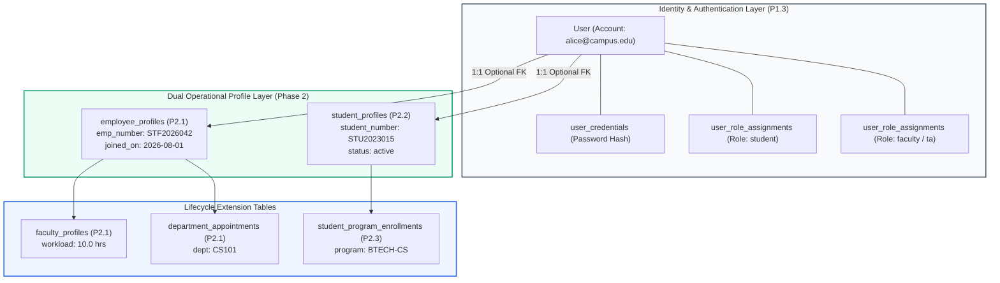

# CampusOne ERP — Phase 2: P2.2 Student Profiles & Admissions Architecture Specification

**Document ID:** `CAMPUSONE-SPEC-P2.2`  
**Revision:** v1.0 (Architecture Baseline & Design Specification)  
**Date:** 2026-10-10  
**Status:** 📋 **PLANNING & SPECIFICATION ONLY — NO DATABASE WRITES OR MIGRATION SQL GENERATED**  
**Repository Working Directory:** `C:\Projects\ERP-System`  
**Git Branch Status:** `main...origin/main [ahead 6]` (Clean working tree; 6 unpushed local commits)  
**Live Target Database (Neon):** 🛡️ **100% UNTOUCHED (Zero writes; foundation & security tables preserved)**  

---

## 1. Executive Summary

Work Package **P2.2: Student Profiles and Canonical Admissions Link Architecture** establishes the core student identity tier and resolves the relationship between admissions applications and student records.

In the legacy ERP:
1. The `"Student"` table is severely overloaded: it conflates **person identity** (`userId`, `rollNumber`), **program enrollment** (`degree`, `batch`), **term progression** (`semester`, `section`, `attendancePercentage`, `cgpa`), and **financial state** (`feeStatus`, `feeQuota`).
2. The legacy `"AdmissionApplication"` table is completely isolated: it contains program and department attributes but has **zero foreign keys** to `"Student"`, `"User"`, or any academic table.
3. Live database inspection reveals that `"AdmissionApplication"` currently contains **0 rows**, meaning all 5 existing legacy students were matriculated directly without an electronic application record.

This specification accomplishes the following architectural objectives:
* **Separates Person Identity from Academic Lifecycle:** Introduces `student_profiles` to store enduring institutional student identity, independent of semesters, terms, or specific degree programs.
* **Resolves Policy Decision 2 (Canonical Admissions Relationship):** Demonstrates why the admission application links canonically to **`student_program_enrollments`** (program-level enrollment offer), rather than `student_profiles` (physical person).
* **Guarantees Dual-Role Harmony with P2.1:** Demonstrates that a single `"User"` account can seamlessly link to both `employee_profiles` (P2.1) and `student_profiles` (P2.2) without credential duplication or schema collisions.
* **Quarantines `UNRESOLVED_STUDENT_01` (Policy Decision 3):** Preserves the unverified `"2026-2026"` batch record in staging without modifying the legacy row or making premature curriculum assignments.

**Boundary Commitment:** This deliverable is strictly an architectural design specification. No Prisma schema files are modified, no migration SQL is generated or executed, no seeds are written to live Neon, and no local commits are pushed to GitHub during this step.

---

## 2. Legacy Baseline & Source Data Audit

A physical inspection of the live Neon PostgreSQL database and `backend/prisma/schema.prisma` confirms the following baseline:

### 2.1 Legacy Tables Involved
| Legacy Entity | Physical Table | Live Rows | Primary Key | Key Columns / Relations |
|---|---|---|---|---|
| `Student` | `"Student"` | 5 | `id String @id @default(uuid())` | `userId`, `rollNumber`, `departmentId`, `degree`, `semester`, `batch`, `section`, `cgpa`, `attendancePercentage`, `feeStatus`, `feeQuota` |
| `AdmissionApplication` | `"AdmissionApplication"` | 0 | `id String @id @default(uuid())` | `applicantName`, `applicationId` (unique), `program`, `department`, `status`, `appliedDate` |
| `User` | `"User"` | 12 | `id String @id @default(uuid())` | `email`, `role`, `name`, `password` |

### 2.2 Live Data Records Inspected
Direct read-only inspection reveals:
* **Legacy Student Records (5 rows):**
  1. `c891d8a7...` | `rollNumber: STU2***` | `deptId: CS101` | `degree: B.Tech` | `sem: 7` | `batch: 2023-2027` | `sec: B` | `feeStatus: paid`
  2. `e1d8027e...` | `rollNumber: STU2***` | `deptId: CS101` | `degree: B.Tech` | `sem: 7` | `batch: 2023-2027` | `sec: A` | `feeStatus: due`
  3. `e12c37b9...` | `rollNumber: STU2***` | `deptId: CS101` | `degree: B.Tech` | `sem: 1` | `batch: 2023-2027` | `sec: A` | `feeStatus: due`
  4. `11fefef4...` | `rollNumber: STU2***` | `deptId: CS101` | `degree: B.Tech` | `sem: 2` | `batch: 2023-2027` | `sec: A` | `feeStatus: due`
  5. `ccd73763...` (`UNRESOLVED_STUDENT_01`) | `rollNumber: STU2***` | `deptId: CS101` | `degree: B.Tech` | `sem: 1` | `batch: 2026-2026` | `sec: A` | `feeStatus: paid`
* **Legacy Admission Applications (0 rows):**
  * The table is physically present with 0 rows in the live database.
  * In `backend/prisma/schema.prisma` lines 575–592:
    ```prisma
    model AdmissionApplication {
      id            String            @id @default(uuid())
      applicantName String
      applicationId String            @unique
      program       String
      department    String
      jeeRank       Int?
      gateRank      Int?
      category      String
      quota         String
      status        ApplicationStatus @default(pending)
      appliedDate   DateTime          @default(now())
      updatedAt     DateTime          @updatedAt
      @@index([status])
      @@index([department])
      @@index([program])
    }
    ```

### 2.3 Structural Deficiencies of Legacy `Student`
1. **Conflated Lifecycles:** When a student advances from Semester 1 to Semester 2, the legacy system updates `Student.semester` in place, overwriting historical academic progression.
2. **Inability to Support Alumni or Readmission:** When a student graduates, their `degree` and `batch` remain frozen; they cannot re-enroll for a Master's degree or second qualification under the same identity.
3. **Absence of Personal Demographics:** The legacy schema lacks fields for date of birth, gender, blood group, and emergency contacts.
4. **Unlinked Admissions:** Because `AdmissionApplication` lacks foreign keys, accepted applicants must be manually copied into `Student` and `User` with no referential integrity.

---

## 3. Domain Architecture: Decoupling Student Identity

To resolve these deficiencies, the redesign distributes the overloaded legacy `Student` attributes across four distinct lifecycle tiers:

| Lifecycle Tier | Entity Model | Phase | Responsibilities & Attributes |
|---|---|:---:|---|
| **1. Institutional Person Identity** | **`student_profiles`** | **P2.2** | Student number (roll number), legal name, date of birth, gender, blood group, emergency contact, global status (`active`, `graduated`, `withdrawn`). |
| **2. Program Enrollment Lifecycle** | `student_program_enrollments` | P2.3 | Specific degree program, cohort batch, curriculum version, canonical admissions application link (`admission_application_id`), entry academic term. |
| **3. Term Progression Tracking** | `student_term_registrations` | P2.4 | Semester number, section, term registration status, attendance percentage, term GPA, cumulative CGPA. |
| **4. Financial Account** | `student_fee_accounts` | Phase 6 | Fee quota (`general`, `management`, `scholarship`), fee status (`paid`, `due`), ledger balance. |

---

## 4. Entity Technical Specification: `student_profiles`

`student_profiles` represents the enduring institutional record of a student person.

| Column | Type | Nullable | Default | Description / Constraints |
|---|---|:---:|---|---|
| `id` | `UUID` | No | `gen_random_uuid()` | Primary Key (native PostgreSQL UUID). |
| `user_id` | `TEXT` | No | None | Foreign Key referencing legacy `"User"("id")` `ON DELETE RESTRICT`. |
| `institution_id` | `UUID` | No | None | Foreign Key referencing `"institutions"("id")` `ON DELETE RESTRICT`. |
| `student_number` | `TEXT` | No | None | Institutional roll number / registration number (e.g. `STU2026001`). |
| `first_name` | `TEXT` | No | None | Legal first name. |
| `last_name` | `TEXT` | No | None | Legal last name. |
| `date_of_birth` | `DATE` | Yes | `NULL` | Student date of birth. |
| `gender` | `TEXT` | Yes | `'unspecified'` | CHECK: `gender IN ('male', 'female', 'other', 'unspecified')` |
| `blood_group` | `TEXT` | Yes | `NULL` | Blood group (e.g. `'O+'`, `'A+'`, `'B+'`, `'AB+'`, `'O-'`, etc.). |
| `emergency_contact_phone` | `TEXT` | Yes | `NULL` | Emergency contact phone number. |
| `status` | `TEXT` | No | `'active'` | CHECK: `status IN ('active', 'graduated', 'withdrawn', 'suspended', 'deceased')` |
| `created_at` | `TIMESTAMPTZ` | No | `CURRENT_TIMESTAMP` | Audit creation timestamp. |
| `updated_at` | `TIMESTAMPTZ` | No | `CURRENT_TIMESTAMP` | Audit update timestamp. |
| `deleted_at` | `TIMESTAMPTZ` | Yes | `NULL` | Soft-delete timestamp (Policy 11). |

### 4.1 Indexes & Table Constraints:
* `CONSTRAINT "student_profiles_pkey" PRIMARY KEY ("id")`
* `CONSTRAINT "student_profiles_user_id_key" UNIQUE ("user_id")` — Ensures a user account maps to at most one student profile.
* `CONSTRAINT "student_profiles_inst_stu_no_key" UNIQUE ("institution_id", "student_number")` — Natural roll number uniqueness within an institution.
* `CONSTRAINT "student_profiles_gender_check" CHECK ("gender" IS NULL OR "gender" IN ('male', 'female', 'other', 'unspecified'))`
* `CONSTRAINT "student_profiles_status_check" CHECK ("status" IN ('active', 'graduated', 'withdrawn', 'suspended', 'deceased'))`
* `CREATE INDEX "student_profiles_institution_id_idx" ON "student_profiles"("institution_id");`
* `CREATE INDEX "student_profiles_status_idx" ON "student_profiles"("status");`
* `CREATE INDEX "student_profiles_student_number_idx" ON "student_profiles"("student_number");`

---

## 5. Decision Brief 2 Resolution: Canonical Admissions Relationship

### 5.1 The Architectural Conflict
In earlier planning sketches, two competing foreign key relationships were considered for linking admissions applications to student data:
* **Option A:** `student_profiles.admission_application_id`
* **Option B:** `student_program_enrollments.admission_application_id`

### 5.2 Evidence-Based Evaluation
1. **Admissions is Program-Centric, Not Person-Centric:**
   * In `backend/prisma/schema.prisma` lines 575–592, `AdmissionApplication` explicitly records `program String` and `department String`.
   * An applicant does not apply to "be a person"; they apply for admission into a specific degree curriculum (e.g., *B.Tech Computer Science*).
2. **Cardinality Over Lifespan:**
   * A student may graduate with a B.Tech and later submit a new application for an M.Tech or Ph.D. program.
   * If `admission_application_id` was placed on `student_profiles`, the returning student would either overwrite their original undergraduate admission link or require a duplicate student profile.
   * Conversely, placing `admission_application_id` on `student_program_enrollments` cleanly supports multiple independent admissions throughout the student's lifetime:
     * `Enrollment 1 (B.Tech)` $\to$ `admission_application_id: APP-2023-001`
     * `Enrollment 2 (M.Tech)` $\to$ `admission_application_id: APP-2027-042`
3. **Empty Legacy Baseline Reality:**
   * Physical query of live Neon confirms **0 rows** in `AdmissionApplication`.
   * All 5 existing students matriculated prior to digital application tracking.
   * For historical backfills, `student_program_enrollments.admission_application_id` will be `NULL`.

### 5.3 Formal Decision
* **Canonical FK Location:** **`student_program_enrollments.admission_application_id`** (UUID FK referencing `admission_applications.id` ON DELETE SET NULL).
* **Omission from `student_profiles`:** `admission_application_id` is **strictly omitted** from `student_profiles`. This eliminates dual sources of truth and ensures strict normalization.

---

## 6. Co-Design Alignment: P2.1 (Employee) & P2.2 (Student) Harmony

A major achievement of the P2.1 and P2.2 co-design is ensuring complete compatibility for dual-role users (Policy 2).



### 6.1 Architectural Rules for Dual-Role Users
1. **Independent Uniqueness:** `employee_profiles.user_id` is unique, and `student_profiles.user_id` is unique. Because they exist on separate tables, both rows can point to the same `User.id` without constraint violation.
2. **Decoupled Identifiers:**
   * The individual holds an `employee_number` (e.g. `STF2026042`) for employment payroll and HR.
   * The individual holds a `student_number` (e.g. `STU2023015`) for grade transcripts and academic records.
3. **Session Context Management:** When authenticating via `/api/auth/login`, if the user holds both profiles, `auth_sessions` tracks the active operational context (`active_context: 'student' | 'employee'`). The UI allows seamless switching without requiring re-authentication.

---

## 7. Decision Brief 3 Resolution: Quarantine of `UNRESOLVED_STUDENT_01`

### 7.1 Legacy Finding
Student row `ccd73763-0046-408f-b67f-12c4299808c3` contains:
* `semester: 1`
* `degree: "B.Tech"`
* `batch: "2026-2026"` (Standard B.Tech batches span 4 years, e.g. `"2023-2027"`).

### 7.2 Staging & Backfill Protocol
1. **Zero Legacy DB Writes:** The row in `"Student"` remains completely untouched.
2. **Profile Staging Allowed:** A `student_profiles` row **will** be created for this user during P2.2 backfill, because their personal identity (`userId`, `rollNumber`, `name`) is unambiguous and valid.
3. **Program Enrollment Quarantined (P2.3):** In Work Package P2.3, this student's `student_program_enrollments` record will **not** be automatically backfilled into the 2026–2030 cohort. It will be quarantined in an exception table (`_quarantine_records`) until the Academic Registrar provides a signed administrative memo confirming whether:
   * `"2026-2026"` was an entry typo for freshman cohort `2026-2030` (`2026-ODD`), OR
   * The student was enrolled in a special 1-year bridge or diploma curriculum.

---

## 8. Draft DDL Specification: `student_profiles` (For Review Only)

The following SQL represents the proposed forward-only schema for P2.2. **It will not be applied until Phase 2 architecture is approved.**

```sql
-- ==============================================================================
-- DRAFT PROPOSAL: Phase 2 Work Package P2.2 (Student Profiles)
-- DO NOT EXECUTE DIRECTLY - PENDING STAKEHOLDER APPROVAL
-- ==============================================================================

-- 1. Table: student_profiles
CREATE TABLE "student_profiles" (
    "id" UUID NOT NULL DEFAULT gen_random_uuid(),
    "user_id" TEXT NOT NULL,
    "institution_id" UUID NOT NULL,
    "student_number" TEXT NOT NULL,
    "first_name" TEXT NOT NULL,
    "last_name" TEXT NOT NULL,
    "date_of_birth" DATE,
    "gender" TEXT DEFAULT 'unspecified',
    "blood_group" TEXT,
    "emergency_contact_phone" TEXT,
    "status" TEXT NOT NULL DEFAULT 'active',
    "created_at" TIMESTAMPTZ NOT NULL DEFAULT CURRENT_TIMESTAMP,
    "updated_at" TIMESTAMPTZ NOT NULL DEFAULT CURRENT_TIMESTAMP,
    "deleted_at" TIMESTAMPTZ,

    CONSTRAINT "student_profiles_pkey" PRIMARY KEY ("id"),
    CONSTRAINT "student_profiles_user_id_key" UNIQUE ("user_id"),
    CONSTRAINT "student_profiles_inst_stu_no_key" UNIQUE ("institution_id", "student_number"),
    CONSTRAINT "student_profiles_gender_check" CHECK (
        "gender" IS NULL OR "gender" IN ('male', 'female', 'other', 'unspecified')
    ),
    CONSTRAINT "student_profiles_status_check" CHECK (
        "status" IN ('active', 'graduated', 'withdrawn', 'suspended', 'deceased')
    )
);

-- 2. Foreign Key Constraints
ALTER TABLE "student_profiles" ADD CONSTRAINT "student_profiles_user_id_fkey"
    FOREIGN KEY ("user_id") REFERENCES "User"("id") ON DELETE RESTRICT ON UPDATE CASCADE;

ALTER TABLE "student_profiles" ADD CONSTRAINT "student_profiles_institution_id_fkey"
    FOREIGN KEY ("institution_id") REFERENCES "institutions"("id") ON DELETE RESTRICT ON UPDATE CASCADE;

-- 3. Performance Indexes
CREATE INDEX "student_profiles_institution_id_idx" ON "student_profiles"("institution_id");
CREATE INDEX "student_profiles_status_idx" ON "student_profiles"("status");
CREATE INDEX "student_profiles_student_number_idx" ON "student_profiles"("student_number");
```

---

## 9. Rehearsal, Validation & Acceptance Gates

Before P2.2 can be approved for live Neon deployment, it must pass rehearsal in a disposable test schema (`p2_2_disposable_validation`):

### 9.1 Acceptance Criteria
| Gate | Verification Check | Expected Result |
|---|---|---|
| **Gate 1: Migration Atomicity** | Execute DDL in fresh disposable schema. | `student_profiles` table and 3 indexes create without error. |
| **Gate 2: Legacy Preservation** | SHA-256 fingerprint comparison of all 22 legacy tables before and after backfill. | **100% byte-for-byte identical**. Zero rows added, removed, or mutated in legacy tables. |
| **Gate 3: Backfill Completeness** | Map 5 legacy `Student` rows. | Exactly 5 `student_profiles` rows created with deterministic UUID v5. |
| **Gate 4: Idempotency** | Execute backfill script a second time. | Exactly **0 inserts**, 0 updates, 0 duplicate mappings in `_id_map`. |
| **Gate 5: Negative Constraint Tests** | Attempt invalid data insertions: | All rejected with expected PostgreSQL constraint violation: |
| | a) Duplicate `student_number` | ❌ Rejected by `student_profiles_inst_stu_no_key`. |
| | b) Duplicate `user_id` mapping | ❌ Rejected by `student_profiles_user_id_key`. |
| | c) Invalid gender string (`'alien'`) | ❌ Rejected by `student_profiles_gender_check`. |
| | d) Invalid status string (`'expelled'`) | ❌ Rejected by `student_profiles_status_check`. |
| | e) Non-existent `institution_id` | ❌ Rejected by `student_profiles_institution_id_fkey`. |
| **Gate 6: Dual-Role Verification** | Insert test user linking both an `employee_profiles` row and a `student_profiles` row. | Both succeed without constraint collision. |
| **Gate 7: Transactional Rollback** | Inject artificial error midway through batch backfill. | Entire transaction rolls back; schema leaves **0 orphan rows**. |

---

## 10. Summary & Next Steps

Work Package P2.2 completes the foundational identity architecture for students, resolving the canonical admissions relationship and aligning seamlessly with P2.1.

1. **Document Created:** [`docs/P2.2-STUDENT-PROFILES-AND-ADMISSIONS-SPECIFICATION.md`](file:///c:/Projects/ERP-System/docs/P2.2-STUDENT-PROFILES-AND-ADMISSIONS-SPECIFICATION.md)
2. **Current Database State:** Unchanged; 0 writes performed.
3. **Current Commit Status:** 6 commits ahead of `origin/main`; working tree clean except for this specification.
4. **Next Step:** Joint review of P2.1 and P2.2 specifications with stakeholders before authorizing Phase 2 migration SQL generation and disposable database rehearsal.
