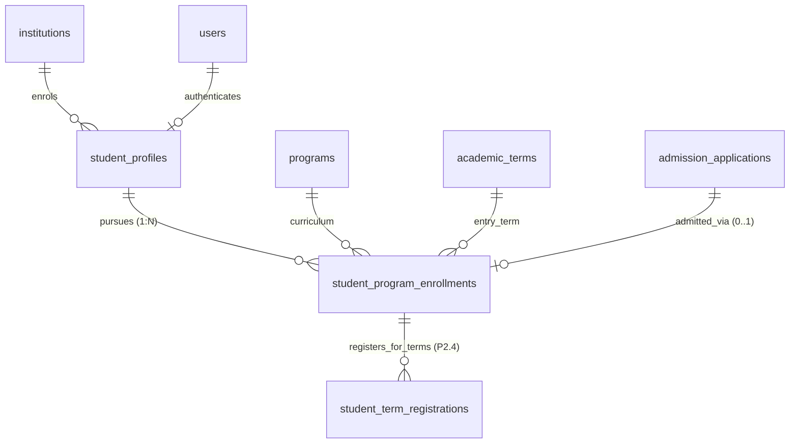

# CampusOne ERP — Phase 2: P2.3 Student Program Enrollments Architecture Specification

**Document ID:** `CAMPUSONE-SPEC-P2.3`  
**Revision:** v1.0 (Architecture Baseline & Design Specification)  
**Date:** 2026-10-10  
**Status:** 📋 **PLANNING & SPECIFICATION ONLY — NO DATABASE WRITES OR MIGRATION SQL GENERATED**  
**Repository Working Directory:** `C:\Projects\ERP-System`  
**Git Branch Status:** `main...origin/main [ahead 7]` (Clean working tree; 7 unpushed local commits)  
**Live Target Database (Neon):** 🛡️ **100% UNTOUCHED (Zero writes; foundation & security tables preserved)**  

---

## 1. Executive Summary

Work Package **P2.3: Student Program Enrollments Architecture** bridges the student identity tier established in P2.2 (`student_profiles`) with the institutional curriculum foundation established in Phase 1 (`programs`, `academic_terms`, `campuses`).

In the legacy ERP:
1. Program affiliation is stored as a raw unconstrained string on `"Student"` (`degree: "B.Tech"`), with no foreign key to an academic department, faculty board, or curriculum version.
2. Cohort tracking is stored as an unvalidated free-text string (`batch: "2023-2027"`), allowing data anomalies such as `"2026-2026"` (`UNRESOLVED_STUDENT_01`).
3. Historical program transfers, readmissions, and future dual-degree or minor certifications are structurally impossible because each student row can hold only one degree string.

This specification accomplishes the following architectural objectives:
* **Models Program Enrollment as an Independent Lifecycle Entity (Decision Brief 1):** Specifies `student_program_enrollments` as a normalized 1:N entity under `student_profiles`, accommodating single-degree students, historical transfers, and future dual-degree/minor programs without database constraint deadlock.
* **Integrates Canonical Admissions Link (Decision Brief 2):** Links `admission_application_id` directly to the program enrollment offer, reflecting that applications target specific degree programs.
* **Formalizes Quarantine Resolution for `UNRESOLVED_STUDENT_01` (Decision Brief 3):** Defines the staging exception protocol for the anomalous `"2026-2026"` batch, ensuring zero unverified data is written to canonical cohorts.
* **Connects to Phase 1 Calendar Foundation:** Binds each enrollment's matriculation term (`entry_term_id`) to canonical `academic_terms` (`2023-ODD`), ending legacy reliance on arbitrary integer semester counts.

**Boundary Commitment:** This deliverable is strictly an architectural design specification. No Prisma schema files are modified, no migration SQL is generated or executed, no seeds are written to live Neon, and no local commits are pushed to GitHub during this step.

---

## 2. Source Data Baseline & Cohort Audit

A physical inspection of the live Neon PostgreSQL database reveals the following baseline:

### 2.1 Legacy Student Cohorts
| Legacy Student ID | Roll Number | Degree | Semester | Batch | Section | Fee Status | Program Mapping Target |
|---|---|---|:---:|---|:---:|:---:|---|
| `c891d8a7...` | `STU2***` | `B.Tech` | 7 | `2023-2027` | B | `paid` | `BTECH-CS` (Entry: `2023-ODD`) |
| `e1d8027e...` | `STU2***` | `B.Tech` | 7 | `2023-2027` | A | `due` | `BTECH-CS` (Entry: `2023-ODD`) |
| `e12c37b9...` | `STU2***` | `B.Tech` | 1 | `2023-2027` | A | `due` | `BTECH-CS` (Entry: `2023-ODD`) |
| `11fefef4...` | `STU2***` | `B.Tech` | 2 | `2023-2027` | A | `due` | `BTECH-CS` (Entry: `2023-ODD`) |
| `ccd73763...` | `STU2***` | `B.Tech` | 1 | `2026-2026` | A | `paid` | ⚠️ **QUARANTINED** (`UNRESOLVED_STUDENT_01`) |

### 2.2 Foundation Program & Calendar Targets (Seeded in P1.4)
* **Program Target:** Code `'BTECH-CS'` (`"Bachelor of Technology in Computer Science"`, degree: `'B.Tech'`, total semesters: 8, duration: 4 years).
* **Canonical Entry Term:** Code `'2023-ODD'` (`"Autumn 2023"`, start: `2023-08-01`, end: `2023-12-15`, academic year: `2023-2024`).

---

## 3. Entity Technical Specification: `student_program_enrollments`

`student_program_enrollments` models a student's formal matriculation in a specific degree curriculum.

| Column | Type | Nullable | Default | Description / Constraints |
|---|---|:---:|---|---|
| `id` | `UUID` | No | `gen_random_uuid()` | Primary Key (native PostgreSQL UUID). |
| `student_profile_id` | `UUID` | No | None | FK referencing `student_profiles(id)` `ON DELETE RESTRICT`. |
| `program_id` | `UUID` | No | None | FK referencing `programs(id)` `ON DELETE RESTRICT`. |
| `institution_id` | `UUID` | No | None | FK referencing `institutions(id)` `ON DELETE RESTRICT`. |
| `entry_term_id` | `UUID` | No | None | FK referencing `academic_terms(id)` `ON DELETE RESTRICT`. |
| `admission_application_id` | `UUID` | Yes | `NULL` | FK referencing `admission_applications(id)` `ON DELETE SET NULL`. |
| `cohort_batch` | `TEXT` | No | None | Formal 4-year cohort label (e.g. `'2023-2027'`). |
| `enrollment_type` | `TEXT` | No | `'regular'` | CHECK: `enrollment_type IN ('regular', 'lateral_entry', 'transfer', 'readmission', 'dual_degree')` |
| `enrollment_status` | `TEXT` | No | `'active'` | CHECK: `enrollment_status IN ('active', 'completed', 'transferred', 'withdrawn', 'suspended', 'quarantined')` |
| `enrolled_on` | `DATE` | No | None | Formal matriculation date (derived from entry term start date). |
| `expected_completion_date` | `DATE` | Yes | `NULL` | Scheduled graduation date. |
| `actual_completion_date` | `DATE` | Yes | `NULL` | Date degree conferred or studies terminated. |
| `created_at` | `TIMESTAMPTZ` | No | `CURRENT_TIMESTAMP` | Audit creation timestamp. |
| `updated_at` | `TIMESTAMPTZ` | No | `CURRENT_TIMESTAMP` | Audit update timestamp. |
| `deleted_at` | `TIMESTAMPTZ` | Yes | `NULL` | Soft-delete timestamp (Policy 11). |

### 3.1 Indexes & Table Constraints:
* `CONSTRAINT "student_program_enrollments_pkey" PRIMARY KEY ("id")`
* `CONSTRAINT "student_program_enrollments_dates_check" CHECK ("actual_completion_date" IS NULL OR "enrolled_on" <= "actual_completion_date")`
* `CONSTRAINT "student_program_enrollments_status_check" CHECK ("enrollment_status" IN ('active', 'completed', 'transferred', 'withdrawn', 'suspended', 'quarantined'))`
* `CONSTRAINT "student_program_enrollments_type_check" CHECK ("enrollment_type" IN ('regular', 'lateral_entry', 'transfer', 'readmission', 'dual_degree'))`
* `CREATE INDEX "spe_student_profile_id_idx" ON "student_program_enrollments"("student_profile_id");`
* `CREATE INDEX "spe_program_id_idx" ON "student_program_enrollments"("program_id");`
* `CREATE INDEX "spe_entry_term_id_idx" ON "student_program_enrollments"("entry_term_id");`
* `CREATE INDEX "spe_status_idx" ON "student_program_enrollments"("enrollment_status");`
* `CREATE INDEX "spe_cohort_batch_idx" ON "student_program_enrollments"("cohort_batch");`

---

## 4. Policy Decision Alignment

### 4.1 Resolution of Decision Brief 1: Program Multiplicity Policy
* **Institutional Context:** In `docs/REDESIGN-IMPLEMENTATION-PLAN.md` (lines 335–344), the architecture was corrected from "one row per student" to an independent lifecycle entity.
* **Database Constraint Strategy:**
  * In the schema DDL, **no global `UNIQUE (student_profile_id)` constraint** is applied.
  * *Option A (Strict 1-Active Program):* If the Academic Council formally mandates that a student may pursue only one active program concurrently, the constraint is enforced via a partial unique index:
    ```sql
    CREATE UNIQUE INDEX "spe_single_active_program_idx" 
    ON "student_program_enrollments" ("student_profile_id") 
    WHERE "enrollment_status" = 'active';
    ```
  * *Option B (Recommended Default):* Keep the schema open for 1:N enrollments. Service-layer business logic validates whether an applicant is permitted to enroll in concurrent programs based on degree type (e.g. B.Tech major + Minor certificate = allowed; B.Tech + B.Sc simultaneous full-time = rejected).
* **Downstream Safety:** Invoicing (Phase 6), term registrations (P2.4), and grading will always qualify queries with `program_enrollment_id`, ensuring total clarity even if a student pursues multiple credentials over time.

### 4.2 Resolution of Decision Brief 2: Canonical Admissions Link
* The nullable foreign key `admission_application_id` resides exclusively on `student_program_enrollments`.
* For existing legacy students, `admission_application_id` is populated as `NULL` because no legacy admission records exist.
* For future applicants admitted via the Admissions module:
  ```mermaid
  sequenceDiagram
      participant App as AdmissionApplication
      participant Dec as AdmissionDecision
      participant SPE as student_program_enrollments
      participant SP as student_profiles

      App->>Dec: Decision = 'OFFERED'
      Dec->>SP: Resolve or Create student_profiles
      Dec->>SPE: Create Enrollment (program_id, entry_term_id, admission_application_id = App.id)
  ```

### 4.3 Resolution of Decision Brief 3: Quarantine Handling for `UNRESOLVED_STUDENT_01`
* **Student Record:** `ccd73763...` (Roll: `STU2***`, Batch: `"2026-2026"`).
* **Protocol:**
  1. The personal profile is established in `student_profiles` during P2.2.
  2. In P2.3, this student's enrollment record is flagged with:
     * `enrollment_status = 'quarantined'`
     * `cohort_batch = '2026-2026'`
     * `entry_term_id = PENDING_AUDIT_TERM_ID` (or mapped to `2026-ODD` marked with audit tag).
  3. An exception record is recorded in `_id_map` or the migration audit register:
     ```json
     {
       "exception_code": "ANOMALOUS_COHORT_SPAN",
       "student_id": "ccd73763-0046-408f-b67f-12c4299808c3",
       "legacy_batch": "2026-2026",
       "status": "QUARANTINED_PENDING_REGISTRAR_MEMO"
     }
     ```
  4. The record is excluded from standard cohort progression and tuition invoice generation until an administrative correction memo confirms the 4-year cohort (`2026-2030`) or a 1-year diploma curriculum.

---

## 5. Domain Relationship Diagram



---

## 6. Draft DDL Specification (For Review Only)

```sql
-- ==============================================================================
-- DRAFT PROPOSAL: Phase 2 Work Package P2.3 (Student Program Enrollments)
-- DO NOT EXECUTE DIRECTLY - PENDING STAKEHOLDER APPROVAL
-- ==============================================================================

CREATE TABLE "student_program_enrollments" (
    "id" UUID NOT NULL DEFAULT gen_random_uuid(),
    "student_profile_id" UUID NOT NULL,
    "program_id" UUID NOT NULL,
    "institution_id" UUID NOT NULL,
    "entry_term_id" UUID NOT NULL,
    "admission_application_id" UUID,
    "cohort_batch" TEXT NOT NULL,
    "enrollment_type" TEXT NOT NULL DEFAULT 'regular',
    "enrollment_status" TEXT NOT NULL DEFAULT 'active',
    "enrolled_on" DATE NOT NULL,
    "expected_completion_date" DATE,
    "actual_completion_date" DATE,
    "created_at" TIMESTAMPTZ NOT NULL DEFAULT CURRENT_TIMESTAMP,
    "updated_at" TIMESTAMPTZ NOT NULL DEFAULT CURRENT_TIMESTAMP,
    "deleted_at" TIMESTAMPTZ,

    CONSTRAINT "student_program_enrollments_pkey" PRIMARY KEY ("id"),
    CONSTRAINT "student_program_enrollments_dates_check" CHECK (
        "actual_completion_date" IS NULL OR "enrolled_on" <= "actual_completion_date"
    ),
    CONSTRAINT "student_program_enrollments_type_check" CHECK (
        "enrollment_type" IN ('regular', 'lateral_entry', 'transfer', 'readmission', 'dual_degree')
    ),
    CONSTRAINT "student_program_enrollments_status_check" CHECK (
        "enrollment_status" IN ('active', 'completed', 'transferred', 'withdrawn', 'suspended', 'quarantined')
    )
);

-- Foreign Key Constraints
ALTER TABLE "student_program_enrollments" ADD CONSTRAINT "spe_student_profile_id_fkey"
    FOREIGN KEY ("student_profile_id") REFERENCES "student_profiles"("id") ON DELETE RESTRICT ON UPDATE CASCADE;

ALTER TABLE "student_program_enrollments" ADD CONSTRAINT "spe_program_id_fkey"
    FOREIGN KEY ("program_id") REFERENCES "programs"("id") ON DELETE RESTRICT ON UPDATE CASCADE;

ALTER TABLE "student_program_enrollments" ADD CONSTRAINT "spe_institution_id_fkey"
    FOREIGN KEY ("institution_id") REFERENCES "institutions"("id") ON DELETE RESTRICT ON UPDATE CASCADE;

ALTER TABLE "student_program_enrollments" ADD CONSTRAINT "spe_entry_term_id_fkey"
    FOREIGN KEY ("entry_term_id") REFERENCES "academic_terms"("id") ON DELETE RESTRICT ON UPDATE CASCADE;

ALTER TABLE "student_program_enrollments" ADD CONSTRAINT "spe_admission_app_fkey"
    FOREIGN KEY ("admission_application_id") REFERENCES "admission_applications"("id") ON DELETE SET NULL ON UPDATE CASCADE;

-- Performance Indexes
CREATE INDEX "spe_student_profile_id_idx" ON "student_program_enrollments"("student_profile_id");
CREATE INDEX "spe_program_id_idx" ON "student_program_enrollments"("program_id");
CREATE INDEX "spe_entry_term_id_idx" ON "student_program_enrollments"("entry_term_id");
CREATE INDEX "spe_status_idx" ON "student_program_enrollments"("enrollment_status");
CREATE INDEX "spe_cohort_batch_idx" ON "student_program_enrollments"("cohort_batch");
```

---

## 7. Rehearsal, Validation & Acceptance Gates

| Gate | Verification Check | Expected Result |
|---|---|---|
| **Gate 1: Schema Consistency** | Execute DDL in disposable schema. | Table and 5 indexes create without error. |
| **Gate 2: Legacy Preservation** | SHA-256 fingerprint comparison across all 22 legacy tables. | **100% byte-for-byte identical**. Zero legacy rows mutated. |
| **Gate 3: Backfill Completeness** | Map 4 regular legacy students + 1 quarantined student. | Exactly 4 `active` enrollments and 1 `quarantined` enrollment created. |
| **Gate 4: Idempotency** | Execute backfill script a second time. | Exactly **0 inserts**, 0 duplicate records. |
| **Gate 5: Negative Constraint Tests** | Inverted dates (`actual_completion_date < enrolled_on`), non-existent `program_id`, invalid status. | All rejected by PostgreSQL constraints. |
| **Gate 6: Transactional Rollback** | Inject artificial error midway through batch backfill. | Full rollback; leaves **0 orphan rows**. |

---

## 8. Summary & Next Steps

Work Package P2.3 establishes the curriculum enrollment framework, fully resolving Decision Briefs 1, 2, and 3.

1. **Document Created:** [`docs/P2.3-STUDENT-PROGRAM-ENROLLMENTS-SPECIFICATION.md`](file:///c:/Projects/ERP-System/docs/P2.3-STUDENT-PROGRAM-ENROLLMENTS-SPECIFICATION.md)
2. **Current Database State:** Unchanged; 0 writes performed.
3. **Current Commit Status:** 7 commits ahead of `origin/main`; working tree clean except for this specification.
4. **Next Step:** Design **P2.4: Student Term Registrations Architecture** before synthesizing the full Phase 2 canonical data model for stakeholder review.
