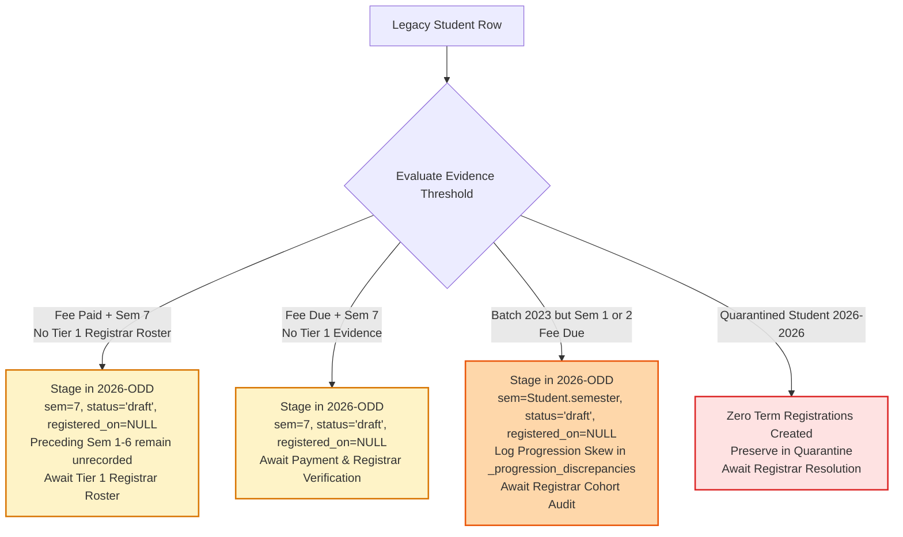

# CampusOne ERP — Phase 2: P2.4 Student Term Registrations Architecture Specification

**Document ID:** `CAMPUSONE-SPEC-P2.4`
**Revision:** v4.0 (Final Architecture Pre-Signoff Baseline — Authoritative Evidence Hierarchy, Complete Trigger Contracts, Registration Date Semantics & Restoration Lifecycle)
**Date:** 2026-10-10
**Status:** 📋 **PLANNING & SPECIFICATION ONLY — NO DATABASE WRITES OR MIGRATION SQL GENERATED**
**Repository Working Directory:** `C:\Projects\ERP-System`
**Git Branch Status:** `main...origin/main [ahead 8]` (Clean working tree; 8 unpushed local commits)
**Live Target Database (Neon):** 🛡️ **100% UNTOUCHED (Zero writes; foundation & security tables preserved)**

---

## 1. Executive Summary

Work Package **P2.4: Student Term Registrations Architecture** establishes the academic progression and term enrollment framework for CampusOne ERP.

In the legacy ERP:
1. Student progression is tracked by updating a single integer column in place (`Student.semester`). When a student advances from Semester 1 to Semester 2, historical registration records, section assignments, term attendance, and semester GPA are overwritten and lost.
2. Section assignments are flattened into an unvalidated string (`Student.section: "A"`), making it impossible to reconstruct historical classroom cohorts across past semesters.
3. Attendance and GPA metrics (`Student.attendancePercentage`, `Student.cgpa`) are denormalized single-float snapshots with no temporal link to specific academic calendars.
4. Scheduled events (`Examination` and `TimetableEntry`) reference semester numbers as raw integers rather than canonical academic terms.

Following the final pre-signoff architectural review, this v4.0 specification resolves four essential technical and data-integrity requirements:
* **Establishes an Authoritative Registration Evidence Hierarchy (Finding 1):** Rigorously distinguishes conclusive legal registration records (Tier 1 Registrar rosters) from indirect academic indicators (Tier 2 timetable/exams) and financial clearance (Tier 3 fee receipts). Prohibits activating term registrations on indirect indicators alone; unverified registrations are held in `draft` with `registered_on = NULL`.
* **Delivers Complete Database Enforcement Definitions & Audit Contracts (Finding 2):** Provides full DDL definitions for trigger functions `trg_enforce_term_registration_institution()` and `trg_guard_completed_registration_snapshots()`, as well as the administrative stored procedure `sp_apply_grade_correction()`. Documents audit destination dependencies (`"SystemActivity"` vs canonical `system_audit_logs`) and application-role bypass defenses.
* **Corrects Registration Date Semantics (Finding 3):** Makes `registered_on` nullable (`DATE NULL`), ensuring draft records do not appear registered. Adds database check constraints enforcing that `registered_on` is NULL in `draft`/`quarantined` states and mandatory in active states (`registered`, `in_progress`, `completed`).
* **Formalizes Soft Deletion & Unique Constraint Policy (Finding 4):** Resolves the interaction between `UNIQUE (program_enrollment_id, academic_term_id)` and `deleted_at`. Adopts the **Auditable Restoration Policy**, preserving registrations as legal transcript records and mandating restoration over replacement.

**Boundary Commitment:** This deliverable is strictly an architectural design specification. No Prisma schema files are modified, no migration SQL is generated or executed, no seeds are written to live Neon, and no local commits are pushed to GitHub during this step.

---

## 2. Source Data Baseline & Historical Integrity Standard

A physical inspection of the live Neon PostgreSQL database reveals the following baseline:

### 2.1 Legacy Student Progression Data
| Legacy Student ID | Roll Number | Batch | Legacy Semester | Section | CGPA | Attendance % | Fee Status | Legacy Data Reality |
|---|---|---|:---:|:---:|:---:|:---:|:---:|---|
| `c891d8a7...` | `STU2***` | `2023-2027` | 7 | B | 0.0 | 0.0 | `paid` | Current semester is 7; zero historical term records exist in legacy DB. Fee marked paid. |
| `e1d8027e...` | `STU2***` | `2023-2027` | 7 | A | 0.0 | 0.0 | `due` | Current semester is 7; zero historical term records exist in legacy DB. Fee marked due. |
| `e12c37b9...` | `STU2***` | `2023-2027` | 1 | A | 0.0 | 0.0 | `due` | ⚠️ Current semester is 1 despite 2023 batch; no historical logs exist. |
| `11fefef4...` | `STU2***` | `2023-2027` | 2 | A | 0.0 | 0.0 | `due` | ⚠️ Current semester is 2 despite 2023 batch; no historical logs exist. |
| `ccd73763...` | `STU2***` | `2026-2026` | 1 | A | 0.0 | 0.0 | `paid` | 🛑 `UNRESOLVED_STUDENT_01`: anomalous single-year batch quarantined in P2.3. |

### 2.2 Critical Data-Integrity Rule: No Manufactured History
In the legacy database:
* There is **no historical semester table**, no transcript ledger, and no semester archive.
* `AttendanceRecord` contains **0 rows**.
* `ExamResult` contains **0 rows**.
* `Examination` contains **1 row** (`Mid-Semester`, Sem 1, Autumn 2026).
* `TimetableEntry` contains **1 row** (`Room 501`, Sem 1, Section A, CS101).

**Mandatory Integrity Principles:**
1. **Never Infer Past Registrations:** We must **not** manufacture completed, failed, or on-leave registration rows for Semesters 1 through 6 for the senior cohort or delayed students to fill calendar gaps.
2. **Missing Records Remain Missing:** If an institution did not digitally record a student's Semester 1–6 registrations, those records must remain **unrecorded** in the database until physical paper ledgers or official signed grade sheets are digitized by the Academic Registrar.
3. **Semester Integer Does Not Prove Term Registration:** The integer in `Student.semester` establishes only the student's curricular standing recorded in legacy data. It does **not** prove that the student officially registered for the current calendar term (`2026-ODD`).
4. **Log Progression Discrepancies:** For students `e12c37b9...` and `11fefef4...` (batch 2023–2027 but semester 1 or 2), the discrepancy between their batch year and current semester will be logged in an audit report (`_progression_discrepancies`). They will **not** be assigned unverified `academic_probation` or `failed` statuses.
5. **Preserve Quarantine:** For `UNRESOLVED_STUDENT_01` (`ccd73763...`), because their program enrollment is quarantined in P2.3, **no active term registration** will be created until the Academic Registrar resolves the cohort batch.

---

## 3. Data Classification & Provenance Standard

Every attribute and proposed backfill record in P2.4 is assigned a strict data provenance classification:

| Provenance Level | Definition | Examples in P2.4 |
|---|---|---|
| **Level 1: Verified Source Facts** | Sourced directly from immutable legacy database columns. | `Student.rollNumber`, `Student.semester`, `Student.section`, `Student.feeStatus`. |
| **Level 2: Derived Values** | Computed using deterministic, auditable rules from Level 1 facts. | Mapping academic year dates from `academic_years` and `academic_terms` based on canonical calendar codes. |
| **Level 3: Inferred Heuristics** | Plausible technical mappings requiring documented confidence flags. | Start date of registration derived from term start date (`2026-07-15`). Classified as `confidence: 'inferred'`. |
| **Level 4: Unresolved Discrepancies** | Contradictions or unverified states requiring institutional review. | Batch 2023–2027 students in Semester 1 & 2; Batch 2026–2026 student. Excluded from automated assumptions. |

---

## 4. Entity Technical Specification: `student_term_registrations`

`student_term_registrations` models a student's formal enrollment and progression within a single academic term under a specific program enrollment.

| Column | Type | Nullable | Default | Description / Constraints |
|---|---|:---:|---|---|
| `id` | `UUID` | No | `gen_random_uuid()` | Primary Key (native PostgreSQL UUID). |
| `program_enrollment_id` | `UUID` | No | None | FK referencing `student_program_enrollments(id)` `ON DELETE RESTRICT`. |
| `academic_term_id` | `UUID` | No | None | FK referencing `academic_terms(id)` `ON DELETE RESTRICT`. |
| `semester_number` | `INTEGER` | No | None | Curricular semester number within the program (1 to 12). |
| `section` | `TEXT` | Yes | `NULL` | Section identifier (e.g. `'A'`, `'B'`). Max length 10. |
| `registration_status` | `TEXT` | No | `'draft'` | CHECK: `registration_status IN ('draft', 'registered', 'in_progress', 'completed', 'on_leave', 'withdrawn', 'suspended', 'quarantined')` |
| `registered_on` | `DATE` | Yes | `NULL` | Effective date registration was confirmed/approved. **NULL while status is `'draft'` or `'quarantined'`**. |
| `completed_on` | `DATE` | Yes | `NULL` | Date term was officially concluded/graded. **Mandatory when status is `'completed'`**. |
| `term_gpa` | `NUMERIC(4, 2)` | Yes | `NULL` | Authoritative snapshot of Term GPA (0.00 to 10.00). Null until grades finalized. |
| `cumulative_cgpa` | `NUMERIC(4, 2)` | Yes | `NULL` | Authoritative snapshot of Cumulative CGPA at term conclusion (0.00 to 10.00). |
| `credits_attempted` | `NUMERIC(4, 1)` | No | `0.0` | Total course credits registered in this term (`>= 0.0`). |
| `credits_earned` | `NUMERIC(4, 1)` | No | `0.0` | Total course credits passed/awarded (`>= 0.0`). |
| `attendance_percentage` | `NUMERIC(5, 2)` | Yes | `NULL` | Authoritative snapshot of term attendance percentage (0.00 to 100.00). |
| `academic_standing` | `TEXT` | No | `'unspecified'` | CHECK: `academic_standing IN ('good_standing', 'academic_probation', 'dean_list', 'suspended', 'unspecified')` |
| `notes` | `TEXT` | Yes | `NULL` | Administrative audit notes or registrar exception memos. |
| `created_at` | `TIMESTAMPTZ` | No | `CURRENT_TIMESTAMP` | System record creation timestamp. Immutable. |
| `updated_at` | `TIMESTAMPTZ` | No | `CURRENT_TIMESTAMP` | System record update timestamp. |
| `deleted_at` | `TIMESTAMPTZ` | Yes | `NULL` | Soft-delete timestamp (Policy 11). |

### 4.1 Constraints & Table Rules
* **Primary Key:**
  ```sql
  CONSTRAINT "student_term_registrations_pkey" PRIMARY KEY ("id")
  ```
* **Composite Uniqueness (All Rows — Restorable Entity Policy):**
  ```sql
  CONSTRAINT "str_enrollment_term_key" UNIQUE ("program_enrollment_id", "academic_term_id");
  ```
  Guarantees that a student cannot have multiple registration records for the same academic term under the same program enrollment. Soft-deleted records continue to occupy the unique slot to mandate an auditable restoration workflow rather than duplicate creation.
* **Foreign Key Constraints:**
  ```sql
  CONSTRAINT "str_program_enrollment_fkey"
      FOREIGN KEY ("program_enrollment_id")
      REFERENCES "student_program_enrollments"("id")
      ON DELETE RESTRICT ON UPDATE CASCADE;

  CONSTRAINT "str_academic_term_fkey"
      FOREIGN KEY ("academic_term_id")
      REFERENCES "academic_terms"("id")
      ON DELETE RESTRICT ON UPDATE CASCADE;
  ```
* **Progression Bounds:**
  ```sql
  CONSTRAINT "str_semester_number_check" CHECK ("semester_number" >= 1 AND "semester_number" <= 12)
  ```
* **Registration Date Semantics Check (Finding 3):**
  ```sql
  CONSTRAINT "str_registered_on_status_check" CHECK (
      ("registration_status" IN ('draft', 'quarantined') AND "registered_on" IS NULL) OR
      ("registration_status" NOT IN ('draft', 'quarantined') AND "registered_on" IS NOT NULL)
  )
  ```
  Prevents draft or quarantined records from masquerading as legally registered, and guarantees that any active or historical registration carries an explicit effective date.
* **Completion Date Consistency:**
  ```sql
  CONSTRAINT "str_dates_check" CHECK (
      "registered_on" IS NULL OR "completed_on" IS NULL OR "registered_on" <= "completed_on"
  );

  CONSTRAINT "str_completed_on_required" CHECK (
      "registration_status" != 'completed' OR "completed_on" IS NOT NULL
  );
  ```
* **Numeric Scale & Precision Rules:**
  ```sql
  CONSTRAINT "str_term_gpa_check" CHECK ("term_gpa" IS NULL OR ("term_gpa" >= 0.00 AND "term_gpa" <= 10.00));
  CONSTRAINT "str_cgpa_check" CHECK ("cumulative_cgpa" IS NULL OR ("cumulative_cgpa" >= 0.00 AND "cumulative_cgpa" <= 10.00));
  CONSTRAINT "str_credits_attempted_check" CHECK ("credits_attempted" >= 0.0);
  CONSTRAINT "str_credits_earned_check" CHECK ("credits_earned" >= 0.0 AND "credits_earned" <= "credits_attempted");
  CONSTRAINT "str_attendance_check" CHECK ("attendance_percentage" IS NULL OR ("attendance_percentage" >= 0.00 AND "attendance_percentage" <= 100.00));
  ```
* **Section Formatting:**
  ```sql
  CONSTRAINT "str_section_format_check" CHECK ("section" IS NULL OR length("section") <= 10);
  ```

---

## 5. Architectural Detail & Data Semantics

### 5.1 Authoritative Registration Evidence Hierarchy (Finding 1)

In institutional academic governance, an academic registration is a legal contract granting course matriculation, examination eligibility, and degree credit. A flat integer in a legacy database (`Student.semester`) or an indirect operational indicator cannot be conflated with verified registration.

To prevent manufacturing or unverified activation of term registrations, CampusOne enforces a formal **Four-Tier Registration Evidence Hierarchy**:

| Tier | Evidence Classification | Institutional Source | What It Proves | What It Does NOT Prove | Evidentiary Sufficiency |
|:---:|---|---|---|---|:---:|
| **Tier 1** | **Authoritative Legal Record** | • Physical Term Registration Roster signed by the Academic Registrar.<br>• Submitted electronic term registration form approved by Faculty Advisor & Registrar. | Official, legally binding matriculation in the specified academic term. | N/A (Conclusive). | **Sufficient on its own.** Allows setting `registration_status = 'registered'` or `'in_progress'` and assigning `registered_on`. |
| **Tier 2** | **Corroborating Academic Activity** | • Active course enrollment in timetable with verified attendance logs.<br>• Official Examination Admit Card / Hall Ticket issued by Controller of Examinations. | Student engaged in academic courses or sat for examinations during that term window. | Does NOT prove formal registration compliance, prerequisite clearance, or that the student registered for the complete term. | **Inconclusive on its own.** Staged in `draft` or `_unverified_term_registrations` pending Registrar confirmation. |
| **Tier 3** | **Supporting Financial Eligibility** | • `FeeTransaction` receipt for session.<br>• `Student.feeStatus = 'paid'`. | Financial clearance / clearance of institutional dues for the academic session. | Does NOT prove academic enrollment. A student may pay tuition fees but take an unannounced gap term, defer registration, or fail academic prerequisites. | **Inconclusive.** Establishes financial eligibility only; zero proof of academic registration. |
| **Tier 4** | **Curricular State Pointer** | • Legacy `Student.semester` integer.<br>• Legacy `Student.section` string. | Legacy database stored a number in a column. | Zero proof of registration for the active calendar term (`2026-ODD`). | **Zero evidentiary value for term registration.** |

#### Policy on Inconclusive Evidence:
1. **Never Manufacture Active Registrations:** If Tier 1 authoritative evidence is absent, the registration must **never** be created in a confirmed state (`registered`, `in_progress`, or `completed`).
2. **Preserve Curricular Standing Without Confirmation:** The student's recorded semester integer is preserved on `student_program_enrollments` (`declared_semester`) and the legacy profile, ensuring no historical signal is lost.
3. **Hold in Staged / Unverified State:** Term registration records for the current term (`2026-ODD`) lacking Tier 1 proof are staged in `registration_status = 'draft'` with `registered_on = NULL` (or held in the staging table `_unverified_term_registrations`) pending formal Registrar verification.
4. **Historical Gap Rule:** Missing historical terms (Semesters 1 through 6) remain entirely unrecorded in `student_term_registrations` until verified paper transcripts or signed ledgers are digitized.

---

### 5.2 Complete Database Enforcement Definitions: Trigger & Procedure Contracts (Finding 2)

To satisfy strict implementation contract requirements, the specifications for all proposed database functions, triggers, and stored procedures are fully defined below.

#### Contract 1: Institutional Tenant Boundary Function & Trigger
* **Name:** `trg_enforce_term_registration_institution()`
* **Trigger:** `trg_str_institution_boundary` (`BEFORE INSERT OR UPDATE OF program_enrollment_id, academic_term_id ON student_term_registrations FOR EACH ROW`)
* **Purpose:** Guarantees that a student's program enrollment and their registered academic term belong to the identical institutional tenant (`institutions.id`), preventing cross-tenant data corruption.
* **Required Inputs:** `NEW.program_enrollment_id`, `NEW.academic_term_id`.
* **Affected Entities:** `student_term_registrations`, `student_program_enrollments`, `academic_terms`, `academic_years`.
* **Integrity & Null Safety Checks:**
  1. Verifies that `NEW.program_enrollment_id` resolves to an existing enrollment and fetches `institution_id`. If not found, raises an exception.
  2. Verifies that `NEW.academic_term_id` resolves through `academic_years` to an existing term and fetches `institution_id`. If not found, raises an exception.
  3. Checks `v_enrollment_inst_id IS DISTINCT FROM v_term_inst_id`. If distinct, raises SQLSTATE `23514` (check violation).
* **Transactional Behavior:** Executes atomically within the `INSERT` or `UPDATE` statement.
* **Failure & Rollback Behavior:** Immediate exception aborts the executing SQL statement and rolls back the enclosing transaction.
* **Complete PL/pgSQL Definition:**
```sql
CREATE OR REPLACE FUNCTION trg_enforce_term_registration_institution()
RETURNS TRIGGER AS $$
DECLARE
    v_enrollment_inst_id UUID;
    v_term_inst_id UUID;
BEGIN
    -- 1. Safely resolve institution ID for the program enrollment
    SELECT institution_id INTO v_enrollment_inst_id
    FROM "student_program_enrollments"
    WHERE id = NEW.program_enrollment_id;

    IF v_enrollment_inst_id IS NULL THEN
        RAISE EXCEPTION 'Foreign Record Not Found: Program enrollment % does not exist or has null institution_id.',
            NEW.program_enrollment_id
            USING ERRCODE = 'foreign_key_violation';
    END IF;

    -- 2. Safely resolve institution ID for the academic term via its parent academic year
    SELECT ay.institution_id INTO v_term_inst_id
    FROM "academic_terms" at
    JOIN "academic_years" ay ON at.academic_year_id = ay.id
    WHERE at.id = NEW.academic_term_id;

    IF v_term_inst_id IS NULL THEN
        RAISE EXCEPTION 'Foreign Record Not Found: Academic term % does not exist or has null institution_id.',
            NEW.academic_term_id
            USING ERRCODE = 'foreign_key_violation';
    END IF;

    -- 3. Enforce tenant boundary match
    IF v_enrollment_inst_id IS DISTINCT FROM v_term_inst_id THEN
        RAISE EXCEPTION 'Cross-Institution Registration Violation: Program enrollment belongs to institution % but academic term belongs to institution %.',
            v_enrollment_inst_id, v_term_inst_id
            USING ERRCODE = 'check_violation';
    END IF;

    RETURN NEW;
END;
$$ LANGUAGE plpgsql;
```

---

#### Contract 2: Finalized Snapshot Immutability Guard Function & Trigger
* **Name:** `trg_guard_completed_registration_snapshots()`
* **Trigger:** `trg_str_snapshot_guard` (`BEFORE UPDATE ON student_term_registrations FOR EACH ROW`)
* **Purpose:** Protects finalized academic results from direct application updates, accidental overwrites, or tampering once a term registration reaches `registration_status = 'completed'`.
* **Required Inputs:** `OLD.*`, `NEW.*`.
* **Affected Entities:** `student_term_registrations`.
* **Strict Immutability Scope:** When `OLD.registration_status = 'completed'`, the following fields become strictly immutable:
  1. `term_gpa`
  2. `cumulative_cgpa`
  3. `credits_attempted`
  4. `credits_earned`
  5. `attendance_percentage`
  6. `completed_on`
  7. `academic_term_id`
  8. `program_enrollment_id`
  9. `semester_number`
* **Session Guard & Bypass Defense:**
  * Checks for a transactional session setting: `current_setting('app.authorized_grade_correction', true)`.
  * If this setting is not `'true'`, any update altering immutable columns raises an immediate exception.
  * Ordinary application database connections and ORM queries cannot bypass this check:
    1. Direct updates from application roles lack the session configuration override.
    2. Furthermore, in production DDL, column-level `UPDATE` permissions on result columns are revoked from ordinary application roles (`REVOKE UPDATE (term_gpa, cumulative_cgpa, credits_attempted, credits_earned, attendance_percentage) ON student_term_registrations FROM app_user;`).
* **Transactional Behavior:** Executes atomically within the `UPDATE` statement.
* **Failure & Rollback Behavior:** Raises exception, aborts the statement, and causes transaction rollback.
* **Complete PL/pgSQL Definition:**
```sql
CREATE OR REPLACE FUNCTION trg_guard_completed_registration_snapshots()
RETURNS TRIGGER AS $$
BEGIN
    -- Check if existing record is in completed terminal state
    IF OLD.registration_status = 'completed' THEN
        -- Evaluate whether any immutable academic snapshot fields are being altered
        IF (NEW.term_gpa IS DISTINCT FROM OLD.term_gpa OR
            NEW.cumulative_cgpa IS DISTINCT FROM OLD.cumulative_cgpa OR
            NEW.credits_attempted IS DISTINCT FROM OLD.credits_attempted OR
            NEW.credits_earned IS DISTINCT FROM OLD.credits_earned OR
            NEW.attendance_percentage IS DISTINCT FROM OLD.attendance_percentage OR
            NEW.completed_on IS DISTINCT FROM OLD.completed_on OR
            NEW.academic_term_id IS DISTINCT FROM OLD.academic_term_id OR
            NEW.program_enrollment_id IS DISTINCT FROM OLD.program_enrollment_id OR
            NEW.semester_number IS DISTINCT FROM OLD.semester_number) THEN

            -- Check for authorized session override set ONLY by sp_apply_grade_correction()
            IF current_setting('app.authorized_grade_correction', true) IS DISTINCT FROM 'true' THEN
                RAISE EXCEPTION 'Completed Snapshot Violation: Academic results for registration % are finalized and immutable. Corrections require the authorized Senate procedure sp_apply_grade_correction().',
                    OLD.id
                    USING ERRCODE = 'integrity_constraint_violation';
            END IF;
        END IF;

        -- Prevent completed status from being demoted or altered
        IF NEW.registration_status IS DISTINCT FROM 'completed' THEN
            IF current_setting('app.authorized_grade_correction', true) IS DISTINCT FROM 'true' THEN
                RAISE EXCEPTION 'Completed Status Violation: A completed registration cannot revert to %.',
                    NEW.registration_status
                    USING ERRCODE = 'integrity_constraint_violation';
            END IF;
        END IF;
    END IF;

    RETURN NEW;
END;
$$ LANGUAGE plpgsql;
```

---

#### Contract 3: Audited Grade Correction Stored Procedure
* **Name:** `sp_apply_grade_correction()`
* **Purpose:** Provides the sole authorized, auditable mechanism to correct finalized academic metrics (`term_gpa`, `cumulative_cgpa`, credits) on a completed registration following an official Academic Senate / Board of Examinations resolution.
* **Required Inputs:**
  * `p_registration_id UUID`: Target registration record.
  * `p_modifying_user_id TEXT`: ID of administrative user executing correction (references `User.id`).
  * `p_new_term_gpa NUMERIC(4,2)`: Corrected Term GPA (0.00 to 10.00).
  * `p_new_cumulative_cgpa NUMERIC(4,2)`: Corrected Cumulative CGPA (0.00 to 10.00).
  * `p_reason TEXT`: Formal institutional justification.
  * `p_memo_reference TEXT`: Senate Resolution / Controller of Examinations memo identifier.
* **Integrity & Authorization Checks:**
  1. Validates that `p_registration_id` exists and is currently in `registration_status = 'completed'`.
  2. Validates that `p_new_term_gpa` and `p_new_cumulative_cgpa` fall within `[0.00, 10.00]`.
  3. Validates that `p_modifying_user_id` exists and possesses an authorized administrative role (`'admin'`, `'exam_controller'`) in canonical `user_role_assignments`.
  4. Validates that `p_memo_reference` and `p_reason` are non-empty strings.
* **Transactional Behavior:**
  * Executes in an atomic transaction.
  * Sets `SET LOCAL app.authorized_grade_correction = 'true'` for the duration of the current transaction.
  * Updates `student_term_registrations` with new metrics and appends memo info to `notes`.
  * Logs a structured audit event to the audit destination.
  * When transaction commits, the session flag automatically expires.
* **Failure & Rollback Behavior:** Any failure (authorization failure, validation error, missing record) raises an exception, terminating execution and rolling back all changes.
* **Complete PL/pgSQL Definition:**
```sql
CREATE OR REPLACE PROCEDURE sp_apply_grade_correction(
    p_registration_id UUID,
    p_modifying_user_id TEXT,
    p_new_term_gpa NUMERIC(4, 2),
    p_new_cumulative_cgpa NUMERIC(4, 2),
    p_reason TEXT,
    p_memo_reference TEXT
)
AS $$
DECLARE
    v_old_term_gpa NUMERIC(4, 2);
    v_old_cgpa NUMERIC(4, 2);
    v_status TEXT;
    v_audit_payload TEXT;
    v_authorized BOOLEAN := FALSE;
BEGIN
    -- 1. Validate parameter inputs
    IF p_memo_reference IS NULL OR trim(p_memo_reference) = '' THEN
        RAISE EXCEPTION 'Grade Correction Error: A formal Senate memo reference is required.';
    END IF;

    IF p_reason IS NULL OR trim(p_reason) = '' THEN
        RAISE EXCEPTION 'Grade Correction Error: A substantive justification reason is required.';
    END IF;

    IF (p_new_term_gpa IS NOT NULL AND (p_new_term_gpa < 0.00 OR p_new_term_gpa > 10.00)) OR
       (p_new_cumulative_cgpa IS NOT NULL AND (p_new_cumulative_cgpa < 0.00 OR p_new_cumulative_cgpa > 10.00)) THEN
        RAISE EXCEPTION 'Grade Correction Error: GPA and CGPA must be between 0.00 and 10.00.';
    END IF;

    -- 2. Authorization verification: check modifier role in canonical RBAC
    SELECT EXISTS (
        SELECT 1
        FROM "user_role_assignments" ura
        JOIN "roles" r ON ura.role_id = r.id
        WHERE ura.user_id = p_modifying_user_id
          AND ura.is_active = TRUE
          AND r.code IN ('admin', 'super_admin', 'exam_controller')
    ) INTO v_authorized;

    IF NOT v_authorized THEN
        RAISE EXCEPTION 'Grade Correction Unauthorized: User % lacks exam_controller or admin privileges.',
            p_modifying_user_id
            USING ERRCODE = 'insufficient_privilege';
    END IF;

    -- 3. Retrieve current record state
    SELECT registration_status, term_gpa, cumulative_cgpa
    INTO v_status, v_old_term_gpa, v_old_cgpa
    FROM "student_term_registrations"
    WHERE id = p_registration_id;

    IF NOT FOUND THEN
        RAISE EXCEPTION 'Grade Correction Error: Registration record % not found.', p_registration_id;
    END IF;

    IF v_status != 'completed' THEN
        RAISE EXCEPTION 'Grade Correction Error: Registration % is in % status, not completed.',
            p_registration_id, v_status;
    END IF;

    -- 4. Set transactional session flag allowing snapshot modification
    PERFORM set_config('app.authorized_grade_correction', 'true', true);

    -- 5. Apply grade correction update
    UPDATE "student_term_registrations"
    SET
        term_gpa = p_new_term_gpa,
        cumulative_cgpa = p_new_cumulative_cgpa,
        notes = coalesce(notes || E'\n', '') ||
                format('[%s GRADE CORRECTION] Memo: %s. Reason: %s. Prior: GPA=%s, CGPA=%s. By: %s',
                       CURRENT_TIMESTAMP, p_memo_reference, p_reason, v_old_term_gpa, v_old_cgpa, p_modifying_user_id),
        updated_at = CURRENT_TIMESTAMP
    WHERE id = p_registration_id;

    -- 6. Record audit event in audit destination
    v_audit_payload := format('{"registration_id":"%s","memo":"%s","user_id":"%s","old_gpa":"%s","new_gpa":"%s","old_cgpa":"%s","new_cgpa":"%s","reason":"%s"}',
                              p_registration_id, p_memo_reference, p_modifying_user_id, v_old_term_gpa, p_new_term_gpa, v_old_cgpa, p_new_cumulative_cgpa, p_reason);

    -- Audit destination write (documented dependency)
    INSERT INTO "SystemActivity" ("id", "action", "description", "type", "timestamp")
    VALUES (
        gen_random_uuid()::text,
        'GRADE_CORRECTION',
        v_audit_payload,
        'warning',
        CURRENT_TIMESTAMP
    );

    -- Notice: Local session flag app.authorized_grade_correction automatically clears at COMMIT
END;
$$ LANGUAGE plpgsql;
```

---

#### Contract 4: Audit Destination Dependency Analysis
A rigorous audit of the current database schema (`backend/prisma/schema.prisma` lines 637–645) identifies the following architectural realities regarding the audit destination:
1. **Existing Legacy Table:** The schema contains `model SystemActivity`, which maps to table `"SystemActivity"` with columns `id TEXT`, `action TEXT`, `description TEXT`, `type TEXT`, and `timestamp TIMESTAMP`.
   * The SQL table name is capitalized `"SystemActivity"`, not snake_case `system_activities`.
   * It lacks dedicated relational columns for `user_id`, `entity_type`, `entity_id`, `ip_address`, or native `JSONB` diffs.
2. **Current Contract Compatibility:** As specified in `sp_apply_grade_correction()`, the procedure safely targets `"SystemActivity"` by encoding the complete audit trail (modifier user ID, target registration UUID, old/new GPA, memo reference, reason) into a structured JSON payload in the `description` column.
3. **Identified Enterprise Redesign Dependency:** A dedicated canonical audit log table `system_audit_logs` (featuring `actor_user_id UUID`, `entity_type TEXT`, `entity_id UUID`, `action_type TEXT`, `previous_state JSONB`, `new_state JSONB`, `client_ip INET`, `created_at TIMESTAMPTZ`) is formally registered as a platform dependency. Once implemented in the Phase 5/Governance package, `sp_apply_grade_correction()` will be redirected to the canonical audit table without altering the registration schema.

---

### 5.3 Registration Date Semantics & Lifecycle State Machine (Finding 3)

The semantics of record lifecycle timestamps must accurately reflect administrative reality:

1. **`created_at TIMESTAMPTZ`:** Technical database insertion timestamp. Immutable. Indicates solely when the physical row was created in PostgreSQL.
2. **`registered_on DATE NULL`:** The official effective date of academic registration.
   * In `draft` or `quarantined` status: **MUST BE NULL**. A student drafting a course schedule or undergoing quarantine is **not registered**.
   * When approved (`registered` or `in_progress`): Populated with the effective registration approval date (`CURRENT_DATE` or backfill approved date).
   * Enforced via constraint:
     ```sql
     CONSTRAINT "str_registered_on_status_check" CHECK (
         ("registration_status" IN ('draft', 'quarantined') AND "registered_on" IS NULL) OR
         ("registration_status" NOT IN ('draft', 'quarantined') AND "registered_on" IS NOT NULL)
     )
     ```
3. **`completed_on DATE NULL`:** The date when examination results and grade rosters were ratified by the Academic Senate. Mandatory when `registration_status = 'completed'`.

#### State Machine & Transition Behavior:

```mermaid
stateDiagram-v2
    [*] --> draft : Initial course staging / unverified backfill
    draft --> registered : Advisor / Registrar approves registration\n[sets registered_on = CURRENT_DATE]
    registered --> in_progress : Term begins & enrollment confirmed
    in_progress --> completed : Grades ratified & term finalized\n[sets completed_on = CURRENT_DATE; locks snapshots]
    in_progress --> on_leave : Approved medical / sabbatical leave\n[registered_on preserved]
    in_progress --> suspended : Operational administrative hold\n[registered_on preserved; notes recorded]
    in_progress --> withdrawn : Term enrollment terminated\n[registered_on preserved]
    on_leave --> in_progress : Student returns from approved leave\n[registered_on preserved]
    suspended --> in_progress : Operational hold cleared by Registrar\n[registered_on preserved]
    any_state --> quarantined : Cohort or data anomaly identified\n[registered_on set NULL if reverting from draft]
    quarantined --> draft : Anomaly resolved by Academic Registrar
    completed --> [*] : Terminal (Snapshots immutable)
    withdrawn --> [*] : Terminal
```



#### Detailed Transition Rules:
* **`draft -> registered`:** Authorized official confirms registration. `registered_on` is assigned `CURRENT_DATE` (or official effective registration date).
* **`registered -> in_progress`:** Term classes begin. `registered_on` remains untouched.
* **`in_progress -> suspended` (Operational Hold):** Applied when an operational hold occurs (e.g. fee default hold, document verification hold). `registered_on` is **retained unchanged** because the original registration date is historical fact.
* **`suspended -> in_progress` (Hold Lifted):** Hold cleared upon clearance. `registered_on` is **retained unchanged** (never overwritten with the clearance date).
* **`in_progress -> on_leave`:** Approved gap term. `registered_on` is retained.
* **`in_progress -> completed`:** Terminal state for regular progression. `completed_on` populated; immutability trigger locks result columns.
* **Restoration of Soft-Deleted Records:** When a soft-deleted registration is restored (`deleted_at = NULL`), `registered_on` retains its historical confirmed date.

#### Disambiguating Registration Suspension vs Academic Disciplinary Debarment:
* **`registration_status = 'suspended'`:** Operational registration halt (e.g. tuition payment default hold, or administrative document submission hold). Does **not** affect academic standing.
* **`academic_standing = 'suspended'`:** Formal disciplinary debarment sanctioned by the Academic Senate / Disciplinary Board for academic dishonesty or conduct violations.

---

### 5.4 Soft Deletion and Uniqueness Lifecycle Policy (Finding 4)

The proposed entity includes both:
```sql
CONSTRAINT "str_enrollment_term_key" UNIQUE ("program_enrollment_id", "academic_term_id")
```
and a nullable `deleted_at TIMESTAMPTZ` column.

In relational design, a standard unique constraint enforces uniqueness across all rows regardless of `deleted_at`. If a row is soft-deleted, a subsequent `INSERT` for the same `(program_enrollment_id, academic_term_id)` will be rejected with a unique violation.

#### Architectural Evaluation of Approaches:
* **Alternative (Rejected): Partial Unique Index (`WHERE deleted_at IS NULL`)**
  * Allows creating a new registration row if an existing registration was soft-deleted.
  * *Why Rejected for CampusOne:* An academic term registration is an enduring legal transcript record, not an ephemeral shopping cart item. Permitting replacement rows generates multiple conflicting historical records for the same student-term, risks orphaned course grades or attendance child records attached to the previous registration ID, and fractures transcript generation.
* **Selected Architecture: Auditable Restoration & Amendment Policy (Adopted)**
  1. The global unique constraint `UNIQUE ("program_enrollment_id", "academic_term_id")` is **intentionally retained across all rows**.
  2. If a registration was soft-deleted in error or cancelled administratively, inserting a duplicate row is **prohibited**.
  3. Instead, administrative workflows must use an **Audited Restoration Workflow**:
     ```sql
     UPDATE "student_term_registrations"
     SET deleted_at = NULL,
         registration_status = 'draft',
         notes = coalesce(notes || E'\n', '') || format('[%s RESTORATION] Restored by %s: %s', CURRENT_TIMESTAMP, p_user_id, p_reason),
         updated_at = CURRENT_TIMESTAMP
     WHERE id = p_registration_id;
     ```
  4. This policy guarantees that each student-term pair retains exactly one canonical primary key (`id`), protecting all downstream child foreign keys (course grades, attendance ledgers, timetable allotments).

---

## 6. Historical Backfill Rules & Legacy Reconciliation

During Phase 2 backfill, the 5 legacy students are processed under strict adherence to the **Four-Tier Evidence Hierarchy**:



### Concrete Processing Protocol:
1. **Student 1 (`c891d8a7...` — Legacy Semester 7, Fee Paid):**
   * Curricular standing: Semester 7. Fee status: `paid` (Tier 3 financial eligibility).
   * Tier 1 Evidence Audit: No physical or digital signed term registration roster exists in the database.
   * **Integrity Action:** An active registration is **NOT** manufactured. Exactly **1 row** is staged in `student_term_registrations`:
     * `academic_term_id` = `2026-ODD`
     * `semester_number` = 7
     * `section` = `'B'`
     * `registration_status` = `'draft'` (Pending Tier 1 Registrar signoff)
     * `registered_on` = `NULL`
     * `academic_standing` = `'unspecified'`
   * Semesters 1 through 6 are **completely unrecorded**. They remain uncreated pending official transcript digitization.
2. **Student 2 (`e1d8027e...` — Legacy Semester 7, Fee Due):**
   * Curricular standing: Semester 7. Fee status: `due` (Tier 3 incomplete). No Tier 1 evidence.
   * Staged in `registration_status = 'draft'` with `registered_on = NULL`.
3. **Students 3 & 4 (`e12c37b9...`, `11fefef4...` — Legacy Semester 1 & 2, Fee Due):**
   * Exhibit significant progression skew (Batch 2023 but recorded in Semester 1/2) with fees `due`.
   * Staged in `registration_status = 'draft'` with `registered_on = NULL` and `academic_standing = 'unspecified'`.
   * Logged in `_progression_discrepancies` requiring Academic Registrar audit.
4. **Student 5 (`ccd73763...` — `UNRESOLVED_STUDENT_01`):**
   * Zero rows inserted into `student_term_registrations`.
   * Preserved in staging quarantine until the Academic Registrar resolves the `"2026-2026"` batch.

**Backfill Summary:** Zero active registrations created. 4 staged records created in `draft` with `registered_on = NULL`. 1 student quarantined. Zero historical registrations manufactured.

---

## 7. Draft DDL Specification (For Review Only)

The following SQL represents the complete proposed forward-only schema and database enforcement definitions for P2.4. **It will not be applied until Phase 2 architecture is approved.**

```sql
-- ==============================================================================
-- DRAFT PROPOSAL: Phase 2 Work Package P2.4 (Student Term Registrations)
-- DO NOT EXECUTE DIRECTLY - PENDING STAKEHOLDER ARCHITECTURE SIGNOFF
-- ==============================================================================

CREATE TABLE "student_term_registrations" (
    "id" UUID NOT NULL DEFAULT gen_random_uuid(),
    "program_enrollment_id" UUID NOT NULL,
    "academic_term_id" UUID NOT NULL,
    "semester_number" INTEGER NOT NULL,
    "section" TEXT,
    "registration_status" TEXT NOT NULL DEFAULT 'draft',
    "registered_on" DATE,
    "completed_on" DATE,
    "term_gpa" NUMERIC(4, 2),
    "cumulative_cgpa" NUMERIC(4, 2),
    "credits_attempted" NUMERIC(4, 1) NOT NULL DEFAULT 0.0,
    "credits_earned" NUMERIC(4, 1) NOT NULL DEFAULT 0.0,
    "attendance_percentage" NUMERIC(5, 2),
    "academic_standing" TEXT NOT NULL DEFAULT 'unspecified',
    "notes" TEXT,
    "created_at" TIMESTAMPTZ NOT NULL DEFAULT CURRENT_TIMESTAMP,
    "updated_at" TIMESTAMPTZ NOT NULL DEFAULT CURRENT_TIMESTAMP,
    "deleted_at" TIMESTAMPTZ,

    CONSTRAINT "student_term_registrations_pkey" PRIMARY KEY ("id"),
    CONSTRAINT "str_enrollment_term_key" UNIQUE ("program_enrollment_id", "academic_term_id"),
    CONSTRAINT "str_semester_number_check" CHECK ("semester_number" >= 1 AND "semester_number" <= 12),

    -- Registration Date Semantics (Finding 3)
    CONSTRAINT "str_registered_on_status_check" CHECK (
        ("registration_status" IN ('draft', 'quarantined') AND "registered_on" IS NULL) OR
        ("registration_status" NOT IN ('draft', 'quarantined') AND "registered_on" IS NOT NULL)
    ),
    CONSTRAINT "str_dates_check" CHECK (
        "registered_on" IS NULL OR "completed_on" IS NULL OR "registered_on" <= "completed_on"
    ),
    CONSTRAINT "str_completed_on_required" CHECK (
        "registration_status" != 'completed' OR "completed_on" IS NOT NULL
    ),

    -- Academic Metrics Bounds
    CONSTRAINT "str_term_gpa_check" CHECK ("term_gpa" IS NULL OR ("term_gpa" >= 0.00 AND "term_gpa" <= 10.00)),
    CONSTRAINT "str_cgpa_check" CHECK ("cumulative_cgpa" IS NULL OR ("cumulative_cgpa" >= 0.00 AND "cumulative_cgpa" <= 10.00)),
    CONSTRAINT "str_credits_attempted_check" CHECK ("credits_attempted" >= 0.0),
    CONSTRAINT "str_credits_earned_check" CHECK ("credits_earned" >= 0.0 AND "credits_earned" <= "credits_attempted"),
    CONSTRAINT "str_attendance_check" CHECK ("attendance_percentage" IS NULL OR ("attendance_percentage" >= 0.00 AND "attendance_percentage" <= 100.00)),
    CONSTRAINT "str_section_format_check" CHECK ("section" IS NULL OR length("section") <= 10),
    CONSTRAINT "str_status_check" CHECK (
        "registration_status" IN ('draft', 'registered', 'in_progress', 'completed', 'on_leave', 'withdrawn', 'suspended', 'quarantined')
    ),
    CONSTRAINT "str_standing_check" CHECK (
        "academic_standing" IN ('good_standing', 'academic_probation', 'dean_list', 'suspended', 'unspecified')
    )
);

-- Foreign Key Constraints
ALTER TABLE "student_term_registrations" ADD CONSTRAINT "str_program_enrollment_fkey"
    FOREIGN KEY ("program_enrollment_id") REFERENCES "student_program_enrollments"("id") ON DELETE RESTRICT ON UPDATE CASCADE;

ALTER TABLE "student_term_registrations" ADD CONSTRAINT "str_academic_term_fkey"
    FOREIGN KEY ("academic_term_id") REFERENCES "academic_terms"("id") ON DELETE RESTRICT ON UPDATE CASCADE;

-- Performance Indexes
CREATE INDEX "str_program_enrollment_idx" ON "student_term_registrations"("program_enrollment_id");
CREATE INDEX "str_academic_term_idx" ON "student_term_registrations"("academic_term_id");
CREATE INDEX "str_status_idx" ON "student_term_registrations"("registration_status");
CREATE INDEX "str_semester_section_idx" ON "student_term_registrations"("academic_term_id", "semester_number", "section");

-- ==============================================================================
-- DATABASE ENFORCEMENT FUNCTIONS AND PROCEDURES (Finding 2)
-- ==============================================================================

-- 1. Tenant Boundary Function
CREATE OR REPLACE FUNCTION trg_enforce_term_registration_institution()
RETURNS TRIGGER AS $$
DECLARE
    v_enrollment_inst_id UUID;
    v_term_inst_id UUID;
BEGIN
    SELECT institution_id INTO v_enrollment_inst_id
    FROM "student_program_enrollments"
    WHERE id = NEW.program_enrollment_id;

    IF v_enrollment_inst_id IS NULL THEN
        RAISE EXCEPTION 'Foreign Record Not Found: Program enrollment % does not exist or has null institution_id.',
            NEW.program_enrollment_id
            USING ERRCODE = 'foreign_key_violation';
    END IF;

    SELECT ay.institution_id INTO v_term_inst_id
    FROM "academic_terms" at
    JOIN "academic_years" ay ON at.academic_year_id = ay.id
    WHERE at.id = NEW.academic_term_id;

    IF v_term_inst_id IS NULL THEN
        RAISE EXCEPTION 'Foreign Record Not Found: Academic term % does not exist or has null institution_id.',
            NEW.academic_term_id
            USING ERRCODE = 'foreign_key_violation';
    END IF;

    IF v_enrollment_inst_id IS DISTINCT FROM v_term_inst_id THEN
        RAISE EXCEPTION 'Cross-Institution Registration Violation: Program enrollment belongs to institution % but academic term belongs to institution %.',
            v_enrollment_inst_id, v_term_inst_id
            USING ERRCODE = 'check_violation';
    END IF;

    RETURN NEW;
END;
$$ LANGUAGE plpgsql;

CREATE TRIGGER "trg_str_institution_boundary"
    BEFORE INSERT OR UPDATE OF "program_enrollment_id", "academic_term_id" ON "student_term_registrations"
    FOR EACH ROW EXECUTE FUNCTION trg_enforce_term_registration_institution();

-- 2. Snapshot Immutability Guard Function
CREATE OR REPLACE FUNCTION trg_guard_completed_registration_snapshots()
RETURNS TRIGGER AS $$
BEGIN
    IF OLD.registration_status = 'completed' THEN
        IF (NEW.term_gpa IS DISTINCT FROM OLD.term_gpa OR
            NEW.cumulative_cgpa IS DISTINCT FROM OLD.cumulative_cgpa OR
            NEW.credits_attempted IS DISTINCT FROM OLD.credits_attempted OR
            NEW.credits_earned IS DISTINCT FROM OLD.credits_earned OR
            NEW.attendance_percentage IS DISTINCT FROM OLD.attendance_percentage OR
            NEW.completed_on IS DISTINCT FROM OLD.completed_on OR
            NEW.academic_term_id IS DISTINCT FROM OLD.academic_term_id OR
            NEW.program_enrollment_id IS DISTINCT FROM OLD.program_enrollment_id OR
            NEW.semester_number IS DISTINCT FROM OLD.semester_number) THEN

            IF current_setting('app.authorized_grade_correction', true) IS DISTINCT FROM 'true' THEN
                RAISE EXCEPTION 'Completed Snapshot Violation: Academic results for registration % are finalized and immutable. Corrections require the authorized Senate procedure sp_apply_grade_correction().',
                    OLD.id
                    USING ERRCODE = 'integrity_constraint_violation';
            END IF;
        END IF;

        IF NEW.registration_status IS DISTINCT FROM 'completed' THEN
            IF current_setting('app.authorized_grade_correction', true) IS DISTINCT FROM 'true' THEN
                RAISE EXCEPTION 'Completed Status Violation: A completed registration cannot revert to %.',
                    NEW.registration_status
                    USING ERRCODE = 'integrity_constraint_violation';
            END IF;
        END IF;
    END IF;

    RETURN NEW;
END;
$$ LANGUAGE plpgsql;

CREATE TRIGGER "trg_str_snapshot_guard"
    BEFORE UPDATE ON "student_term_registrations"
    FOR EACH ROW EXECUTE FUNCTION trg_guard_completed_registration_snapshots();

-- 3. Controlled Grade Correction Stored Procedure
CREATE OR REPLACE PROCEDURE sp_apply_grade_correction(
    p_registration_id UUID,
    p_modifying_user_id TEXT,
    p_new_term_gpa NUMERIC(4, 2),
    p_new_cumulative_cgpa NUMERIC(4, 2),
    p_reason TEXT,
    p_memo_reference TEXT
)
AS $$
DECLARE
    v_old_term_gpa NUMERIC(4, 2);
    v_old_cgpa NUMERIC(4, 2);
    v_status TEXT;
    v_audit_payload TEXT;
    v_authorized BOOLEAN := FALSE;
BEGIN
    IF p_memo_reference IS NULL OR trim(p_memo_reference) = '' THEN
        RAISE EXCEPTION 'Grade Correction Error: A formal Senate memo reference is required.';
    END IF;

    IF p_reason IS NULL OR trim(p_reason) = '' THEN
        RAISE EXCEPTION 'Grade Correction Error: A substantive justification reason is required.';
    END IF;

    IF (p_new_term_gpa IS NOT NULL AND (p_new_term_gpa < 0.00 OR p_new_term_gpa > 10.00)) OR
       (p_new_cumulative_cgpa IS NOT NULL AND (p_new_cumulative_cgpa < 0.00 OR p_new_cumulative_cgpa > 10.00)) THEN
        RAISE EXCEPTION 'Grade Correction Error: GPA and CGPA must be between 0.00 and 10.00.';
    END IF;

    SELECT EXISTS (
        SELECT 1
        FROM "user_role_assignments" ura
        JOIN "roles" r ON ura.role_id = r.id
        WHERE ura.user_id = p_modifying_user_id
          AND ura.is_active = TRUE
          AND r.code IN ('admin', 'super_admin', 'exam_controller')
    ) INTO v_authorized;

    IF NOT v_authorized THEN
        RAISE EXCEPTION 'Grade Correction Unauthorized: User % lacks exam_controller or admin privileges.',
            p_modifying_user_id
            USING ERRCODE = 'insufficient_privilege';
    END IF;

    SELECT registration_status, term_gpa, cumulative_cgpa
    INTO v_status, v_old_term_gpa, v_old_cgpa
    FROM "student_term_registrations"
    WHERE id = p_registration_id;

    IF NOT FOUND THEN
        RAISE EXCEPTION 'Grade Correction Error: Registration record % not found.', p_registration_id;
    END IF;

    IF v_status != 'completed' THEN
        RAISE EXCEPTION 'Grade Correction Error: Registration % is in % status, not completed.',
            p_registration_id, v_status;
    END IF;

    PERFORM set_config('app.authorized_grade_correction', 'true', true);

    UPDATE "student_term_registrations"
    SET
        term_gpa = p_new_term_gpa,
        cumulative_cgpa = p_new_cumulative_cgpa,
        notes = coalesce(notes || E'\n', '') ||
                format('[%s GRADE CORRECTION] Memo: %s. Reason: %s. Prior: GPA=%s, CGPA=%s. By: %s',
                       CURRENT_TIMESTAMP, p_memo_reference, p_reason, v_old_term_gpa, v_old_cgpa, p_modifying_user_id),
        updated_at = CURRENT_TIMESTAMP
    WHERE id = p_registration_id;

    v_audit_payload := format('{"registration_id":"%s","memo":"%s","user_id":"%s","old_gpa":"%s","new_gpa":"%s","old_cgpa":"%s","new_cgpa":"%s","reason":"%s"}',
                              p_registration_id, p_memo_reference, p_modifying_user_id, v_old_term_gpa, p_new_term_gpa, v_old_cgpa, p_new_cumulative_cgpa, p_reason);

    INSERT INTO "SystemActivity" ("id", "action", "description", "type", "timestamp")
    VALUES (
        gen_random_uuid()::text,
        'GRADE_CORRECTION',
        v_audit_payload,
        'warning',
        CURRENT_TIMESTAMP
    );
END;
$$ LANGUAGE plpgsql;
```

---

## 8. Cross-Specification Consistency Matrix (P2.1 through P2.4)

| Dimension | P2.1 (Employee & Faculty) | P2.2 (Student Identity) | P2.3 (Program Enrollment) | P2.4 (Term Registration) | Verification |
|---|---|---|---|---|:---:|
| **Primary Key Strategy** | `UUID DEFAULT gen_random_uuid()` | `UUID DEFAULT gen_random_uuid()` | `UUID DEFAULT gen_random_uuid()` | `UUID DEFAULT gen_random_uuid()` | ✅ Identical |
| **User Account FK** | `user_id TEXT REFERENCES "User"(id)` | `user_id TEXT REFERENCES "User"(id)` | N/A (via `student_profile_id`) | N/A (via `program_enrollment_id`) | ✅ Preserved |
| **Institution Boundary** | `institution_id UUID` | `institution_id UUID` | `institution_id UUID` | Enforced via Trigger | ✅ Consistent |
| **Parent Entity Link** | Independent profile | Independent profile | `student_profile_id UUID` | `program_enrollment_id UUID` | ✅ Strict Hierarchy |
| **Admission Link** | N/A | Strictly Omitted | `admission_application_id UUID` | N/A | ✅ Zero Duplication |
| **Historical Data Policy** | Derived timestamps flagged `inferred` | 1:1 legacy mapping | Anomalous batch quarantined | Unrecorded history remains unrecorded; Tier 1 proof required for activation | ✅ Rigorous |
| **Soft Delete & Uniqueness** | `deleted_at TIMESTAMPTZ` | `deleted_at TIMESTAMPTZ` | `deleted_at TIMESTAMPTZ` | Standard `UNIQUE` key + Auditable Restoration | ✅ Policy 11 compliant |

---

## 9. Unresolved Institutional Decisions Register

| Decision # | Area | Description & Policy Question | Authority Required | Status |
|---|---|---|---|:---:|
| **ID-1** | Program Multiplicity | Does CampusOne permit concurrent program enrollment (minors, dual degrees)? | Academic Council | **Pending** (Option B schema proposed) |
| **ID-2** | Grading Scale Policy | Formal confirmation of 10-point scale, letter grades, and 2-decimal GPA rounding. | Academic Senate | **Pending** (0.00–10.00 schema bounded) |
| **ID-3** | Academic Standing Rules | Criteria governing academic probation vs good standing. | Board of Studies | **Pending** (Defaults to `'unspecified'`) |
| **ID-4** | Progression Skew Audit | Investigation of why Batch 2023 students are recorded in Semesters 1 & 2. | Academic Registrar | **Pending** (Logged in `_progression_discrepancies`) |
| **ID-5** | Historical Digitisation | Institutional policy on backfilling Semesters 1–6 paper transcripts. | Academic Registrar | **Pending** (Historical terms left unrecorded) |
| **ID-6** | `UNRESOLVED_STUDENT_01` | Determination whether `"2026-2026"` batch is an entry typo for `"2026-2030"` or a 1-year diploma. | Academic Registrar | **Pending** (Record Quarantined) |

---

## 10. Final Readiness Assessment

* **Finding 1 (Authoritative Registration Evidence):** **RESOLVED** (Formal 4-tier evidence hierarchy defined; indirect indicators do not activate registrations; source semester preserved; unverified records held in draft with `registered_on = NULL`).
* **Finding 2 (Complete Database Enforcement Definitions):** **RESOLVED** (Complete PL/pgSQL function definitions for triggers and stored procedure provided; safe null-handling in place; exact immutable fields defined; role verification and session guards documented; `"SystemActivity"` vs canonical `system_audit_logs` dependency verified).
* **Finding 3 (Registration Date Semantics):** **RESOLVED** (`registered_on` made nullable; check constraint `str_registered_on_status_check` enforces NULL for draft/quarantine and mandatory for active; transition behavior formalized).
* **Finding 4 (Soft Deletion & Uniqueness):** **RESOLVED** (Standard unique constraint retained; auditable restoration policy adopted and justified over duplicate replacement).
* **Cross-Specification Alignment:** **VERIFIED** against P2.1, P2.2, P2.3, and Phase 1 foundation schema.
* **Database State:** 🛡️ Neon PostgreSQL untouched (0 writes; foundation tables contain 0 rows; legacy row counts intact; P1.4 live seed on hold).
* **Technical Verdict:** **READY FOR ARCHITECTURE SIGNOFF**
