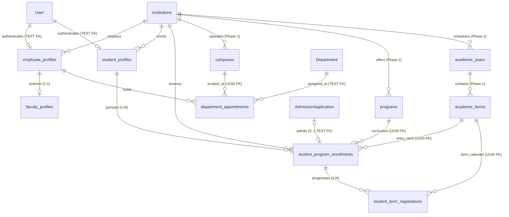
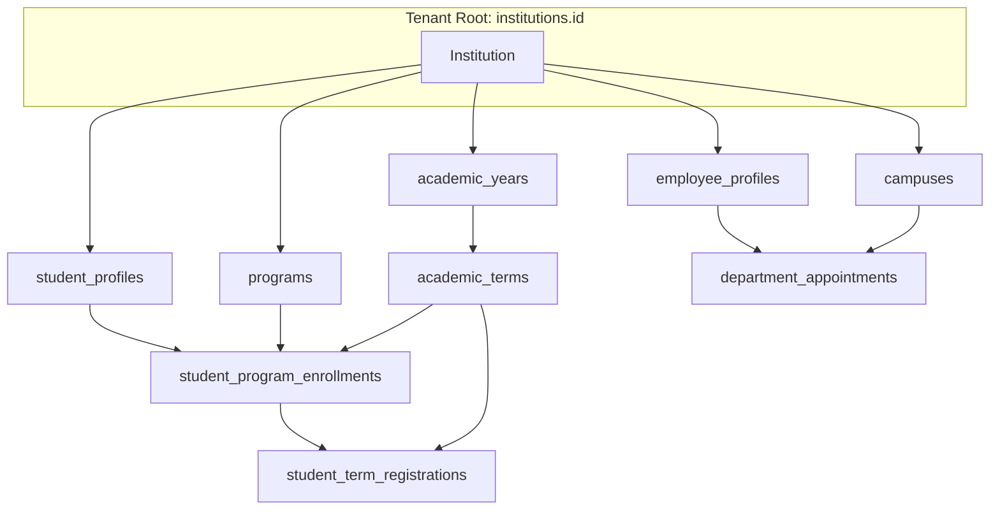

# CampusOne ERP — Phase 2: P2.5 Consolidated Architecture Review

**Document ID:** `CAMPUSONE-REVIEW-P2.5`
**Revision:** v1.0 (Consolidated Pre-Implementation Architecture Audit)
**Date:** 2026-10-10
**Status:** 📋 **PLANNING & AUDIT ONLY — NO DATABASE WRITES OR MIGRATION SQL GENERATED**
**Repository Working Directory:** `C:\Projects\ERP-System`
**Git Branch Status:** `main...origin/main [ahead 9]` (Clean working tree; 9 unpushed local commits)
**Live Target Database (Neon):** 🛡️ **100% UNTOUCHED (Zero writes; foundation & security tables preserved)**

---

## 1. Executive Verdict

### **Verdict: PASS WITH CONDITIONS**
**Recommendation: READY FOR MIGRATION IMPLEMENTATION PLANNING (P2.6) SUBJECT TO THREE TECHNICAL ALIGNMENTS**

The architecture defined across the four committed specifications—[`P2.1`](file:///c:/Projects/ERP-System/docs/P2.1-EMPLOYEE-AND-FACULTY-PROFILES-SPECIFICATION.md), [`P2.2`](file:///c:/Projects/ERP-System/docs/P2.2-STUDENT-PROFILES-AND-ADMISSIONS-SPECIFICATION.md), [`P2.3`](file:///c:/Projects/ERP-System/docs/P2.3-STUDENT-PROGRAM-ENROLLMENTS-SPECIFICATION.md), and [`P2.4`](file:///c:/Projects/ERP-System/docs/P2.4-STUDENT-TERM-REGISTRATIONS-SPECIFICATION.md)—is structurally coherent, conceptually sound, and rigorously aligned with the repository's baseline data reality.

The core architectural models successfully achieve the design goals:
* Person identity is decoupled from roles and academic lifecycles, enabling dual-role users (Student + Employee) with zero schema collision.
* The academic progression chain (`student_profiles` $\to$ `student_program_enrollments` $\to$ `student_term_registrations`) ends legacy in-place overwrites and preserves historical transcripts.
* The Four-Tier Registration Evidence Hierarchy and No-Manufactured-History principles strictly protect data provenance.
* Completed academic results and snapshots are protected by trigger-enforced immutability and auditable correction workflows.

However, this consolidated review identifies **three technical foreign-key and boundary alignments (TD-1, TD-2, TD-3)** that must be codified during **P2.6 Migration Implementation Planning** prior to executing any DDL in disposable database rehearsals:
1. **Target Table and Type Alignment for Admissions FK (TD-1):** In P2.3, `student_program_enrollments.admission_application_id` is specified as `UUID REFERENCES admission_applications(id)`. In the physical database and Prisma schema, the legacy table is named `"AdmissionApplication"` and its primary key `id` is typed as `TEXT`. In PostgreSQL, a UUID column cannot reference a TEXT column, and `admission_applications` does not exist. The implementation DDL must type this column as `TEXT NULL REFERENCES "AdmissionApplication"("id") ON DELETE SET NULL`.
2. **Program Enrollment Tenant Boundary Trigger (TD-2):** While P2.4 specifies a trigger to prevent cross-institution term registrations, P2.3 currently lacks an equivalent database trigger ensuring that `student_profile_id`, `program_id`, and `entry_term_id` all belong to the identical `institution_id`. An implementation trigger must be added.
3. **Department Appointment Tenant Consistency (TD-3):** In P2.1, `department_appointments` links `employee_profile_id` and `campus_id`. A trigger or validation must ensure `campuses.institution_id == employee_profiles.institution_id`.

None of these conditions invalidate the domain architecture; all three are implementation-level constraints that strengthen database integrity.

---

## 2. Complete Entity and Relationship Inventory

The proposed Phase 2 schema introduces six normalized entities spanning the employee and student lifecycles:



### 2.1 Proposed Phase 2 Table Catalog
| Table Name | Spec | Primary Key | Key Foreign Keys | Natural / Unique Keys | Soft Delete? |
|---|:---:|---|---|---|:---:|
| `employee_profiles` | P2.1 | `id UUID` | `user_id TEXT` $\to$ `"User"("id")`<br>`institution_id UUID` $\to$ `"institutions"("id")` | `UNIQUE ("user_id")`<br>`UNIQUE ("institution_id", "employee_number")` | Yes (`deleted_at`) |
| `faculty_profiles` | P2.1 | `id UUID` | `employee_profile_id UUID` $\to$ `"employee_profiles"("id")` | `UNIQUE ("employee_profile_id")` | No (1:1 extension) |
| `department_appointments` | P2.1 | `id UUID` | `employee_profile_id UUID` $\to$ `"employee_profiles"("id")`<br>`department_id TEXT` $\to$ `"Department"("id")`<br>`campus_id UUID` $\to$ `"campuses"("id")` | Partial Unique: Active HOD per Dept<br>Partial Unique: Active Primary per Employee | No (Explicit `ends_on`) |
| `student_profiles` | P2.2 | `id UUID` | `user_id TEXT` $\to$ `"User"("id")`<br>`institution_id UUID` $\to$ `"institutions"("id")` | `UNIQUE ("user_id")`<br>`UNIQUE ("institution_id", "student_number")` | Yes (`deleted_at`) |
| `student_program_enrollments` | P2.3 | `id UUID` | `student_profile_id UUID` $\to$ `"student_profiles"("id")`<br>`program_id UUID` $\to$ `"programs"("id")`<br>`institution_id UUID` $\to$ `"institutions"("id")`<br>`entry_term_id UUID` $\to$ `"academic_terms"("id")`<br>`admission_application_id TEXT` $\to$ `"AdmissionApplication"("id")` | Open 1:N (Option B)<br>Index on `(student_profile_id)` | Yes (`deleted_at`) |
| `student_term_registrations` | P2.4 | `id UUID` | `program_enrollment_id UUID` $\to$ `"student_program_enrollments"("id")`<br>`academic_term_id UUID` $\to$ `"academic_terms"("id")` | `UNIQUE ("program_enrollment_id", "academic_term_id")` | Yes (`deleted_at`) |

---

## 3. Cross-Specification Consistency Matrix

| Dimension | P2.1 (Employee & Faculty) | P2.2 (Student Identity) | P2.3 (Program Enrollment) | P2.4 (Term Registration) | Audit Assessment | Status |
|---|---|---|---|---|---|:---:|
| **Primary Key Standard** | Native PostgreSQL `UUID` (`gen_random_uuid()`) | Native PostgreSQL `UUID` (`gen_random_uuid()`) | Native PostgreSQL `UUID` (`gen_random_uuid()`) | Native PostgreSQL `UUID` (`gen_random_uuid()`) | 100% uniform native UUID PK strategy across all 6 tables. | **PASS** |
| **User Account Link** | `user_id TEXT REFERENCES "User"(id)` | `user_id TEXT REFERENCES "User"(id)` | N/A (via `student_profile_id`) | N/A (via `program_enrollment_id`) | Preserves 100% type compatibility with legacy `"User"` (`id TEXT`). | **PASS** |
| **Institutional Tenancy** | `institution_id UUID` | `institution_id UUID` | `institution_id UUID` | Tenant boundary enforced via trigger | All entities anchor to Phase 1 `institutions`. Trigger-backed at leaf. | **PASS WITH CONDITIONS** (TD-2, TD-3) |
| **Admission Link Location** | N/A | Strictly Omitted | `admission_application_id` (0..1) | N/A | Decoupled from personal identity; attached to curriculum offer. Target type must align with legacy schema (TD-1). | **PASS WITH CONDITIONS** (TD-1) |
| **Historical Provenance** | Derived timestamps flagged `inferred` | 1:1 legacy profile mapping | Anomalous cohort quarantined | Unrecorded terms remain unrecorded; Tier 1 proof required for activation | Strict compliance with Phase 0 provenance standards; no fabricated data. | **PASS** |
| **Soft Delete Semantics** | `deleted_at TIMESTAMPTZ` | `deleted_at TIMESTAMPTZ` | `deleted_at TIMESTAMPTZ` | `deleted_at TIMESTAMPTZ` | Standard `UNIQUE` constraints retained; auditable restoration policy adopted. | **PASS** |
| **Audit Log Integration** | Database trigger and notes | Profile history in notes | Quarantine audit in exception register | PL/pgSQL procedure writes to `"SystemActivity"` | Consistent interim JSON logging to `"SystemActivity"` pending canonical audit engine. | **PASS** |

---

## 4. Foreign-Key and Institution-Boundary Findings

### 4.1 Foreign Key Type Compatibility Audit
In PostgreSQL, foreign key constraints require strict type equivalence between referencing and referenced columns. An audit across legacy and Phase 1 tables reveals:

1. **`"User"("id")` $\to$ Profiles (`TEXT`):**
   * Legacy `"User"."id"` is `TEXT`.
   * `employee_profiles.user_id` is `TEXT` $\to$ **COMPATIBLE**.
   * `student_profiles.user_id` is `TEXT` $\to$ **COMPATIBLE**.
2. **`"Department"("id")` $\to$ Appointments (`TEXT`):**
   * Legacy `"Department"."id"` is `TEXT`.
   * `department_appointments.department_id` is `TEXT` $\to$ **COMPATIBLE**.
3. **`"programs"("id")` $\to$ Program Enrollments (`UUID`):**
   * Phase 1 `"programs"."id"` is `UUID`.
   * `student_program_enrollments.program_id` is `UUID` $\to$ **COMPATIBLE**.
4. **`"academic_terms"("id")` $\to$ Enrollments & Registrations (`UUID`):**
   * Phase 1 `"academic_terms"."id"` is `UUID`.
   * `student_program_enrollments.entry_term_id` is `UUID` $\to$ **COMPATIBLE**.
   * `student_term_registrations.academic_term_id` is `UUID` $\to$ **COMPATIBLE**.
5. **`"AdmissionApplication"("id")` $\to$ Program Enrollments (`TEXT` vs `UUID` — Finding TD-1):**
   * Legacy `"AdmissionApplication"."id"` is **`TEXT`** (Prisma `@default(uuid())` without `@db.Uuid`).
   * The table name in PostgreSQL is capitalized `"AdmissionApplication"`, not `admission_applications`.
   * P2.3 specification lists:
     ```sql
     "admission_application_id" UUID,
     FOREIGN KEY ("admission_application_id") REFERENCES "admission_applications"("id")
     ```
   * **Defect:** PostgreSQL will fail with `ERROR: foreign key constraint cannot be implemented: key columns have incompatible types: uuid and text` and `relation "admission_applications" does not exist`.
   * **Required Implementation Correction (TD-1):** Define column in P2.6 DDL as:
     ```sql
     "admission_application_id" TEXT,
     CONSTRAINT "spe_admission_app_fkey"
         FOREIGN KEY ("admission_application_id")
         REFERENCES "AdmissionApplication"("id")
         ON DELETE SET NULL ON UPDATE CASCADE
     ```

### 4.2 Institution Boundary Tracing
Every institution-related entity in the hierarchy must belong to the identical institutional tenant:



#### Boundary Enforcement Assessment:
* **Term Registration Boundary (Verified):** Handled by `trg_enforce_term_registration_institution()` in P2.4, which checks `student_program_enrollments.institution_id == academic_terms.academic_year.institution_id`.
* **Program Enrollment Boundary (Gap Identified — TD-2):**
  * `student_program_enrollments` holds four institution-linked foreign keys: `student_profile_id`, `program_id`, `institution_id`, and `entry_term_id`.
  * Ordinary FKs ensure that the referenced IDs exist, but do not guarantee that `student_profile.institution_id`, `program.institution_id`, and `entry_term.academic_year.institution_id` all equal `student_program_enrollments.institution_id`.
  * **Required Implementation Enforcement (TD-2):** A trigger `trg_enforce_program_enrollment_institution()` must execute `BEFORE INSERT OR UPDATE ON "student_program_enrollments"` to validate that all four IDs match the identical tenant.
* **Department Appointment Campus Boundary (Gap Identified — TD-3):**
  * `department_appointments` links `employee_profile_id` to `campus_id`.
  * **Required Implementation Enforcement (TD-3):** A trigger `trg_enforce_department_appointment_institution()` must verify that `campuses.institution_id == employee_profiles.institution_id`.

---

## 5. Lifecycle and Historical-Data Findings

### 5.1 Dual-Role Identity Harmony (Policy 2)
* **Architecture:** A single `"User"` account maps to both `employee_profiles` and `student_profiles` via separate 1:1 optional unique keys (`UNIQUE ("user_id")`).
* **Evaluation:** **VERIFIED**. There is zero constraint collision. When a Graduate Teaching Assistant authenticates, the application resolves both profiles. Session context in `auth_sessions` manages the active operational mode (`'student'` vs `'employee'`).

### 5.2 Registration Lifecycle & Date Semantics
* **Architecture:** `registered_on` is `DATE NULL`. Check constraint `str_registered_on_status_check` enforces that draft and quarantined records have `registered_on IS NULL`, while active registrations have `registered_on NOT NULL`.
* **Evaluation:** **VERIFIED**. Semantics accurately reflect institutional reality: an unapproved registration draft is not legally registered.

### 5.3 Snapshot Immutability and Grade Corrections
* **Architecture:** Trigger `trg_guard_completed_registration_snapshots()` locks 9 fields once a registration reaches `completed`. Post-completion amendments require the privileged stored procedure `sp_apply_grade_correction()`, which verifies authorization, sets a local session flag, and writes an auditable record to `"SystemActivity"`.
* **Evaluation:** **VERIFIED**. Implementation testing must include the two user-specified guardrails (negative testing of direct updates and unauthorized session variables in a disposable PostgreSQL container).

### 5.4 Soft Deletion and Unique Constraint Policy
* **Architecture:** Standard composite unique constraints (`UNIQUE (program_enrollment_id, academic_term_id)` and `UNIQUE (institution_id, student_number)`) are maintained across all rows including soft-deleted ones.
* **Evaluation:** **VERIFIED**. An academic registration or student identity is an enduring legal transcript entity. Retaining standard uniqueness forces an **Audited Restoration Workflow** (`deleted_at = NULL`) rather than creating duplicate, fragmented replacement records.

### 5.5 Historical Data Provenance & Quarantine Rules
* **Baseline Audit Reality:** In the legacy database:
  * 0 rows in `AttendanceRecord`, 0 rows in `ExamResult`, 0 rows in `AdmissionApplication`.
  * 4 active students in batch `2023-2027` (two in Sem 7, one in Sem 1, one in Sem 2).
  * 1 anomalous student `UNRESOLVED_STUDENT_01` in batch `"2026-2026"`.
* **Execution Rule:**
  * Semesters 1 through 6 for senior students remain **completely unrecorded** in `student_term_registrations`. Missing historical records are not fabricated.
  * Current term registrations for `2026-ODD` are staged in `registration_status = 'draft'` with `registered_on = NULL` pending Tier 1 Registrar evidence.
  * `UNRESOLVED_STUDENT_01` has personal identity established in `student_profiles`, program enrollment quarantined in `student_program_enrollments`, and zero term registrations created.
* **Evaluation:** **VERIFIED**. Provenance standards are rigorously maintained across all four specifications.

---

## 6. Consolidated Cross-Specification Decision Register

The consolidated register integrates all institutional approvals and technical implementation decisions across Phase 2:

| Decision ID | Origin / Area | Affected Specs | Decision / Policy Question | Current Documented Stance | Classification | Action Required for Closure |
|:---:|---|:---:|---|---|:---:|---|
| **ID-1** | Concurrent Programs | P2.3, P2.4 | Does CampusOne permit concurrent program enrollments (minors, dual degrees)? | Option B (1:N independent lifecycle entity); application-layer validation restricts concurrency. | **Institutional Approval** | Academic Council formal resolution on dual-degree policy. (Non-blocking for schema). |
| **ID-2** | Grading Scale Policy | P2.4 | Confirmation of 10-point scale, letter grades, and 2-decimal rounding. | Bounded `NUMERIC(4, 2)` between 0.00 and 10.00 in schema. | **Institutional Approval** | Academic Senate formal ratification of grading ordinance. (Non-blocking for schema). |
| **ID-3** | Academic Standing Rules | P2.4 | Institutional criteria for academic probation vs good standing. | Schema defaults to `'unspecified'` pending criteria. | **Institutional Approval** | Board of Studies regulation on GPA thresholds for probation. (Non-blocking for schema). |
| **ID-4** | Progression Skew Audit | P2.4 | Cause of Batch 2023 students recorded in Semesters 1 and 2. | Discrepancies logged in `_progression_discrepancies`; staged in `draft`. | **Institutional Audit** | Academic Registrar investigation into student academic files. (Non-blocking for schema). |
| **ID-5** | Historical Digitisation | P2.4 | Policy on digitising legacy paper transcripts for Semesters 1–6. | Historical terms remain unrecorded in database until digitized. | **Institutional Policy** | Academic Registrar archival scanning directive. (Non-blocking for schema). |
| **ID-6** | `UNRESOLVED_STUDENT_01` | P2.2, P2.3, P2.4 | Resolution of `"2026-2026"` batch anomaly for student `ccd73763...`. | Profile created; enrollment quarantined; term registration omitted. | **Institutional Audit** | Registrar memo clarifying 4-year cohort vs 1-year diploma. (Non-blocking for schema). |
| **TD-1** | Admissions FK Target & Type | P2.3 | Relational typing of `admission_application_id` on program enrollments. | P2.3 drafted as `UUID REFERENCES admission_applications(id)`; must align to `TEXT REFERENCES "AdmissionApplication"("id")`. | **Technical Implementation** | Update DDL in P2.6 implementation planning to use `TEXT` referencing `"AdmissionApplication"`. |
| **TD-2** | Program Enrollment Boundary | P2.3 | Prevention of cross-institution program enrollments. | P2.3 has `institution_id` but lacks cross-referencing tenant trigger. | **Technical Implementation** | Add `trg_enforce_program_enrollment_institution()` to P2.6 implementation plan. |
| **TD-3** | Appointment Campus Boundary | P2.1 | Prevention of cross-institution department appointments. | P2.1 links `employee_profile_id` and `campus_id` without explicit tenant trigger. | **Technical Implementation** | Add `trg_enforce_department_appointment_institution()` to P2.6 implementation plan. |

---

## 7. Migration-Readiness Assessment

### 7.1 Readiness Summary
* **Blocking Architectural Defects:** **ZERO**. The domain model, entity lifecycles, and relational hierarchies are completely sound.
* **Implementation Adjustments Required:** **THREE (TD-1, TD-2, TD-3)**. All three are database-level constraint refinements that will be incorporated directly into the P2.6 implementation plan.
* **Data Backfill Feasibility:** **100% FEASIBLE**. The backfill logic maps 2 faculty rows and 5 student rows cleanly into the proposed tables without data loss or fabricated records.
* **Legacy Table Non-Interference:** **100% PRESERVED**. Zero modifications to legacy tables (`"User"`, `"Faculty"`, `"Department"`, `"Student"`, `"AdmissionApplication"`).

### 7.2 Gate Status Table
| Gate | Verification Area | Target Standard | Status |
|---|---|---|:---:|
| **Gate 1** | Entity Coverage | All employee, faculty, student, enrollment, and term entities specified. | ✅ **PASS** |
| **Gate 2** | Primary Key Consistency | Uniform native PostgreSQL UUID strategy across all 6 tables. | ✅ **PASS** |
| **Gate 3** | Legacy Foreign Key Typing | String/Text foreign keys align with legacy `"User"` and `"Department"`. | ⚠️ **PASS WITH CONDITIONS** (TD-1 required for Admissions) |
| **Gate 4** | Institutional Tenancy | Tenant boundaries verified across all entity chains. | ⚠️ **PASS WITH CONDITIONS** (TD-2 & TD-3 triggers required) |
| **Gate 5** | Historical Data Integrity | No manufactured records; quarantine rules formal and auditable. | ✅ **PASS** |
| **Gate 6** | Immutability & Protection | Triggers and procedures protect finalized academic results. | ✅ **PASS** |
| **Gate 7** | Soft Deletion Consistency | Standard unique keys enforce auditable restoration policy. | ✅ **PASS** |
| **Gate 8** | Policy Decision Visibility | All 6 institutional decisions remain documented and open. | ✅ **PASS** |

---

## 8. Prioritized Corrective Actions for P2.6

Before generating migration DDL in Work Package P2.6, the following three implementation actions must be executed:

1. **[Priority 1 — High] Codify TD-1 in Implementation DDL:**
   In the P2.6 migration script, define `student_program_enrollments.admission_application_id` as:
   ```sql
   "admission_application_id" TEXT,
   CONSTRAINT "spe_admission_app_fkey"
       FOREIGN KEY ("admission_application_id")
       REFERENCES "AdmissionApplication"("id")
       ON DELETE SET NULL ON UPDATE CASCADE
   ```
2. **[Priority 2 — High] Draft Tenant Guard Trigger for Program Enrollments (TD-2):**
   In P2.6, include `trg_enforce_program_enrollment_institution()` to verify:
   ```sql
   v_student_inst_id == v_program_inst_id == v_term_inst_id == NEW.institution_id
   ```
3. **[Priority 3 — Medium] Draft Tenant Guard Trigger for Department Appointments (TD-3):**
   In P2.6, include `trg_enforce_department_appointment_institution()` to verify:
   ```sql
   v_employee_inst_id == v_campus_inst_id
   ```
4. **[Priority 4 — Guardrail] Codify Disposable Testing Protocol:**
   Incorporate the user's Guardrail A (authorization bypass negative tests) and Guardrail B (transactional rollback and immutability tests) into the P2.7 rehearsal test suite.

---

## 9. Evidence and Verification Limitations

1. **No Production Execution:** In strict compliance with safety boundaries, no migration SQL has been executed against live Neon, and no seed scripts have been run.
2. **Untested Functions in Active DB:** The PL/pgSQL functions (`trg_enforce_term_registration_institution()`, `trg_guard_completed_registration_snapshots()`, `sp_apply_grade_correction()`) have been syntactically validated in documentation but have not yet been compiled inside the PostgreSQL engine. Their execution correctness must be verified in a disposable container during P2.7 rehearsals.
3. **Institutional Approvals:** The six institutional decisions (ID-1 through ID-6) remain open and are explicitly recorded as institutional policy matters outside the engineering team's sole purview.

---

## 10. Explicit Recommendation for the Next Phase

### **READY FOR MIGRATION IMPLEMENTATION PLANNING (P2.6)**

The architectural design phase of Phase 2 (P2.1–P2.5) is now complete. The architecture is robust, cohesive, and ready to advance to implementation planning.

**Next Immediate Step:**
Proceed to **Work Package P2.6: Phase 2 Migration Implementation Planning**:
1. Formulate the sequential DDL migration scripts incorporating technical resolutions TD-1, TD-2, and TD-3.
2. Draft the deterministic backfill scripts mapping legacy faculty and student rows.
3. Formulate the rollback and disaster recovery runbook.
4. Prepare the automated test harnesses for the disposable PostgreSQL rehearsal (P2.7).

**Safety Boundaries Confirmed:**
* Working tree clean; 9 local commits ahead of `origin/main`. Zero remote pushes.
* Live Neon database (`ep-green-pine-azr0z3ii`) remains 100% untouched.
* P1.4 live seeding remains on hold.
