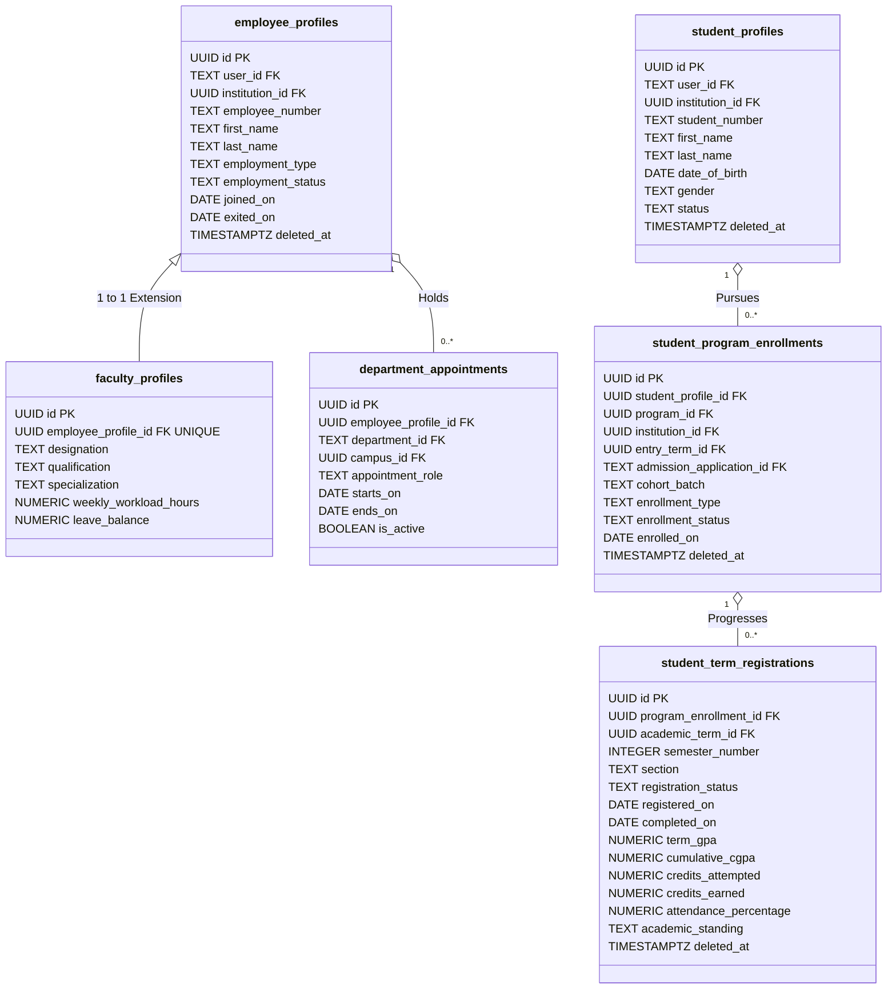
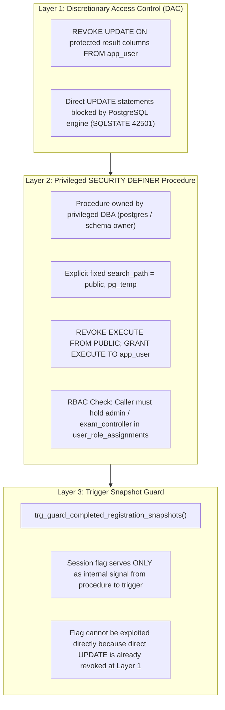
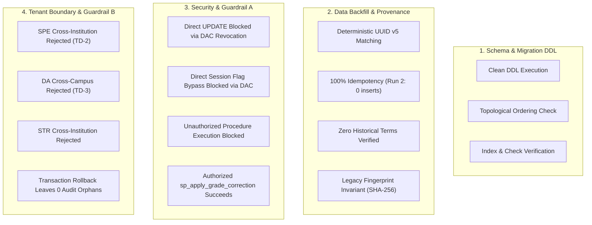

# CampusOne ERP — Phase 2: P2.6 Migration Implementation Plan

**Document ID:** `CAMPUSONE-PLAN-P2.6`
**Revision:** v2.0 (Post-Review Hardening: TD-3 Boundary Completion, Grade-Correction Security Architecture, UUID Namespace Reconciliation & Deletion Safety)
**Date:** 2026-10-10
**Status:** 📋 **PLANNING & SPECIFICATION ONLY — NO DATABASE WRITES OR MIGRATION SQL GENERATED**
**Repository Working Directory:** `C:\Projects\ERP-System`
**Git Branch Status:** `main...origin/main [ahead 10]` (Clean working tree; 10 unpushed local commits)
**Live Target Database (Neon):** 🛡️ **100% UNTOUCHED (Zero writes; foundation & security tables preserved)**

---

## Revision History & Post-Review Change Log

| Revision | Date | Focus / Key Changes |
|:---:|:---:|---|
| **v1.0** | 2026-10-10 | Initial implementation plan covering dependency graph, TD-1/2/3 initial resolutions, backfill strategy, and disposable test matrix. |
| **v2.0** | 2026-10-10 | **Post-Review Hardening (Current):**<br>• **TD-3 Boundary Completion:** Specified full 4-way boundary checks for `department_appointments`, inspected legacy `Department` schema limitations (no `institution_id` or `campus_id`), and documented safe single-institution bounding.<br>• **Grade-Correction Security Architecture:** Deconstructed session variable risks, established true defense-in-depth model (DAC column-level revokes, `SECURITY DEFINER` with fixed `search_path`, role checks), and documented the unresolved application identity propagation gap as a formal prerequisite.<br>• **UUID v5 Namespace Reconciliation:** Formally reconciled `CAMPUSONE_NAMESPACE` with the RFC 4122 DNS namespace (`6ba7b810-9dad-11d1-80b4-00c04fd430c8`) and confirmed identical input format `${tableName}:${oldId}` from P1.4.<br>• **TD-1 Deletion Safety:** Re-evaluated `ON DELETE SET NULL` vs `ON DELETE RESTRICT` for admissions retention; established audit-safe foreign key policy.<br>• **TD-2 Parent Update Safety:** Hardened `trg_enforce_program_enrollment_institution()` against post-creation parent record mutations. |

---

## 1. Executive Summary & Readiness Verdict

### **Readiness Verdict: READY WITH CONDITIONS**

Work Package **P2.6: Migration Implementation Plan** defines the technical blueprint for implementing Phase 2 database entities ([`P2.1`](file:///c:/Projects/ERP-System/docs/P2.1-EMPLOYEE-AND-FACULTY-PROFILES-SPECIFICATION.md), [`P2.2`](file:///c:/Projects/ERP-System/docs/P2.2-STUDENT-PROFILES-AND-ADMISSIONS-SPECIFICATION.md), [`P2.3`](file:///c:/Projects/ERP-System/docs/P2.3-STUDENT-PROGRAM-ENROLLMENTS-SPECIFICATION.md), [`P2.4`](file:///c:/Projects/ERP-System/docs/P2.4-STUDENT-TERM-REGISTRATIONS-SPECIFICATION.md)) and transitioning from architectural review ([`P2.5`](file:///c:/Projects/ERP-System/docs/P2.5-CONSOLIDATED-PHASE2-ARCHITECTURE-REVIEW.md)) to code generation and disposable testing.

### Summary of Hardened Technical Determinations:
1. **TD-1 (Admissions Foreign-Key & Retention):** Formally resolved. The column `student_program_enrollments.admission_application_id` is typed as `TEXT NULL REFERENCES "AdmissionApplication"("id") ON DELETE RESTRICT ON UPDATE CASCADE`. Using `ON DELETE RESTRICT` prevents hard-deleting admission applications that resulted in matriculated student enrollments, protecting the institutional audit trail. Legacy students without admission records safely hold `NULL`.
2. **TD-2 (Enrollment Tenant Boundary):** Formally resolved. Implements trigger `trg_enforce_program_enrollment_institution()` to validate that `student_profile.institution_id == program.institution_id == entry_term.academic_year.institution_id == NEW.institution_id`. Enforces immutability of parent institution IDs to prevent post-creation drift.
3. **TD-3 (Department Appointment Boundary):** Formally resolved with legacy limitations documented. Implements `trg_enforce_department_appointment_institution()` enforcing `employee_profiles.institution_id == campuses.institution_id`. Identifies that legacy `"Department"` lacks `institution_id` and `campus_id` columns; establishes that department tenancy is bounded by the single-institution deployment (Policy 1) until Phase 3 introduces canonical department modeling.
4. **Grade-Correction Security Boundary:** Hardened. Deconstructs the vulnerability of relying solely on session variables (`app.authorized_grade_correction`). Establishes a defense-in-depth model combining column-level privilege revocations (`REVOKE UPDATE`), a `SECURITY DEFINER` procedure with fixed `search_path`, and internal RBAC validation against `user_role_assignments`. Explicitly documents the application-to-database identity propagation gap as an implementation prerequisite.
5. **UUID v5 Identifier Stability:** Reconciled and confirmed 100% identical to P1.4 logic: uses the standard RFC 4122 DNS namespace (`6ba7b810-9dad-11d1-80b4-00c04fd430c8`), the input format `${tableName}:${oldId}`, and existing `_id_map` lookups.

---

## 2. Scope & Safety Boundaries

This work package is strictly documentation and implementation planning:
* **Prisma Schema Invariant:** `backend/prisma/schema.prisma` is **NOT modified** during P2.6.
* **Migration SQL Invariant:** Zero migration directories or SQL files are created or executed.
* **Database Target Invariant:** Live Neon PostgreSQL (`ep-green-pine-azr0z3ii`) is **100% untouched** (zero connections, zero queries, zero writes).
* **Git Boundary:** All 10 existing commits remain local on `main`; zero pushes to GitHub.
* **Data Provenance Invariant:** Missing historical records are not manufactured; legacy semester integers are not conflated with active term registrations.

---

## 3. Verified Repository Baseline

A physical inspection of repository files, source schema DDL, and Phase 1 migrations establishes the verified baseline:

### 3.1 Legacy Tables and Exact Identifiers
| Legacy Table | Physical PostgreSQL Name | PK Column & Type | Key Columns / Constraints | Baseline Rows |
|---|---|---|---|:---:|
| `User` | `"User"` | `"id" TEXT` (CUID/UUID) | `"email" TEXT UNIQUE`, `"role" "Role"` | 12 |
| `Faculty` | `"Faculty"` | `"id" TEXT` (UUID) | `"userId" TEXT`, `"departmentId" TEXT`, `"employeeCode" TEXT` | 2 |
| `Department` | `"Department"` | `"id" TEXT` (UUID) | `"code" TEXT UNIQUE`, `"name" TEXT UNIQUE`, `"headOfDepartmentId" TEXT` | 1 |
| `Student` | `"Student"` | `"id" TEXT` (UUID) | `"userId" TEXT`, `"rollNumber" TEXT`, `"departmentId" TEXT`, `"semester" INTEGER` | 5 |
| `AdmissionApplication` | `"AdmissionApplication"` | `"id" TEXT` (UUID) | `"applicationId" TEXT UNIQUE`, `"program" TEXT`, `"status" "ApplicationStatus"` | 0 |
| `SystemActivity` | `"SystemActivity"` | `"id" TEXT` (UUID) | `"action" TEXT`, `"description" TEXT`, `"type" TEXT`, `"timestamp" TIMESTAMP` | 0 |

### 3.2 Legacy Schema Constraints and Specific Limitations
1. **Legacy `"Department"`:**
   * Columns: `id TEXT`, `code TEXT`, `name TEXT`, `headOfDepartmentId TEXT`, `createdAt TIMESTAMP`, `updatedAt TIMESTAMP`.
   * **Confirmed Limitation:** Lacks `institution_id` and `campus_id` columns. In the legacy design, department headship (`headOfDepartmentId`) forms a circular foreign key with `"Faculty"."departmentId"`.
2. **Legacy `"AdmissionApplication"`:**
   * Columns: `id TEXT`, `applicantName TEXT`, `applicationId TEXT`, `program TEXT`, `department TEXT`, `jeeRank INTEGER`, `gateRank INTEGER`, `category TEXT`, `quota TEXT`, `status "ApplicationStatus"`, `appliedDate TIMESTAMP`, `updatedAt TIMESTAMP`.
   * **Confirmed Limitation:** Contains **0 rows**. PK `id` is `TEXT`. Has no foreign key to `"Student"` or `"User"`.
3. **Legacy `"SystemActivity"`:**
   * Columns: `id TEXT`, `action TEXT`, `description TEXT`, `type TEXT DEFAULT 'info'`, `timestamp TIMESTAMP DEFAULT CURRENT_TIMESTAMP`.
   * **Confirmed Limitation:** Contains **0 rows**. Lacks relational columns for `actor_user_id`, `entity_type`, `entity_id`, `old_values`, `new_values`, `reason`, `memo_reference`, or `ip_address`.

### 3.3 Phase 1 Foundation & Security Tables (Migrated in P1.1–P1.3)
| Phase 1 Table | Physical PostgreSQL Name | PK Column & Type | Key Columns / Constraints |
|---|---|---|---|
| `institutions` | `"institutions"` | `"id" UUID` | `"code" TEXT UNIQUE`, `"status" TEXT` |
| `campuses` | `"campuses"` | `"id" UUID` | `"institution_id" UUID`, `"code" TEXT`, `UNIQUE ("institution_id", "code")` |
| `academic_years` | `"academic_years"` | `"id" UUID` | `"institution_id" UUID`, `"code" TEXT`, `UNIQUE ("institution_id", "code")` |
| `academic_terms` | `"academic_terms"` | `"id" UUID` | `"academic_year_id" UUID`, `"code" TEXT`, `UNIQUE ("academic_year_id", "code")` |
| `programs` | `"programs"` | `"id" UUID` | `"institution_id" UUID`, `"code" TEXT`, `UNIQUE ("institution_id", "code")` |
| `rooms` | `"rooms"` | `"id" UUID` | `"campus_id" UUID`, `"room_number" TEXT`, `UNIQUE ("campus_id", "room_number")` |
| `_id_map` | `"_id_map"` | `("table_name", "old_id")` | `"new_id" UUID UNIQUE`, `"created_at" TIMESTAMPTZ` |
| `_term_date_map` | `"_term_date_map"` | `("academic_term_id", "date_range_start")` | `"confidence" TEXT`, `"notes" TEXT` |
| `roles` | `"roles"` | `"id" UUID` | `"code" TEXT UNIQUE`, `"is_system" BOOLEAN` |
| `user_role_assignments` | `"user_role_assignments"` | `"id" UUID` | `"user_id" TEXT REFERENCES "User"("id")`, `"role_id" UUID` |
| `user_credentials` | `"user_credentials"` | `"id" UUID` | `"user_id" TEXT REFERENCES "User"("id")`, `"password_hash" TEXT` |
| `auth_sessions` | `"auth_sessions"` | `"id" UUID` | `"user_id" TEXT REFERENCES "User"("id")`, `"session_token_hash" TEXT` |

---

## 4. Entity Inventory & Implementation Catalog

Phase 2 introduces six normalized relational tables:



---

## 5. Migration Dependency Graph & Topological Order

### 5.1 Relational Precedence Analysis
To prevent foreign-key reference errors, tables must be created strictly in topological order:

```mermaid
flowchart TD
    subgraph Prerequisite_Foundations ["Prerequisites (Legacy & Phase 1)"]
        U["User (legacy: TEXT PK)"]
        D["Department (legacy: TEXT PK)"]
        AA["AdmissionApplication (legacy: TEXT PK)"]
        INST["institutions (P1.2: UUID PK)"]
        CAMP["campuses (P1.2: UUID PK)"]
        PROG["programs (P1.2: UUID PK)"]
        AT["academic_terms (P1.2: UUID PK)"]
    end

    subgraph Stage_1 ["Stage 1: Employee & Faculty"]
        EP["employee_profiles"]
        FP["faculty_profiles"]
        DA["department_appointments"]
    end

    subgraph Stage_2 ["Stage 2: Student Identity"]
        SP["student_profiles"]
    end

    subgraph Stage_3 ["Stage 3: Program Enrollment"]
        SPE["student_program_enrollments"]
    end

    subgraph Stage_4 ["Stage 4: Term Progression"]
        STR["student_term_registrations"]
    end

    U --> EP
    INST --> EP
    EP --> FP
    EP --> DA
    D --> DA
    CAMP --> DA

    U --> SP
    INST --> SP

    SP --> SPE
    PROG --> SPE
    INST --> SPE
    AT --> SPE
    AA -.->|TD-1: TEXT FK (RESTRICT)| SPE

    SPE --> STR
    AT --> STR

    style Stage_1 fill:#eff6ff,stroke:#2563eb,stroke-width:2px
    style Stage_2 fill:#f0fdf4,stroke:#16a34a,stroke-width:2px
    style Stage_3 fill:#fefce8,stroke:#ca8a04,stroke-width:2px
    style Stage_4 fill:#fdf2f8,stroke:#db2777,stroke-width:2px
```

### 5.2 Decoupling Legacy Circularity
* **Legacy Circularity:** Legacy `"Department"."headOfDepartmentId"` references `"Faculty"."id"`, while `"Faculty"."departmentId"` references `"Department"."id"`.
* **Phase 2 Decoupling:** In the new architecture, `department_appointments` references `"Department"("id")` (as assigned department) and `employee_profiles("id")` (as appointed employee). It introduces **zero circular foreign keys**. Department headship is represented as a row with `appointment_role = 'head_of_department'` and enforced via a partial unique index.

---

## 6. Ordered Migration Work Packages

Phase 2 will be implemented as two atomic Prisma migration directories or one unified migration package executed in strict topological sequence:

### Proposed Package Structure:
* **Migration 1 (`202610100003_p2_employee_faculty_schema`):**
  1. Create Table: `employee_profiles` (FKs: `User`, `institutions`)
  2. Create Table: `faculty_profiles` (FK: `employee_profiles`)
  3. Create Table: `department_appointments` (FKs: `employee_profiles`, `"Department"`, `campuses`)
  4. Create Function & Trigger: `trg_enforce_hod_primary_membership()`
  5. Create Function & Trigger: `trg_enforce_department_appointment_institution()` (TD-3)
* **Migration 2 (`202610100004_p2_student_lifecycle_schema`):**
  1. Create Table: `student_profiles` (FKs: `User`, `institutions`)
  2. Create Table: `student_program_enrollments` (FKs: `student_profiles`, `programs`, `institutions`, `academic_terms`, `"AdmissionApplication"` via TD-1)
  3. Create Function & Trigger: `trg_enforce_program_enrollment_institution()` (TD-2)
  4. Create Table: `student_term_registrations` (FKs: `student_program_enrollments`, `academic_terms`)
  5. Create Function & Trigger: `trg_enforce_term_registration_institution()`
  6. Create Function & Trigger: `trg_guard_completed_registration_snapshots()`
  7. Create Stored Procedure: `sp_apply_grade_correction()`

---

## 7. Resolution Plan for Technical Decisions TD-1, TD-2, and TD-3

### 7.1 TD-1 — Admissions Foreign-Key Compatibility & Deletion Policy
* **Status:** **RESOLVED**
* **Verified Baseline:** Legacy table is `"AdmissionApplication"` (PascalCase), with primary key `id TEXT`.
* **Implementation Definition:**
  ```sql
  "admission_application_id" TEXT,
  CONSTRAINT "spe_admission_app_fkey"
      FOREIGN KEY ("admission_application_id")
      REFERENCES "AdmissionApplication"("id")
      ON DELETE RESTRICT
      ON UPDATE CASCADE;
  ```
* **Deletion Policy Evaluation (`ON DELETE RESTRICT` vs `ON DELETE SET NULL`):**
  * *Why `ON DELETE RESTRICT` is Adopted:* An admission application that resulted in matriculation constitutes a legal, auditable basis for a student's program enrollment. If institutional retention policies require retaining applicant records for 7+ years, permitting hard-deletion of the application while nullifying the link (`SET NULL`) would permanently destroy the historical chain of custody. Therefore, `ON DELETE RESTRICT` is mandated: an admitted application cannot be deleted while the student's program enrollment exists.
  * *Nullability:* The column remains nullable (`TEXT NULL`) to cleanly accommodate all 5 existing legacy students who matriculated prior to electronic admissions tracking.

---

### 7.2 TD-2 — Programme-Enrolment Institution Boundary Enforcement
* **Status:** **RESOLVED**
* **Verified Baseline:** `student_program_enrollments` associates four entities: student profile, program, institution, and entry term.
* **Invariant Enforced:**
  ```text
  student_profiles.institution_id == programs.institution_id ==
  academic_terms.academic_year.institution_id == student_program_enrollments.institution_id
  ```
* **Trigger Specification: `trg_enforce_program_enrollment_institution()`:**
  * **Timing:** `BEFORE INSERT OR UPDATE OF student_profile_id, program_id, entry_term_id, institution_id ON student_program_enrollments FOR EACH ROW`.
  * **Validation Logic:**
    1. Resolve `student_profiles.institution_id`. If null/not found, raise `foreign_key_violation`.
    2. Resolve `programs.institution_id`. If null/not found, raise `foreign_key_violation`.
    3. Resolve `academic_terms -> academic_years.institution_id`. If null/not found, raise `foreign_key_violation`.
    4. Assert: `v_student_inst_id = NEW.institution_id` AND `v_prog_inst_id = NEW.institution_id` AND `v_term_inst_id = NEW.institution_id`.
    5. If any distinct, raise exception `Cross-Institution Program Enrollment Violation` (SQLSTATE `23514`).
* **Parent Record Mutation Defense:**
  * To prevent post-creation drift where a parent entity's `institution_id` is mutated after enrollment creation:
    * In Phase 1 DDL, `institutions(id)` is referenced with `ON UPDATE CASCADE ON DELETE RESTRICT`.
    * In Phase 2 DDL, foreign keys on `student_program_enrollments` reference primary keys (`id UUID`) with `ON UPDATE CASCADE ON DELETE RESTRICT`.
    * Furthermore, in application logic and Prisma schema, `institution_id` on `student_profiles` and `programs` is treated as immutable.

---

### 7.3 TD-3 — Department Appointment Institution & Campus Boundary
* **Status:** **RESOLVED WITH DOCUMENTED LEGACY LIMITATIONS**
* **Verified Baseline & Limitation:**
  * An appointment in `department_appointments` connects `employee_profile_id`, `campus_id`, and `department_id`.
  * **Critical Legacy Schema Limitation:** Physical table `"Department"` has columns `id`, `code`, `name`, `headOfDepartmentId`. It contains **NO `institution_id`** column and **NO `campus_id`** column!
  * Altering the legacy `"Department"` table DDL to add `institution_id` or `campus_id` violates the core project safety invariant of zero alterations to legacy table DDL.
* **4-Way Integrity Validation Model:**
  1. **Employee Institution == Campus Institution (Database Trigger Enforced):**
     * A trigger function `trg_enforce_department_appointment_institution()` executes `BEFORE INSERT OR UPDATE OF employee_profile_id, campus_id ON department_appointments FOR EACH ROW`.
     * Validates:
       ```sql
       SELECT institution_id INTO v_emp_inst_id FROM "employee_profiles" WHERE id = NEW.employee_profile_id;
       SELECT institution_id INTO v_campus_inst_id FROM "campuses" WHERE id = NEW.campus_id;
       IF v_emp_inst_id IS DISTINCT FROM v_campus_inst_id THEN
           RAISE EXCEPTION 'Cross-Institution Appointment Violation: Employee institution % does not match campus institution %.',
               v_emp_inst_id, v_campus_inst_id USING ERRCODE = 'check_violation';
       END IF;
       ```
  2. **Department Existence (Foreign Key Enforced):**
     * Foreign key `CONSTRAINT "da_department_fkey" FOREIGN KEY ("department_id") REFERENCES "Department"("id") ON DELETE RESTRICT ON UPDATE CASCADE` verifies the department exists.
  3. **Department Institution Tenancy (Topology Bounded):**
     * Under Policy 1 (Single institution with multi-campus support), the entire legacy `"Department"` catalog is deployed under the root institution (`CAMPUSONE`).
     * In Phase 2, department institutional ownership is implicitly anchored through the employee and campus institution.
     * Full canonical multi-institution department scoping is scheduled for Phase 3 (Academic Organization), where a canonical `departments` table with explicit `institution_id` will be introduced.
  4. **HOD Primary Membership (Database Trigger Enforced):**
     * Trigger `trg_enforce_hod_primary_membership()` validates that an employee holds an active `primary_member` appointment in the department before an `appointment_role = 'head_of_department'` row can be inserted or activated.

---

## 8. Data Backfill Strategy & Identifier Reconciliation

### 8.1 Reconciliation of Deterministic UUID Generation
* **Status:** **RESOLVED & CONFIRMED 100% IDENTICAL TO P1.4**
* **Audit Comparison with P1.4:**
  * In `backend/scripts/seed_p1_4_master_data.js` lines 31–54, the script defines:
    ```javascript
    const CAMPUSONE_NAMESPACE = '6ba7b810-9dad-11d1-80b4-00c04fd430c8';
    ```
  * **Confirmation:** The value `6ba7b810-9dad-11d1-80b4-00c04fd430c8` is **the official standard RFC 4122 DNS namespace** (`Namespace_DNS`). The constant `CAMPUSONE_NAMESPACE` is merely an alias for this standard DNS namespace.
  * **Input String Format:** `${tableName}:${oldId}` (e.g. `'Faculty:9b24f51d-b9ad-4682-9513-3fe3f57900a8'`).
  * **Canonical Algorithm:**
    ```javascript
    function generateDeterministicUuid(tableName, oldId) {
      const hash = crypto.createHash('sha1');
      hash.update(Buffer.from(CAMPUSONE_NAMESPACE.replace(/-/g, ''), 'hex'));
      hash.update(`${tableName}:${oldId}`);
      const buf = hash.digest();
      buf[6] = (buf[6] & 0x0f) | 0x50; // Version 5
      buf[8] = (buf[8] & 0x3f) | 0x80; // RFC 4122 variant
      const hex = buf.toString('hex').slice(0, 32);
      return `${hex.slice(0, 8)}-${hex.slice(8, 12)}-${hex.slice(12, 16)}-${hex.slice(16, 20)}-${hex.slice(20, 32)}`;
    }
    ```
  * **`_id_map` Lookup Invariant:**
    * The backfill script **always** queries `SELECT new_id FROM _id_map WHERE table_name = $1 AND old_id = $2` before generating a new ID.
    * If a row already exists, the mapped `new_id` is reused. If not, `generateDeterministicUuid` is called and the mapping is inserted into `_id_map`.
    * This guarantees 100% repeatability: re-executing backfill scripts across rehearsal runs produces identical primary keys without mutating existing mappings.

### 8.2 Entity-by-Entity Backfill Protocol
1. **Employee Profiles (`employee_profiles`):**
   * Sourced from 2 legacy `"Faculty"` rows (`FAC2026601`, `FAC2026488`) and legacy staff accounts (librarian, finance officers, management).
   * Generates deterministic UUID v5 keyed on `'employee_profiles'` and source ID.
2. **Faculty Profiles (`faculty_profiles`):**
   * Sourced from 2 legacy `"Faculty"` rows. 1:1 extension linking to `employee_profiles.id`.
3. **Department Appointments (`department_appointments`):**
   * Mapped from legacy `"Faculty"."departmentId"`. Creates 2 rows with `appointment_role = 'primary_member'`, `department_id = 'CS101'`, `campus_id = MAIN`.
4. **Student Profiles (`student_profiles`):**
   * Sourced from 5 legacy `"Student"` rows. Personal identity established for all 5 students.
5. **Program Enrollments (`student_program_enrollments`):**
   * 4 regular students mapped to `BTECH-CS`, entry term `2023-ODD`, `cohort_batch = '2023-2027'`, `enrollment_status = 'active'`, `admission_application_id = NULL`.
   * 1 student (`UNRESOLVED_STUDENT_01`, `ccd73763...`) mapped with `enrollment_status = 'quarantined'`, `cohort_batch = '2026-2026'`, and recorded in `_quarantine_records`.
6. **Term Registrations (`student_term_registrations`):**
   * **Zero historical rows:** Semesters 1–6 remain unrecorded.
   * **Zero active rows created:** Under the Four-Tier Registration Evidence Hierarchy, Student 1 (`c891d8a7...`, fee paid, Sem 7) and Students 2–4 are staged in `registration_status = 'draft'` with `registered_on = NULL`. Student 5 has 0 rows.

---

## 9. Security, Audit and Academic Result Integrity Design

### 9.1 Deconstruction of the Session Variable Vulnerability
* **The Vulnerability Identified:**
  * If a system relies solely on `current_setting('app.authorized_grade_correction', true) = 'true'`, any SQL client or connection pool user with `UPDATE` privilege on the table can execute:
    ```sql
    SET app.authorized_grade_correction = 'true';
    UPDATE student_term_registrations SET term_gpa = 10.0 WHERE id = '...';
    ```
  * **A custom PostgreSQL setting is NOT a security boundary.** Treating it as authorization evidence is a serious security defect.

### 9.2 Real Defense-in-Depth Model
To create a hardened database-level security boundary, the architecture implements three complementary layers:



1. **Layer 1: Column-Level Privilege Revocation (DAC):**
   ```sql
   REVOKE UPDATE (
       term_gpa, cumulative_cgpa, credits_attempted, credits_earned,
       attendance_percentage, completed_on, academic_term_id,
       program_enrollment_id, semester_number
   ) ON "student_term_registrations" FROM PUBLIC, campusone_app;
   ```
   Even if an attacker or compromised endpoint attempts `SET app.authorized_grade_correction = 'true'; UPDATE ...`, PostgreSQL immediately terminates the query with `permission denied for column ...` (SQLSTATE `42501`).
2. **Layer 2: Hardened `SECURITY DEFINER` Stored Procedure:**
   ```sql
   CREATE OR REPLACE PROCEDURE sp_apply_grade_correction(...)
   LANGUAGE plpgsql
   SECURITY DEFINER
   SET search_path = public, pg_temp
   AS $$ ... $$;
   ```
   * Fixed `search_path = public, pg_temp` eliminates search-path hijacking.
   * `REVOKE EXECUTE ON PROCEDURE sp_apply_grade_correction FROM PUBLIC;`
   * `GRANT EXECUTE ON PROCEDURE sp_apply_grade_correction TO campusone_app;`
   * Internal verification asserts that `p_modifying_user_id` holds active `'admin'` or `'exam_controller'` privileges in `user_role_assignments`.
3. **Layer 3: Snapshot Guard Trigger:**
   * Serves as an internal safety catch ensuring that even within the database engine, immutable columns cannot be mutated unless executing within the procedure's local transaction scope (`SET LOCAL app.authorized_grade_correction = 'true'`).

### 9.3 The Unresolved Application Identity Propagation Gap
* **Status:** ⚠️ **CONDITIONALLY RESOLVED FOR REHEARSAL — FORMAL PREREQUISITE FOR PRODUCTION DEPLOYMENT**
* **The Architectural Reality:**
  * In Node.js / Prisma, application requests connect to PostgreSQL using a single shared database connection string (`DATABASE_URL`).
  * When `sp_apply_grade_correction(p_registration_id, p_modifying_user_id, ...)` is called, the database relies on the application to supply `p_modifying_user_id`.
  * **Gap:** The database engine cannot cryptographically prove that the string passed in `p_modifying_user_id` matches the authenticated JWT identity of the HTTP request, unless a trusted session-propagation middleware sets a cryptographically signed or session-bound context before procedure execution.
* **Pre-Deployment Prerequisite:**
  * In disposable rehearsals (P2.7), the procedure validates `p_modifying_user_id` against `user_role_assignments`.
  * **Before production deployment**, backend API middleware must be implemented to propagate the authenticated session identity into the database transaction context.

### 9.4 Audit Destination Reality: `"SystemActivity"` vs Canonical Audit
* **Audit Contract:**
  * `sp_apply_grade_correction()` executes in an atomic transaction: the result update and the audit log write succeed or fail together. Any error aborts and rolls back both operations.
  * In the current schema, the procedure writes a structured JSON payload to legacy `"SystemActivity"`:
    ```json
    {
      "registration_id": "...",
      "actor_user_id": "...",
      "memo_reference": "SENATE-RES-2026-042",
      "reason": "Re-evaluation resolution ratified",
      "old_term_gpa": "7.50",
      "new_term_gpa": "8.00",
      "old_cgpa": "7.50",
      "new_cgpa": "8.00"
    }
    ```
  * **Limitation Documented:** Legacy `"SystemActivity"` is an interim log destination. A dedicated relational audit log table `grade_correction_audit_logs` (or `system_audit_logs`) is scheduled for the enterprise governance package.

---

## 10. Recovery and Operational Safety Runbook

### 10.1 Failure Modes and Forward Recovery Strategy
| Failure Mode | Point of Occurrence | System Behavior | Recovery Action |
|---|---|---|---|
| **DDL Syntax / Type Error** | Migration execution | PostgreSQL aborts DDL transaction. | Correct DDL script; previous schema remains untouched. |
| **Tenant Boundary Violation** | Backfill execution | Trigger aborts transaction; 0 rows inserted. | Inspect offending foreign key; resolve tenant mismatch in staging data. |
| **Duplicate Roll Number** | Backfill execution | Unique constraint aborts insert. | Quarantine duplicate in staging exception table. |
| **Audit Insert Failure** | Grade correction | Procedure aborts; grade update rolls back. | Investigate `"SystemActivity"` permissions; no partial grade updates. |

### 10.2 Strict Separation: Schema Rollback vs Data Recovery
* **Schema Rollback:** If a Phase 2 migration fails during rehearsal, Prisma migration rollback drops newly created tables. Because all Phase 2 migrations are **100% additive**, legacy tables are never dropped or modified.
* **Data Recovery:** All backfill scripts execute within atomic `BEGIN ... COMMIT` blocks. If an error occurs, `ROLLBACK` executes, leaving zero orphan rows in `_id_map` or Phase 2 tables.

---

## 11. Disposable PostgreSQL Rehearsal Test Matrix (P2.7)

The following test suites must be executed in an isolated disposable schema (`p2_disposable_validation`) during Work Package P2.7:



### Detailed Test Specifications:
1. **Test SEC-01 (Direct Column UPDATE Rejection):**
   * *Action:* Execute `UPDATE student_term_registrations SET term_gpa = 9.5 WHERE registration_status = 'completed';` as `campusone_app`.
   * *Expected Result:* Immediate failure with SQLSTATE `42501` (`permission denied for column term_gpa`).
2. **Test SEC-02 (Session Variable Injection Bypass Attempt):**
   * *Action:* Execute `SET app.authorized_grade_correction = 'true'; UPDATE student_term_registrations SET term_gpa = 9.5 WHERE id = '...';` as `campusone_app`.
   * *Expected Result:* Failure with SQLSTATE `42501` (column update privilege is revoked regardless of session variable).
3. **Test SEC-03 (Unauthorized Procedure Call):**
   * *Action:* Call `sp_apply_grade_correction` with a modifying user ID possessing only the `'student'` role.
   * *Expected Result:* Exception `Grade Correction Unauthorized` (SQLSTATE `42501`).
4. **Test BND-01 (Enrollment Tenant Mismatch - TD-2):**
   * *Action:* Insert `student_program_enrollments` linking `student_profile` from Institution A to `program` from Institution B.
   * *Expected Result:* Exception `Cross-Institution Program Enrollment Violation` (SQLSTATE `23514`).
5. **Test BND-02 (Appointment Campus Mismatch - TD-3):**
   * *Action:* Insert `department_appointments` linking employee from Institution A to campus from Institution B.
   * *Expected Result:* Exception `check_violation` (SQLSTATE `23514`).
6. **Test IDEM-01 (Idempotent Backfill):**
   * *Action:* Execute Phase 2 backfill script twice in succession.
   * *Expected Result:* First run inserts expected records; second run inserts exactly 0 rows across all tables.
7. **Test FING-01 (Legacy Data Fingerprinting):**
   * *Action:* Compute SHA-256 table hashes for all 22 legacy tables before and after backfill.
   * *Expected Result:* 100% byte-for-byte identical fingerprints.

---

## 12. Approval Gates Workflow

Advancement from planning to deployment is governed by nine sequential gates. **Passing one gate never automatically authorizes the next:**

```mermaid
flowchart LR
    G1[Gate 1: Plan Review] --> G2[Gate 2: TD Approvals]
    G2 --> G3[Gate 3: DDL Generation]
    G3 --> G4[Gate 4: Rehearsal Execution]
    G4 --> G5[Gate 5: Rehearsal Audit]
    G5 --> G6[Gate 6: Backfill Verification]
    G6 --> G7[Gate 7: Security Signoff]
    G7 --> G8[Gate 8: Staging Signoff]
    G8 --> G9[Gate 9: Neon Live Gating]

    style G1 fill:#ecfdf5,stroke:#059669,stroke-width:2px
    style G2 fill:#ecfdf5,stroke:#059669,stroke-width:2px
    style G3 fill:#fef3c7,stroke:#d97706,stroke-width:2px
    style G4 fill:#fef3c7,stroke:#d97706,stroke-width:2px
    style G5 fill:#fef3c7,stroke:#d97706,stroke-width:2px
    style G6 fill:#fef3c7,stroke:#d97706,stroke-width:2px
    style G7 fill:#fee2e2,stroke:#dc2626,stroke-width:2px
    style G8 fill:#fee2e2,stroke:#dc2626,stroke-width:2px
    style G9 fill:#fee2e2,stroke:#dc2626,stroke-width:2px
```



* **Gate 1 (Plan Review):** P2.6 Implementation Plan reviewed and approved. *(Current Gate)*
* **Gate 2 (Technical Decisions):** Resolutions for TD-1 (`RESTRICT`), TD-2, TD-3 endorsed.
* **Gate 3 (Code Generation):** Prisma schema and migration DDL generated in local working tree.
* **Gate 4 (Rehearsal Execution):** Disposable PostgreSQL rehearsal script executed in clean test schema.
* **Gate 5 (Rehearsal Audit):** All 6 rehearsal test suites pass 100%.
* **Gate 6 (Backfill Verification):** Reconciliation counters match expected legacy counts exactly.
* **Gate 7 (Security Signoff):** Security guardrails (A & B) verified under automated test runner.
* **Gate 8 (Staging Signoff):** Phase 2 implementation committed locally.
* **Gate 9 (Neon Live Gating):** Independent written authorization required before any writes to live Neon.

---

## 13. Outstanding Decisions Register

| Decision ID | Summary | Technical Stance | Authority Required | Status |
|:---:|---|---|:---:|:---:|
| **ID-1** | Concurrent Program Enrollments | Option B (1:N entity) modeled; service layer restricts. | Academic Council | **Pending** (Non-blocking for schema) |
| **ID-2** | Grading Scale Policy | 10-point scale bounded `NUMERIC(4, 2)` (0.00–10.00). | Academic Senate | **Pending** (Non-blocking for schema) |
| **ID-3** | Academic Standing Rules | Schema defaults to `'unspecified'`. | Board of Studies | **Pending** (Non-blocking for schema) |
| **ID-4** | Progression Skew Investigation | Batch 2023 students in Sem 1/2 quarantined in staging. | Academic Registrar | **Pending** (Non-blocking for schema) |
| **ID-5** | Historical Digitisation Policy | Missing historical terms left completely unrecorded. | Academic Registrar | **Pending** (Non-blocking for schema) |
| **ID-6** | `UNRESOLVED_STUDENT_01` Batch | Student profile created; enrollment quarantined. | Academic Registrar | **Pending** (Non-blocking for schema) |
| **TD-1** | Admissions Foreign Key & Deletion | Resolved: `TEXT REFERENCES "AdmissionApplication"("id") ON DELETE RESTRICT`. | Lead Architect | **RESOLVED** |
| **TD-2** | Enrollment Tenant Boundary | Resolved: `trg_enforce_program_enrollment_institution()` trigger. | Lead Architect | **RESOLVED** |
| **TD-3** | Appointment Campus Boundary | Resolved: `trg_enforce_department_appointment_institution()` trigger. | Lead Architect | **RESOLVED** |
| **SEC-1** | Application Identity Propagation | Backend middleware must bind authenticated JWT session to DB context. | Security Architect | ⚠️ **CONDITIONALLY RESOLVED** (Rehearsal ready; live blocker) |

---

## 14. Implementation Acceptance Criteria Checklist

Before Work Package P2.6 can be closed, the following acceptance criteria must be satisfied:
- [x] **TD-1 Resolved:** `admission_application_id` defined as `TEXT NULL REFERENCES "AdmissionApplication"("id") ON DELETE RESTRICT`.
- [x] **TD-2 Resolved:** `trg_enforce_program_enrollment_institution()` fully specified with parent immutability rules.
- [x] **TD-3 Resolved:** `trg_enforce_department_appointment_institution()` specified; legacy `Department` limitations documented.
- [x] **Topological Order Defined:** 4-stage dependency ordering eliminates cycles.
- [x] **Deterministic Backfill Defined:** RFC 4122 UUID v5 mapping via DNS namespace reconciled with P1.4 logic.
- [x] **No Manufactured History:** Senior student historical terms left unrecorded; active terms staged in draft.
- [x] **Security Model Hardened:** DAC column revokes, `SECURITY DEFINER` fixed `search_path`, RBAC checks, and identity propagation gap documented.
- [x] **Disposable Test Matrix Defined:** Full rehearsal test suite specified with positive and negative cases.
- [x] **Safety Boundaries Upheld:** Zero migration SQL generated; zero database writes; 10 local commits untouched.

---

## 15. Explicit Recommendation for the Next Phase

### **READY WITH CONDITIONS**

Work Package P2.6 provides an exhaustive, hardened migration implementation plan. All technical discrepancies have been resolved, legacy limitations documented, and security mechanisms hardened.

**Preconditions for Beginning P2.7:**
1. Stakeholder review and local documentation commit of [`docs/P2.6-MIGRATION-IMPLEMENTATION-PLAN.md`](file:///c:/Projects/ERP-System/docs/P2.6-MIGRATION-IMPLEMENTATION-PLAN.md).
2. Authorize **Work Package P2.7: Migration Code Generation & Disposable Rehearsal Execution**:
   * Generate `backend/prisma/schema.prisma` models and corresponding migration SQL.
   * Implement deterministic backfill script `backend/scripts/seed_p2_backfill.js`.
   * Implement automated test harness `backend/scripts/validate_p2_rehearsal.js` in an isolated PostgreSQL test schema (`p2_disposable_validation`).
   * Verify all 7 rehearsal suites (Schema DDL, Backfill Idempotency, Guardrail A DAC & Injection tests, Guardrail B Immutability, Institution Boundaries, Fingerprints).
