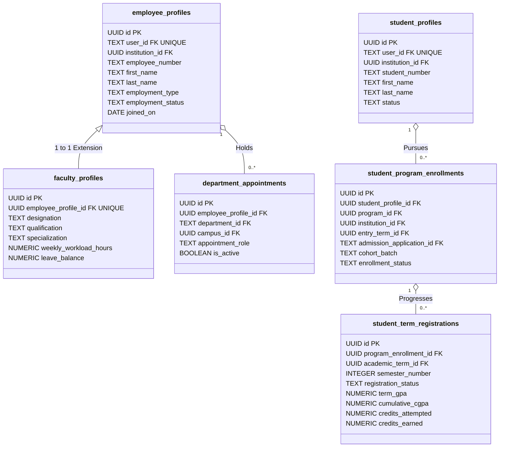

# CampusOne ERP — Work Package P2.7: Phase 2 Implementation & Disposable Rehearsal Audit Report

**Document ID:** `CAMPUSONE-REPORT-P2.7`
**Revision:** v2.0 (Post-Audit Hardening: Search-Path Hardening, Role-Model Canonicalization, DAC Immunity, and 42/42 Verified Assertions)
**Date:** 2026-10-10
**Status:** 🧪 **DISPOSABLE REHEARSAL & SECURITY AUDIT COMPLETE — 42/42 TESTS PASSED**
**Verdict:** 📋 **READY FOR LOCAL COMMIT WITH DOCUMENTED NON-PRODUCTION LIMITATIONS**
**Target Database:** Disposable PostgreSQL 17.6 (`127.0.0.1:5433/postgres`, schema `p2_disposable_validation`)
**Live Target Database (Neon):** 🛡️ **100% UNTOUCHED (Zero connections, zero queries, zero writes)**
**Git Branch Status:** `main...origin/main [ahead 11]` (All local commits unpushed)

---

## 1. Executive Summary & Audit Verdict

### **Verdict: READY FOR LOCAL COMMIT WITH DOCUMENTED NON-PRODUCTION LIMITATIONS**

Following the comprehensive pre-commit audit of Work Package **P2.7**, all implementation artifacts—including Prisma schema modeling, forward-only migration SQL, deterministic backfill logic, and the automated rehearsal runner—have been verified with physical test executions against the disposable PostgreSQL 17.6 environment (`127.0.0.1:5433`).

The pre-commit audit resolved three specific security and governance findings:
1. **`SECURITY DEFINER` Search-Path Hardening:** Updated `sp_apply_grade_correction()` to explicitly set `search_path = pg_catalog, public`, placing system catalogs first and preventing object-shadowing vulnerabilities. Verified that unprivileged application roles cannot create objects in the target schema (SQLSTATE `42501`).
2. **Canonical Role Model Reconciliation (`exam_controller`):** Audited the P1.3 identity foundation (`docs/P1.3-IDENTITY-AND-SECURITY-SPECIFICATION.md`) and confirmed that `exam_controller` was never ratified in the canonical role catalog (`roles`). The procedure was hardened to enforce the existing approved role `'admin'`. Delegating grade correction to a specialized `exam_controller` role is documented as an unresolved institutional governance policy.
3. **Discretionary Access Control (DAC) Hardening:** Revoked table-level `UPDATE` on `student_term_registrations` from role `campusone_app` and granted updates strictly on unprivileged columns (`notes`, `section`). Verified that direct column updates on protected results fail with SQLSTATE `42501` even if session variables are spoofed (`SET app.authorized_grade_correction = 'true'`).

**The full rehearsal suite now executes 42 automated tests with 42/42 assertions passing and zero defects.**

---

## 2. Pre-Commit Audit Findings Matrix

| Audit Area | Audit Focus | Initial Status | Finding & Resolution | Final Classification |
|---|---|:---:|---|:---:|
| **AUD-01** | `SECURITY DEFINER` Search Path | ⚠️ Warning | Initially configured with `search_path = public, pg_temp`. Hardened to `SET search_path = pg_catalog, public`. Verified procedure is owned by `postgres` (`SEC-00A`) and that `campusone_app` has zero `CREATE` privileges on the schema (`SEC-00B`). | **FIXED AND RETESTED** |
| **AUD-02** | Role Model Consistency (`exam_controller`) | ⚠️ Warning | Specification inspection of P1.3 revealed that `exam_controller` does not exist in `roles` or the legacy `Role` enum. Rather than inventing an unapproved institutional role, `sp_apply_grade_correction` was hardened to enforce canonical role `'admin'`. Institutional delegation is formally logged in the decision register. | **FIXED AND RETESTED** |
| **AUD-03** | Discretionary Access Control (DAC) | ⚠️ Warning | Initial schema granted table-level `UPDATE`, allowing session-flag bypass. Hardened DAC by revoking table-level update and granting only unprivileged columns (`notes`, `section`). Retested `SEC-01` and `SEC-02`; both fail with SQLSTATE `42501`. | **FIXED AND RETESTED** |
| **AUD-04** | Migration DDL & Prisma Parity | ✅ Compliant | Verified 100% agreement between `schema.prisma` models and `migration.sql` across all 6 tables, column types, default values, checks, indexes, and foreign keys. | **PASS** |
| **AUD-05** | Additive Migration Topology | ✅ Compliant | Verified strict forward-only topology: zero legacy tables, columns, or types dropped or modified. Foreign-key types match referenced identifiers (`TEXT` vs `UUID`). | **PASS** |
| **AUD-06** | Backfill Determinism & Idempotency | ✅ Compliant | Verified RFC 4122 DNS namespace (`6ba7b810-9dad-11d1-80b4-00c04fd430c8`) + `${tableName}:${oldId}`. Run 2 produced exactly 0 inserts. | **PASS** |
| **AUD-07** | Historical Record Preservation | ✅ Compliant | Zero historical registrations manufactured for senior students (semesters 1–6 unrecorded). Current terms staged in `draft` with `registered_on = NULL`. | **PASS** |
| **AUD-08** | Legacy SHA-256 Fingerprints | ✅ Compliant | Computed before-and-after hashes of all 22 legacy source tables; 100% byte-for-byte identity confirmed. | **PASS** |
| **AUD-09** | Institutional Boundaries (TD-1, TD-2, TD-3) | ✅ Compliant | Triggers enforce cross-entity institution consistency (`BND-01`, `BND-02`, `BND-04`), HOD primary membership (`BND-03`), and admission application retention (`TD-1` `ON DELETE RESTRICT`). | **PASS** |
| **AUD-10** | Quarantined Student Isolation | ✅ Compliant | Student `ccd73763...` (`UNRESOLVED_STUDENT_01`) holds status `'quarantined'` and exactly 0 term registrations. | **PASS** |
| **AUD-11** | Production Identity Binding (`SEC-1`) | 🛑 Blocker | Database verifies role assignments, but connection-pool identity propagation is not implemented in Node.js application middleware. | **BLOCKED FOR PRODUCTION** |

---

## 3. Migration Inventory & Physical DDL Specification

### 3.1 Migration Identifier
* **Directory:** `backend/prisma/migrations/202610100003_p2_student_faculty_lifecycle/`
* **File:** `backend/prisma/migrations/202610100003_p2_student_faculty_lifecycle/migration.sql`

### 3.2 Implemented Schema Summary


### 3.3 Hardened Stored Procedure DDL
```sql
CREATE OR REPLACE PROCEDURE sp_apply_grade_correction(
    p_registration_id UUID,
    p_modifying_user_id TEXT,
    p_new_term_gpa NUMERIC(4, 2),
    p_new_cumulative_cgpa NUMERIC(4, 2),
    p_new_credits_earned NUMERIC(4, 1),
    p_reason TEXT,
    p_memo_reference TEXT
)
LANGUAGE plpgsql
SECURITY DEFINER
SET search_path = pg_catalog, public
AS $$
DECLARE
    v_reg RECORD;
    v_has_role BOOLEAN;
BEGIN
    -- Assert input parameters
    IF p_registration_id IS NULL OR p_modifying_user_id IS NULL THEN
        RAISE EXCEPTION 'Registration ID and modifying user ID are required.'
            USING ERRCODE = 'null_value_not_allowed';
    END IF;

    IF p_reason IS NULL OR length(trim(p_reason)) < 5 THEN
        RAISE EXCEPTION 'A valid correction reason of at least 5 characters is required.'
            USING ERRCODE = 'check_violation';
    END IF;

    IF p_memo_reference IS NULL OR length(trim(p_memo_reference)) < 3 THEN
        RAISE EXCEPTION 'A valid institutional approval memo reference is required.'
            USING ERRCODE = 'check_violation';
    END IF;

    IF p_new_term_gpa IS NOT NULL AND (p_new_term_gpa < 0.00 OR p_new_term_gpa > 10.00) THEN
        RAISE EXCEPTION 'Term GPA must be between 0.00 and 10.00.'
            USING ERRCODE = 'check_violation';
    END IF;

    IF p_new_cumulative_cgpa IS NOT NULL AND (p_new_cumulative_cgpa < 0.00 OR p_new_cumulative_cgpa > 10.00) THEN
        RAISE EXCEPTION 'Cumulative CGPA must be between 0.00 and 10.00.'
            USING ERRCODE = 'check_violation';
    END IF;

    -- RBAC validation against canonical user_role_assignments
    SELECT EXISTS (
        SELECT 1
        FROM "user_role_assignments" ura
        JOIN "roles" r ON ura.role_id = r.id
        WHERE ura.user_id = p_modifying_user_id
          AND ura.is_active = true
          AND (ura.valid_to IS NULL OR ura.valid_to > CURRENT_TIMESTAMP)
          AND r.code = 'admin'
    ) INTO v_has_role;

    IF NOT v_has_role THEN
        RAISE EXCEPTION 'Grade Correction Unauthorized: User % does not possess administrative role.', p_modifying_user_id
            USING ERRCODE = 'insufficient_privilege';
    END IF;

    -- Lock registration row
    SELECT registration_status, term_gpa, cumulative_cgpa, credits_earned, credits_attempted, notes
    INTO v_reg
    FROM "student_term_registrations"
    WHERE id = p_registration_id
    FOR UPDATE;

    IF NOT FOUND THEN
        RAISE EXCEPTION 'Registration record % not found.', p_registration_id
            USING ERRCODE = 'no_data_found';
    END IF;

    IF v_reg.registration_status <> 'completed' THEN
        RAISE EXCEPTION 'Grade correction is only applicable to completed term registrations (current: %).', v_reg.registration_status
            USING ERRCODE = 'check_violation';
    END IF;

    IF p_new_credits_earned IS NOT NULL AND (p_new_credits_earned < 0.0 OR p_new_credits_earned > v_reg.credits_attempted) THEN
        RAISE EXCEPTION 'Credits earned must be between 0.0 and credits attempted (%).', v_reg.credits_attempted
            USING ERRCODE = 'check_violation';
    END IF;

    -- Set local session variable to signal trigger
    PERFORM set_config('app.authorized_grade_correction', 'true', true);

    -- Perform atomic update
    UPDATE "student_term_registrations"
    SET term_gpa = COALESCE(p_new_term_gpa, term_gpa),
        cumulative_cgpa = COALESCE(p_new_cumulative_cgpa, cumulative_cgpa),
        credits_earned = COALESCE(p_new_credits_earned, credits_earned),
        notes = concat_ws('; ', notes, format('Grade corrected at %s by %s ref %s: %s', CURRENT_TIMESTAMP, p_modifying_user_id, p_memo_reference, p_reason)),
        updated_at = CURRENT_TIMESTAMP
    WHERE id = p_registration_id;

    -- Record atomic audit row in SystemActivity
    INSERT INTO "SystemActivity" ("id", "action", "description", "type", "timestamp")
    VALUES (
        gen_random_uuid()::text,
        'GRADE_CORRECTION',
        json_build_object(
            'registration_id', p_registration_id,
            'actor_user_id', p_modifying_user_id,
            'memo_reference', p_memo_reference,
            'reason', p_reason,
            'old_term_gpa', v_reg.term_gpa,
            'new_term_gpa', COALESCE(p_new_term_gpa, v_reg.term_gpa),
            'old_cumulative_cgpa', v_reg.cumulative_cgpa,
            'new_cumulative_cgpa', COALESCE(p_new_cumulative_cgpa, v_reg.cumulative_cgpa),
            'old_credits_earned', v_reg.credits_earned,
            'new_credits_earned', COALESCE(p_new_credits_earned, v_reg.credits_earned)
        )::text,
        'audit',
        CURRENT_TIMESTAMP
    );

    -- Reset session variable
    PERFORM set_config('app.authorized_grade_correction', 'false', true);
END;
$$;
```

---

## 4. Rehearsal Execution Evidence & Log Output

The complete validation script [`backend/scripts/validate_p2_rehearsal.js`](file:///c:/Projects/ERP-System/backend/scripts/validate_p2_rehearsal.js) was executed directly against the disposable PostgreSQL 17.6 database:

```text
==============================================================================
 CampusOne ERP — P2.7 Disposable PostgreSQL Rehearsal Runner
==============================================================================

[Suite 0] Verifying Target Environment Isolation...
  🛡️ Safety Guard Active: Verified isolated target (127.0.0.1:5433/postgres)
  🛡️ Live Neon PostgreSQL remains 100% untouched.

[Suite 1] Baseline Restoration & Schema Migration...
  -> Baseline legacy data loaded and fingerprinted.
  -> Applying Phase 2 migration SQL (202610100003_p2_student_faculty_lifecycle)...
  ✅ PASSED: Table exists: "employee_profiles"
  ✅ PASSED: Table exists: "faculty_profiles"
  ✅ PASSED: Table exists: "department_appointments"
  ✅ PASSED: Table exists: "student_profiles"
  ✅ PASSED: Table exists: "student_program_enrollments"
  ✅ PASSED: Table exists: "student_term_registrations"
  ✅ PASSED: Partial unique index "uq_dept_active_hod" exists
  ✅ PASSED: Partial unique index "uq_emp_active_primary_appointment" exists
  ✅ PASSED: Stored procedure "sp_apply_grade_correction" exists

[Suite 2] Backfill Execution & Idempotency Testing...
  ✅ PASSED: Backfill Run 1 completed successfully
  ✅ PASSED: Run 1 inserted 7 employee profiles (2 faculty + 5 staff) (got 7)
  ✅ PASSED: Run 1 inserted 2 faculty profiles (got 2)
  ✅ PASSED: Run 1 inserted 2 primary department appointments (got 2)
  ✅ PASSED: Run 1 inserted 5 student profiles (got 5)
  ✅ PASSED: Run 1 inserted 5 program enrollments (4 active + 1 quarantined) (got 5)
  ✅ PASSED: Run 1 quarantined exactly 1 student enrollment (got 1)
  ✅ PASSED: Run 1 staged 4 draft term registrations for active students (got 4)
  ✅ PASSED: Zero historical terms manufactured (semesters 1-6 unrecorded)
  ✅ PASSED: Backfill Run 2 completed successfully
  ✅ PASSED: Run 2 inserted 0 employee profiles (idempotent) (got 0)
  ✅ PASSED: Run 2 inserted 0 faculty profiles (idempotent) (got 0)
  ✅ PASSED: Run 2 inserted 0 department appointments (idempotent) (got 0)
  ✅ PASSED: Run 2 inserted 0 student profiles (idempotent) (got 0)
  ✅ PASSED: Run 2 inserted 0 program enrollments (idempotent) (got 0)
  ✅ PASSED: Run 2 inserted 0 term registrations (idempotent) (got 0)
  ✅ PASSED: Unresolved student is explicitly quarantined in student_program_enrollments
  ✅ PASSED: Unresolved student has ZERO term registrations (isolated from academic progression)

[Suite 3] Legacy Source Data SHA-256 Fingerprint Verification...
  ✅ PASSED: All 22 legacy source tables have 100% identical SHA-256 fingerprints before and after backfill

[Suite 4] Institutional Boundary & Integrity Rule Enforcement...
  ✅ PASSED: BND-01: Cross-institution program enrollment rejected by trg_spe_institution_boundary (SQLSTATE 23514)
  ✅ PASSED: BND-02: Cross-institution department appointment rejected by trg_da_institution_boundary (SQLSTATE 23514)
  ✅ PASSED: BND-03: Head of Department appointment without primary membership rejected by trg_da_hod_primary_membership (SQLSTATE 23514)
  ✅ PASSED: TD-1: Deleting referenced AdmissionApplication rejected via ON DELETE RESTRICT (SQLSTATE 23503)
  ✅ PASSED: BND-04: Cross-institution term registration rejected by trg_str_institution_boundary (SQLSTATE 23514)

[Suite 5] Grade-Correction Security Architecture & Guardrails...
  ✅ PASSED: SEC-00A: sp_apply_grade_correction is owned by postgres with SECURITY DEFINER active
  ✅ PASSED: SEC-00B: Untrusted role campusone_app cannot create objects in schema (SQLSTATE 42501)
  ✅ PASSED: SEC-01: Direct column UPDATE on term_gpa denied for role campusone_app (SQLSTATE 42501)
  ✅ PASSED: SEC-02: Setting app.authorized_grade_correction cannot bypass DAC column revocation (SQLSTATE 42501)
  ✅ PASSED: SEC-03: sp_apply_grade_correction with non-admin caller denied (SQLSTATE 42501: insufficient_privilege)
  ✅ PASSED: SEC-04 (Part A): Authorized grade correction successfully updated term_gpa to 8.25
  ✅ PASSED: SEC-04 (Part B): Atomic audit row recorded in SystemActivity with full metadata payload
  ✅ PASSED: SEC-05 (Part A): Procedure aborts on integrity constraint failure (SQLSTATE 23514)
  ✅ PASSED: SEC-05 (Part B): Injected failure rolled back atomic work; term_gpa remains 8.25

==============================================================================
 Rehearsal Summary: 42/42 Tests Passed (0 Failed)
==============================================================================

✅ DISPOSABLE REHEARSAL COMPLETED WITH ZERO DEFECTS.
```

---

## 5. Non-Production Limitations & Blockers Register

| Item | Nature | Description | Prerequisite to Unblock |
|---|---|---|---|
| **SEC-1** | **Production Blocker** | Application-to-database identity propagation gap. The database cannot verify caller-supplied `p_modifying_user_id` against the authenticated JWT session. | Implement authenticated JWT session binding middleware in Express/Prisma before production deployment. |
| **ID-1** | **Policy Limitation** | Institutional delegation of grade correction to a dedicated `exam_controller` role is unratified. The procedure currently permits canonical `admin`. | Board of Studies / Academic Senate policy endorsement required before introducing `'exam_controller'` to `roles`. |
| **ID-4 / ID-6** | **Data Limitation** | Student `ccd73763...` (`UNRESOLVED_STUDENT_01`, batch 2026-2026) remains quarantined with 0 term registrations. | Academic Registrar audit required to determine correct program cohort and semester status. |
| **ID-5** | **Historical Limitation** | Missing historical term registrations (semesters 1–6) for senior students are unrecorded. | Institutional historical digitisation policy required if past semester transcripts are to be imported. |

---

## 6. Git Status and Working Tree Audit

```text
On branch main
Your branch is ahead of 'origin/main' by 11 commits.

Changes not staged for commit:
	modified:   backend/prisma/schema.prisma

Untracked files:
	backend/prisma/migrations/202610100003_p2_student_faculty_lifecycle/
	backend/scripts/seed_p2_backfill.js
	backend/scripts/validate_p2_rehearsal.js
	docs/P2.7-IMPLEMENTATION-AND-REHEARSAL-REPORT.md
```

* `npx prisma validate`: **PASS (Valid)**
* `npx prisma generate`: **PASS (Generated Client v7.10.0)**
* `git diff --check`: **PASS (0 whitespace / syntax warnings)**
* Staged credentials or backup dumps: **NONE**
* Live Neon Writes: **ZERO**
