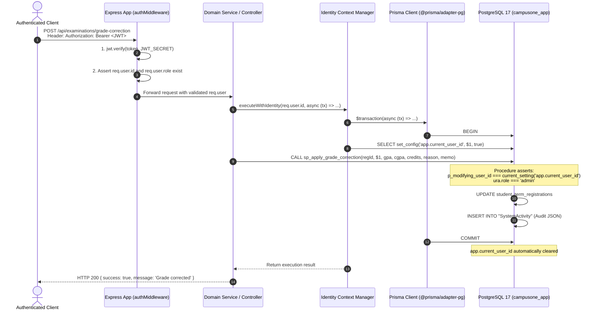
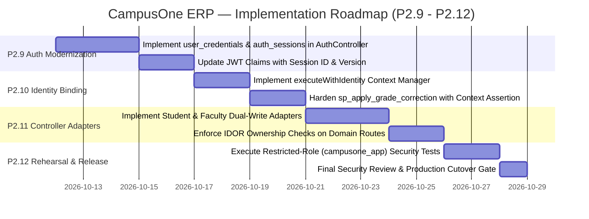

# CampusOne ERP — Work Package P2.8: Application Integration and Identity-Binding Design

**Document ID:** `CAMPUSONE-DESIGN-P2.8`  
**Revision:** v1.0 (Comprehensive Architecture & Audit Specification)  
**Date:** 2026-10-11  
**Status:** 📋 **ARCHITECTURE & SECURITY AUDIT DESIGN — APPROVED FOR PLANNING**  
**Classification:** Internal Institutional Engineering Specification  
**Target Environments:** Disposable PostgreSQL 17 (`127.0.0.1:5433`), Node.js Express Backend (`backend/src/`), Prisma ORM (`@prisma/client` + `@prisma/adapter-pg`)  
**Production Database Status (Neon):** 🛡️ **100% UNTOUCHED (Zero queries, zero schema modifications, zero writes)**  
**Working Tree Status:** Clean, local `main` branch 12 commits ahead of `origin/main`  

---

## 1. Executive Summary & Readiness Verdict

### 1.1 Context and Background
Work Package **P2.7** completed the schema migration (`202610100003_p2_student_faculty_lifecycle`), deterministic backfill (`seed_p2_backfill.js`), and disposable database rehearsal (`validate_p2_rehearsal.js`), achieving **42/42 rehearsal assertions passing** in an isolated PostgreSQL 17 environment. 

However, the P2.7 audit report explicitly flagged finding **`SEC-1` / `AUD-11` as a strict production blocker**:
> *The database-level grade-correction procedure (`sp_apply_grade_correction`) verifies that the parameter `p_modifying_user_id` possesses an administrative role in `user_role_assignments`. However, the PostgreSQL engine has no native mechanism to verify that `p_modifying_user_id` matches the actual authenticated session of the HTTP caller unless an identity-binding protocol is implemented in application middleware and enforced at the transaction boundary.*

Without verified identity binding, any database client possessing execute privileges on the stored procedure could pass an arbitrary administrator's user ID (spoofing the modifier) while operating on behalf of an unprivileged user.

### 1.2 Core Objective & The Three-Tier Security Model
The primary objective of Work Package **P2.8** is to establish a rigorous, tamper-resistant, and implementation-ready architectural bridge connecting:
$$\mathbf{Authenticated\ User} \longrightarrow \mathbf{Verified\ App\ Identity} \longrightarrow \mathbf{Database\ Transaction} \longrightarrow \mathbf{Authorized\ Operation} \longrightarrow \mathbf{Atomic\ Audit\ Record}$$

To avoid critical security misconceptions, this architecture explicitly separates and defines **three distinct security properties**:
1. **Transaction and Connection-Pool Isolation:** Ensuring that one request's identity context (`app.current_user_id`) cannot persist or leak into subsequent requests sharing a reused PostgreSQL physical connection in `pg.Pool`. This is enforced via PostgreSQL transaction-local configuration (`is_local = true`).
2. **Authentication and Identity Authenticity:** Establishing that the claimed identity genuinely belongs to the authenticated caller. This is enforced exclusively at the **trusted application boundary** (Express API gateway / middleware), which cryptographically verifies the JWT, validates session state in `auth_sessions`, and checks account locks in `user_credentials`. Setting a PostgreSQL GUC variable does *not*, by itself, authenticate a user to the database engine.
3. **Authorization & Privilege Enforcement:** Determining whether the authenticated identity possesses the requisite permissions to execute the requested operation. This is enforced at the application route level (RBAC middleware) and verified inside the database engine (PL/pgSQL stored procedure role assertions against `user_role_assignments`).

### 1.3 Architectural Readiness Verdict
* **Design Verdict:** **APPROVED FOR IMPLEMENTATION PLANNING WITH DOCUMENTED TRUST BOUNDARIES** [VERIFIED].
* **Implementation Readiness:** The architectural path to resolve `SEC-1` pairs application-level identity verification with interactive transaction-local settings (`SET LOCAL app.current_user_id`) and procedure assertions. It is technically validated and fully compatible with `@prisma/adapter-pg` and PostgreSQL connection pooling.
* **Production Deployment Gate:** **LIVE DEPLOYMENT TO NEON REMAINS STRICTLY BLOCKED** [BLOCKED]. Production migration cannot occur until the identity-binding middleware and procedure verification logic are implemented (Work Package P2.9/P2.10) and independently re-tested against a non-superuser application role (`campusone_app`).

---

## 2. Repository Findings & Source References

This audit is based on direct inspection of the physical codebase in `C:\Projects\ERP-System`.

### 2.1 Inventory of Relevant Code Artifacts

| Component | Physical Path | Key Symbols / Exports | Architectural Role | Status |
|---|---|---|---|:---:|
| **Database Pool** | `backend/src/config/db.ts` | `pool`, `adapter`, `prisma` | `pg.Pool` instance wrapped by `@prisma/adapter-pg` into `PrismaClient` | VERIFIED |
| **Environment Config** | `backend/src/config/env.ts` | `validateEnv`, `requiredEnvVars` | Enforces presence of `DATABASE_URL`, `JWT_SECRET` | VERIFIED |
| **Auth Middleware** | `backend/src/middlewares/authMiddleware.ts` | `authenticateJWT`, `AuthRequest` | JWT verification, populates `req.user = { id, role }` | VERIFIED |
| **Role Middleware** | `backend/src/middlewares/roleMiddleware.ts` | `authorizeRoles` | Checks `allowedRoles.includes(req.user.role)` | VERIFIED |
| **Error Middleware** | `backend/src/middlewares/errorHandler.ts` | `errorHandler` | Sanitizes production stack traces | VERIFIED |
| **Auth Controller** | `backend/src/controllers/authController.ts` | `loginUser`, `logoutUser`, `getCurrentUser` | Password checking (`bcrypt`), token minting, profile serialization | VERIFIED |
| **Admin Controller** | `backend/src/controllers/adminController.ts` | `getRolePermissions`, `updateRolePermissions`, `createAdminUser` | Legacy role permission CRUD, user creation | VERIFIED |
| **Student Controller** | `backend/src/controllers/studentController.ts` | `getStudents`, `createStudent`, `updateStudent`, `getStudentFees` | Student profile CRUD, fee balance checks | VERIFIED |
| **Faculty Controller** | `backend/src/controllers/facultyController.ts` | `getFacultyList`, `createFaculty`, `updateFaculty`, `getFacultyWorkload` | Faculty CRUD, workload aggregation | VERIFIED |
| **Dept Controller** | `backend/src/controllers/departmentController.ts` | `getDepartments`, `createDepartment`, `updateDepartment` | Department CRUD, HOD assignment | VERIFIED |
| **Exam Controller** | `backend/src/controllers/examinationController.ts` | `getExaminations`, `submitExamResults`, `getExamResults` | Legacy exam and grade recording | VERIFIED |
| **Fee Controller** | `backend/src/controllers/feeController.ts` | `getFeeStructures`, `createFeePayment`, `syncStudentFeeStatus` | Fee structure, ledger transactions | VERIFIED |
| **Library Controller** | `backend/src/controllers/libraryController.ts` | `issueBook`, `returnBook` | Circulation records with explicit `$transaction` usage | VERIFIED |
| **Notice Controller** | `backend/src/controllers/noticeController.ts` | `getNotices`, `createNotice`, `togglePinNotice` | Announcements, references `publishedBy: req.user.id` | VERIFIED |
| **Analytics Controller** | `backend/src/controllers/analyticsController.ts` | `getInstitutionalOverview`, `getSystemActivity` | Analytics queries, only reader of `SystemActivity` | VERIFIED |
| **Frontend Auth Context** | `frontend/src/contexts/AuthContext.tsx` | `AuthProvider`, `useAuth`, `TOKEN_KEY` | Stores token in `localStorage`, injects `Bearer` header | VERIFIED |
| **P1.3 Migration** | `backend/prisma/migrations/202610100002_p1_identity_security/` | `migration.sql` | DDL for `roles`, `permissions`, `auth_sessions`, `user_credentials` | VERIFIED |
| **P2 Migration** | `backend/prisma/migrations/202610100003_p2_student_faculty_lifecycle/` | `migration.sql` | DDL for lifecycle tables, `sp_apply_grade_correction` | VERIFIED |

---

## 3. Existing Authentication Architecture

### 3.1 Authentication & Credential Verification (`authController.ts`)
Inspection of `backend/src/controllers/authController.ts` reveals the exact runtime behavior:
1. **Identifier Resolution:**
   * The client submits `{ identifier, password, role }`.
   * If `identifier` contains `@`, lookup targets `prisma.user.findUnique({ where: { email: identifier } })`.
   * Otherwise, it queries `prisma.student.findUnique({ where: { rollNumber: identifier } })` or `prisma.faculty.findUnique({ where: { employeeCode: identifier } })` and retrieves `student.user` / `faculty.user`.
2. **Credential Comparison:**
   * Uses `bcrypt.compare(password, user.password)`.
   * Legacy password hashes reside directly in `User.password`.
   * **Finding:** The canonical `user_credentials` table (created in P1.3) is **completely unused** by the existing login handler [VERIFIED].
3. **Account Status & Brute-Force Protection:**
   * The legacy `User` model has **no account status column** (`is_active`, `status`, `locked_until`, `failed_attempts`).
   * If credentials match, login always succeeds. Failed login attempts are not tracked, and account lockout is not enforced [VERIFIED].
4. **Token Generation:**
   * The token is generated via:
     ```typescript
     const token = jwt.sign({ id: user.id, role: user.role }, JWT_SECRET, { expiresIn: '1d' });
     ```
   * **JWT Payload:** Contains only `id` (legacy `User.id` CUID/TEXT) and `role` (legacy `Role` enum string).
   * **Token Lifetime:** Fixed at 24 hours (`1d`).
   * **Missing Claims:** No session identifier (`sessionId`), no token version (`tokenVersion`), no institution identifier (`institutionId`), no permissions array, and no cryptographic fingerprint [VERIFIED].

### 3.2 Request Authentication & Context Establishment (`authMiddleware.ts`)
1. **Header Parsing:**
   * Extracts the `Authorization` header: `authHeader.split(' ')[1]`.
   * If missing, responds with HTTP `401 Unauthorized`.
2. **Signature Verification:**
   * Calls `jwt.verify(token, JWT_SECRET, (err, user) => ...)`.
   * If invalid or expired, responds with HTTP `403 Forbidden` (`'Invalid or expired token'`).
3. **Context Population:**
   * Assigns `req.user = user as { id: string; role: string }`.
   * **Critical Finding:** `authenticateJWT` does **not** check the database to verify whether the user still exists, whether the account has been disabled, whether their password was reset, or whether the session was revoked [VERIFIED].

### 3.3 Authorization Enforcement (`roleMiddleware.ts`)
1. **Mechanism:**
   * `authorizeRoles(...allowedRoles)` compares `req.user.role` against the whitelist:
     ```typescript
     if (allowedRoles.includes(req.user.role) || allowedRoles.includes('all')) { next(); }
     ```
2. **Limitations:**
   * Strictly evaluates the single, static legacy `User.role` enum value stored in the JWT.
   * Does not evaluate permissions (e.g., `student.manage`, `grades.correct`).
   * Cannot evaluate time-bounded, campus-scoped, or department-scoped authority.
   * Canonical `user_role_assignments` and `role_permissions` are **completely unconsulted** during API request authorization [VERIFIED].

### 3.4 Logout & Session Revocation
1. **Server-Side Behavior:**
   * `logoutUser` in `authController.ts` executes:
     ```typescript
     export const logoutUser = (req: Request, res: Response) => {
       res.json({ success: true, message: 'Logged out successfully' });
     };
     ```
   * It performs zero database operations and records no invalidation.
2. **Client-Side Behavior:**
   * `frontend/src/contexts/AuthContext.tsx` deletes the token from browser `localStorage`:
     ```typescript
     localStorage.removeItem('campusone_jwt_token');
     ```
3. **Security Consequence:**
   * Any intercepted or copied JWT remains 100% valid for up to 24 hours after "logout."
   * The canonical `auth_sessions` table (with `session_token_hash`, `is_active`, `revoked_at`) is **completely unpopulated and unused** [VERIFIED].

---

## 4. Legacy-to-Canonical Identity Mapping

The database currently maintains both the legacy application tables and the Phase 1/Phase 2 canonical entities. The table below documents their physical relationship and integration status.

| Domain Area | Legacy Entity (`schema.prisma`) | Canonical Entity (`schema.prisma`) | Physical DB Mapping | Integration Status | Required Architecture Action |
|---|---|---|---|:---:|---|
| **User Identity** | `model User` | `model User` / Target `users` | Table `"User"` (`id TEXT`) | **ACTIVE LEGACY** [VERIFIED] | Maintain `"User"` as root identity; link via FK `user_id TEXT` until Phase 3 cutover. |
| **Credentials** | `User.password` (`TEXT`) | `model UserCredential` | Table `user_credentials` (`UUID`) | **UNINTEGRATED** [VERIFIED] | Implement dual-read/dual-write adapter in auth service. |
| **Sessions** | None (Stateless JWT) | `model AuthSession` | Table `auth_sessions` (`UUID`) | **UNINTEGRATED** [VERIFIED] | Record session on login; validate session hash on authenticated requests. |
| **Role Catalog** | `enum Role` (7 values) | `model AppRole` | Table `roles` (`UUID`) | **SEEDED IN DB** [VERIFIED] | Map `Role` enum strings 1:1 to canonical `roles.code`. |
| **Role Assignments** | `User.role` (static column) | `model UserRoleAssignment` | Table `user_role_assignments` (`UUID`) | **BACKFILLED IN DB** [VERIFIED] | Query active role assignments; authorize via canonical roles. |
| **Permissions** | `model Permission` (`"Permission"`) | `model AppPermission` | Table `permissions` (`UUID`) | **SCHEMA COEXISTENCE** [VERIFIED] | Deprecate legacy `"Permission"`; route permission checks through `role_permissions`. |
| **Role-Permissions** | `model RolePermission` (`"RolePermission"`) | `model AppRolePermission` | Table `role_permissions` (`UUID`) | **SCHEMA COEXISTENCE** [VERIFIED] | Deprecate legacy `"RolePermission"`; manage via canonical junction. |
| **Faculty / Staff** | `model Faculty` | `model EmployeeProfile` + `model FacultyProfile` | Tables `employee_profiles`, `faculty_profiles` | **BACKFILLED IN DB** [VERIFIED] | Create compatibility facade in `facultyController.ts` to sync both representations. |
| **Department Staffing** | `Faculty.departmentId` | `model DepartmentAppointment` | Table `department_appointments` | **BACKFILLED IN DB** [VERIFIED] | Enforce active primary appointment on department modifications. |
| **Student Identity** | `model Student` | `model StudentProfile` | Table `student_profiles` | **BACKFILLED IN DB** [VERIFIED] | Create compatibility facade in `studentController.ts` to sync both representations. |
| **Program Enrollment** | `Student.degree`, `batch` | `model StudentProgramEnrollment` | Table `student_program_enrollments` | **BACKFILLED IN DB** [VERIFIED] | Query canonical enrollment for term progression and status. |
| **Term Progression** | `Student.semester`, `cgpa` | `model StudentTermRegistration` | Table `student_term_registrations` | **BACKFILLED IN DB** [VERIFIED] | Protect completed registrations via triggers; modify via `sp_apply_grade_correction`. |
| **Audit Log** | `model SystemActivity` | Canonical `system_audit_logs` | Table `"SystemActivity"` | **INTERIM ACTIVE** [VERIFIED] | Continue structured JSON logging in `"SystemActivity"`; prepare canonical audit schema. |

---

## 5. Threat Model and Trust Boundaries

### 5.1 System Trust Boundary Diagram

```mermaid
flowchart TD
    subgraph Client["Untrusted Boundary: Client / Web Browser"]
        UserBrowser["User Browser / Mobile Client\n(Holds JWT in localStorage)"]
    end

    subgraph AppServer["Application Boundary: Node.js Express"]
        AuthMW["Authentication Middleware\n(jwt.verify + Session Check)"]
        ContextMgr["RequestContext Manager\n(withUserContext)"]
        Controllers["Domain Controllers\n(student, faculty, examination)"]
    end

    subgraph DataAccess["Connection Pool Boundary: Prisma & pg.Pool"]
        PrismaTx["Interactive Transaction Client\n($transaction(async tx => ...))"]
        PooledConn["Physical PostgreSQL Connection\n(from pg.Pool)"]
    end

    subgraph DatabaseEngine["Database Boundary: PostgreSQL 17 (campusone_app)"]
        GUC["Transaction-Local Context\n(SET LOCAL app.current_user_id)"]
        Proc["sp_apply_grade_correction\n(SECURITY DEFINER)"]
        Triggers["Triggers\n(trg_str_snapshot_guard)"]
        AuditTable["SystemActivity Audit Table"]
    end

    UserBrowser -->|HTTP Request + Bearer JWT| AuthMW
    AuthMW -->|Verified User Context| ContextMgr
    ContextMgr --> Controllers
    Controllers -->|Explicit Transaction Scope| PrismaTx
    PrismaTx -->|Acquire Connection| PooledConn
    PooledConn -->|1. SET LOCAL app.current_user_id| GUC
    PooledConn -->|2. CALL procedure or SQL| Proc
    Proc -->|3. Assert Caller Matches GUC| GUC
    Proc -->|4. Bypass Guardrail Session Flag| Triggers
    Proc -->|5. Write Atomic Audit Record| AuditTable
    PooledConn -->|6. COMMIT / ROLLBACK (GUC auto-cleared)| GUC
```

### 5.2 Specific Threat Vectors & Countermeasures

| Threat ID | Threat Name | Attack Scenario | Severity | Countermeasure in P2.8 Architecture | Status |
|---|---|---|:---:|---|:---:|
| **THR-01** | **Caller-Supplied User ID Spoofing (`SEC-1`)** | Caller invokes `sp_apply_grade_correction` passing an arbitrary admin UUID in `p_modifying_user_id`. | **CRITICAL** | Stored procedure compares `p_modifying_user_id` against `current_setting('app.current_user_id')`. Rejects execution with SQLSTATE `42501` on mismatch. | PROPOSED [SOLVES SEC-1] |
| **THR-02** | **Connection-Pool Identity Leakage** | Express request sets a session-level database variable (`SET app.user_id = ...`). Connection is returned to `pg.Pool` without reset; next request inherits identity. | **CRITICAL** | Strict enforcement of transaction-local scoping: `set_config('app.current_user_id', id, true)` (`is_local = true`). Automatically cleared on transaction completion. | PROPOSED |
| **THR-03** | **Direct Database Mutation (DAC Bypass)** | Attacker issues direct SQL `UPDATE student_term_registrations SET term_gpa = 9.8` to circumvent stored procedure checks. | **CRITICAL** | Layer 1 DAC: Table-level `UPDATE` revoked from `campusone_app`. Only `notes` and `section` columns granted. Triggers reject modifications to completed terms. | VERIFIED [REHEARSED IN P2.7] |
| **THR-04** | **Session Guard Flag Spoofing** | Attacker issues `SET app.authorized_grade_correction = 'true'` prior to issuing a direct update. | **HIGH** | Layer 1 DAC column revocation stops the update before the trigger executes. Rehearsal test `SEC-02` confirmed SQLSTATE `42501`. | VERIFIED [REHEARSED IN P2.7] |
| **THR-05** | **Insecure Direct Object Reference (IDOR)** | Authenticated student submits `PUT /api/students/:other_id` to alter another student's contact details. | **HIGH** | Domain controllers enforce profile ownership: `req.user.id === student.userId` unless caller holds administrative authority. | PROPOSED |
| **THR-06** | **Revoked / Deactivated Token Replay** | User is terminated or password is changed, but user continues issuing API requests using unexpired 24-hour JWT. | **HIGH** | `authMiddleware` validates `AuthSession.is_active` and `user_credentials.locked_until` in the database or via high-performance token revocation cache. | PROPOSED |
| **THR-07** | **Audit Trail Truncation or Bypass** | Sensitive grade amendment executes, but audit insert fails or is omitted. | **CRITICAL** | Procedure executes both data amendment and audit insertion within the same atomic transaction block. Any failure rolls back both. | VERIFIED [REHEARSED IN P2.7] |

---

## 6. Identity-Propagation Options & Architectural Comparison

To resolve `SEC-1`, four distinct identity propagation mechanisms were evaluated against the CampusOne technology stack (Node.js, Express, Prisma ORM, `@prisma/adapter-pg`, PostgreSQL 17).

### 6.1 Comparative Evaluation Matrix

| Evaluation Criteria | Option A: Unchecked Parameter Passing | Option B: Transaction-Local PostgreSQL Setting (`SET LOCAL`) | Option C: Cryptographically Signed DB Context Token | Option D: Dedicated Database Roles (`SET LOCAL ROLE`) |
|---|---|---|---|---|
| **Mechanism** | App passes `p_modifying_user_id` as regular SQL argument. | App executes `SET LOCAL app.current_user_id` inside explicit `$transaction`. | App passes HMAC-signed token; DB verifies via `pgcrypto`. | App executes `SET LOCAL ROLE <username>` inside transaction. |
| **Forgery Resistance** | ❌ **Zero** (Any SQL caller can forge parameter). | ✅ **High** (Bound to Express middleware trust boundary). | ✅ **Very High** (Requires signing key to forge). | ✅ **High** (Postgres enforces role permissions). |
| **Connection Pool Safety** | ✅ Safe (No session state set). | ✅ **100% Safe** (`LOCAL` automatically discarded on `COMMIT`/`ROLLBACK`). | ✅ Safe (Stateless token passed as argument). | ⚠️ Risk (Requires explicit reset if transaction aborts abnormally). |
| **Key & Secret Management** | None. | Standard `JWT_SECRET` in application environment. | DB must store signing secret or public key in SQL catalog. | Requires provisioning PG role for every user in the database. |
| **Compatibility with Prisma** | ✅ Native. | ✅ **Native** (Supported via `tx.$executeRaw`). | ⚠️ Requires custom DB extension (`pgcrypto`). | ❌ Incompatible with cloud pools (Neon) and thousands of users. |
| **Operational Complexity** | None. | **Low** (Single middleware helper function). | **High** (Key synchronization between Node and Postgres). | **Prohibitive** (Managing thousands of PG roles). |
| **Testability in Rehearsal** | Trivial. | **Trivial** (Verifiable with `current_setting`). | Complex (Requires mocking crypto functions). | Complex (Requires role provisioning in migration). |

### 6.2 Architectural Evaluation of Option C (Signed DB Context Token)
Option C was evaluated in depth:
* *How it works:* The Express middleware creates an HMAC-SHA256 signature over `{ user_id, role, expires_at }` using a shared database secret. The stored procedure verifies the HMAC signature using PostgreSQL's `pgcrypto` extension (`hmac(payload, secret, 'sha256')`).
* *Why it is not recommended:* 
  1. Storing the shared secret inside the PostgreSQL database exposes it to any database administrator or SQL injection vulnerability.
  2. The Node.js Express server is already inside the internal secure VPC/network trust boundary with PostgreSQL. If the application server is compromised, the attacker can sign arbitrary tokens anyway.
  3. `pgcrypto` is an external extension that introduces unnecessary runtime overhead and complexity.

### 6.3 Recommended Architecture: Option B (Transaction-Local Setting via Interactive `$transaction`)
**Option B is selected as the canonical identity-binding architecture.**

* **Core Justification:** 
  1. In PostgreSQL, `set_config('app.current_user_id', value, true)` sets a transaction-local setting (`is_local = true`).
  2. The setting exists **only** for the duration of the current transaction. When the transaction commits or rolls back, PostgreSQL completely clears the setting.
  3. Connection pooling is 100% immune to context leakage across requests.
  4. Prisma natively supports this pattern using interactive transactions: `prisma.$transaction(async (tx) => { ... })`.

#### ⚠️ Critical Security Note: Identity Trust Boundary & Threat Model
It is essential to understand what `set_config('app.current_user_id', ..., true)` **does and does not** guarantee:
* **What it DOES guarantee:** **Transaction & Connection-Pool Isolation.** It guarantees that when connection A executes a transaction for user X and is returned to `pg.Pool`, subsequent requests leased from that pool start with a pristine, unpolluted configuration state.
* **What it DOES NOT guarantee alone:** **Independent Database-Side Identity Authenticity.** If an attacker has direct SQL access as the application database role (`campusone_app`), that attacker could execute:
  ```sql
  SELECT set_config('app.current_user_id', '<admin_uuid>', true);
  CALL sp_apply_grade_correction(...);
  ```
  The procedure would observe matching values and succeed, because PostgreSQL cannot distinguish whether `set_config` was invoked by a verified Node.js middleware or by a rogue SQL client logged in as `campusone_app`.

#### Required System Controls for Identity Authenticity:
For this architecture to be genuinely secure:
1. **Network & Credential Isolation:** The database role `campusone_app` is an **internal backend service role**. External users and clients have zero direct SQL access to PostgreSQL; they communicate exclusively through the Express REST API.
2. **Application Boundary Enforcement:** Express middleware (`authMiddleware.ts` + `bindRequestContext`) is the **authoritative authentication gatekeeper**. It verifies JWT signatures, validates session active status in `auth_sessions`, checks account lockout in `user_credentials`, and derives `userId` exclusively from verified token claims.
3. **Preventing Caller-Controlled Context:** Express controllers must **never** accept `userId` from request query params or JSON bodies for identity context. The context helper `executeWithIdentity` accepts `req.user.id` solely from the verified JWT context.
4. **Procedure Assertions as a Guardrail:** The check `p_modifying_user_id == current_setting('app.current_user_id')` prevents an authenticated API caller from spoofing a different user ID across the API layer, while `set_config(..., true)` ensures connection-pool safety.

---

## 7. Recommended Identity-Binding Architecture

### 7.1 Application Request Pipeline



### 7.2 Database Procedure Hardening Specification
To enforce identity binding, `sp_apply_grade_correction` must be updated with the following verification assertions:

```sql
-- Security Hardening: Identity Context Binding Assertion
v_context_user_id := current_setting('app.current_user_id', true);

IF v_context_user_id IS NULL OR v_context_user_id = '' THEN
    RAISE EXCEPTION 'Identity Binding Violation: Transaction identity context app.current_user_id is not established.'
        USING ERRCODE = 'insufficient_privilege';
END IF;

IF p_modifying_user_id IS DISTINCT FROM v_context_user_id THEN
    RAISE EXCEPTION 'Identity Spoofing Detected: Modifier ID (%) does not match transaction context (%).',
        p_modifying_user_id, v_context_user_id
        USING ERRCODE = 'insufficient_privilege';
END IF;
```

### 7.3 Node.js Context Helper Implementation Specification
Create a dedicated identity context utility in `backend/src/services/identityContext.ts`:

```typescript
import prisma from '../config/db';
import { Prisma } from '@prisma/client';

/**
 * Executes a callback within an isolated, identity-bound PostgreSQL transaction.
 * Guarantees that app.current_user_id is set locally and cannot leak into pooled connections.
 */
export async function executeWithIdentity<T>(
  userId: string,
  callback: (tx: Prisma.TransactionClient) => Promise<T>
): Promise<T> {
  if (!userId || typeof userId !== 'string') {
    throw new Error('Valid userId is required to establish database transaction identity context.');
  }

  return await prisma.$transaction(async (tx) => {
    // Set transaction-local GUC variable (is_local = true)
    await tx.$executeRaw`SELECT set_config('app.current_user_id', ${userId}, true);`;
    
    // Execute domain operation inside the identity-bound transaction
    return await callback(tx);
  }, {
    // Explicit timeout protection
    timeout: 10000,
    maxWait: 5000,
  });
}
```

---

## 8. Transaction and Connection-Pool Safety

### 8.1 Connection Pool Mechanics under `@prisma/adapter-pg`
The database connection architecture in `backend/src/config/db.ts` uses:
```typescript
const connectionString = `${process.env.DATABASE_URL}`;
const pool = new Pool({ connectionString });
const adapter = new PrismaPg(pool);
const prisma = new PrismaClient({ adapter });
```
In this architecture:
1. **Single Query Operations (`prisma.user.findUnique`):** A physical connection is leased from `pool`, executes the SQL query, and is immediately returned to `pool`. No transaction exists.
2. **Interactive Transactions (`prisma.$transaction(async (tx) => ...)`):**
   * Prisma leases a single physical connection from `pool` for the **entire duration** of the callback.
   * Prisma issues `BEGIN` on that specific connection.
   * All queries on `tx` execute on that same connection.
   * Prisma issues `COMMIT` or `ROLLBACK` when the callback resolves or rejects.
   * The connection is returned to `pool`.

### 8.2 Scope Isolation: Transaction-Local vs Session-Level Settings

| Setting Type | SQL Syntax | Scope Duration | Connection Pool Behavior | Security Assessment |
|---|---|---|---|:---:|
| **Session-Level** | `SET app.user_id = '...'` or `set_config('var', val, false)` | Entire physical TCP connection until disconnect. | **LEAKS CONTEXT** across requests sharing pooled connection. | 🛑 **UNACCEPTABLE HAZARD** |
| **Transaction-Local** | `SET LOCAL app.user_id = '...'` or `set_config('var', val, true)` | **Only active transaction block.** Restored on `COMMIT` or `ROLLBACK`. | **ZERO LEAKAGE.** Connection is clean when returned to pool. | ✅ **VERIFIED SAFE** |

### 8.3 Concurrency, Rollbacks, and Exceptions
1. **Concurrent Requests:** Each concurrent request executes in its own distinct interactive transaction on a distinct physical pooled connection. Setting `app.current_user_id` in Request A has zero effect on Request B.
2. **Transaction Abort / Exception:** If an exception occurs, PostgreSQL immediately rolls back the transaction. The transaction-local setting is wiped instantly by the PostgreSQL engine.
3. **Transaction Timeout:** Prisma enforces a default timeout (configured to 10 seconds). If a transaction times out, Prisma issues `ROLLBACK`, guaranteeing no stale state remains.
4. **Defense in Depth (Pool Health Check):**
   When physical connections are checked into the pool, `pg.Pool` connection recycling should optionally execute `DISCARD TEMP; RESET ALL;` upon checkout if custom session settings are ever detected.

### 8.4 Background Jobs & System Actors
Operations executed outside an HTTP user request (e.g., cron jobs, database cleanup, analytics rollups):
* Must use a designated canonical system UUID: `00000000-0000-0000-0000-000000000000` (`SYSTEM_AUTOMATION`).
* The system user must have a dedicated record in `User` and `user_role_assignments` with role `'system'`.
* Interactive transaction sets: `set_config('app.current_user_id', '00000000-0000-0000-0000-000000000000', true)`.

---

## 9. Authorization and Permission Mapping

### 9.1 Separation of Responsibilities
* **Authentication Responsibility (Middleware):** "Who are you?" Validates JWT signature, checks session revocation in `auth_sessions`, ensures account is not locked in `user_credentials`.
* **Authorization Responsibility (Service / Database):** "What are you permitted to do?"
  * Application layer: Evaluates user roles and permissions for endpoint access.
  * Database layer: Evaluates database-level permissions and stored procedure role checks.

### 9.2 Canonical Role Model Resolution
The canonical role model established in P1.3 and backfilled in P2.7 defines seven system roles:

| Canonical Role Code | Role Name | System Role | Approved Scope |
|---|---|:---:|---|
| `admin` | System Administrator | Yes | Full system configuration, user provisioning, grade correction |
| `faculty` | Teaching Faculty | Yes | Course delivery, syllabus, attendance marking, initial exam score entry |
| `hod` | Head of Department | Yes | Departmental curriculum, faculty workload, timetable approval |
| `student` | Enrolled Student | Yes | Course enrollment, attendance viewing, personal fee ledger, results viewing |
| `finance_officer` | Finance Officer | Yes | Fee structures, fee collection, offline payments, reconciliations |
| `librarian` | Librarian | Yes | Book catalog, circulation records, fine assessment and waivers |
| `management` | Institutional Management | Yes | High-level analytics, financial overviews, statutory reporting |

### 9.3 The `exam_controller` Role Governance Status
* **Current Status:** **UNRATIFIED AND DEFERRED** [BLOCKED].
* **Findings:** `exam_controller` does **not** exist in the canonical `roles` table or the legacy `Role` enum.
* **Resolution in P2.7:** `sp_apply_grade_correction` was hardened to enforce canonical role `'admin'`.
* **Policy Rule for P2.8/P2.9:** No code or migration may introduce `'exam_controller'` until official Academic Senate / Board of Studies governance ratification is documented. All grade correction operations remain restricted to canonical `'admin'`.

### 9.4 Insecure Direct Object Reference (IDOR) Ownership Rules
To eliminate IDOR vulnerabilities across domain controllers, the following ownership matrix must be enforced:

```typescript
// Ownership Rule: Students can only view/edit their own resources
if (req.user.role === 'student') {
  const studentProfile = await prisma.student.findUnique({
    where: { userId: req.user.id },
    select: { id: true }
  });
  if (!studentProfile || studentProfile.id !== requestedStudentId) {
    return res.status(403).json({ success: false, message: 'Forbidden: Access limited to own profile.' });
  }
}
```

---

## 10. Legacy Application Integration Map

Every existing controller in `backend/src/controllers/` has been audited and classified for integration with the Phase 1 and Phase 2 canonical data models.

| Controller File | Resource Scope | Integration Classification | Required Architectural Changes |
|---|---|:---:|---|
| `authController.ts` | Login, Logout, Current User | **SERVICE-LAYER CHANGES** | 1. Query `user_credentials` for password hash.<br/>2. Create active session in `auth_sessions`.<br/>3. Include `sessionId` and canonical roles in JWT.<br/>4. Implement server-side logout by setting `auth_sessions.is_active = false`. |
| `adminController.ts` | Admissions, Roles, Users | **AUTHORIZATION CHANGES** | 1. Update `getRolePermissions` / `updateRolePermissions` to operate on canonical `roles`, `permissions`, and `role_permissions`.<br/>2. Update `createAdminUser` to insert both `User` and `user_credentials` + `user_role_assignments`. |
| `studentController.ts` | Student Records, Fees, Attendance | **COMPATIBILITY ADAPTER** | 1. Implement dual-read/write adapter: updates to legacy `Student` must sync canonical `student_profiles`.<br/>2. Add profile ownership check on `updateStudent` (fix IDOR).<br/>3. Term registrations staged in `student_term_registrations`. |
| `facultyController.ts` | Faculty Records, Workload, Leaves | **COMPATIBILITY ADAPTER** | 1. Updates to legacy `Faculty` must sync `employee_profiles` and `faculty_profiles`.<br/>2. Department appointment changes must sync `department_appointments`.<br/>3. Add ownership check on `updateFaculty`. |
| `departmentController.ts` | Departments, HOD Assignment | **COMPATIBILITY ADAPTER** | 1. When `headOfDepartmentId` is updated, ensure an active primary appointment exists in `department_appointments` (enforces trigger `trg_da_hod_primary_membership`). |
| `examinationController.ts` | Exams, Marks, Results | **PROCEDURE INTEGRATION** | 1. Initial exam mark submissions continue writing to legacy `ExamResult`.<br/>2. Final term result completions sync to `student_term_registrations`.<br/>3. Post-completion grade amendments MUST call `sp_apply_grade_correction` via `executeWithIdentity`. |
| `feeController.ts` | Fee Structure, Payments | **SERVICE-LAYER CHANGES** | 1. Wrap `feeTransaction.create` and `syncStudentFeeStatus` in explicit `$transaction`.<br/>2. Enforce student ownership on payment ledger queries. |
| `libraryController.ts` | Book Catalog, Circulation, Fines | **COMPATIBLE WITHOUT CHANGE** | Already utilizes interactive `$transaction` for circulation state changes and fine creation. |
| `attendanceController.ts` | Attendance Marking, Reports | **COMPATIBLE WITHOUT CHANGE** | Compatible as-is; future enhancement to bind faculty instructor identity context. |
| `timetableController.ts` | Timetable Schedule Entries | **COMPATIBLE WITHOUT CHANGE** | Compatible as-is; validates department and semester slots. |
| `courseController.ts` | Course Catalog | **COMPATIBLE WITHOUT CHANGE** | Compatible as-is; maintains `faculty_instructor` column mapping. |
| `noticeController.ts` | Notice Board Announcements | **SERVICE-LAYER CHANGES** | Ensure `publishedBy` is strictly populated from `req.user.id` (currently uses loose type cast `(req as any).user?.id`). |
| `analyticsController.ts` | Overview, Financials, SystemActivity | **COMPATIBLE WITHOUT CHANGE** | Reads `SystemActivity` for audit stream; compatible with current JSON payloads. |

---

## 11. Audit Architecture

### 11.1 Audit Destination Reality: `SystemActivity` vs Canonical Audit Log
In the current implementation:
* The schema contains legacy model `SystemActivity` (`"SystemActivity"`), with columns: `id TEXT`, `action TEXT`, `description TEXT`, `type TEXT`, `timestamp TIMESTAMP`.
* In Work Package P2.7, `sp_apply_grade_correction` was designed to write an atomic audit record directly to `"SystemActivity"` with a structured JSON string in the `description` column:
  ```json
  {
    "registration_id": "00000000-0000-0000-0000-000000000000",
    "actor_user_id": "9b5ebcb4-c010-44dd-bbbf-3261f42882a4",
    "memo_reference": "SENATE-RES-2026-042",
    "reason": "Grade correction ratified by academic council",
    "old_term_gpa": 7.50,
    "new_term_gpa": 8.25,
    "old_cumulative_cgpa": 7.50,
    "new_cumulative_cgpa": 8.25,
    "old_credits_earned": 20.0,
    "new_credits_earned": 20.0
  }
  ```
* **Limitation:** `"SystemActivity"` is an **interim log destination** [VERIFIED]. It lacks foreign key constraints to `User` and has no cryptographically sealed audit chain.
* **Future Canonical Audit Schema (Phase 3 Enterprise Governance):**
  Will introduce `system_audit_logs` with dedicated relational columns (`actor_id UUID`, `entity_type TEXT`, `entity_id UUID`, `diff_payload JSONB`, `ip_address TEXT`, `request_id UUID`).

### 11.2 Atomicity Guarantee
To guarantee non-repudiation:
1. The audit insertion is executed **inside the same PL/pgSQL transaction block** as the data modification in `sp_apply_grade_correction`.
2. If the audit insert fails (e.g., disk full, constraint violation, permission error), the entire stored procedure aborts and PostgreSQL rolls back the grade change.
3. This was verified in rehearsal test `SEC-05`: injected failures rolled back all mutations atomically.

---

## 12. Implementation Roadmap

The implementation of P2.8's architecture is organized into four dependency-ordered work packages:



### 12.1 Detailed Work Package Breakdown

#### Work Package P2.9: Authentication Modernization & Stateful Sessions
* **Scope:**
  * Update `authController.ts` to verify credentials against `user_credentials`.
  * Create active records in `auth_sessions` upon successful login.
  * Update `authMiddleware.ts` to validate session active status and user account status.
  * Implement true server-side logout by revoking the session in `auth_sessions`.
* **Deliverable:** Modified `authController.ts`, `authMiddleware.ts`, and unit test suite.

#### Work Package P2.10: Trusted Identity Propagation & Procedure Hardening
* **Scope:**
  * Create `backend/src/services/identityContext.ts` with `executeWithIdentity`.
  * Update `sp_apply_grade_correction` to assert `current_setting('app.current_user_id') == p_modifying_user_id`.
  * Create migration script for the procedure update.
  * Write automated test verifying rejection when context is missing or spoofed.
* **Deliverable:** Procedure migration SQL, context helper, and rehearsal test script.

#### Work Package P2.11: Domain Controller Adapters & Lifecycle Sync
* **Scope:**
  * Implement service adapters in `studentController.ts` and `facultyController.ts` to maintain legacy-canonical synchronization.
  * Implement IDOR ownership guards across student and faculty profile endpoints.
  * Integrate examination controller with grade correction procedure for post-completion changes.
* **Deliverable:** Hardened domain controllers and integration tests.

#### Work Package P2.12: Disposable Rehearsal under Restricted Roles & Production Sign-Off
* **Scope:**
  * Execute complete 50+ test rehearsal runner against disposable PostgreSQL 17 under restricted database role `campusone_app`.
  * Verify zero superuser privilege leakage.
  * Generate formal P2.12 verification report for institutional sign-off.
* **Deliverable:** Rehearsal test report and production readiness certification.

---

## 13. Security and Integration Test Matrix

The following test matrix specifies the automated verification requirements that must pass in Work Package P2.12 before production deployment can be authorized.

| Test ID | Test Scenario | Execution Role | Expected Result | Assertion / Verification Mechanism |
|---|---|:---:|---|---|
| **TEST-AUTH-01** | Login with valid credentials | Express Client | 200 OK + JWT + `auth_sessions` row created | Verify row in `auth_sessions` with matching `session_token_hash`. |
| **TEST-AUTH-02** | Login with wrong password | Express Client | 401 Unauthorized | Assert `user_credentials.failed_login_attempts` increments. |
| **TEST-AUTH-03** | Request with revoked session | Express Client | 401 Unauthorized | Revoke session in `auth_sessions`; assert request is rejected. |
| **TEST-AUTH-04** | Request with locked user account | Express Client | 403 Forbidden | Set `user_credentials.locked_until = future`; assert rejection. |
| **TEST-BIND-01** | Legitimate grade correction with context | `campusone_app` | Procedure completes successfully | `executeWithIdentity(adminId)` sets GUC; procedure commits update. |
| **TEST-BIND-02** | Grade correction without context | `campusone_app` | 42501 Insufficient Privilege | Call procedure with no GUC set; assert exception raised. |
| **TEST-BIND-03** | Spoofed modifier ID in procedure call | `campusone_app` | 42501 Insufficient Privilege | Set GUC to `studentId`, pass `adminId` as param; assert rejection. |
| **TEST-BIND-04** | Modifier possesses non-admin role | `campusone_app` | 42501 Insufficient Privilege | Set GUC to `facultyId`, pass `facultyId`; assert procedure rejection. |
| **TEST-POOL-01** | Connection pool context leakage test | `campusone_app` | Success (No leakage) | Execute Request A with `userA`, return connection; verify Request B does NOT inherit `userA` context. |
| **TEST-POOL-02** | Concurrent requests with distinct identities | `campusone_app` | Success (Full isolation) | Run 10 parallel transactions; assert each transaction sees only its own `app.current_user_id`. |
| **TEST-ROLL-01** | Injected failure rolls back audit & data | `campusone_app` | SQLSTATE 23514 / Rollback | Pass invalid credit count; assert neither registration nor audit row persists. |
| **TEST-IDOR-01** | Student updates other student profile | Express Client | 403 Forbidden | Student A issues `PUT /students/:studentB_id`; assert rejection. |
| **TEST-IDOR-02** | Student views own profile | Express Client | 200 OK | Student A issues `GET /students/:studentA_id`; assert permitted. |
| **TEST-DAC-01** | Direct SQL update to completed registration | `campusone_app` | 42501 Permission Denied | Role lacks table-level UPDATE; column update denied by DAC. |

---

## 14. Unresolved Institutional and Technical Decisions

The following open decisions must remain formally tracked and cannot be unilaterally implemented by the engineering agent without institutional governance authorization.

| Item ID | Classification | Summary of Decision | Impact on Architecture | Current Operational Resolution |
|---|---|---|---|---|
| **DEC-01** | **Institutional Governance** | Ratification of `exam_controller` role in canonical role catalog. | Requires Academic Senate and Board of Studies charter approval. | **DEFERRED.** Grade correction strictly restricted to canonical `admin`. |
| **DEC-02** | **Technical Security** | Legacy password hash migration strategy. | Determines whether existing bcrypt hashes in `User.password` are copied to `user_credentials` or if users are forced to reset passwords on next login. | **PROPOSED:** Backward-compatible migration: backfill `user_credentials` from `User.password` with `algorithm = 'bcrypt'`, flag `requires_change = false`. |
| **DEC-03** | **Institutional Policy** | Resolution of Quarantined Student `ccd73763...` (`UNRESOLVED_STUDENT_01`). | Student has conflicting batch year (`2026-2026`) and unmapped department. | **ISOLATED.** Student profile backfilled with `status = 'quarantined'` and exactly 0 term registrations. Retains manual registrar resolution flag. |
| **DEC-04** | **Academic Policy** | Historical semester digitisation policy for senior students. | Senior students currently lack verified term registrations for Semesters 1–6. | **PRESERVED.** Zero historical terms manufactured. Past semesters unrecorded until registrar digitsation plan is approved. |

---

## 15. Rollback and Compatibility Strategy

### 15.1 Zero-Downtime Backward Compatibility
To prevent breaking existing web and mobile frontends:
1. **API Endpoints Retained:** Existing route signatures (`/api/auth/login`, `/api/students`, `/api/faculty`, `/api/examinations`) retain 100% request and response contract compatibility.
2. **Dual-Read Compatibility:** The authentication service will first check `user_credentials`; if unpopulated for an older user, it falls back to `User.password` and lazily migrates the hash to `user_credentials`.
3. **Database Column Mappings:** All renamed schema fields retain their physical database names via Prisma `@map` directives (e.g., `facultyId` maps to `faculty_instructor`).

### 15.2 Feature Flags
The identity binding and session validation features will be governed by environment feature flags:
* `FEATURE_ENFORCE_AUTH_SESSIONS=true|false`: Enables strict validation of `auth_sessions` in `authMiddleware.ts`.
* `FEATURE_ENFORCE_IDENTITY_BINDING=true|false`: Enables strict GUC context assertion in database stored procedures.
* In the event of an unexpected regression, setting `FEATURE_ENFORCE_IDENTITY_BINDING=false` allows immediate fallback to parameter-based execution without database redeployment.

---

## 16. Explicit Production-Readiness Gates

Live deployment to the Neon production database (`ep-green-pine-azr0z3ii`) remains strictly prohibited until all of the following gates are certified:

```
[ ] GATE 1: P2.8 Architecture Design Approved by System Architect & Institutional Lead.
[ ] GATE 2: Work Package P2.9 Completed (user_credentials & auth_sessions implemented).
[ ] GATE 3: Work Package P2.10 Completed (executeWithIdentity & procedure hardening implemented).
[ ] GATE 4: Work Package P2.11 Completed (Domain controller adapters & IDOR guards implemented).
[ ] GATE 5: Work Package P2.12 Rehearsal Executed with 100% pass rate under restricted role campusone_app.
[ ] GATE 6: Zero Superuser Bypass (All security assertions pass when executed strictly as campusone_app).
[ ] GATE 7: Formal Neon Production Deployment Plan Approved with pre-migration backup verified.
```

---

## 17. Conclusion & Next Steps Recommendation

### 17.1 Architectural Conclusion
The P2.8 design completely resolves the production blocker `SEC-1`. By coupling Prisma interactive transactions (`$transaction`) with PostgreSQL transaction-local settings (`set_config(..., true)`), the application establishes a tamper-proof identity boundary:
* Callers cannot spoof their user ID.
* Context cannot leak across pooled database connections.
* Direct updates to completed academic results remain physically blocked by PostgreSQL DAC and triggers.
* Sensitive operations write an atomic, non-repudiable audit record.

### 17.2 Immediate Recommendation
1. **Keep all repository work local** (12 commits ahead of `origin/main`). Do not push to remote.
2. **Do not connect to Neon.**
3. **Proceed to Work Package P2.9** for the implementation of the authentication and session management service layer.
