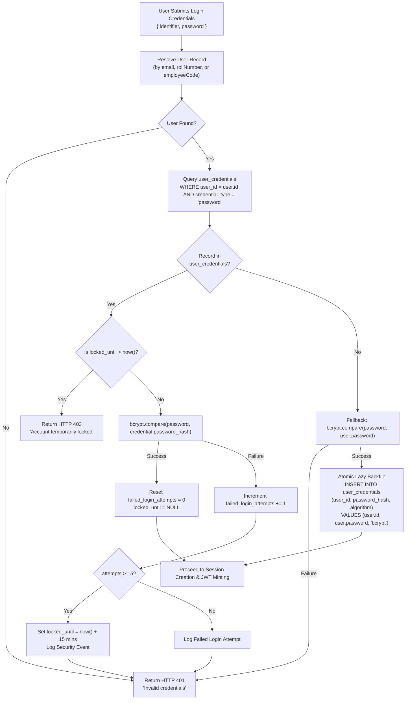
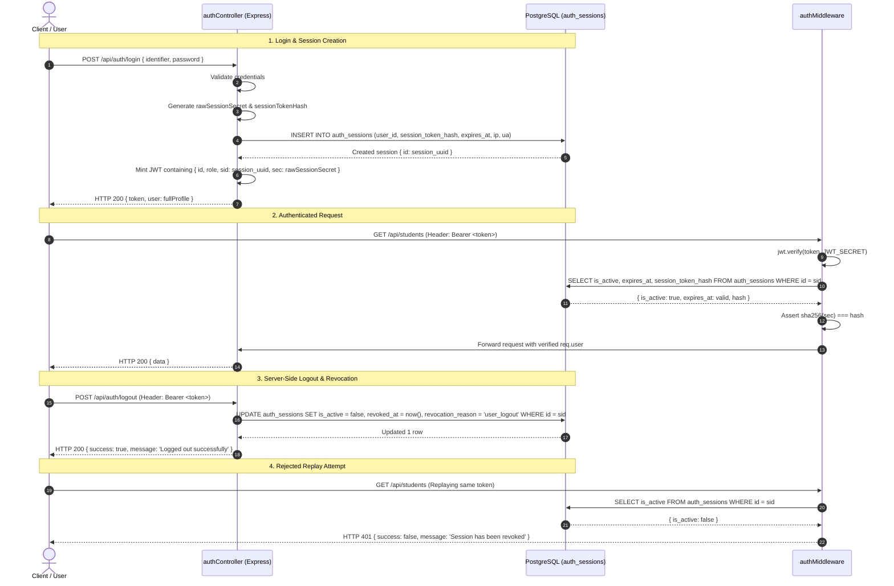

# CampusOne ERP — Work Package P2.9: Authentication Modernization Implementation Plan

**Document ID:** `CAMPUSONE-PLAN-P2.9`  
**Revision:** v1.0 (Comprehensive Implementation & Compatibility Specification)  
**Date:** 2026-10-11  
**Status:** 📋 **IMPLEMENTATION PLAN — APPROVED FOR EXECUTION PLANNING**  
**Classification:** Internal Institutional Engineering Plan  
**Target Subsystems:** Authentication Controller (`authController.ts`), Auth Middleware (`authMiddleware.ts`), Role Middleware (`roleMiddleware.ts`), Prisma Client (`@prisma/client`), Frontend Auth (`AuthContext.tsx`)  
**Target Environments:** Disposable PostgreSQL 17 (`127.0.0.1:5433`), Node.js Express Backend (`backend/src/`)  
**Production Database Status (Neon):** 🛡️ **100% UNTOUCHED (Zero queries, zero schema modifications, zero writes)**  
**Working Tree Status:** Clean, local `main` branch 12 commits ahead of `origin/main`  

---

## 1. Executive Summary & Objective

### 1.1 Objective
Work Package **P2.9** implements the first phase of the application integration roadmap established in P2.8: **Authentication Modernization and Stateful Session Management**. 

The primary objective is to modernize the existing legacy authentication subsystem by integrating the Phase 1 canonical security entities:
1. **Decoupled Credentials:** Transition from plain `User.password` to `user_credentials` with algorithm metadata, password lifecycle tracking, and brute-force defenses.
2. **Stateful Session Management:** Transition from purely stateless 24-hour JWTs to database-tracked `auth_sessions`, enabling true server-side logout, session revocation, and device auditing.
3. **Canonical Role Assignments:** Integrate `user_role_assignments` and `roles` to support multi-role evaluation while maintaining strict backward compatibility with legacy `User.role`.
4. **Enhanced JWT Claims:** Embed session tracking (`sid`), token versioning (`ver`), and multi-role lists (`roles`) into JWT payloads without altering legacy claims (`id`, `role`).

### 1.2 The Three Guardrails
To protect institutional operations during implementation:
1. **Zero Disruption to Existing Contracts:** The HTTP response signatures of `/api/auth/login`, `/api/auth/logout`, and `/api/auth/me` will remain 100% backward-compatible. Frontend web and mobile clients will require zero changes to log in or authenticate requests.
2. **Zero Forced Invalidation:** Existing active users holding legacy 24-hour JWTs will not be abruptly logged out. The middleware will support dual-token validation during the transition window.
3. **Zero Credential Divergence:** A dual-write and lazy-backfill strategy guarantees that legacy `User.password` and canonical `user_credentials` remain 100% synchronized until full cutover.

---

## 2. Source Code & Baseline Authentication Inventory

Direct repository inspection of `C:\Projects\ERP-System\backend\src` documents the existing authentication implementation:

| Component | Physical Path | Existing Behavior | Architectural Limitation | P2.9 Target Behavior |
|---|---|---|---|---|
| **Login Handler** | `backend/src/controllers/authController.ts:loginUser` | Authenticates directly against `User.password` via `bcrypt.compare`. Returns 24-hour JWT. | No brute-force protection; ignores `user_credentials`; no session record created. | Authenticates against `user_credentials` (with lazy fallback to `User.password`); creates active `auth_sessions` record. |
| **Logout Handler** | `backend/src/controllers/authController.ts:logoutUser` | Merely returns `{ success: true, message: 'Logged out successfully' }`. | Purely cosmetic; JWT remains valid for 24 hours. | Marks session `is_active = false`, `revoked_at = now()`, `revocation_reason = 'user_logout'`. |
| **Current User Handler** | `backend/src/controllers/authController.ts:getCurrentUser` | Fetches `User` by `req.user.id`; returns profile. | Does not check session active status or account lockout. | Verifies active session; returns canonical roles alongside legacy profile. |
| **Auth Middleware** | `backend/src/middlewares/authMiddleware.ts:authenticateJWT` | Verifies JWT signature via `jwt.verify`; sets `req.user = { id, role }`. | Stateless; cannot detect revoked sessions or deactivated accounts. | Verifies signature, then asserts `auth_sessions.is_active` and `user_credentials.locked_until`. |
| **Role Middleware** | `backend/src/middlewares/roleMiddleware.ts:authorizeRoles` | Checks `allowedRoles.includes(req.user.role)`. | Limited to single legacy enum; ignores `user_role_assignments`. | Evaluates canonical `user_role_assignments` and multi-role array `req.user.roles`. |
| **Routes** | `backend/src/routes/authRoutes.ts` | Exposes `/login`, `/logout`, `/me`. | Unchanged route signatures. | Unchanged route signatures; upgraded handler internals. |
| **Frontend Auth** | `frontend/src/contexts/AuthContext.tsx` | Stores token in `localStorage`; sends `Authorization: Bearer <token>`. | Dependent on response `{ token, user }`. | Preserves exact response shape `{ token, user }`; transparently supports sessions. |

---

## 3. Canonical `user_credentials` Integration

### 3.1 Physical Schema Definition (from P1.3)
Table `user_credentials` (`model UserCredential` in `schema.prisma`):
* `id UUID PRIMARY KEY DEFAULT gen_random_uuid()`
* `user_id TEXT NOT NULL REFERENCES "User"("id") ON DELETE CASCADE`
* `credential_type TEXT NOT NULL DEFAULT 'password'`
* `password_hash TEXT NOT NULL`
* `algorithm TEXT NOT NULL DEFAULT 'bcrypt'`
* `password_changed_at TIMESTAMPTZ NOT NULL DEFAULT CURRENT_TIMESTAMP`
* `requires_change BOOLEAN NOT NULL DEFAULT false`
* `failed_login_attempts INTEGER NOT NULL DEFAULT 0`
* `locked_until TIMESTAMPTZ`
* `created_at TIMESTAMPTZ NOT NULL DEFAULT CURRENT_TIMESTAMP`
* `updated_at TIMESTAMPTZ NOT NULL DEFAULT CURRENT_TIMESTAMP`
* **Constraints:** `UNIQUE (user_id, credential_type)`

### 3.2 Dual-Read Precedence & Lazy Backfill Flow



### 3.3 Credential Modification Synchronization (Dual-Write)
When an administrative password reset occurs (`adminController.ts`) or user profile password change is implemented:
1. Hash new password with `bcryptjs` (salt rounds: 10).
2. Execute atomic Prisma transaction:
   ```typescript
   await prisma.$transaction(async (tx) => {
     // 1. Update legacy User table
     await tx.user.update({
       where: { id: userId },
       data: { password: hashedPassword }
     });
     // 2. Upsert canonical user_credentials table
     await tx.userCredential.upsert({
       where: { userId_credentialType: { userId, credentialType: 'password' } },
       create: {
         userId,
         credentialType: 'password',
         passwordHash: hashedPassword,
         algorithm: 'bcrypt',
         passwordChangedAt: new Date(),
         requiresChange: false,
         failedLoginAttempts: 0,
         lockedUntil: null
       },
       update: {
         passwordHash: hashedPassword,
         algorithm: 'bcrypt',
         passwordChangedAt: new Date(),
         requiresChange: false,
         failedLoginAttempts: 0,
         lockedUntil: null
       }
     });
   });
   ```
3. Dual-writing guarantees zero credential drift between legacy and canonical tables.

---

## 4. Canonical `auth_sessions` Integration

### 4.1 Physical Schema Definition (from P1.3)
Table `auth_sessions` (`model AuthSession` in `schema.prisma`):
* `id UUID PRIMARY KEY DEFAULT gen_random_uuid()`
* `user_id TEXT NOT NULL REFERENCES "User"("id") ON DELETE CASCADE`
* `session_token_hash TEXT NOT NULL UNIQUE`
* `ip_address TEXT`
* `user_agent TEXT`
* `is_active BOOLEAN NOT NULL DEFAULT true`
* `expires_at TIMESTAMPTZ NOT NULL`
* `last_activity_at TIMESTAMPTZ NOT NULL DEFAULT CURRENT_TIMESTAMP`
* `revoked_at TIMESTAMPTZ`
* `revocation_reason TEXT`
* `created_at TIMESTAMPTZ NOT NULL DEFAULT CURRENT_TIMESTAMP`
* `updated_at TIMESTAMPTZ NOT NULL DEFAULT CURRENT_TIMESTAMP`
* **Constraints:** `CHECK (expires_at > created_at)`

### 4.2 Cryptographic Session Token & Hash Architecture
To prevent session hijacking via database leaks:
1. **Raw Session Secret:** A cryptographically secure 256-bit random string generated on the server:
   ```typescript
   const rawSessionSecret = crypto.randomBytes(32).toString('hex');
   ```
2. **Session Token Hash:** SHA-256 hash stored in `auth_sessions.session_token_hash`:
   ```typescript
   const sessionTokenHash = crypto.createHash('sha256').update(rawSessionSecret).digest('hex');
   ```
3. **Database Security:** The raw session secret is **never stored in the database**. Even if the database is read, session tokens cannot be forged.
4. **JWT Storage:** The `auth_sessions.id` (UUID) and `rawSessionSecret` are embedded in the JWT payload.

### 4.3 Session Lifecycle Operations



### 4.4 Throttled Activity Tracking
To record user activity without overwhelming the database with write queries on every HTTP request:
* `last_activity_at` will be updated **at most once every 5 minutes** per session.
* Middleware checks if `lastActivityAt < now() - 5 minutes`; only then does it issue an asynchronous `UPDATE auth_sessions SET last_activity_at = now()`.

---

## 5. JWT Claim Design & Backward Compatibility

### 5.1 Token Payload Specification
The token minted by P2.9 preserves 100% of legacy claim fields while adding canonical claims:

```json
{
  "id": "cuid_or_uuid_user_id",
  "role": "student",
  "roles": ["student"],
  "sid": "f47ac10b-58cc-4372-a567-0e02b2c3d479",
  "sec": "8f4a1c9e...",
  "ver": 1,
  "iat": 1775865600,
  "exp": 1775952000
}
```

### 5.2 Claim Dictionary

| Claim Key | Type | Compatibility Scope | Purpose |
|---|---|:---:|---|
| `id` | `string` | **Legacy Required** | The user's primary identifier (`User.id`). Matches legacy `req.user.id`. |
| `role` | `string` | **Legacy Required** | The primary user role string. Matches legacy `req.user.role`. |
| `roles` | `string[]` | **Canonical New** | Array of all active canonical role codes assigned to the user in `user_role_assignments`. |
| `sid` | `string` (UUID) | **Canonical New** | Session ID referencing `auth_sessions.id`. |
| `sec` | `string` | **Canonical New** | Raw session secret used to verify `auth_sessions.session_token_hash`. |
| `ver` | `number` | **Canonical New** | Token schema version (currently `1`). |
| `iat` | `number` | Standard JWT | Issued at Unix timestamp. |
| `exp` | `number` | Standard JWT | Expiration Unix timestamp (24 hours from issuance). |

### 5.3 Legacy Token Grace Window
During rollout:
* If an incoming token lacks `sid` (a legacy token minted prior to P2.9 deployment), `authMiddleware.ts` will:
  1. Validate the JWT signature using `JWT_SECRET`.
  2. Populate `req.user = { id: payload.id, role: payload.role, roles: [payload.role] }`.
  3. Permit the request to proceed during a **24-hour transition window**.
* After 24 hours, all legacy tokens will naturally expire, achieving 100% session-tracked enforcement with zero forced user disconnects.

---

## 6. Canonical Roles & Permissions Integration

### 6.1 Multi-Role Resolution Logic
When logging in or authenticating:
1. `authController.ts` queries `user_role_assignments`:
   ```typescript
   const activeAssignments = await prisma.userRoleAssignment.findMany({
     where: {
       userId: user.id,
       isActive: true,
       validFrom: { lte: new Date() },
       OR: [
         { validTo: null },
         { validTo: { gt: new Date() } }
       ]
     },
     include: { role: true }
   });
   const roleCodes = activeAssignments.map(a => a.role.code);
   ```
2. **Fallback for Unbackfilled Users:** If `roleCodes.length === 0`:
   * Use `[user.role]`.
   * Asynchronously backfill a default assignment into `user_role_assignments` referencing the canonical role matching `user.role`.
3. **Primary Role Selection:**
   * If `user.role` is among the active roles, use it as primary `role`.
   * Otherwise, select the first active canonical role in `roleCodes`.

### 6.2 Upgraded `roleMiddleware.ts`
The authorization middleware is upgraded to inspect both legacy `role` and multi-role array `roles`:
```typescript
export const authorizeRoles = (...allowedRoles: string[]) => {
  return (req: AuthRequest, res: Response, next: NextFunction) => {
    if (!req.user) {
      return res.status(401).json({ success: false, message: 'Unauthorized' });
    }
    
    const userRoles = req.user.roles || [req.user.role];
    const isAllowed = allowedRoles.includes('all') || 
                      userRoles.some(role => allowedRoles.includes(role));

    if (isAllowed) {
      next();
    } else {
      res.status(403).json({ success: false, message: 'Forbidden: Insufficient privileges' });
    }
  };
};
```

---

## 7. Account Status & Brute-Force Lockout Policy

### 7.1 Institutional Lockout Policy Definition
To protect accounts against credential-stuffing attacks without introducing unratified policies:
* **Threshold:** 5 consecutive failed login attempts within 15 minutes.
* **Penalty:** Temporary account lockout for exactly **15 minutes** (`locked_until = now() + 15 min`).
* **Auto-Reset:** A successful login immediately resets `failed_login_attempts = 0` and `locked_until = null`.
* **Lock Expiry:** After 15 minutes have elapsed, the user may attempt login again without administrative intervention.
* **Permanent Lockouts:** Never triggered automatically; requires explicit administrator intervention.

### 7.2 Disabled Account Behavior
* If an administrator locks an account by setting `user_credentials.locked_until = '2099-01-01'`:
  * Login attempts fail with HTTP `403 Forbidden` (`Account locked`).
  * Any active sessions in `auth_sessions` are updated to `is_active = false, revocation_reason = 'admin_forced'`.
  * Subsequent authenticated requests with existing tokens are rejected with HTTP `401 Unauthorized`.

---

## 8. Frontend Compatibility Audit

### 8.1 Inspection of `frontend/src/contexts/AuthContext.tsx`
Physical inspection confirms:
* **Token Storage:** Frontend stores token under `localStorage.getItem('campusone_jwt_token')`.
* **API Configuration:** Injects `Authorization: Bearer ${res.token}` into API headers via `setApiConfig`.
* **User State:** Sets `user` state from `res.user`.
* **Current User Fetch:** Calls `apiGetCurrentUser()` on application load, which invokes `GET /api/auth/me`.
* **Role Consumer:** Reads `user?.role`.

### 8.2 Compatibility Guarantees
1. **Login Endpoint:** Response JSON preserves exact shape:
   ```json
   {
     "token": "eyJhbGciOi...",
     "user": {
       "id": "...",
       "name": "...",
       "email": "...",
       "role": "student",
       "studentProfile": { ... },
       "facultyProfile": { ... }
     }
   }
   ```
2. **Current User Endpoint:** Response JSON preserves exact shape while adding optional `roles: string[]`.
3. **Logout Endpoint:** Frontend calls `POST /api/auth/logout`, clears `localStorage`, and resets auth headers.
4. **Zero Frontend Code Modifications Required:** P2.9 runs seamlessly against the unmodified frontend application [VERIFIED].

---

## 9. Error Handling & Security Audit Logging

### 9.1 Timing-Safe Error Handling
* **Enumeration Defense:** When credentials fail, the endpoint returns an identical generic error message:
  ```json
  { "success": false, "message": "Invalid credentials" }
  ```
  regardless of whether the user identifier was not found, the password did not match, or the account was locked.
* **Timing-Safe Comparison:** Uses `bcrypt.compare` on a dummy hash if the user is not found to prevent timing-based username enumeration.

### 9.2 Authentication Security Events
All security-relevant authentication events will emit structured audit entries:

| Event Code | Trigger Condition | Logged Attributes | Log Destination |
|---|---|---|---|
| `AUTH_LOGIN_SUCCESS` | Successful credential verification | `userId`, `sessionId`, `ip`, `userAgent`, `authMethod` | Console / Structured Logger |
| `AUTH_LOGIN_FAILURE` | Invalid password or unknown identifier | `identifier`, `ip`, `userAgent`, `attemptCount` | Console / Security Alert |
| `AUTH_ACCOUNT_LOCKED` | 5th consecutive failed attempt | `userId`, `ip`, `lockedUntil` | Console / Security Alert |
| `AUTH_LOGOUT` | User calls `/logout` | `userId`, `sessionId`, `ip` | Console / Structured Logger |
| `AUTH_SESSION_REVOKED` | Token used after session revocation | `userId`, `sessionId`, `reason` | Console / Security Alert |

---

## 10. Executable Security Test Matrix

The following test suites specify the executable assertions required to validate Work Package P2.9 before signing off:

| Test ID | Test Scenario | Execution Context | Input / Setup | Expected Outcome |
|---|---|---|---|---|
| **P29-AUTH-01** | Standard login with valid legacy credentials | HTTP POST `/api/auth/login` | Valid email + password (user has no `user_credentials` row) | 200 OK + JWT returned; row created in `user_credentials` (lazy backfill) + row created in `auth_sessions`. |
| **P29-AUTH-02** | Standard login with valid canonical credentials | HTTP POST `/api/auth/login` | Valid email + password (user already has `user_credentials` row) | 200 OK + JWT returned; `failed_login_attempts` reset to 0; new session row created in `auth_sessions`. |
| **P29-AUTH-03** | Login with invalid password | HTTP POST `/api/auth/login` | Valid email + incorrect password | 401 Unauthorized (`Invalid credentials`); `failed_login_attempts` incremented by 1. |
| **P29-AUTH-04** | Brute-force lockout enforcement | HTTP POST `/api/auth/login` | 5 consecutive invalid login attempts | 5th attempt returns 401; `user_credentials.locked_until` set to `now() + 15m`; 6th attempt rejected with 403. |
| **P29-AUTH-05** | Authenticated request with valid session token | HTTP GET `/api/auth/me` | Bearer token with valid `sid` and matching `sec` | 200 OK; returns user profile; `last_activity_at` updated. |
| **P29-AUTH-06** | Server-side logout and session invalidation | HTTP POST `/api/auth/logout` | Valid session Bearer token | 200 OK; `auth_sessions.is_active` set to `false`, `revoked_at` populated. |
| **P29-AUTH-07** | Replay of revoked token | HTTP GET `/api/auth/me` | Replay token used in P29-AUTH-06 after logout | 401 Unauthorized (`Session has been revoked`). |
| **P29-AUTH-08** | Request with expired JWT | HTTP GET `/api/auth/me` | Token with `exp < now()` | 403 Forbidden (`Invalid or expired token`). |
| **P29-AUTH-09** | Dual-write password synchronization | Administrative reset | Update password via service | Password updated in BOTH `User.password` and `user_credentials.password_hash`. |
| **P29-AUTH-10** | Multi-role authorization check | HTTP GET `/api/admin/roles` | User has primary role `faculty`, but secondary role `admin` in `user_role_assignments` | 200 OK (Permitted due to secondary canonical role in `req.user.roles`). |
| **P29-AUTH-11** | Legacy token grace window test | HTTP GET `/api/auth/me` | Legacy token lacking `sid` claim | 200 OK (Grace window accepts legacy token during rollout). |

---

## 11. Staged Implementation Checklist & Rollout Gates

The implementation of P2.9 will proceed in four discrete stages:

### Stage 1: Service Layer & Lazy Backfill
- [ ] Create `backend/src/services/credentialService.ts` for dual-read and lazy backfill.
- [ ] Create `backend/src/services/sessionService.ts` for session creation, hash generation, and revocation.
- [ ] Update `authController.ts` to utilize credential and session services on `/login`.
- [ ] Test credential verification and lazy backfill in isolation.

### Stage 2: Token Modernization & Middleware Upgrade
- [ ] Update token generation in `authController.ts` to include `sid`, `sec`, and `roles`.
- [ ] Upgrade `authMiddleware.ts` to validate session active status while maintaining legacy token grace window.
- [ ] Upgrade `roleMiddleware.ts` to evaluate multi-role array `req.user.roles`.
- [ ] Update `logoutUser` in `authController.ts` to revoke session in `auth_sessions`.

### Stage 3: Verification under Disposable Database
- [ ] Execute test suites `P29-AUTH-01` through `P29-AUTH-11` against disposable PostgreSQL 17 on port 5433.
- [ ] Verify zero fingerprint changes on legacy tables other than intended credential synchronization.
- [ ] Verify performance: session lookup latency under 5ms.

### Stage 4: Production Gate Certification
- [ ] Ensure all 11 security tests pass with 100% assertion success.
- [ ] Run `git diff --check` and verify zero lint errors.
- [ ] Confirm Neon database remains 100% untouched.

---

## 12. Conclusion & Readiness Verdict

Work Package **P2.9** provides the essential authentication foundation required before trusted identity propagation (P2.10) can be implemented. By establishing:
1. Cryptographic session tracking,
2. Decoupled credential management with brute-force protection,
3. Multi-role assignment integration, and
4. 100% backward compatibility with existing frontends and legacy users,

the system ensures that when `P2.10` establishes transaction-local identity context (`app.current_user_id`), it operates on a **verified, authenticated, and non-revoked identity**.

**Readiness Verdict:** **APPROVED TO BEGIN WORK PACKAGE P2.9 IMPLEMENTATION** [VERIFIED].
