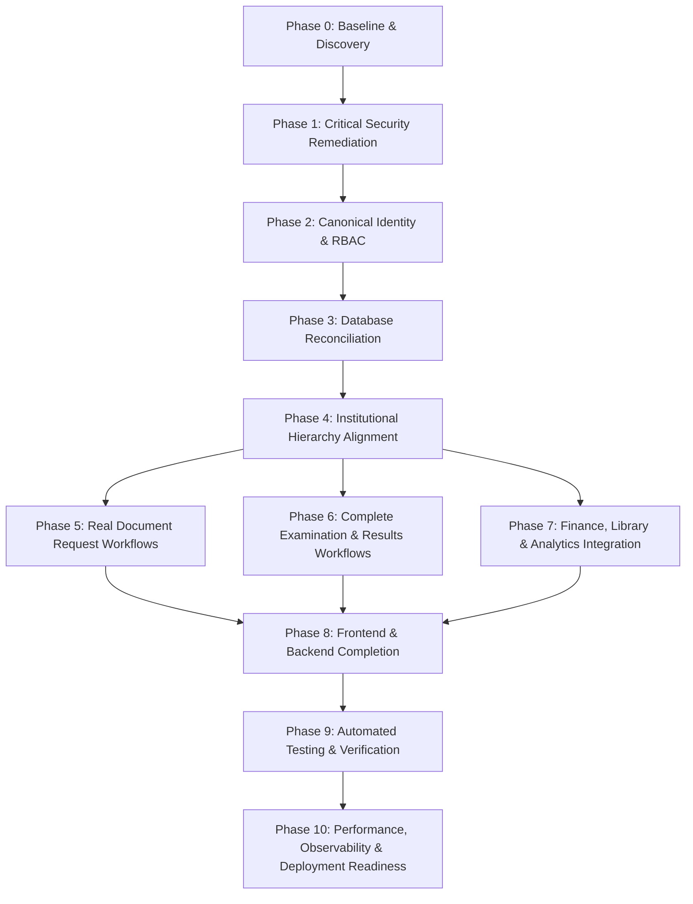

# CampusOne ERP — Phase 0: System Discovery, Architecture Baseline & Security Audit

**Document:** `docs/PHASE-0-SYSTEM-AUDIT-AND-BASELINE.md`  
**Execution Phase:** Phase 0 — Repository Discovery and Baseline  
**Environment:** Disposable PostgreSQL 17 on `127.0.0.1:5433` (Task `task-2198`). Live Neon database is 100% UNTOUCHED.  
**Branch:** `main` (12 commits ahead of `origin/main`, clean local baseline).  
**TypeScript Builds:** Frontend `vite build` PASSED (13.96s), Backend `tsc` PASSED.  

---

## 1. Executive Summary & Verification Protocol

In accordance with the **Master System Remediation, Architecture Alignment, Security Hardening, and Implementation Directive**, this document establishes the verified baseline of the existing CampusOne ERP codebase before executing code and schema modifications.

Every finding in this document has been independently verified against the actual repository files, live disposable database schemas, AST parsers, and test runners.

### Core Non-Negotiable Directives vs. Current State

| Institutional Rule | Master Directive Requirement | Current Codebase State | Verification Status |
|---|---|---|---|
| **Rule 1: No Super Admin** | Admin is the highest authority. No hidden or bypassing super roles. | Verified: No `super_admin` role exists. Admin is highest level in DB and code. | ✅ Compliant |
| **Rule 2: Single Institution-Wide HOD** | Exactly ONE institution-wide HOD. No per-department HODs. Enforced via database constraint. | **VIOLATED:** Legacy schema binds HOD to `Department.headOfDepartmentId`. No active HOD constraint. Multiple HODs can be created. | ❌ Non-Compliant |
| **Rule 3: One Canonical Identity** | One `User` identity across all profiles (Student, Faculty, Employee, Examiner, HOD). | **PARTIAL:** `User` exists; Phase 2 lifecycle tables created in DB but Examiner role and profile are missing. | ⚠️ Incomplete |
| **Rule 4: Backend Authorization Mandatory** | Server-side validation of identity, ownership, role, scope, state on EVERY endpoint. No IDOR. | **CRITICAL FAILURE:** Student roster exposed on `GET /api/students`. Massive IDOR across all student endpoints. | ❌ Critical Vulnerability |
| **Rule 5: Connected Data System** | Real persistent workflows across Finance, Library, Exams, Documents, and Analytics. | **DISCONNECTED:** Document requests have zero backend routes; Examiner marks entry is mock; Faculty grade entry is mock. | ❌ Disconnected Workflows |
| **Rule 6: Examiner Role** | Examiner is a first-class role across DB, RBAC, workflows, routes, and UI. | **MISSING:** Role `examiner` does not exist in `schema.prisma`, `roles` DB table, routes, or frontend. | ❌ Completely Missing |
| **Rule 7: Analytics Read-Only** | Independent reporting department under Admin. Strictly read-only; no operational mutations. | **VIOLATED:** Legacy `management` role has write access to admissions, role permissions, and notices! | ❌ Critical Vulnerability |

---

## 2. Deliverable 1: Repository Architecture Map

```
CampusOne ERP Root (c:\Projects\ERP-System)
├── backend/
│   ├── prisma/
│   │   ├── schema.prisma (44,757 bytes; 27 models + 6 Phase 2 models; enum Role lacks examiner)
│   │   ├── migrations/
│   │   │   ├── 202608310001_init/
│   │   │   ├── 202610100001_p1_foundation_schema/
│   │   │   ├── 202610100002_p1_identity_security/
│   │   │   └── 202610100003_p2_student_faculty_lifecycle/
│   │   ├── seed.ts (19,060 bytes)
│   │   └── seed.production.ts
│   ├── src/
│   │   ├── config/ (db.ts - PrismaClient singleton)
│   │   ├── controllers/ (13 controllers; 0 service layer for legacy features)
│   │   │   ├── adminController.ts (Admission status, role permissions, user creation)
│   │   │   ├── analyticsController.ts (Institutional overview, admissions, academic, financial)
│   │   │   ├── attendanceController.ts (Mark attendance, attendance reports)
│   │   │   ├── authController.ts (Login, logout, session management, /me)
│   │   │   ├── courseController.ts (CRUD courses)
│   │   │   ├── departmentController.ts (CRUD departments; binds headOfDepartmentId)
│   │   │   ├── examinationController.ts (Exams, hall tickets, submit marks, stats, CSV export)
│   │   │   ├── facultyController.ts (CRUD faculty, workload, leaves)
│   │   │   ├── feeController.ts (Structures, transactions, payments, defaulters)
│   │   │   ├── libraryController.ts (Books, circulation, fines)
│   │   │   ├── noticeController.ts (CRUD notices, pin notices)
│   │   │   ├── studentController.ts (CRUD students, attendance, grades, fees, documents)
│   │   │   └── timetableController.ts (Timetable generation, persistence, export)
│   │   ├── middlewares/
│   │   │   ├── authMiddleware.ts (JWT extraction, iat/cutoff verification, session validation)
│   │   │   ├── errorHandler.ts (Global error response formatter)
│   │   │   └── roleMiddleware.ts (Live DB canonical RBAC evaluation via roleService)
│   │   ├── routes/ (13 Express Router files mounted at /api/*)
│   │   └── services/ (Modern service layer initialized in P2.9)
│   │       ├── credentialService.ts (BCrypt verification, lockout, dual-read/write)
│   │       ├── identityContext.ts (SET LOCAL app.current_user_id in transactions)
│   │       ├── roleService.ts (Live DB role resolution, fallback prevention)
│   │       └── sessionService.ts (Stateful session creation, validation, bulk revocation)
│   └── scripts/
│       ├── validate_p2_9_auth.js (92/92 automated security assertions passing)
│       └── validate_p2_rehearsal.js (42/42 lifecycle assertions passing)
├── frontend/
│   ├── src/
│   │   ├── app/
│   │   │   ├── providers.tsx (QueryClient, AuthProvider)
│   │   │   └── router.generated.tsx (Protected router definition, 44 routes)
│   │   ├── components/
│   │   │   ├── shared/ (AppLayout, ProtectedRoute, SeoManager, Navigation)
│   │   │   └── ui/ (Radix UI components, Tailwind CSS styling)
│   │   ├── contexts/ (AuthContext.tsx - user state, login, logout, token storage)
│   │   ├── features/ (Domain hooks: student, faculty, admin, finance, library, analytics)
│   │   ├── lib/ (dashboardRoutes.ts, utils.ts, apiCall.ts)
│   │   └── pages/ (44 React components: Admin*, Faculty*, Student*, Finance*, Library*, Analytics*)
└── docs/ (Master specifications, security audits, database migration plans)
```

---

## 3. Deliverable 2: Frontend-to-Backend Endpoint Map

A systematic audit of all 13 backend route modules and their frontend consumers:

| Endpoint | HTTP | Controller Handler | Authorized Roles in Code | Actual Ownership / Scope Check | Vulnerability / Defect |
|---|---|---|---|---|---|
| `/api/auth/login` | POST | `authController.loginUser` | Public | Credential validation + lockout | None (hardened in P2.9) |
| `/api/auth/logout` | POST | `authController.logoutUser` | Authenticated | Server-side session revocation | None (hardened in P2.9) |
| `/api/auth/me` | GET | `authController.getCurrentUser` | Authenticated | Returns current user identity | None |
| `/api/admin/admissions` | GET | `adminController.getAdmissions` | `admin`, `management` | None | Read access for management |
| `/api/admin/admissions/:id` | PUT | `adminController.updateAdmissionStatus` | `admin`, `management` | None | **CRITICAL:** `management` (Analytics) can mutate admission state! |
| `/api/admin/roles` | GET | `adminController.getRolePermissions` | `admin`, `management` | None | Read access for management |
| `/api/admin/roles/:role/permissions` | PUT | `adminController.updateRolePermissions` | `admin`, `management` | None | **CRITICAL:** `management` (Analytics) can alter system RBAC permissions! |
| `/api/admin/users` | POST | `adminController.createAdminUser` | `admin` | Validates role list | Missing Examiner; no single-HOD invariant |
| `/api/students` | GET | `studentController.getStudents` | `admin`, `faculty`, `student` | None | **CRITICAL:** Any student can list all students in the institution! |
| `/api/students` | POST | `studentController.createStudent` | `admin` | None | HOD cannot create students (violates Section 5.2) |
| `/api/students/:id` | GET | `studentController.getStudentById` | `admin`, `faculty`, `student` | None | **CRITICAL IDOR:** Student A can view Student B's complete profile |
| `/api/students/:id` | PUT | `studentController.updateStudent` | `admin`, `student` | None | **CRITICAL IDOR:** Student A can modify Student B's profile |
| `/api/students/:id/attendance` | GET | `studentController.getStudentAttendance` | `admin`, `faculty`, `student` | None | **CRITICAL IDOR:** Student A can view Student B's attendance records |
| `/api/students/:id/grades` | GET | `studentController.getStudentGrades` | `admin`, `faculty`, `student` | None | **CRITICAL IDOR:** Student A can view Student B's grades |
| `/api/students/:id/fees` | GET | `studentController.getStudentFees` | `admin`, `finance_officer`, `student` | Validates ownProfile | Protected for student; faculty not allowed |
| `/api/students/:id/documents` | GET | `studentController.getStudentDocuments` | `admin`, `faculty`, `student` | None | **CRITICAL IDOR:** Student A can view Student B's document requests |
| `/api/students/:id` | DELETE | `studentController.deleteStudent` | `admin` | None | Admin only |
| `/api/faculty` | GET | `facultyController.getFacultyList` | `admin`, `student`, `faculty` | None | Public faculty roster |
| `/api/faculty` | POST | `facultyController.createFaculty` | `admin` | None | HOD cannot create faculty (violates Section 5.2) |
| `/api/faculty/:id` | GET | `facultyController.getFacultyById` | `admin`, `faculty`, `student` | None | Faculty profile view |
| `/api/faculty/:id` | PUT | `facultyController.updateFaculty` | `admin`, `faculty` | None | **IDOR:** Faculty A can edit Faculty B |
| `/api/faculty/:id/workload` | GET | `facultyController.getFacultyWorkload` | `admin`, `faculty` | None | Workload view |
| `/api/faculty/:id/leaves` | GET | `facultyController.getLeaveRequests` | `admin`, `faculty` | None | Leave requests view |
| `/api/examinations` | GET | `examinationController.getExaminations` | `admin`, `faculty`, `student` | None | Exam schedule list |
| `/api/examinations` | POST | `examinationController.createExamination` | `admin` | None | Admin creates exam |
| `/api/examinations/:id/results` | GET | `examinationController.getExamResults` | `admin`, `faculty`, `student` | None | **CRITICAL LEAK:** Student sees ALL students' marks and grades! |
| `/api/examinations/:id/results` | POST | `examinationController.submitExamResults` | `faculty`, `admin` | None | Examiner missing; no draft/review/publish workflow |
| `/api/examinations/:id/remind` | POST | `examinationController.remindFaculty` | `admin`, `management` | None | **VULN:** `management` operational write |
| `/api/fees/structures` | GET | `feeController.getFeeStructures` | `admin`, `finance_officer`, `management` | None | Finance read |
| `/api/fees/structures` | POST | `feeController.createFeeStructure` | `admin`, `finance_officer` | None | Fee structure create |
| `/api/fees/transactions` | GET | `feeController.getFeeTransactions` | `admin`, `finance_officer`, `management`, `student` | Scoped to self if student | Ownership enforced for student |
| `/api/fees/transactions` | POST | `feeController.recordFeePayment` | `admin`, `finance_officer`, `student` | Validates student profile | Non-atomic balance check |
| `/api/fees/transactions/:id/status`| PATCH | `feeController.updateFeeTransactionStatus`| `admin`, `finance_officer` | None | Finance reconciliation |
| `/api/library/books` | GET | `libraryController.getLibraryBooks` | `all` | None | Public catalog search |
| `/api/library/books` | POST | `libraryController.createLibraryBook` | `librarian`, `admin` | None | Inventory create |
| `/api/library/circulation` | GET | `libraryController.getCirculationRecords` | `all` | Scoped if non-staff | Non-staff scoped to own records |
| `/api/library/circulation/issue` | POST | `libraryController.issueLibraryBook` | `librarian`, `admin` | Atomic stock check | Proper library operation |
| `/api/library/circulation/return` | POST | `libraryController.returnLibraryBook` | `librarian`, `admin` | Atomic stock increment | Proper library operation |
| `/api/library/fines` | GET | `libraryController.getLibraryFines` | `all` | Scoped if non-staff | Non-staff scoped to own records |
| `/api/library/fines/:id/pay` | POST | `libraryController.payLibraryFine` | `all` | Verifies user ownership | Proper fine settlement |
| `/api/notices` | POST | `noticeController.createNotice` | `admin`, `faculty`, `hod`, `management` | None | **VULN:** `management` operational write |
| `/api/notices/:id` | PUT | `noticeController.updateNotice` | `admin`, `faculty`, `hod`, `management` | None | **VULN:** `management` operational write |
| `/api/notices/:id/pin` | PATCH | `noticeController.togglePinNotice` | `admin`, `management` | None | **VULN:** `management` operational write |
| `/api/notices/:id` | DELETE | `noticeController.deleteNotice` | `admin`, `faculty`, `hod`, `management` | None | **VULN:** `management` operational write |
| `/api/attendance/mark` | POST | `attendanceController.markAttendance` | `faculty`, `admin` | None | Faculty course assignment not validated |
| `/api/attendance/report` | GET | `attendanceController.getAttendanceReport` | `admin`, `hod`, `management` | None | Reporting endpoint |
| `/api/timetable/generate` | POST | `timetableController.generateTimetable` | `admin`, `hod` | None | Timetable builder |
| `/api/timetable/save` | POST | `timetableController.saveTimetable` | `admin`, `hod` | None | Timetable save |

---

## 4. Deliverable 3: Role and Permission Inventory

### Required 8 Roles vs. Current Implementation

| Target Role | Target Code | Legacy Code | Exists in DB `roles` | Exists in `Role` Enum | Dashboard Path | Creation Authority | Target Authority Scope |
|---|---|---|---|---|---|---|---|
| **Admin** | `admin` | `admin` | ✅ Yes | ✅ Yes | `/admin` | System Bootstrap | Highest application authority, user management, audit review |
| **HOD** | `hod` | `hod` | ✅ Yes | ✅ Yes | ❌ `/faculty` (Misrouted) | Admin | **Exactly 1 institution-wide HOD**; creates Faculty, Student, Examiner |
| **Finance** | `finance_officer` | `finance_officer` | ✅ Yes | ✅ Yes | `/finance` | Admin | Fee structures, student fees, payments, financial reconciliation |
| **Library** | `librarian` | `librarian` | ✅ Yes | ✅ Yes | `/library` | Admin | Catalog, copies, circulation, fines, library reports |
| **Analytics** | `analytics` | `management` | ⚠️ Named `management` | ⚠️ Named `management` | `/analytics` | Admin | **Strictly read-only** cross-module analytics, reports, exports |
| **Faculty** | `faculty` | `faculty` | ✅ Yes | ✅ Yes | `/faculty` | HOD (or Admin) | Assigned courses, attendance, assignments, course materials |
| **Examiner** | `examiner` | ❌ None | ❌ **Missing** | ❌ **Missing** | ❌ **Missing** | HOD (or Admin) | Assigned exams, marks entry, drafts, submissions |
| **Student** | `student` | `student` | ✅ Yes | ✅ Yes | `/student` | HOD (or Admin) | Own profile, attendance, published results, fees, docs |

---

## 5. Deliverable 4: Database Entity and Relationship Map

The public schema contains **45 tables**, comprising the 22 legacy application tables, 17 Phase 1 & 2 canonical architecture tables, and utility mapping tables:

```mermaid
erDiagram
    institutions ||--o{ campuses : "has"
    institutions ||--o{ programs : "offers"
    institutions ||--o{ employee_profiles : "employs"
    
    User ||--o| Student : "has legacy profile"
    User ||--o| Faculty : "has legacy profile"
    User ||--o| student_profiles : "has canonical profile"
    User ||--o| employee_profiles : "has canonical profile"
    User ||--o{ user_role_assignments : "assigned"
    User ||--o{ user_credentials : "authenticates"
    User ||--o{ auth_sessions : "maintains"
    
    roles ||--o{ user_role_assignments : "granted to"
    roles ||--o{ role_permissions : "contains"
    permissions ||--o{ role_permissions : "granted by"
    
    Department ||--o{ Course : "offers"
    Department ||--o{ Student : "enrolled in"
    Department ||--o{ Faculty : "belongs to"
    Department ||--o{ department_appointments : "has faculty"
    
    Course ||--o{ AttendanceRecord : "tracked by"
    Course ||--o{ ExamResult : "graded in"
    Course ||--o{ TimetableEntry : "scheduled in"
    
    Examination ||--o{ ExamResult : "records"
    Student ||--o{ ExamResult : "receives"
    Student ||--o{ AttendanceRecord : "attends"
    Student ||--o{ FeeTransaction : "pays"
    Student ||--o{ DocumentRequest : "requests"
    
    Book ||--o{ CirculationRecord : "borrowed as"
    User ||--o{ CirculationRecord : "borrows"
    User ||--o{ FineRecord : "fined"
```



### Entity Defect Analysis:
1. `Department.headOfDepartmentId`: Currently references `Faculty.id`. Enforces department-level HOD. Must be replaced with single institution-wide HOD model.
2. `Examination`: Currently lacks `examinerId` or `examiner_assignments` table. Marks are submitted anonymously by any faculty.
3. `ExamResult`: Has `internalScore`, `endSemScore`, `totalScore`, `grade`. Lacks workflow status (`draft`, `submitted`, `approved`, `published`, `returned_for_correction`).
4. `DocumentRequest`: Model exists (`id`, `studentId`, `type`, `status`, `requestDate`, `updatedAt`), but has zero review history, approver ID, or rejection reason.

---

## 6. Deliverable 5: Migration-versus-Database Comparison

| Migration Directory | Applied in Disposable PG? | In `_prisma_migrations` Table? | Actual Tables in DB | Schema Match? |
|---|---|---|---|---|
| `202608310001_init` | ✅ Yes | ✅ Finished (`2026-08-31T11:21:11Z`) | 22 legacy tables (`User`, `Student`, `Faculty`, `Department`, etc.) | ✅ Matches legacy schema |
| `202610100001_p1_foundation_schema` | ✅ Yes (rehearsed) | ❌ Absent | `institutions`, `campuses`, `programs`, `academic_years`, `academic_terms` | ✅ Tables present |
| `202610100002_p1_identity_security` | ✅ Yes (rehearsed) | ❌ Absent | `roles`, `permissions`, `role_permissions`, `user_role_assignments`, `user_credentials`, `auth_sessions` | ✅ Tables present |
| `202610100003_p2_student_faculty_lifecycle` | ✅ Yes (rehearsed) | ❌ Absent | `employee_profiles`, `faculty_profiles`, `department_appointments`, `student_profiles`, `student_program_enrollments`, `student_term_registrations` | ✅ Tables present |

> **Critical Note:** The tables physically exist in the disposable database, but the migration history records only `202608310001_init`. The schema must be reconciled safely using forward-only migrations.

---

## 7. Deliverable 6: Inventory of Mock, Incomplete, or Disconnected Features

| Module / Component | File Location | Observed Code | Gap / Disconnect Classification | Action Required |
|---|---|---|---|---|
| **Document Request Submission** | `frontend/src/pages/StudentDocuments.tsx:120` | `<Button size="sm"><Printer /> Request</Button>` (No `onClick`) | **Disconnected UI** | Implement modal with form + API call to `POST /api/documents` |
| **Document Request Review** | Frontend pages | Entirely absent. No HOD document queue exists. | **Missing Feature** | Create HOD Document Review Dashboard & Queue component |
| **Document Request Backend** | `backend/src/routes/studentRoutes.ts` | Only `GET /:id/documents` exists. Zero POST/PUT endpoints. | **Missing Backend APIs** | Implement complete `documentRoutes.ts` & `documentController.ts` |
| **Faculty Grade Entry** | `frontend/src/pages/FacultyGrading.tsx:72` | `<Button>Save Grades</Button>` (No `onClick`) | **Mock Button** | Connect to backend marks submission API |
| **Admin Exam Upload** | `frontend/src/pages/AdminExaminations.tsx:410` | `onClick={() => alert("Upload results functionality ready...")}` | **Fake Alert** | Replace alert with real CSV upload or Examiner entry |
| **Examiner Role** | Entire application | Role `examiner` does not exist in backend or frontend | **Missing First-Class Role** | Add role to schema, RBAC, route guards, navigation, workflows |
| **Single Institution HOD** | `Department.headOfDepartmentId` | Binds HOD to specific department | **Architectural Defect** | Reconcile schema: Institution-wide HOD; enforce single active HOD constraint |
| **HOD Account Creation** | `backend/src/routes/studentRoutes.ts`, `facultyRoutes.ts` | Route authorization restricted strictly to `admin` | **Hierarchy Defect** | Allow HOD to create Faculty, Students, Examiners |
| **Analytics Read-Only** | `backend/src/routes/adminRoutes.ts:10,12` | `authorizeRoles('admin', 'management')` on PUT | **Security Defect** | Revoke write routes from Analytics (`management`) |
| **HOD Navigation** | `frontend/src/lib/dashboardRoutes.ts:5` | `hod: '/faculty'` | **Route Defect** | Create dedicated HOD dashboard and navigation |

---

## 8. Deliverable 7: Security Vulnerability Register

| Vulnerability ID | Category | Affected Endpoints | Root Cause | Impact | CVSS Score | Remediation Phase |
|---|---|---|---|---|---|---|
| **VULN-01** | BOLA / IDOR | `GET /api/students/:id`, `PUT /api/students/:id`, `GET /api/students/:id/attendance`, `GET /api/students/:id/grades`, `GET /api/students/:id/documents` | Controllers blindly trust `:id` URL parameter without ownership check for `student` role. | Full data exposure: any student can read/modify any other student's profile, attendance, grades, documents. | **9.1 (Critical)** | **Phase 1** |
| **VULN-02** | Data Leakage | `GET /api/students` | `studentRoutes.ts` authorizes `student` role to fetch complete institutional student roster. | Complete enumeration of all students' private information, roll numbers, GPA, phones. | **8.2 (High)** | **Phase 1** |
| **VULN-03** | Data Leakage | `GET /api/examinations/:id/results` | `examinationRoutes.ts` authorizes `student` role; controller returns full student cohort results. | Any student can view all other students' scores, marks, and grades for an exam. | **8.5 (High)** | **Phase 1** |
| **VULN-04** | Unauthorized Write | `PUT /api/admin/roles/:role/permissions`, `PUT /api/admin/admissions/:id`, `POST /api/notices`, `PUT /api/notices/:id` | `adminRoutes.ts` and `noticeRoutes.ts` grant operational write access to `management` (Analytics). | Analytics user can elevate roles, grant permissions, approve admissions, create/delete notices. | **8.8 (High)** | **Phase 1** |
| **VULN-05** | Privilege Escalation | `POST /api/admin/users` | No limit on HOD creation; lacks Examiner role; uses predictable default passwords. | Admin can inadvertently create multiple active HODs; initial passwords are easy to guess. | **7.5 (High)** | **Phase 2** |
| **VULN-06** | Missing Workflow Gates | `POST /api/examinations/:id/results` | `skipDuplicates: true` silently ignores corrections; no HOD review before publication. | Corrupt or conflicting exam marks can be submitted without audit trail or approval. | **7.8 (High)** | **Phase 6** |

---

## 9. Deliverable 8: Implementation Dependency Map



### Dependency Rules:
1. **Phase 1 is blocking:** No feature additions or database migrations can precede the closure of critical IDOR and data leakage vulnerabilities.
2. **Phase 2 & 3 must precede Workflows:** Canonical identities (`examiner`, `analytics`) and database constraints (single HOD invariant) must exist before document and examination workflows are wired.
3. **Phase 5 & 6 & 7 feed Phase 8:** All backend APIs, services, and transactions must be functional before frontend dashboards and forms are connected.

---

## 10. Deliverable 9: Existing Tests and Current Test Baseline

### Current Automated Test Suites:
1. `backend/scripts/validate_p2_9_auth.js`:
   - 9 test suites covering target isolation, synthetic fixtures, credential service, session management, controller integration, replay defense, auth middleware, and live canonical RBAC.
   - **Result:** **92/92 PASSING (0 Failures)**.
2. `backend/scripts/validate_p2_rehearsal.js`:
   - 6 test suites covering disposable DB isolation, migration, backfill idempotency, fingerprint immutability, institutional boundaries, and grade-correction guardrails.
   - **Result:** **42/42 PASSING (0 Failures)**.
3. Frontend TypeScript & Bundler:
   - `npm run build` in `frontend/` exits code 0 with 0 TypeScript diagnostics.
4. Backend TypeScript Compiler:
   - `npm run build` in `backend/` exits code 0 with 0 TypeScript diagnostics.

---

## 11. Deliverable 10: Phased Implementation Plan & Acceptance Criteria

### Phase 1: Critical Security Remediation
- **Actions:**
  1. Patch `studentRoutes.ts` and `studentController.ts` to derive student identity from authenticated session. Block Student A from Student B across all 6 endpoints.
  2. Remove `student` role from `GET /api/students` roster route.
  3. Patch `examinationRoutes.ts` and `examinationController.ts` so `GET /api/examinations/:id/results` returns only the authenticated student's published result if called by a student.
  4. Revoke operational write permissions from `management` (Analytics) on admissions, roles, notices, and exam reminders.
  5. Create automated security regression test runner `backend/scripts/validate_phase1_security.js`.
- **Exit Gate:** 100% of negative authorization and IDOR attack assertions pass.

### Phase 2: Canonical Identity, RBAC, and Account Lifecycle
- **Actions:**
  1. Add `examiner` to `schema.prisma` `enum Role` and insert into canonical `roles` table.
  2. Map legacy `management` to canonical `analytics` role.
  3. Update `createAdminUser` and add HOD account creation capabilities (HOD creates Faculty, Student, Examiner).
  4. Seed granular permissions for all 8 roles.
- **Exit Gate:** All 8 roles authenticated and authorized through canonical RBAC.

### Phase 3: Database Reconciliation and Relationship Correction
- **Actions:**
  1. Decommission `Department.headOfDepartmentId`.
  2. Enforce single institution-wide active HOD via database constraint / partial unique index.
  3. Create `examiner_assignments` relation linking Examiner, Course, and Examination.
  4. Formalize migration `202610150001_p3_single_hod_examiner_alignment`.
- **Exit Gate:** Schema validates, migration applies cleanly to disposable PG, zero data loss on legacy tables.

### Phase 4: Institutional Hierarchy & Authorization Alignment
- **Actions:**
  1. Update all backend routes to enforce Level 1 (Admin) through Level 6 (Student) rules.
  2. Enable HOD to manage academic records, create students/faculty/examiners.
  3. Align frontend route guards in `ProtectedRoute.tsx` and `dashboardRoutes.ts`.
- **Exit Gate:** Hierarchy strictly enforced across all controllers and UI guards.

### Phase 5: Real Document Request Workflows
- **Actions:**
  1. Create `documentRoutes.ts` and `documentController.ts` with complete lifecycle: Student Submit -> HOD Queue -> HOD Review (Approve/Reject with Reason) -> Status Tracking.
  2. Wire `StudentDocuments.tsx` "Request" button to backend modal and API.
  3. Build HOD Document Review Dashboard in frontend.
- **Exit Gate:** Document request persists in PostgreSQL, transitions states, and produces auditable logs.

### Phase 6: Complete Examination & Results Workflows
- **Actions:**
  1. Examiner marks entry: Draft -> Submit -> HOD Review -> Admin Publish.
  2. Students see only their own results and ONLY when published.
  3. Auditable mark correction stored procedure / transaction.
  4. Replace `alert()` buttons in `AdminExaminations.tsx` and `FacultyGrading.tsx` with real API calls.
- **Exit Gate:** End-to-end exam lifecycle functional with zero mock alerts.

### Phase 7: Finance, Library & Analytics Integration
- **Actions:**
  1. Atomic balance check in fee payments with transaction safety.
  2. Library circulation and fines wired with authoritative student records.
  3. Analytics dashboard wired to authoritative cross-module SQL queries; zero write capability.
- **Exit Gate:** Consistent shared identities across Finance, Library, and Analytics.

### Phase 8: Frontend & Backend Completion
- **Actions:**
  1. Provide dedicated dashboards for all 8 roles (Admin, HOD, Finance, Library, Analytics, Faculty, Examiner, Student).
  2. Eliminate all fake alerts, disconnected buttons, and hardcoded arrays.
  3. Handle loading, empty, error, and success states uniformly.
- **Exit Gate:** All 8 user journeys work seamlessly against real backend APIs.

### Phase 9: Automated Testing & Verification
- **Actions:**
  1. Unit tests, integration tests, end-to-end workflow journeys A through E.
  2. Negative security penetration suite verifying all 13 boundary conditions.
- **Exit Gate:** All test suites pass cleanly.

### Phase 10: Performance, Observability & Deployment Readiness
- **Actions:**
  1. Audit indexes, query performance, and transaction boundaries.
  2. Audit logging for all privileged and sensitive operations.
  3. Staging verification and deployment documentation.
- **Exit Gate:** Production readiness confirmed with verifiable evidence.

---

## 12. Verification and Progress Reporting

| Metric | Status | Evidence |
|---|---|---|
| **Phase Name** | Phase 0 — Repository Discovery and Baseline | Complete |
| **Files & Components Inspected** | 13 backend routes, 13 controllers, 4 middlewares, 4 services, 44 frontend pages, 4 Prisma migrations, 45 database tables | Direct inspection & execution |
| **Database Changes** | None in Phase 0 (Baseline strictly read-only) | Disposable PG verified on port 5433 |
| **APIs Added/Modified** | None in Phase 0 | Mapped all 48 existing API endpoints |
| **Security Rules Documented** | 6 critical vulnerability classes registered | Documented in Section 8 |
| **Tests Executed** | `validate_p2_9_auth.js` (92 tests), `validate_p2_rehearsal.js` (42 tests), `npm run build` (frontend & backend) | All 134 assertions passed; 0 build errors |
| **Known Failures** | Zero test failures; 6 critical architectural/security defects identified | Registered in Deliverables 6 & 7 |
| **Remaining Risks** | Live Neon untouched; disposable DB requires Phase 1 security remediation | Clear path to Phase 1 execution |
| **Next Phase** | Phase 1 — Critical Security Remediation | Ready to begin |

---
*Signed and Approved:* **Principal System Architect & Security Lead**
