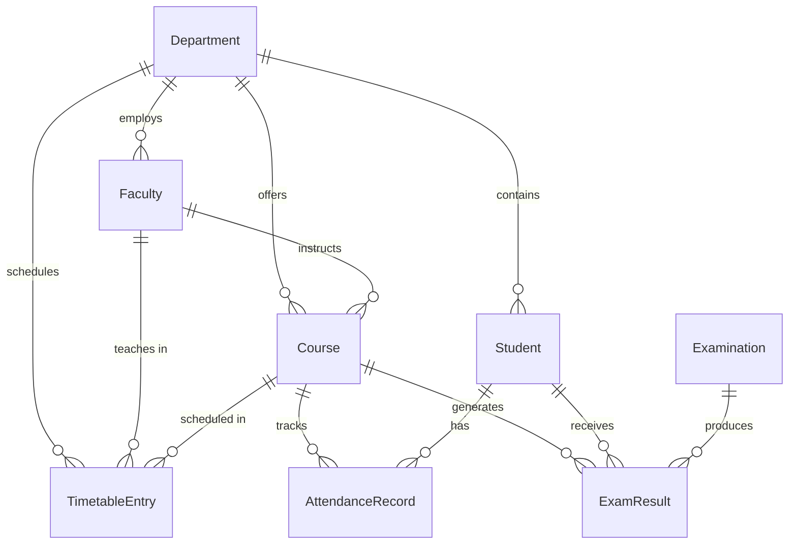
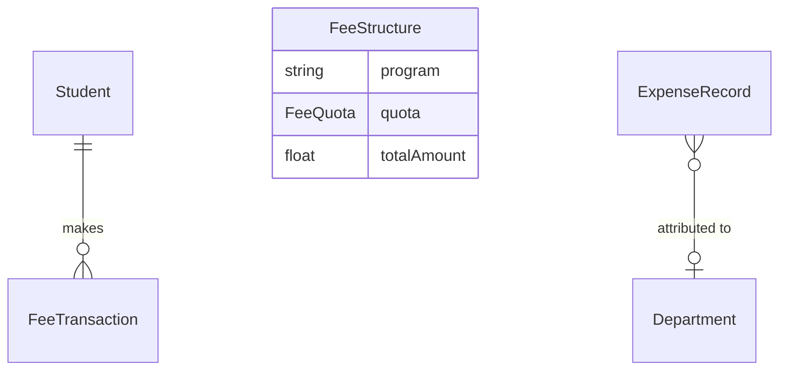
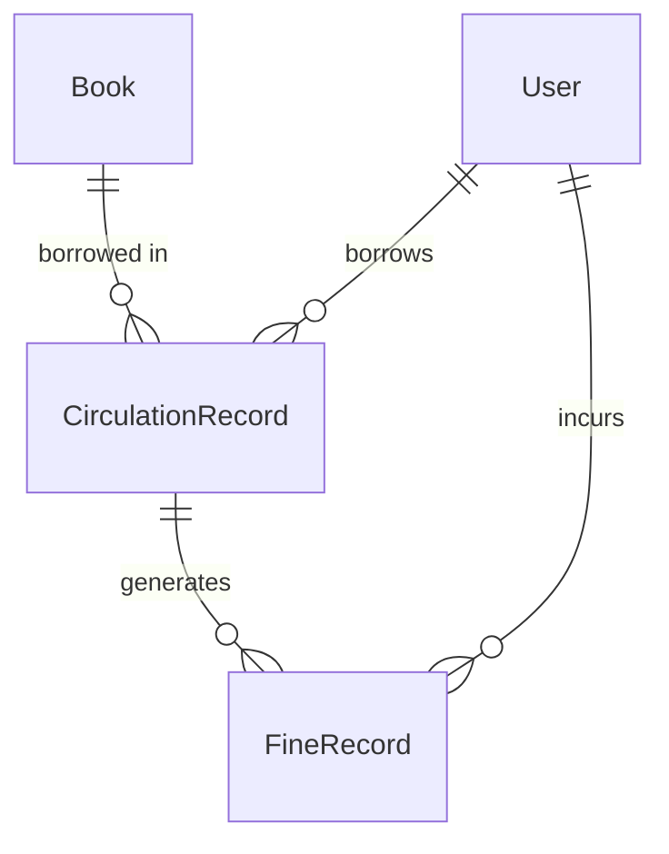

# Entity Relationship Diagram

> **Verification Status:** All entities and relationships verified from `backend/prisma/schema.prisma` and `backend/prisma/migrations/202608310001_init/migration.sql`.

## Complete ERD

```mermaid
erDiagram
    User {
        string id PK
        string email UK
        string name
        string password
        Role role
        string phone
        string avatarUrl
        datetime createdAt
        datetime updatedAt
    }

    Department {
        string id PK
        string code UK
        string name UK
        string headOfDepartmentId FK
        datetime createdAt
        datetime updatedAt
    }

    Student {
        string id PK
        string userId FK
        string rollNumber UK
        string departmentId FK
        string degree
        int semester
        string batch
        string section
        float cgpa
        float attendancePercentage
        FeeStatus feeStatus
        FeeQuota feeQuota
        datetime createdAt
        datetime updatedAt
    }

    Faculty {
        string id PK
        string userId FK
        string employeeCode UK
        string departmentId FK
        string designation
        string qualification
        float weeklyWorkloadHours
        float leaveBalance
        datetime createdAt
        datetime updatedAt
    }

    Course {
        string id PK
        string code UK
        string name
        string departmentId FK
        int semester
        int credits
        CourseType type
        string description
        string faculty_instructor FK
        datetime createdAt
        datetime updatedAt
    }

    AttendanceRecord {
        string id PK
        string studentId FK
        string courseId FK
        datetime date
        int period
        AttendanceStatus status
        datetime createdAt
        datetime updatedAt
    }

    TimetableEntry {
        string id PK
        DayOfWeek dayOfWeek
        int period
        string timeSlot
        string courseId FK
        string facultyId FK
        string roomNumber
        string section
        int semester
        string departmentId FK
        datetime createdAt
        datetime updatedAt
    }

    Examination {
        string id PK
        string title
        string academicYear
        int semester
        datetime startDate
        datetime endDate
        ExamStatus status
        boolean hallTicketReleased
        datetime createdAt
        datetime updatedAt
    }

    ExamResult {
        string id PK
        string studentId FK
        string courseId FK
        string examinationId FK
        float internalScore
        float endSemScore
        float totalScore
        string grade
        datetime createdAt
        datetime updatedAt
    }

    FeeStructure {
        string id PK
        string program
        FeeQuota quota
        float tuitionFee
        float hostelFee
        float examFee
        float libraryDeposit
        float totalAmount
        datetime dueDate
        datetime createdAt
        datetime updatedAt
    }

    FeeTransaction {
        string id PK
        string receiptNumber UK
        string studentId FK
        float amount
        PaymentMethod paymentMethod
        TransactionStatus status
        datetime paidAt
        datetime createdAt
        datetime updatedAt
    }

    Book {
        string id PK
        string isbn UK
        string title
        string author
        string publisher
        string category
        string rackLocation
        int totalCopies
        int availableCopies
        string coverImageUrl
        datetime createdAt
        datetime updatedAt
    }

    CirculationRecord {
        string id PK
        string bookId FK
        string borrowerId FK
        datetime issueDate
        datetime dueDate
        datetime returnDate
        float fineAmount
        CirculationStatus status
        datetime createdAt
        datetime updatedAt
    }

    FineRecord {
        string id PK
        string userId FK
        string circulationId FK
        float amount
        string reason
        FineStatus status
        datetime issuedAt
        datetime createdAt
        datetime updatedAt
    }

    Notice {
        string id PK
        string title
        string content
        NoticeCategory category
        NoticeTargetRole targetRole
        string department
        string publishedBy FK
        datetime publishedAt
        boolean isUrgent
        boolean isPinned
        datetime createdAt
        datetime updatedAt
    }

    LeaveRequest {
        string id PK
        string facultyId FK
        string type
        datetime fromDate
        datetime toDate
        int days
        string reason
        LeaveStatus status
        datetime createdAt
        datetime updatedAt
    }

    DocumentRequest {
        string id PK
        string studentId FK
        string documentName
        DocumentStatus status
        datetime requestedAt
        datetime updatedAt
    }

    AdmissionApplication {
        string id PK
        string applicantName
        string applicationId UK
        string program
        string department
        int jeeRank
        int gateRank
        string category
        string quota
        ApplicationStatus status
        datetime appliedDate
        datetime updatedAt
    }

    PlacementRecord {
        string id PK
        string studentId FK
        string companyName
        string companyType
        float ctc
        datetime offerDate
        datetime createdAt
        datetime updatedAt
    }

    Permission {
        string id PK
        string name UK
        string category
        string description
    }

    RolePermission {
        string id PK
        Role role
        string permissionId FK
    }

    SystemActivity {
        string id PK
        string action
        string description
        string type
        datetime timestamp
    }

    ExpenseRecord {
        string id PK
        string departmentId FK
        string category
        float amount
        datetime date
        datetime createdAt
    }

    ResearchGrant {
        string id PK
        string title
        string agency
        float amount
        string status
        datetime awardedDate
        datetime createdAt
    }

    %% Identity relationships
    User ||--o| Student : "has profile"
    User ||--o| Faculty : "has profile"

    %% Department relationships
    Department }o--|| Faculty : "headed by (HOD)"
    Department ||--o{ Student : "contains"
    Department ||--o{ Faculty : "employs"
    Department ||--o{ Course : "offers"
    Department ||--o{ TimetableEntry : "schedules"
    Department ||--o{ ExpenseRecord : "incurs"

    %% Academic relationships
    Faculty ||--o{ Course : "instructs"
    Faculty ||--o{ TimetableEntry : "teaches in"
    Faculty ||--o{ LeaveRequest : "submits"

    Student ||--o{ AttendanceRecord : "has"
    Student ||--o{ ExamResult : "receives"
    Student ||--o{ FeeTransaction : "makes"
    Student ||--o{ DocumentRequest : "requests"
    Student ||--o{ PlacementRecord : "has"

    Course ||--o{ AttendanceRecord : "tracks"
    Course ||--o{ ExamResult : "generates"
    Course ||--o{ TimetableEntry : "scheduled in"

    Examination ||--o{ ExamResult : "produces"

    %% Library relationships
    Book ||--o{ CirculationRecord : "borrowed in"
    User ||--o{ CirculationRecord : "borrows"
    CirculationRecord ||--o{ FineRecord : "generates"
    User ||--o{ FineRecord : "incurs"

    %% Communication
    User ||--o{ Notice : "publishes"

    %% RBAC
    Permission ||--o{ RolePermission : "assigned in"
```

---

## Domain-Specific ERD: Academic Core

## Domain-Specific ERD: Finance

## Domain-Specific ERD: Library

