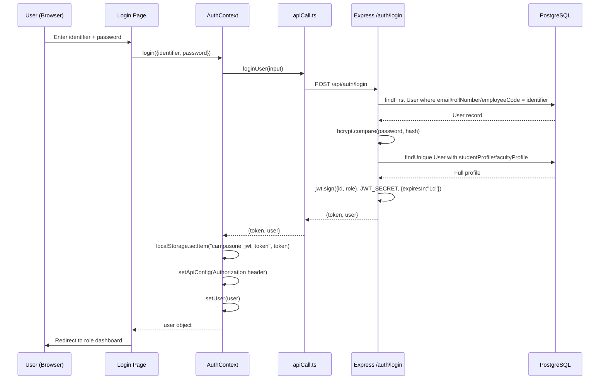
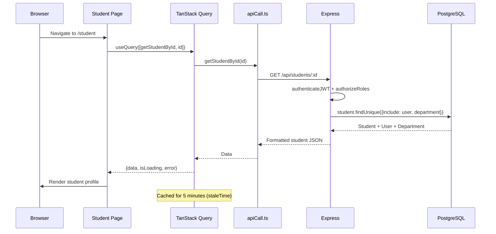
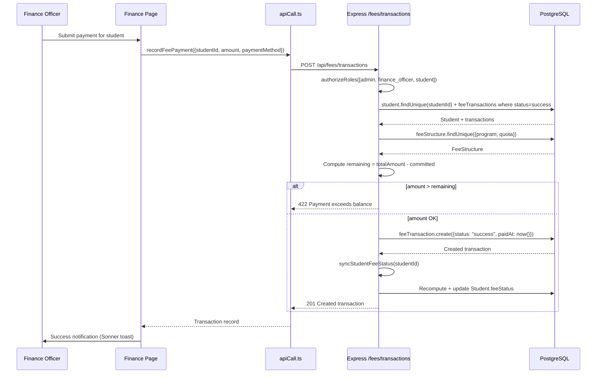
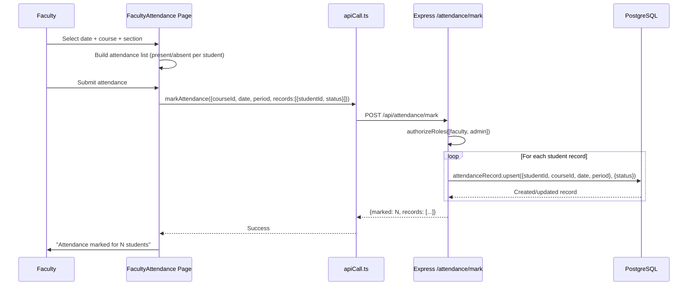
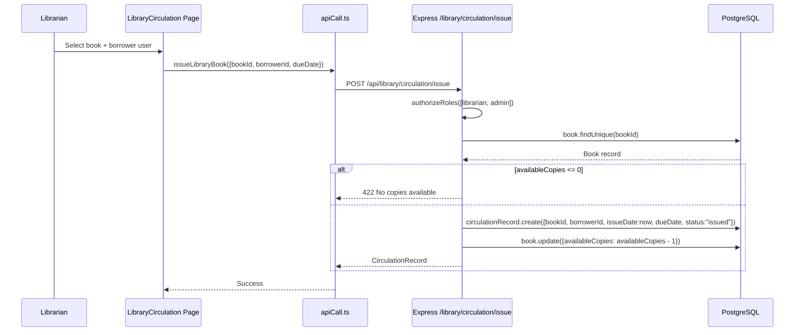
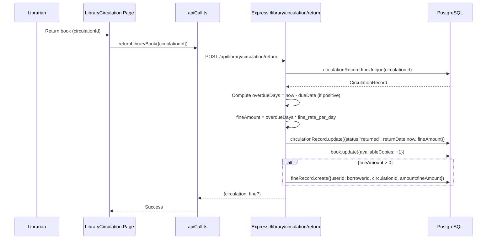
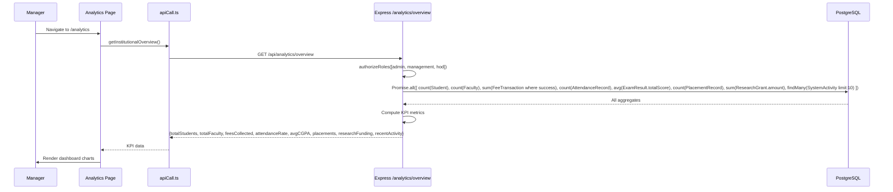

# Data Flow Diagrams

> All flows reconstructed from source code. Verification status noted per flow.

## 1. User Login Flow

## 2. Student Dashboard Data Load

## 3. Fee Payment Flow

## 4. Attendance Marking Flow

## 5. Library Book Issue Flow

## 6. Book Return + Fine Generation Flow

## 7. Analytics Overview Load Flow

