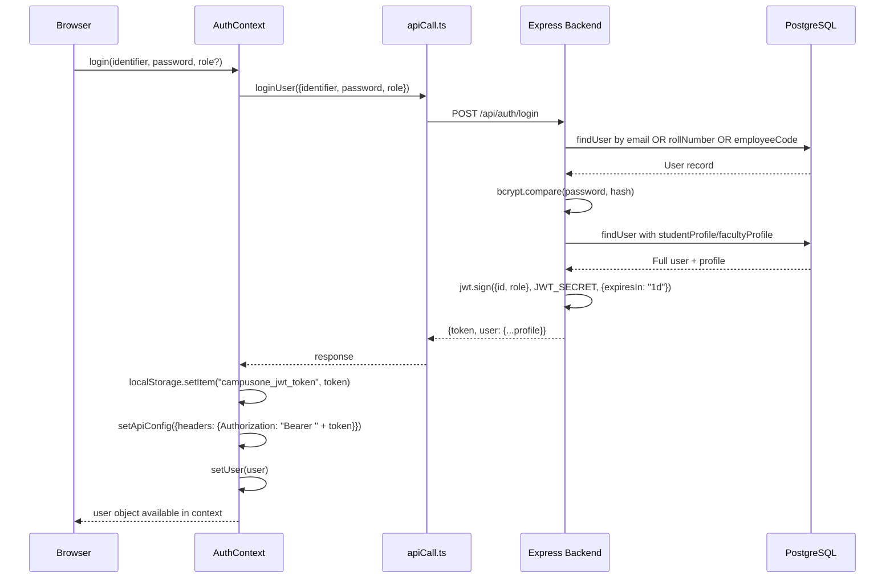
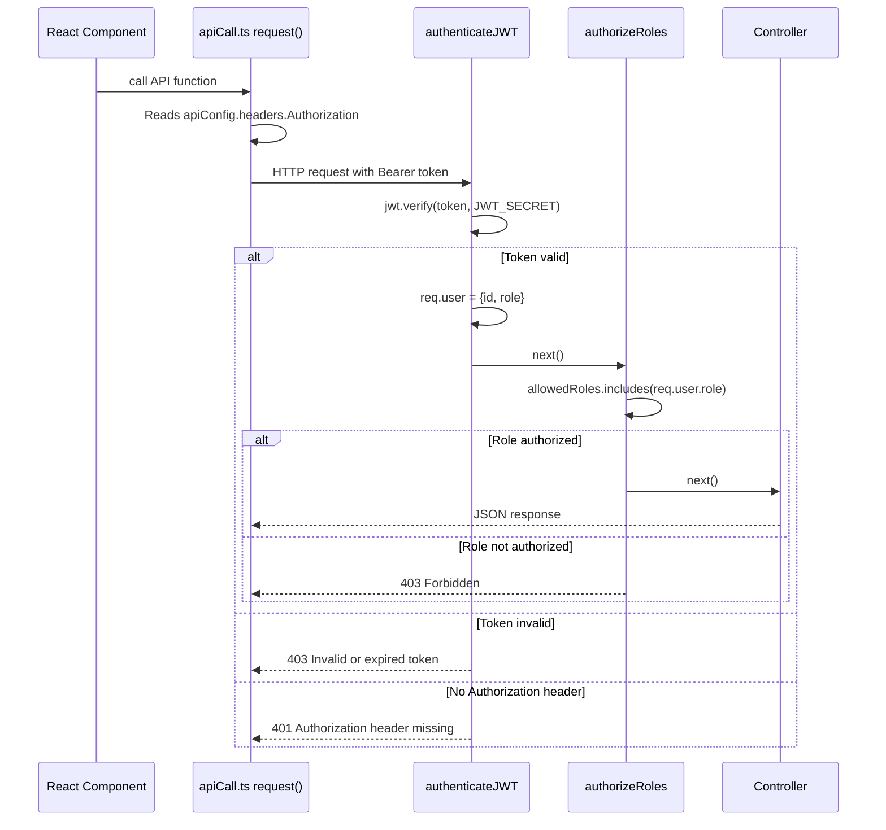

# Authentication & Authorization — Security Analysis

> **Verification Status:** Verified from `authMiddleware.ts`, `roleMiddleware.ts`, `authController.ts`, `AuthContext.tsx`, and route files.

## 1. Authentication Flow



## 2. Request Authentication Flow



## 3. Session Management

| Property | Implementation | Evidence |
|---|---|---|
| Token type | JWT (JSON Web Token) | `authController.ts:41` |
| Token storage | `localStorage` (key: `campusone_jwt_token`) | `AuthContext.tsx:17-18` |
| Token expiry | 1 day (`expiresIn: '1d'`) | `authController.ts:41` |
| Token refresh | **Not implemented** | Inferred — no refresh endpoint exists |
| Session invalidation | Client-side only (token dropped from localStorage) | `AuthContext.tsx:69-71` |
| Token propagation | Module-level `apiConfig.headers` object | `AuthContext.tsx:40,53` |

> **Security Finding (High):** JWT tokens are stored in `localStorage`, making them vulnerable to XSS attacks. HttpOnly cookies would be more secure. Additionally, there is no token refresh mechanism — tokens expire after exactly 1 day with no graceful renewal path.

> **Security Finding (High):** Logout is **client-side only** — the server has no token blacklist. A stolen token remains valid until it expires (up to 24 hours after logout).

## 4. Role-Based Access Control

### Roles Defined (Enum in DB and code)
- `student`
- `faculty`
- `hod` (Head of Department)
- `admin`
- `finance_officer`
- `librarian`
- `management`

### Role Resolution
- Role is embedded in the JWT payload at login time.
- Middleware reads `req.user.role` (decoded from JWT).
- `authorizeRoles()` accepts a list of allowed roles or `'all'`.

### Route-Level Authorization Summary

| Role | Key Accessible Resources |
|---|---|
| `student` | Own profile, own attendance, own grades, own fees, own documents, library books/fines, notices, courses, timetable, faculty list |
| `faculty` | Own profile, students (read), attendance marking, timetable, exam results submission, leaves, workload |
| `hod` | Attendance reports, analytics overview + academic performance, timetable generation, notices |
| `admin` | Full access to all resources |
| `finance_officer` | Fee structures, fee transactions, fee defaulters |
| `librarian` | Library books (add), circulation (issue/return), fines |
| `management` | Admissions, analytics, exam export/stats, notices |

### Resource-Level Authorization (Application Code)

Beyond role checks, certain controllers enforce resource ownership:

| Resource | Check | Location |
|---|---|---|
| Student fee ledger | Student can only view own fee ledger | `studentController.ts:266-271` |
| Fee payment submission | Student can only pay for own account | `feeController.ts:146-151` |
| Fee transaction list | Student automatically filtered to own records | `feeController.ts:103-106` |

## 5. CORS Configuration

```typescript
// backend/src/index.ts:17-20
app.use(cors({
  origin: process.env.FRONTEND_URL || 'http://localhost:5173',
  credentials: true,
}));
```

- CORS restricted to one origin: `FRONTEND_URL` env var.
- `credentials: true` allows cookies to be sent (though cookies are not currently used — JWT is in localStorage).

> **Finding (Medium):** `credentials: true` with a specific origin is correct. However, if `FRONTEND_URL` is not set in production, it defaults to `http://localhost:5173`, which would block the production frontend. Must ensure `FRONTEND_URL` is set in all production environments.

## 6. Security Middleware

| Middleware | Configuration | Evidence |
|---|---|---|
| `helmet()` | Default configuration (sets CSP, HSTS, X-Frame-Options, etc.) | `backend/src/index.ts:16` |
| `express-rate-limit` | 100 requests per 15 minutes per IP | `backend/src/index.ts:23-27` |
| `express.json({limit: '10kb'})` | Body size limited to 10KB | `backend/src/index.ts:32` |
| CSRF protection | **Not implemented** | Inferred — no CSRF middleware found |
| Input validation library | **Not implemented** | Inline ad-hoc validation only (e.g. feeController) |

## 7. Password Security

| Property | Implementation | Evidence |
|---|---|---|
| Hashing algorithm | bcrypt | `authController.ts:36`, `studentController.ts:60` |
| Bcrypt library | `bcryptjs` | `backend/package.json` |
| Salt rounds | 10 | `studentController.ts:60`, `facultyController.ts:59` |
| Default student password | `student123` | `studentController.ts:60` |
| Default faculty password | `faculty123` | `facultyController.ts:59` |

> **Security Finding (Critical):** All newly created students and faculty receive the same predictable default passwords (`student123`, `faculty123`). There is no forced password change on first login. If users do not change their passwords, accounts remain trivially compromisable.

## 8. Error Handling & Information Exposure

```typescript
// backend/src/middlewares/errorHandler.ts
const isProduction = process.env.NODE_ENV === 'production';
res.status(500).json({
  message: isProduction ? 'Internal Server Error' : err.message,
  ...(isProduction ? {} : { stack: err.stack })
});
```

- Stack traces are suppressed in production.
- Error messages are generic in production.

> **Finding (Medium):** Individual controller functions catch errors and respond with `{ success: false, message: '...' }`, sometimes including `error.message` directly (e.g., `studentController.ts:103`). In production, this could expose internal details. Recommendation: always use the centralised error handler.

## 9. Known Security Gaps Summary

| Finding | Severity | Evidence |
|---|---|---|
| Default passwords for all new users | Critical | `studentController.ts:60`, `facultyController.ts:59` |
| JWT in localStorage (XSS risk) | High | `AuthContext.tsx:17` |
| No token refresh mechanism | High | No `/auth/refresh` endpoint found |
| Server-side logout not implemented | High | `authController.ts:93-95` (stateless logout) |
| No input validation library (Zod, Joi, etc.) | Medium | `backend/src/services/` is empty |
| CSRF protection absent | Medium | No CSRF middleware in `index.ts` |
| `FRONTEND_URL` defaults to localhost | Medium | `backend/src/index.ts:18` |
| Hardcoded JWT_SECRET in docker-compose | Medium | `docker-compose.yml:34` |
| `error.message` exposed in some 500 responses | Low | `studentController.ts:103` |
| `ResearchGrant.status` is raw TEXT with no enum | Low | `schema.prisma:661` |
